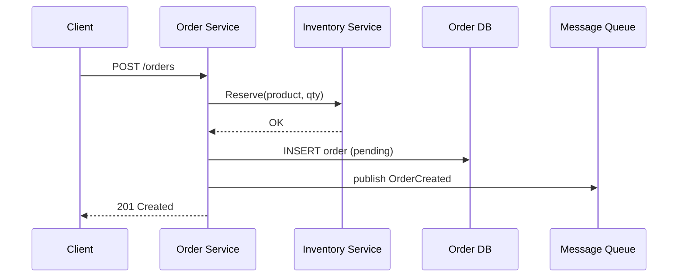

# Backend architecture

> Backend là phần chạy phía server: nhận request từ client qua mạng, thực thi nghiệp vụ, đọc/ghi dữ liệu và trả response. File này mô tả bức tranh tổng thể: một request đi qua những tầng nào, code backend được tổ chức ra sao, monolith và microservices khác gì, và cách đọc một tài liệu giải pháp hệ thống.

## Tại sao cần biết
Trước khi đi vào ngôn ngữ, thuật toán hay database, cần biết từng mảnh đó nằm ở đâu trong hệ thống. Interview thường mở đầu bằng "điều gì xảy ra khi gõ URL vào trình duyệt", "REST là gì", "monolith vs microservices", hoặc yêu cầu giải thích kiến trúc dự án bạn từng làm. Ở công việc hằng ngày, bạn phải đọc tài liệu giải pháp (solution document) để hiểu mình code phần nào.

## Khái niệm cốt lõi

### Mô hình client-server
- **Client** gửi yêu cầu (trình duyệt, app mobile, service khác). **Server** lắng nghe trên một địa chỉ IP + port, xử lý và trả kết quả.
- Giao tiếp qua mạng theo bộ giao thức TCP/IP. Backend cần nắm tối thiểu:
  - **IP + port** xác định một tiến trình trên mạng (vd `10.0.0.5:8080`).
  - **TCP**: tin cậy, có thứ tự, bắt tay 3 bước; nền của HTTP/1.1, HTTP/2, gRPC, kết nối DB. **UDP**: không kết nối, không đảm bảo, nhanh; dùng cho DNS, streaming, game, RADIUS.
  - **DNS** đổi tên miền thành IP. **HTTP/HTTPS** là giao thức ứng dụng phổ biến nhất của backend; HTTPS = HTTP chạy trên TLS.
  - Chi tiết ở [../internet/07-transport-layer.md](../internet/07-transport-layer.md), [../internet/08-dns-and-dhcp.md](../internet/08-dns-and-dhcp.md), [../internet/09-http-and-web.md](../internet/09-http-and-web.md).

### HTTP căn bản cho backend
Một HTTP request gồm method, path, header, body:

```http
POST /api/v1/orders HTTP/1.1
Host: shop.example.com
Content-Type: application/json
Authorization: Bearer eyJhbGciOi...

{"product_id": 42, "quantity": 2}
```

Response:

```http
HTTP/1.1 201 Created
Content-Type: application/json

{"id": 1001, "status": "pending"}
```

| Method | Ý nghĩa | Idempotent | Safe |
|---|---|---|---|
| GET | Đọc tài nguyên | Có | Có |
| POST | Tạo mới / hành động | Không | Không |
| PUT | Thay thế toàn bộ tài nguyên | Có | Không |
| PATCH | Sửa một phần | Không nhất thiết | Không |
| DELETE | Xóa | Có | Không |

- **Safe**: không thay đổi trạng thái server. **Idempotent**: gọi 1 lần hay N lần cho cùng kết quả trên server (quan trọng khi client retry).
- Nhóm status code: `2xx` thành công (200 OK, 201 Created, 204 No Content), `3xx` chuyển hướng, `4xx` lỗi phía client (400 Bad Request, 401 Unauthorized = chưa xác thực, 403 Forbidden = không có quyền, 404 Not Found, 409 Conflict, 422, 429 Too Many Requests), `5xx` lỗi phía server (500, 502 Bad Gateway, 503 Service Unavailable, 504 Gateway Timeout).
- HTTP là **stateless**: mỗi request độc lập, server không tự nhớ request trước. Muốn "nhớ" người dùng thì dùng cookie/session hoặc token (JWT).

### REST API
REST là phong cách thiết kế API xoay quanh **tài nguyên** (resource) được định danh bằng URL và thao tác bằng HTTP method:

```
GET    /users          danh sách user
GET    /users/42       một user
POST   /users          tạo user
PUT    /users/42       thay thế user 42
PATCH  /users/42       sửa một phần
DELETE /users/42       xóa
GET    /users/42/orders  đơn hàng của user 42
```
Nguyên tắc: URL là danh từ (không phải `/getUser`), dùng đúng method và status code, stateless, có versioning (`/v1/`), phân trang (`?page=2&limit=20`) cho danh sách.

Các kiểu giao tiếp khác: **gRPC** (HTTP/2 + Protocol Buffers, nhanh, hợp cho service-to-service), **GraphQL** (client tự chọn trường cần lấy), **WebSocket** (kết nối hai chiều lâu dài), **message queue** (bất đồng bộ).

### Các thành phần hạ tầng thường gặp
```
Client ──► DNS ──► Load Balancer / Reverse Proxy (Nginx) ──► App servers (Go) ──► Cache (Redis)
                                                                   │              
                                                                   ├──► Database (PostgreSQL)
                                                                   └──► Message queue (Kafka/RabbitMQ) ──► Worker
```
- **Web server / reverse proxy** (Nginx, HAProxy, Envoy): nhận kết nối từ ngoài, kết thúc TLS, phục vụ file tĩnh, chuyển tiếp request vào app server, nén, giới hạn tốc độ. Trong Go, gói `net/http` đã là một HTTP server đầy đủ, nên app Go thường đứng sau reverse proxy chứ không cần Apache/Tomcat.
- **Load balancer**: chia tải cho nhiều instance (round robin, least connections, hash). Cho phép **scale ngang** (thêm máy) và chịu lỗi (một instance chết, chuyển sang instance khác qua health check).
- **Cache** (Redis, Memcached): lưu kết quả đọc nhiều trong RAM để giảm tải DB và giảm latency. Vấn đề khó: khi nào xóa cache (invalidation), TTL.
- **Database**: lưu trữ bền vững. Xem [10-databases.md](10-databases.md).
- **Message queue / broker**: service A đẩy message, service B xử lý sau. Tách rời các service, chịu tải đột biến, xử lý bất đồng bộ (gửi email, xử lý ảnh).
- **API gateway**: cửa ngõ duy nhất cho nhiều microservice: định tuyến, xác thực, rate limit.

### Scale và stateless
- **Scale dọc** (vertical): máy mạnh hơn; đơn giản nhưng có giới hạn. **Scale ngang** (horizontal): thêm máy; cần service **stateless**, tức không giữ trạng thái người dùng trong RAM của riêng instance (đưa session vào Redis/DB), để request nào rơi vào instance nào cũng được.

### Tổ chức code: layered architecture
Cách tổ chức phổ biến nhất cho một service:

```
┌──────────────────────────────┐
│ Transport / Handler          │  parse HTTP/gRPC, validate input, trả response
├──────────────────────────────┤
│ Service / Use case           │  logic nghiệp vụ, không biết HTTP hay SQL
├──────────────────────────────┤
│ Repository / Data access     │  đọc/ghi DB, cache, gọi API ngoài
└──────────────────────────────┘
          ▼ phụ thuộc đi xuống qua interface
```
- Mỗi tầng chỉ gọi tầng ngay dưới, qua **interface**. Nhờ vậy test được tầng service bằng repository giả (mock), đổi PostgreSQL sang MySQL không ảnh hưởng nghiệp vụ. Đây là ứng dụng trực tiếp của SOLID (D — Dependency Inversion) và Dependency Injection, xem [07-design-patterns.md](07-design-patterns.md), [08-clean-code-and-solid.md](08-clean-code-and-solid.md).
- Biến thể: Clean Architecture, Hexagonal (Ports & Adapters): cùng tinh thần "nghiệp vụ ở giữa, chi tiết kỹ thuật ở rìa".

Cấu trúc thư mục Go thường gặp:
```
myservice/
├── cmd/server/main.go        # điểm vào, wiring dependency
├── internal/
│   ├── handler/              # HTTP handlers
│   ├── service/              # nghiệp vụ
│   ├── repository/           # truy cập DB
│   └── model/                # struct dữ liệu
├── migrations/               # SQL migration
├── go.mod
└── Dockerfile
```

### Monolith và microservices
| | Monolith | Microservices |
|---|---|---|
| Định nghĩa | Một ứng dụng, một codebase, deploy một khối | Nhiều service nhỏ, mỗi service một nghiệp vụ, deploy độc lập |
| Giao tiếp nội bộ | Gọi hàm | Qua mạng (HTTP, gRPC, message queue) |
| Ưu điểm | Đơn giản, dễ debug, transaction dễ, nhanh lúc đầu | Scale riêng từng phần, team độc lập, lỗi cô lập, chọn công nghệ riêng |
| Nhược điểm | Codebase phình to, deploy cả khối, scale cả khối | Phức tạp vận hành, lỗi mạng, khó transaction phân tán, cần monitoring/tracing |
| Khi nào | Sản phẩm mới, team nhỏ | Hệ thống lớn, nhiều team, nghiệp vụ tách bạch rõ |

Microservices kéo theo: **service discovery**, **database per service**, **distributed tracing**, **circuit breaker**, **eventual consistency**, container (Docker) và orchestration (Kubernetes).

### Container và triển khai (sơ lược)
- **Docker image**: gói ứng dụng + thư viện + cấu hình chạy, build từ `Dockerfile`. **Container**: một image đang chạy, cô lập bằng tính năng kernel Linux (namespaces, cgroups), nhẹ hơn máy ảo vì dùng chung kernel host.
- **Kubernetes (k8s)**: điều phối nhiều container trên cụm máy: tự khởi động lại, scale, rolling update, service discovery. Đơn vị nhỏ nhất là **Pod**.
- **CI/CD**: mỗi lần push code, pipeline tự chạy build, test, lint (CI) rồi triển khai (CD).

```dockerfile
# multi-stage build cho Go: image cuối chỉ chứa binary
FROM golang:1.22 AS build
WORKDIR /src
COPY go.mod go.sum ./
RUN go mod download
COPY . .
RUN CGO_ENABLED=0 go build -o /app ./cmd/server

FROM gcr.io/distroless/static
COPY --from=build /app /app
ENTRYPOINT ["/app"]
```

### Quan sát hệ thống (observability)
- **Log**: ghi sự kiện, nên dùng log có cấu trúc (JSON, `log/slog` trong Go) kèm request ID.
- **Metrics**: số đo theo thời gian (request/s, latency p95/p99, error rate), thường Prometheus + Grafana.
- **Tracing**: theo dấu một request đi qua nhiều service (OpenTelemetry).

## Cách hoạt động
Điều gì xảy ra khi người dùng gửi `GET https://shop.example.com/api/v1/products/42`:

1. Client hỏi DNS lấy IP của `shop.example.com`.
2. Mở kết nối TCP (bắt tay 3 bước) tới load balancer, bắt tay TLS để mã hóa.
3. Gửi HTTP request. Load balancer/reverse proxy chọn một instance app server khỏe và chuyển tiếp.
4. Trong app Go: router khớp path → **middleware** (log, xác thực token, recover panic, đo latency) → **handler** parse tham số `42`.
5. Handler gọi **service** `GetProduct(ctx, 42)`. Service hỏi **cache** trước; cache miss thì gọi **repository** truy vấn DB qua connection pool, rồi ghi lại cache.
6. Handler đóng gói kết quả thành JSON, đặt status 200, trả về. Nếu không có sản phẩm thì 404; DB lỗi thì 500 và log chi tiết (không lộ chi tiết ra client).
7. Response đi ngược lại qua proxy về client.

## Ví dụ
Một service tối giản đủ ba tầng bằng Go chuẩn (`net/http`, Go 1.22+ hỗ trợ method và path param trong pattern):

```go
// model
type Product struct {
    ID    int64  `json:"id"`
    Name  string `json:"name"`
    Price int64  `json:"price"`
}

var ErrNotFound = errors.New("not found")

// repository: interface để service không phụ thuộc DB cụ thể
type ProductRepository interface {
    FindByID(ctx context.Context, id int64) (Product, error)
}

// service
type ProductService struct{ repo ProductRepository }

func (s *ProductService) Get(ctx context.Context, id int64) (Product, error) {
    if id <= 0 {
        return Product{}, fmt.Errorf("invalid id %d", id)
    }
    return s.repo.FindByID(ctx, id)
}

// handler
type ProductHandler struct{ svc *ProductService }

func (h *ProductHandler) Get(w http.ResponseWriter, r *http.Request) {
    id, err := strconv.ParseInt(r.PathValue("id"), 10, 64)
    if err != nil {
        http.Error(w, "bad id", http.StatusBadRequest)
        return
    }
    p, err := h.svc.Get(r.Context(), id)
    switch {
    case errors.Is(err, ErrNotFound):
        http.Error(w, "not found", http.StatusNotFound)
        return
    case err != nil:
        slog.Error("get product", "id", id, "err", err)
        http.Error(w, "internal error", http.StatusInternalServerError)
        return
    }
    w.Header().Set("Content-Type", "application/json")
    json.NewEncoder(w).Encode(p)
}

func main() {
    repo := NewPostgresProductRepo(db) // implement ProductRepository
    h := &ProductHandler{svc: &ProductService{repo: repo}}

    mux := http.NewServeMux()
    mux.HandleFunc("GET /api/v1/products/{id}", h.Get)
    log.Fatal(http.ListenAndServe(":8080", mux))
}
```

## Đọc tài liệu giải pháp hệ thống
Tài liệu giải pháp (solution/design document) mô tả hệ thống sẽ được xây thế nào. Cách đọc hiệu quả:

1. **Bối cảnh và mục tiêu**: bài toán gì, ai dùng, yêu cầu chức năng (functional) và phi chức năng (non-functional: hiệu năng, sẵn sàng, bảo mật, khả năng mở rộng).
2. **Sơ đồ kiến trúc tổng thể** (*component/context diagram*): có những thành phần nào, kết nối bằng giao thức gì, dữ liệu đi theo hướng nào, đâu là biên hệ thống (cái gì của mình, cái gì của bên ngoài).
3. **Sequence diagram**: thứ tự các bước giữa các thành phần cho một luồng nghiệp vụ. Đọc từ trên xuống, mũi tên liền là gọi, mũi tên nét đứt là trả về. Đặc biệt chú ý luồng lỗi (timeout, retry, rollback).
4. **Mô hình dữ liệu** (ERD): bảng, khóa, quan hệ 1-n, n-n.
5. **Đặc tả API** (OpenAPI/Swagger, file `.proto`): endpoint, request/response, mã lỗi.
6. **Các quyết định và đánh đổi**: vì sao chọn A thay vì B.

Khi đọc, tự trả lời được các câu: luồng chính đi qua những thành phần nào; phần mình code nhận input gì, trả output gì, gọi ai; nếu thành phần X chết thì sao; dữ liệu được lưu ở đâu, nhất quán thế nào. Chỗ nào tài liệu mâu thuẫn hoặc thiếu (luồng lỗi không được mô tả, trường dữ liệu không khớp giữa API và DB) thì ghi lại và hỏi; phát hiện lỗi logic trong tài liệu sớm rẻ hơn nhiều so với phát hiện khi đã code.

Ví dụ sequence diagram cho luồng đặt hàng:



## Hiểu nhầm thường gặp
- **"Microservices luôn tốt hơn monolith"**: microservices đổi độ phức tạp code lấy độ phức tạp vận hành và mạng. Với team nhỏ, monolith tổ chức tốt thường là lựa chọn đúng.
- **"401 và 403 như nhau"**: 401 là chưa xác thực (không biết bạn là ai), 403 là đã biết nhưng không có quyền.
- **"PUT và POST thay nhau được"**: PUT idempotent và thay thế toàn bộ tài nguyên ở URL chỉ định; POST thì không idempotent.
- **"Stateless nghĩa là không có dữ liệu"**: stateless là instance không giữ trạng thái phiên trong RAM riêng; dữ liệu vẫn nằm ở DB/cache dùng chung.

## Câu hỏi ôn tập
1. **Chuyện gì xảy ra khi gõ URL vào trình duyệt?** DNS → TCP → TLS → HTTP request → LB → app → DB/cache → response → trình duyệt render.
2. **REST là gì? Thế nào là API RESTful tốt?** Thiết kế quanh tài nguyên, URL danh từ, dùng đúng method và status code, stateless, có versioning và phân trang.
3. **Idempotent là gì, method nào idempotent?** Gọi nhiều lần cùng kết quả; GET, PUT, DELETE.
4. **Monolith vs microservices?** Xem bảng; nêu được đánh đổi và khi nào chọn cái nào.
5. **Load balancer làm gì?** Chia tải, health check, cho phép scale ngang và chịu lỗi.
6. **Vì sao chia handler / service / repository?** Tách trách nhiệm, dễ test bằng mock, đổi hạ tầng không ảnh hưởng nghiệp vụ.
7. **TCP khác UDP?** TCP tin cậy, có thứ tự, có kết nối; UDP nhanh, không đảm bảo.
8. **Docker khác máy ảo?** Container dùng chung kernel host, nhẹ, khởi động nhanh; VM có kernel riêng.

## Liên quan
- [01-operating-systems.md](01-operating-systems.md): service là một process trên OS.
- [03-go-basics.md](03-go-basics.md): ngôn ngữ dùng để viết các tầng trên.
- [10-databases.md](10-databases.md): tầng lưu trữ.
- [12-secure-coding.md](12-secure-coding.md): xác thực, phân quyền, TLS.
