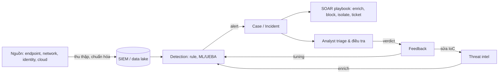

# SOAR, XDR and automation

> SOAR tự động hóa quy trình xử lý alert/case; XDR hợp nhất nhiều sensor của một vendor với phân tích và phản ứng; cả hai nhằm giảm việc thủ công lặp lại của SOC.

## Tại sao cần biết
Các sản phẩm này hay bị gọi bằng nhãn marketing chồng lấn. Biết chúng thực sự làm gì giúp vẽ được bản đồ kiến trúc security operations và đặt đúng chỗ cho tự động hóa.

## Khái niệm cốt lõi

- **SOAR** (Security Orchestration, Automation & Response):
  - *Orchestration*: kết nối nhiều công cụ (SIEM, EDR, firewall, ticket, TI) vào một quy trình.
  - *Automation*: tự chạy các bước lặp lại (enrich IP, tra hash, tạo ticket).
  - *Response*: hành động khắc phục (chặn IP, cô lập máy, vô hiệu hóa tài khoản).
- **Playbook** trong SOAR: workflow tự động hoặc bán tự động chạy khi có alert/case. Ví dụ: Sentinel dùng Logic Apps; Google SecOps có cả playbook theo alert và theo case.
- **Automation rule** (Sentinel): lớp điều phối trung tâm có thể tag, assign, đóng incident không cần playbook, gọi playbook và áp cho nhiều rule cùng lúc.
- **Mức tự động hóa**: tự chạy hoàn toàn (với hành động rủi ro thấp: enrich), bán tự động có phê duyệt (cô lập máy), hoặc chỉ gợi ý.
- **EDR / NDR**: sensor chuyên biệt trên endpoint / mạng; vừa phát hiện vừa là nguồn alert cho SIEM.
- **XDR** (Extended Detection & Response): theo mô tả của Gartner, là công cụ SaaS của *một vendor* tích hợp native nhiều sản phẩm bảo mật (tối thiểu có endpoint) thành hệ thống vận hành thống nhất: tương quan, điều tra và phản ứng.
- **SIEM vs XDR**: SIEM rộng, không phụ thuộc vendor, mạnh về log đa nguồn và tuân thủ; XDR sâu và tích hợp chặt trong hệ sinh thái của một vendor. Nhiều tổ chức dùng cả hai; ranh giới đang mờ.
- **Case management**: nơi tập hợp alert, bằng chứng, nhiệm vụ và nhật ký hành động của sự cố.

## Cách hoạt động

Luồng dữ liệu tổng quát của security operations:

## Ví dụ
Playbook cho alert phishing: trích URL và hash từ email → tra reputation → nếu độc hại: xóa email khỏi hộp thư mọi người nhận, chặn domain trên proxy, tạo ticket, và hỏi analyst duyệt trước khi khóa tài khoản người đã bấm link.

## Hiểu nhầm thường gặp
- **"Tự động hóa thay analyst"**: tự động hóa gánh phần lặp lại; quyết định rủi ro cao vẫn cần người.
- **"Automate trên alert nhiễu"**: tự động hóa thứ rác chỉ tạo rác nhanh hơn; tuning rule trước.
- **"XDR = SIEM mới"**: XDR gắn với hệ sinh thái vendor; không thay thế vai trò thu log đa nguồn.

## Liên quan
- [08-siem.md](08-siem.md): nguồn alert cho SOAR.
- [12-incident-response.md](12-incident-response.md): các bước mà playbook tự động hóa.
- [05-defense-controls.md](05-defense-controls.md): EDR, NDR là sensor trong XDR.
