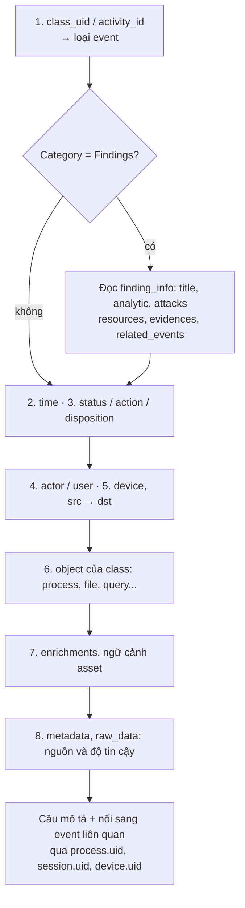

# Reading an OCSF event

> Mọi event OCSF đọc được theo cùng một trình tự câu hỏi (loại gì, khi nào, kết quả ra sao, ai làm, ở đâu, tác động vào cái gì, ngữ cảnh gì, tin được đến đâu), vì câu trả lời luôn nằm ở cùng những field, bất kể event đến từ nguồn nào.

## Tại sao cần biết
Với log gốc, mỗi nguồn phải học cách đọc riêng: event Windows phải tra mã, log firewall phải biết vendor đặt field nào là nguồn. Sau khi chuẩn hóa ([16-ocsf-schema.md](16-ocsf-schema.md)), analyst, rule, hay một LLM tóm tắt đều có thể áp **một quy trình đọc duy nhất**. Quy trình này cũng chính là cách hệ thống tự động "hiểu" event: render câu mô tả, gom event theo thực thể, nối các event thành chuỗi.

## Khái niệm cốt lõi

### Tám câu hỏi, tám chỗ để nhìn

| # | Câu hỏi | Field cần đọc | Ghi chú |
|---|---|---|---|
| 1 | **Đây là loại event gì?** | `category_uid`, `class_uid`, `activity_id` → `type_uid` | Category Findings (2) là *alert/kết luận*; các category khác là *hoạt động* hay *inventory* |
| 2 | **Khi nào?** | `time`; `start_time`/`end_time` và `count` nếu là event gộp | `time` là thời điểm sự kiện, không phải lúc log về SIEM |
| 3 | **Kết quả ra sao?** | `status_id` (Success/Failure), `status_detail`; với control: `action_id`, `disposition_id`; `severity_id` | Một lần logon *thất bại* và một lần *thành công* cùng `type_uid` |
| 4 | **Ai làm?** | `actor.user`, `actor.process`, `actor.session`; với IAM: `user` | `actor` là chủ thể; `user` trong IAM là tài khoản bị tác động |
| 5 | **Ở đâu?** | `device` (máy ghi nhận), `src_endpoint` → `dst_endpoint` | Xác định đúng vai trò máy trước khi kết luận ([18](18-mapping-logs-to-ocsf.md)) |
| 6 | **Tác động vào cái gì?** | Object riêng của class: `process`, `file`, `dns_query`, `http_request`, `finding_info`... | Biết `class_uid` là biết object nào chứa đối tượng |
| 7 | **Ngữ cảnh gì?** | `enrichments[]`, ngữ cảnh asset trong `device` (`org`, `groups`, `owner`), `observables[].reputation` | Ngữ cảnh do pipeline thêm, không phải do nguồn báo |
| 8 | **Tin được đến đâu?** | `metadata.product`, `metadata.event_code`, `metadata.log_name`, `metadata.original_time`, `unmapped`, `raw_data` | Truy ngược về log gốc khi cần kiểm chứng |

### Câu mô tả chuẩn
Trả lời 8 câu xong, ghép thành một câu theo khuôn:

```
[time] [actor] trên [device] đã [activity_name] [đối tượng] (từ [src] tới [dst]) → [kết quả]. Ngữ cảnh: [enrichment].
```

Vì `type_uid` là duy nhất, có thể giữ một template cho mỗi `type_uid` để máy tự render câu, không cần LLM cho từng event.

### Từ một event đến một câu chuyện
Một event riêng lẻ ít khi đủ nghĩa. OCSF cung cấp các khóa để nối event:
- **Cùng tiến trình**: `process.uid`, `process.parent_process.uid`, `actor.process.uid`. Dựng được cây process.
- **Cùng phiên**: `actor.session.uid`. Gom mọi việc trong một lần đăng nhập.
- **Cùng thực thể**: `device.uid`, `user.uid`, `observables[]`. Gom mọi event của một máy hay một user.
- **Do hệ thống liên kết sẵn**: `metadata.correlation_uid`; với finding là `finding_info.related_events[]`.

## Cách hoạt động



## Ví dụ
Một alert EDR đã chuẩn hóa và enrich (rút gọn):

```json
{
  "category_uid": 2, "class_uid": 2004, "activity_id": 1, "type_uid": 200401,
  "time": 1761638400000, "severity_id": 4, "status_id": 1,
  "action_id": 2, "disposition_id": 2, "is_alert": true,
  "finding_info": {
    "uid": "det-88121", "title": "Encoded PowerShell spawned by Office",
    "attacks": [ { "technique": { "uid": "T1059.001", "name": "PowerShell" } } ],
    "related_events": [ { "uid": "evt-5521", "type_uid": 100701 } ]
  },
  "device": { "hostname": "WS-0412", "uid": "edr-agent-7f3a", "type_id": 3,
              "owner": { "name": "lan.nguyen" },
              "org": { "name": "ACME", "ou_name": "Tài chính" } },
  "actor": { "user": { "name": "lan.nguyen" },
             "process": { "name": "winword.exe", "uid": "p-1001" } },
  "metadata": { "version": "1.9.0", "product": { "name": "ExampleEDR" },
                "original_time": "2025-10-28T08:00:00Z" },
  "enrichments": [ { "name": "device.uid", "value": "edr-agent-7f3a", "type": "asset",
                     "provider": "asset-profile", "data": { "criticality": "High" } } ]
}
```

Đọc theo 8 bước:
1. `type_uid 200401` = Detection Finding: Create. Đây là một **alert mới**, không phải log hoạt động thô.
2. Xảy ra lúc 08:00 UTC ngày 28/10/2025.
3. `severity_id 4` (High); `action_id 2` (Denied), `disposition_id 2` (Blocked): EDR đã chặn. `status_id 1`: finding đang ở trạng thái New, chưa ai xử lý.
4. Chủ thể là `winword.exe` chạy dưới user `lan.nguyen`.
5. Trên laptop `WS-0412`.
6. Finding nói "PowerShell mã hóa do Office sinh ra", map ATT&CK `T1059.001`. Event gốc là `evt-5521` (Process Launch `100701`).
7. Máy thuộc phòng Tài chính, owner `lan.nguyen`, criticality High.
8. Nguồn là ExampleEDR, schema OCSF 1.9.0.

Câu mô tả: *"08:00 28/10, winword.exe (user lan.nguyen) trên laptop WS-0412 của phòng Tài chính (criticality High) sinh PowerShell mã hóa (T1059.001); EDR đã chặn. Alert mới, mức High."* Bước tiếp theo là kéo `evt-5521` và mọi event cùng `device.uid` quanh thời điểm đó để dựng timeline.

## Hiểu nhầm thường gặp
- **"`severity_id` cao là sự cố nghiêm trọng"**: severity là đánh giá của nguồn về event đó; mức ưu tiên thực còn phụ thuộc criticality của tài sản và ngữ cảnh (xem [22-asset-data-use-cases.md](22-asset-data-use-cases.md)).
- **"`status_id` nghĩa giống nhau ở mọi class"**: ở class hoạt động, nó là Success/Failure của hành động; ở finding, nó là trạng thái xử lý (New, In Progress, Resolved...).
- **"Đọc `message` là đủ"**: `message` do nguồn tự viết, có thể thiếu hoặc không nhất quán; câu mô tả nên dựng từ các field có cấu trúc.
- **"Có alert thì có tấn công đã thành công"**: `disposition_id` cho biết control đã chặn hay chỉ ghi nhận; đọc nó trước khi kết luận.

## Liên quan
- [16-ocsf-schema.md](16-ocsf-schema.md): các field được nhắc trong quy trình.
- [18-mapping-logs-to-ocsf.md](18-mapping-logs-to-ocsf.md): mapping quyết định đọc có đúng hay không.
- [12-incident-response.md](12-incident-response.md): dựng timeline khi điều tra.
- [02-threats-and-attack-lifecycle.md](02-threats-and-attack-lifecycle.md): ATT&CK technique trong `finding_info.attacks`.
