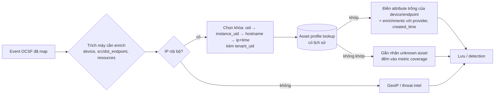

# Asset enrichment in OCSF

> Asset enrichment là bước gắn asset profile vào event OCSF đã map: tìm đúng tài sản cho từng máy xuất hiện trong event, rồi ghi ngữ cảnh vào các attribute có sẵn của `device`/endpoint, vào `enrichments[]`, hoặc vào `resources[]` của finding.

## Tại sao cần biết
Event sau khi map ([16-mapping-logs-to-ocsf.md](16-mapping-logs-to-ocsf.md)) mới chỉ có những gì nguồn log biết: hostname, IP, có khi chỉ một agent ID. Rule và analyst cần thêm owner, bộ phận, criticality, trạng thái EDR để:
- **ưu tiên**: cùng một alert, trên domain controller khác với trên máy lab;
- **giảm false positive**: máy quét lỗ hổng, máy jump host có hành vi "đáng ngờ" nhưng hợp lệ;
- **định tuyến**: gửi case cho đúng owner hay đơn vị;
- **thấy lỗ hổng giám sát**: event từ máy không có trong inventory hay không có EDR.

Nguồn ngữ cảnh là asset profile ở [17-asset-inventory-and-profile.md](17-asset-inventory-and-profile.md); file này nói cách gắn nó vào schema ở [15-ocsf-schema.md](15-ocsf-schema.md).

## Khái niệm cốt lõi

### Enrich máy nào trong event
Một event có thể có nhiều máy, mỗi máy được enrich riêng:

| Vị trí | Kiểu object | Khi nào có |
|---|---|---|
| `device` | `device` | Hầu hết event có profile `host`: máy cài agent, máy ghi log |
| `src_endpoint`, `dst_endpoint` | `network_endpoint` | Event mạng, xác thực, HTTP, DNS |
| `resources[]` | `resource_details` | Finding: tài nguyên bị ảnh hưởng |

Chỉ tra asset profile cho máy nội bộ (`network_scope_id = 1` Internal, hoặc IP thuộc dải của tổ chức). IP bên ngoài đi nhánh enrich khác: GeoIP, ASN, threat intel ([10-threat-intelligence.md](10-threat-intelligence.md)).

### Thứ tự khóa tra cứu
1. `device.uid`: agent ID hoặc ID do nguồn cấp, khớp chính xác.
2. `instance_uid`: ID của VM/instance cloud.
3. `hostname`: chuẩn hóa trước khi tra (chữ thường, tách phần domain, so cả FQDN lẫn tên ngắn).
4. `ip` + `time`: tra lịch sử IP ↔ máy tại đúng thời điểm event, và chỉ với IP nội bộ.

Mọi khóa đều phải kèm `metadata.tenant_uid` khi hệ thống phục vụ nhiều khách hàng: dải `10.0.0.0/8` của hai tenant có thể trùng nhau.

### Ba chỗ để ghi ngữ cảnh
**1. Attribute có sẵn của `device` / endpoint.** Đây là chỗ rule truy vấn dễ nhất:

| Ngữ cảnh asset | Attribute OCSF |
|---|---|
| ID ổn định, ID phụ (vd AD DN) | `uid`, `uid_alt` |
| Tên, domain | `hostname`, `name`, `domain` |
| Loại máy | `type_id` (1 Server, 2 Desktop, 3 Laptop, 5 Mobile, 6 Virtual, 7 IOT, 9 Firewall...) |
| Hệ điều hành | `os.name`, `os.version`, `os.type_id` |
| Owner | `owner` (object `user`: `name`, `uid`, `email_addr`) |
| Đơn vị tổ chức | `org` (object `organization`: `name`, `ou_name`) |
| Nhóm máy | `groups[]` (object `group`: `name`) |
| Tư thế bảo mật | `is_managed`, `is_compliant`, `is_trusted`, `risk_level_id` (0 Info … 4 Critical), `risk_score` |
| Agent đã cài | `agent_list[]` (`name`, `type_id`, `version`) |
| Mạng, vị trí | `subnet`, `zone`, `vpc_uid`, `region`, `location` |
| Vòng đời | `first_seen_time`, `last_seen_time` |

**2. `enrichments[]`.** Dành cho ngữ cảnh *không có* attribute riêng (criticality, dịch vụ nghiệp vụ, môi trường, số lỗ hổng mở) và để ghi rõ dữ liệu đến từ đâu, lúc nào. Mỗi phần tử trỏ vào field đã dùng để tra (`name`, `value`) và chứa cả gói dữ liệu trong `data`.

**3. `resources[]` của finding.** Object `resource_details` có sẵn `criticality_id` (1 Low, 2 Medium, 3 High, 4 Very High), `owner`, `group`, `labels`. Với Detection Finding, đây là chỗ chuẩn để ghi tài sản bị ảnh hưởng kèm criticality.

Ngoài ra, `metadata.labels` hay `metadata.tags` giữ vài nhãn ngắn để lọc nhanh (`env:prod`), và `metadata.modified_time` ghi lúc event được enrich.

> Lưu ý: trong OCSF 1.9.0, object `device` **không có** attribute criticality. Muốn rule lọc trực tiếp kiểu `device.criticality_id >= 3` thì phải tạo extension riêng; cái giá là công cụ khác đọc OCSF chuẩn sẽ không hiểu field đó.

### Khi nào enrich
| Thời điểm | Ưu | Nhược |
|---|---|---|
| **Lúc ingest** (trong pipeline, trước khi lưu) | Giữ ngữ cảnh *tại thời điểm event*; rule chạy nhanh vì không cần join | Tốn dung lượng; profile sai lúc đó thì dữ liệu sai mãi |
| **Lúc truy vấn** (join với bảng lookup khi search/detect) | Luôn theo profile mới nhất, không tốn lưu trữ | Chỉ có trạng thái hiện tại, trừ khi bảng lookup có lịch sử; truy vấn chậm hơn |
| **Lúc có alert** (SOAR, case) | Rẻ: chỉ enrich số ít event; lấy được dữ liệu chi tiết, live | Rule không dùng được ngữ cảnh này để lọc |

Cách phổ biến là kết hợp: lúc ingest gắn vài thuộc tính gọn và ổn định (asset ID, owner, bộ phận, criticality, managed); lúc có alert mới kéo hồ sơ đầy đủ (lỗ hổng mở, phần mềm, user đăng nhập gần nhất).

### Không ghi đè dữ liệu nguồn
Giá trị nguồn log báo (vd hostname EDR thấy) là bằng chứng; giá trị từ profile là suy luận. Quy tắc an toàn:
- chỉ điền vào attribute *đang trống*;
- khi profile khác nguồn, giữ giá trị nguồn và ghi giá trị profile vào `enrichments[]`.

Nhờ vậy, khi profile sai, ta vẫn biết nguồn đã nói gì.

## Cách hoạt động



Các chỉ số nên theo dõi: tỷ lệ event có máy nội bộ được enrich thành công (hit rate) theo từng nguồn log, tỷ lệ khớp bằng khóa yếu (IP) so với khóa mạnh, và số máy "unknown" mới mỗi ngày.

## Ví dụ
Event `4625` ở file 16 (DC01 ghi nhận đăng nhập thất bại từ WS-0412) sau khi enrich, rút gọn:

```json
{
  "class_uid": 3002, "activity_id": 1, "type_uid": 300201, "status_id": 2,
  "time": 1761645600000,
  "metadata": { "version": "1.9.0", "event_code": "4625", "tenant_uid": "acme",
                "labels": ["env:prod"], "modified_time": 1761645601200 },
  "user": { "name": "lan.nguyen", "domain": "CORP" },
  "device": {
    "hostname": "DC01.corp.local", "type_id": 1,
    "uid": "edr-agent-01dc", "is_managed": true,
    "org": { "name": "ACME", "ou_name": "IT Infrastructure" },
    "groups": [ { "name": "Tier0" }, { "name": "Domain Controllers" } ]
  },
  "src_endpoint": {
    "ip": "10.20.4.12", "hostname": "WS-0412",
    "uid": "edr-agent-7f3a", "type_id": 3,
    "owner": { "name": "lan.nguyen", "email_addr": "lan.nguyen@acme.example" },
    "network_scope_id": 1
  },
  "enrichments": [
    { "name": "device.hostname", "value": "DC01.corp.local", "type": "asset",
      "provider": "cmdb", "created_time": 1761645601200,
      "data": { "criticality": "Critical", "service": "Active Directory", "env": "prod" } },
    { "name": "src_endpoint.ip", "value": "10.20.4.12", "type": "asset",
      "provider": "asset-profile", "created_time": 1761645601200,
      "data": { "matched_by": "ip+time", "dhcp_lease": "06:58-14:58",
                "criticality": "High", "bu": "Tài chính", "edr": true } }
  ]
}
```

Đọc event này, rule "nhiều lần đăng nhập thất bại" có thể nâng mức ưu tiên vì đích là máy Tier 0 criticality Critical. Analyst cũng thấy ngay máy nguồn là laptop phòng Tài chính, có EDR, và mối nối IP → máy được suy từ DHCP (khóa yếu), nên cần kiểm tra lại trước khi kết luận.

## Hiểu nhầm thường gặp
- **"Enrich lúc ingest là lúc nào cũng đúng"**: nó đúng *tại thời điểm đó* theo profile *lúc đó*. Nếu CMDB sửa owner sau này, event cũ vẫn mang owner cũ. Đó là ưu điểm khi điều tra, nhưng sai nếu profile lúc ấy đã sai.
- **"Cứ nhét hết profile vào event"**: làm phình dung lượng ở mọi event. Chỉ gắn thuộc tính dùng cho rule, ưu tiên hoặc định tuyến; phần còn lại kéo khi có alert.
- **"Không khớp profile thì bỏ qua"**: máy không có trong inventory là phát hiện quan trọng (shadow IT, máy chưa cài EDR, máy của kẻ tấn công cắm vào mạng). Hãy gắn nhãn và đếm.
- **"Đưa criticality vào `device.risk_level_id`"**: risk level là mức *rủi ro* của máy (do EDR, lỗ hổng, hành vi tính ra), còn criticality là *giá trị nghiệp vụ*. Một domain controller vá đầy đủ có criticality cao nhưng risk thấp. Gộp hai thứ làm sai cả ưu tiên lẫn báo cáo.
- **"Tra theo IP là đủ"**: IP không kèm thời gian và tenant sẽ gán nhầm máy khi DHCP cấp lại, qua NAT/VPN, hoặc khi hai khách hàng dùng chung dải private.

## Liên quan
- [15-ocsf-schema.md](15-ocsf-schema.md): object `device`, `enrichments`, `metadata`.
- [16-mapping-logs-to-ocsf.md](16-mapping-logs-to-ocsf.md): xác định đúng `device` và `src_endpoint` trước khi enrich.
- [17-asset-inventory-and-profile.md](17-asset-inventory-and-profile.md): nguồn dữ liệu và cách dựng profile.
- [08-siem.md](08-siem.md): risk-based alerting dùng criticality.
- [11-soc-organization.md](11-soc-organization.md): multi-tenant và định tuyến case.
- [13-soar-xdr-and-automation.md](13-soar-xdr-and-automation.md): enrich lúc có alert bằng playbook.
