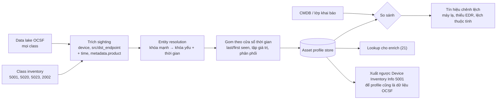

# Asset profiling from OCSF logs

> Khi mọi nguồn đã về OCSF, mỗi event là một lần "nhìn thấy" một hoặc nhiều tài sản; gom các lần nhìn thấy đó theo thực thể và theo thời gian sẽ dựng được lớp trạng thái và lớp hành vi của asset profile, kể cả cho những máy không ai khai báo.

## Tại sao cần biết
Inventory truyền thống dựa vào khai báo (CMDB) hoặc quét chủ động; cả hai đều có khoảng trống: máy mới cắm vào, máy tắt lúc quét, VM sống vài giờ, thiết bị cá nhân. Log thì luôn chạy và ghi lại mọi máy *thực sự hoạt động*. CIS Controls v8 đưa đúng ý này vào các safeguard của Control 1: dùng DHCP log để cập nhật inventory, dùng công cụ phát hiện thụ động.

Điều làm cách này khả thi là **chuẩn hóa**. Khi log còn ở định dạng gốc, muốn "lấy mọi máy từ mọi nguồn" phải viết một bộ trích xuất cho mỗi nguồn. Khi đã về OCSF ([15-why-ocsf.md](15-why-ocsf.md)), máy luôn nằm ở `device`, `src_endpoint`, `dst_endpoint` với cùng tên field. Một truy vấn duy nhất gom được tài sản từ hàng chục nguồn. Đây là một ứng dụng trực tiếp của log đã sạch, và kết quả của nó quay lại làm giàu chính log đó ([21-asset-enrichment-in-ocsf.md](21-asset-enrichment-in-ocsf.md)).

## Khái niệm cốt lõi

### Sighting: đơn vị dữ liệu của asset profiling
Một **sighting** là bản ghi "thực thể X được nhìn thấy với thuộc tính Y lúc T, theo nguồn S". Mỗi event OCSF sinh ra một hoặc vài sighting:
- `device`: sighting mạnh. Nguồn tự báo về chính máy nó chạy trên đó (agent EDR, Windows log).
- `src_endpoint`, `dst_endpoint`: sighting yếu hơn. Đây là thông tin một máy khác nhìn thấy, vd hostname do client tự khai trong log đăng nhập.
- `metadata.product`: *cảm biến nào* thấy máy này. Từ đó biết máy có những control nào.

### Hai loại đầu vào
1. **Class inventory**, có sẵn trạng thái dạng snapshot:

| Class | `class_uid` | Cho profile |
|---|---|---|
| Device Inventory Info | 5001 | thuộc tính máy: OS, phần cứng, agent, managed/compliant |
| Software Inventory Info | 5020 | phần mềm cài đặt (`package`) |
| Cloud Resources Inventory Info | 5023 | tài nguyên cloud |
| Operating System Patch State | 5004 | tình trạng bản vá |
| Vulnerability Finding | 2002 | lỗ hổng đang mở |

2. **Class hoạt động**, mỗi class đóng góp một mảng của profile:

| Class | `class_uid` | Lớp trạng thái | Lớp hành vi |
|---|---|---|---|
| Mọi event có `device` | — | tồn tại, first/last seen, hostname, IP, OS, cảm biến nào thấy | giờ hoạt động |
| DHCP Activity | 4004 | IP ↔ MAC ↔ hostname kèm thời hạn lease (`lease_dur`) | |
| Authentication | 3002 | | user nào đăng nhập, kiểu logon, đăng nhập từ đâu, tài khoản admin nào dùng máy |
| Process Activity | 1007 | phần mềm *thực sự chạy* (`process.file.path`, hash) | process thường gặp, công cụ quản trị |
| Application Lifecycle | 6002 | phần mềm cài/gỡ/cập nhật | |
| Network Activity | 4001 | dịch vụ lắng nghe (activity 7 Listen), cổng nhận kết nối khi máy là đích | đích kết nối, lưu lượng ra internet |
| DNS Activity | 4003 | | domain, SaaS mà máy dùng |
| HTTP Activity | 4002 | OS/trình duyệt qua `http_request.user_agent` (hữu ích với máy không có agent) | |
| Detection Finding | 2004 | | lịch sử alert của máy |

### Gom sighting thành profile
Mỗi loại thuộc tính gom theo một cách:
- **Đơn trị, lấy giá trị mới nhất**: OS, hostname, IP hiện tại. Lấy theo nguồn chuẩn, rồi theo `time` mới nhất.
- **Mốc thời gian**: `first_seen` = min(`time`), `last_seen` = max(`time`), tính trên mọi sighting.
- **Tập giá trị kèm thống kê**: user, phần mềm, cổng, đích kết nối. Lưu mỗi giá trị kèm số lần, first/last seen.
- **Phân phối**: giờ trong ngày, số phiên mỗi ngày, lượng dữ liệu ra. Đây là baseline để so khi có event mới.

### So với lớp khai báo
Đặt profile quan sát được cạnh CMDB ([19-asset-management-and-profile.md](19-asset-management-and-profile.md)) cho ra các nhóm chênh lệch:
- có trong log, **không** có trong CMDB → tài sản chưa khai báo;
- có trong CMDB, **không** thấy trong log nhiều ngày → đã thu hồi mà chưa cập nhật, hoặc mất log;
- có telemetry mạng nhưng **không** có event từ EDR → máy không có EDR;
- thuộc tính lệch nhau: OS, owner, môi trường khác với khai báo.

## Cách hoạt động



Thực tế nên gom **tăng dần**: mỗi giờ hay mỗi ngày gom phần event mới vào bảng tổng hợp, không quét lại toàn bộ lake.

## Ví dụ
Truy vấn gom tài sản từ mọi nguồn trong 7 ngày (SQL trên bảng OCSF, field lồng nhau viết bằng dấu chấm):

```sql
SELECT
  lower(device.hostname)                 AS host,
  min(time)                              AS first_seen,
  max(time)                              AS last_seen,
  array_agg(DISTINCT metadata.product.name) AS seen_by,      -- cảm biến nào thấy máy
  array_agg(DISTINCT device.os.name)     AS os_reported,
  count(*)                               AS events
FROM ocsf_events
WHERE time > now() - interval '7' day
  AND device.hostname IS NOT NULL
GROUP BY 1
```

Và người dùng chính của từng máy, lấy từ log đăng nhập thành công:

```sql
SELECT lower(device.hostname) AS host, user.name, count(*) AS logons
FROM ocsf_events
WHERE class_uid = 3002 AND activity_id = 1 AND status_id = 1
  AND time > now() - interval '30' day
GROUP BY 1, 2
ORDER BY host, logons DESC
```

Kết quả cho một máy lạ:

| host | seen_by | os_reported | trong CMDB? |
|---|---|---|---|
| `ws-0412` | EDR, Windows, Firewall, DHCP | Windows 11 | có |
| `desktop-7hq2k` | Firewall, DHCP, Proxy | (trống) | **không** |

`desktop-7hq2k` chỉ được thiết bị mạng nhìn thấy, không có EDR, không có trong CMDB, và user-agent HTTP cho thấy máy Windows. Đây là máy chưa được quản lý: cần tìm owner, cài EDR hoặc chặn.

## Hiểu nhầm thường gặp
- **"Mọi hostname trong log đều là một máy"**: hostname ở `src_endpoint` có thể do client tự khai (dễ giả mạo); proxy, NAT, VPN gateway làm nhiều máy hiện ra như một. Gắn độ tin cậy cho sighting theo vai trò và nguồn.
- **"Máy chủ chia sẻ cũng có 'user chính'"**: terminal server, jump host có hàng trăm user; baseline phải theo loại máy, không dùng một khuôn cho mọi máy.
- **"Không thấy trong log tức là máy đã tắt"**: có thể nguồn log hỏng. Kiểm tra sức khỏe nguồn trước khi đánh dấu máy đã thu hồi.
- **"Profile từ log thay được CMDB"**: log cho trạng thái và hành vi; owner, dịch vụ nghiệp vụ, criticality vẫn cần con người khai báo.

## Liên quan
- [15-why-ocsf.md](15-why-ocsf.md): vì sao chỉ khi đã chuẩn hóa mới làm được việc này.
- [18-mapping-logs-to-ocsf.md](18-mapping-logs-to-ocsf.md): map đúng `device` và `src_endpoint` là điều kiện để sighting đúng.
- [19-asset-management-and-profile.md](19-asset-management-and-profile.md): ba lớp profile, entity resolution.
- [21-asset-enrichment-in-ocsf.md](21-asset-enrichment-in-ocsf.md): đưa profile ngược vào event.
- [22-asset-data-use-cases.md](22-asset-data-use-cases.md): dùng profile vào việc gì.
