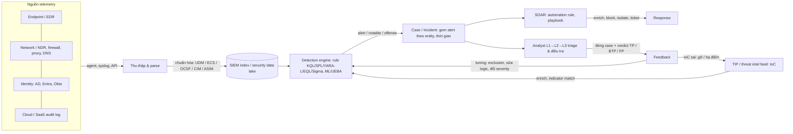

# Domain & kiến trúc an ninh mạng enterprise (SIEM, SOC, SOAR, XDR, TIP...)

> Góc này chỉ dựng nền domain cho người đọc là kỹ sư phần mềm/AI. Phần quy trình tuning, IoC và LLM do researcher khác phụ trách.

## 1. Các thành phần (SIEM, SOC, SOAR, EDR/XDR/NDR, TIP, UEBA, security data lake) và luồng dữ liệu giữa chúng

### Kết luận ngắn
Luồng chuẩn là: nguồn log → thu thập/parse/chuẩn hóa về một schema chung (UDM, ECS, OCSF, CIM, ASIM) → detection rule chạy trên dữ liệu đã chuẩn hóa sinh ra alert → alert được gom thành case/incident → analyst điều tra, playbook SOAR tự động hóa enrichment/response → analyst gán verdict khi đóng case, và verdict đó quay lại thành feedback để tuning rule. Mức chắc chắn **cao** cho luồng tổng thể, vì docs chính thức của Google SecOps, Microsoft Sentinel và IBM QRadar mô tả cùng một chuỗi. Định nghĩa "chuẩn" của từng nhãn sản phẩm (XDR, SOAR, SIEM) chỉ ở mức **trung bình**, vì Gartner, nơi đặt ra các nhãn này, không công khai glossary gốc.

### Phát hiện có nguồn
- **Google SecOps** gộp cả chuỗi vào một nền tảng. Lõi xử lý "Normalizes raw telemetry into the structured UDM schema, evaluates events using the YARA-L detection engine, and orchestrates workflows using the SOAR case management engine". Khâu ingestion biến log thô thành UDM (Unified Data Model) và gắn thêm ngữ cảnh từ Entity Context Graph. — [Google SecOps architecture and data flows](https://docs.cloud.google.com/chronicle/docs/secops/secops-architecture) (bậc 1, docs hiện hành 2026; trích qua kết quả search, WebFetch không đọc được thân bài)
- Rule YARA-L mặc định coi như dữ liệu đã được chuẩn hóa về UDM. Rule gồm các section có tên: `meta` (author, description, severity) và `events` (khai báo nguồn dữ liệu, lọc theo field UDM). Ngoài ra còn các section để correlation nhiều bước. — [Get Started: YARA-L 2.0 in SecOps](https://docs.cloud.google.com/chronicle/docs/yara-l/getting-started) (bậc 1, 2026)
- **IBM QRadar:** "As event and flow data passes through QRadar SIEM, it tests different conditions to generate an offense". Custom Rules Engine chạy các test, còn thành phần Magistrate trên Console tạo và quản lý offense. QRadar phân biệt hai loại dữ liệu: *event* là log của một hành động tại một thời điểm (login, VPN connection), *flow* là bản ghi hoạt động mạng kéo dài từ vài giây đến vài ngày. Analyst có thể đánh dấu event/flow là false positive để chúng không còn correlate thành offense nữa. — [IBM QRadar Getting Started Guide 7.5](https://www.ibm.com/docs/en/SS42VS_7.5/pdf/b_qradar_gs_guide.pdf) và [Offense investigations](https://www.ibm.com/docs/en/qsip/7.5.0?topic=management-offense-investigations) (bậc 1, 7.5; trích qua kết quả search)
- **Microsoft Sentinel tự định vị là SIEM kiêm SOAR:** "Microsoft Sentinel, in addition to being a SIEM system, is also a platform for security orchestration, automation, and response (SOAR). One of its primary purposes is to automate any recurring and predictable enrichment, response, and remediation tasks". — [Automation in Microsoft Sentinel](https://learn.microsoft.com/en-us/azure/sentinel/automation/automation) (bậc 1, cập nhật 2026-06)
- **Schema chuẩn hóa của từng hệ:** OCSF là schema mở, trung lập vendor. Elastic dùng ECS, Google SecOps dùng UDM, Microsoft Sentinel dùng ASIM, Splunk dùng CIM. Theo Tenzir, nên chuẩn hóa về OCSF, nhưng vẫn phải map sang ECS/UDM/ASIM khi tích hợp với nền tảng cụ thể. — [Tenzir: map to other schemas](https://docs.tenzir.com/guides/normalization/map-to-other-schemas) (bậc 2, không rõ ngày). Splunk đang đưa CIM về gần OCSF. — [Trifork: Splunk embraces openness](https://trifork.security/splunk-embraces-openness) (bậc 2/3, không rõ ngày)
- **Phê phán CIM/ECS (quan điểm của một vendor):** field của CIM như `src`/`dest` kém chính xác và gắn chặt với correlation search của Splunk. ECS có kiểu dữ liệu riêng của Elastic như `geo_point`. — DataBee, trích qua [kết quả search](https://comcasttechnologysolutions.com/node/10351) (bậc 3, chỉ coi là quan điểm vendor)
- **Security data lake:** Amazon Security Lake lưu log trong S3 của chính khách hàng, chuẩn hóa về OCSF, và cho SIEM/XDR hoặc Athena đọc theo mô hình *subscriber*. Lưu trữ được tách khỏi công cụ phân tích. GA tháng 5/2023. — [AWS announces GA of Amazon Security Lake](https://press.aboutamazon.com/2023/5/aws-announces-general-availability-of-amazon-security-lake) (bậc 1, 2023-05); [Amazon Security Lake features](https://aws.amazon.com/security-lake/features/) (bậc 1)
- **XDR:** Gartner, qua trích dẫn trong các hồ sơ patent Mỹ, định nghĩa XDR là "a SaaS-based, vendor-specific, security threat detection and incident response tool that natively integrates multiple security products into a cohesive security operations system that unifies all licensed components". — [USPTO patent 12223047](https://image-ppubs.uspto.gov/dirsearch-public/print/downloadPdf/12223047) (bậc 2, trích thứ cấp, chưa đối chiếu được với Gartner). Trang Gartner Peer Insights liệt kê các tính năng bắt buộc của XDR: analytics/correlation, workspace điều tra, response tự động native, ít nhất 2 sensor native (một trong đó là endpoint) và ingest log. — [Gartner Peer Insights – XDR](https://reviews.api.gartner.com/reviews/market/extended-detection-and-response) (bậc 2, 2025)
- **TIP/threat intel trong SIEM:** Sentinel cho phép analyst đánh dấu entity (IP, URL, domain, file hash) là IoC và "Add to TI" ngay trong incident. Top insights hiển thị "Threat indicators related to user", "IP address remote connections with TI match" và UEBA insights. — [Investigate Sentinel incidents in depth](https://learn.microsoft.com/en-us/azure/sentinel/investigate-incidents) (bậc 1, 2026-07). Elastic có loại rule **Indicator match**, so sánh field của event với index threat intel, "Alerts are enriched with indicator metadata". — [Elastic: About detection rules](https://www.elastic.co/docs/solutions/security/detect-and-alert/about-detection-rules) (bậc 1, 2026)
- **UEBA/ML trong rule engine:** Elastic có loại rule Machine learning, dùng anomaly detection job mô hình hóa hành vi bình thường, và loại New terms, bắn khi một giá trị chưa từng xuất hiện trong cửa sổ lịch sử. — [Elastic: About detection rules](https://www.elastic.co/docs/solutions/security/detect-and-alert/about-detection-rules) (bậc 1, 2026)

### Nhận định
- **Nhận định:** sơ đồ luồng dữ liệu tổng quát, tổng hợp từ các docs ở trên:

- **Nhận định:** đặt các thành phần cạnh nhau như sau. **SIEM** là kho log tập trung cộng engine chạy rule. **EDR/NDR** là sensor kèm detection riêng cho endpoint/mạng, đồng thời là nguồn alert đổ vào SIEM. **XDR** là sản phẩm của một vendor hợp nhất nhiều sensor kèm phân tích và response. **SOAR** là lớp workflow/automation chạy trên case. **TIP** quản lý IoC và đẩy chúng xuống rule. **UEBA** là analytics hành vi trên user/entity. **Security data lake** là lưu trữ rẻ, tách khỏi compute và thường theo OCSF. Ranh giới giữa các nhãn ngày càng mờ, vì Sentinel, Google SecOps và Splunk ES đều đã gộp SIEM với SOAR với UEBA.
- **Nhận định:** với task LLM, "rule" luôn chạy trên dữ liệu **đã chuẩn hóa**. Vì vậy một FP có thể đến từ logic rule, nhưng cũng có thể đến từ lỗi parse/chuẩn hóa. Sentinel tách hẳn hai lý do đóng case "incorrect alert logic" và "incorrect data" (xem mục 2).

### Khoảng trống
- Chưa lấy được định nghĩa Gartner gốc cho SIEM, SOAR và UEBA: search glossary Gartner không ra trang gốc, chỉ có trích dẫn thứ cấp.
- Chưa đọc được thân bài trang kiến trúc Google SecOps (WebFetch chỉ trả về navigation), nên các đoạn trích dựa vào snippet của kết quả search.
- NDR chưa có nguồn riêng, chỉ có hiểu biết chung.

## 2. Định nghĩa và phân biệt thuật ngữ

### Kết luận ngắn
Các thuật ngữ cốt lõi (event, incident, alert, case, verdict, IoC, IoA, TTP) có định nghĩa chính thức hoặc gần chính thức. Riêng verdict thì mỗi vendor đặt tên một kiểu: Sentinel dùng True Positive / Benign Positive / False Positive (incorrect logic hoặc incorrect data) / Undetermined. Các thuật ngữ vận hành như playbook vs runbook, SLA, MTTD/MTTR không có định nghĩa chuẩn thống nhất. Mức chắc chắn **cao** cho event/incident/verdict, **trung bình** cho playbook/runbook và MTTD/MTTR.

### Phát hiện có nguồn
- **Event (NIST SP 800-61r3, 2025):** "Any observable occurrence involving computing assets", bao gồm nền tảng vật lý, ảo, mạng, dịch vụ và cloud. NIST SP 800-92 (log management) định nghĩa event là "Something that occurs within a system or network". — [NIST CSRC Glossary: event](https://csrc.nist.gov/glossary/term/event) (bậc 1)
- **Cybersecurity incident:** SP 800-61r3 dùng định nghĩa của FISMA (PL 113-283): một sự kiện *thực sự hoặc sắp xảy ra* đe dọa tính bảo mật, toàn vẹn hoặc sẵn sàng của thông tin/hệ thống mà không có thẩm quyền hợp pháp, hoặc vi phạm luật hay chính sách bảo mật. CSF 1.1 định nghĩa gọn hơn: "A cybersecurity event that has been determined to have an impact on the organization prompting the need for response and recovery". — [NIST CSRC Glossary: cybersecurity incident](https://csrc.nist.gov/glossary/term/cybersecurity_incident) (bậc 1)
- **Vòng đời incident response:** SP 800-61r3 (phát hành 2025-04-03) thay Rev. 2 (2012) và bỏ mô hình 4 pha cũ để map vào 6 Function của CSF 2.0. Ba function Detect, Respond, Recover là phần xử lý incident, còn Govern, Identify, Protect là chuẩn bị. Bảng map: Detection & Analysis → Detect; Containment/Eradication/Recovery → Respond + Recover; Post-Incident Activity → nhóm Improvement của Identify. Tổ chức không bắt buộc dùng mô hình này. — [NIST SP 800-61r3 (PDF)](https://nvlpubs.nist.gov/nistpubs/specialpublications/nist.sp.800-61r3.pdf) và [NIST news 2025-04](https://www.nist.gov/news-events/news/2025/04/nist-revises-sp-800-61-incident-response-recommendations-and-considerations) (bậc 1, 2025-04)
- **Alert / notable / offense / incident theo vendor:**
  - Splunk ES: "A notable is an event generated by a correlation search as an alert". Notable mang metadata để điều tra và theo dõi khắc phục. "Risk notables are notable events with risk scores", sinh ra khi một *risk incident rule* gán risk score cho *risk object* ("Any entity that represents potential security threats such as an asset, identity, user, or device"). — [Splunk ES 7.3: Risk notables](https://help.splunk.com/en/splunk-enterprise-security-7/risk-based-alerting/7.3/identify-threat/risk-notables-in-splunk-enterprise-security) (bậc 1, ES 7.3)
  - Sentinel: "Incidents are Microsoft Sentinel records that contain a complete and constantly updated chronology of a security threat, including evidence (alerts), suspects and parties of interest (entities)…". Incident được tạo từ hoặc gom thêm alert do analytics rule sinh ra, hoặc alert nhập từ sản phẩm bên thứ ba. Incident thừa hưởng entity, severity, status và tactic/technique MITRE ATT&CK của các alert bên trong. — [Sentinel incident investigation](https://learn.microsoft.com/en-us/azure/sentinel/incident-investigation) (bậc 1, cập nhật 2026-09); [Investigate incidents in depth](https://learn.microsoft.com/en-us/azure/sentinel/investigate-incidents) (bậc 1, 2026-07)
  - QRadar: offense là đơn vị điều tra, sinh ra khi event/flow thỏa điều kiện của rule. "The magnitude rating of an offense is a measure of the importance of the offense in your environment". — [QRadar SIEM Investigation – Working with Offenses](https://www.ibm.com/support/pages/qradar-siem-investigation-working-offenses) (bậc 1, trích qua kết quả search)
  - Google SecOps: alert do rule YARA-L sinh ra được gom thành **case**. Thứ tự áp dụng rule gom: alert type → product → data source → fallback. Alert có chung entity với một case đang mở trong cửa sổ thời gian thì vào case đó. Mỗi case tối đa 30 alert, cửa sổ gom 0,5–24 giờ. — [Configure alert grouping](https://cloud.google.com/chronicle/docs/soar/investigate/working-with-alerts/alert-grouping-mechanism-admin) (bậc 1, 2026; trích qua kết quả search)
  - TheHive (case management mã nguồn mở): alert từ SIEM, email phishing... vào panel Alerts. Từ đó alert được import thành case, merge vào case có sẵn, hoặc bị bỏ qua. Case chia thành task, mang các observable (IP, hash...), và TheHive tự nhận ra observable đã xuất hiện ở case trước. — [TheHive (GitHub README)](https://github.com/TheHive-Project/TheHive4py) (bậc 1/2, README; trích qua kết quả search)
- **Verdict / classification khi đóng incident (Sentinel):** classification là bắt buộc khi đóng, gồm "**True Positive** – suspicious activity; **Benign Positive** – suspicious but expected; **False Positive** – incorrect alert logic; **False Positive** – incorrect data; **Undetermined**". — [Basic incident tasks (Sentinel)](https://learn.microsoft.com/en-us/azure/sentinel/incident-navigate-triage) (bậc 1, 2026-07)
- **Nguyên nhân FP điển hình, theo Microsoft:** "false positives often stem from specific entities like users or IP addresses that should be excluded". Ví dụ: service principal có hành vi trông đáng ngờ, scanner bảo mật nội bộ từ IP đã biết, IP nội bộ không thuộc dải private. — [Handle false positives in Microsoft Sentinel](https://learn.microsoft.com/en-us/azure/sentinel/false-positives) (bậc 1, 2026-07)
- **IoC vs IoA:** theo CrowdStrike, IoC mang tính phản ứng: "If an organization finds an indicator, it is almost certain that they have already been compromised". IoA "focus on identifying a cyberattack that is in process", tức chuỗi hoạt động mà khi thấy cùng nhau thì nhiều khả năng đang có tấn công. Ví dụ IoA: Word sinh ra PowerShell rồi đọc bộ nhớ credential store. Ví dụ IoC: IP xấu đã biết khớp với feed. — [CrowdStrike: IOA vs IOC](https://www.crowdstrike.com/resources/indicators-attack-vs-indicators-compromise/) (bậc 1 nhưng là tài liệu marketing của vendor); [CyberDefenders glossary: IOA vs IOC](https://cyberdefenders.org/cybersecurity-glossary/ioa-vs-ioc/) (bậc 2/3)
- **TTP theo MITRE ATT&CK:** ATT&CK là "knowledge base of adversarial techniques based on real-world observations". Tactic là "why" (mục tiêu), technique là "how", sub-technique là mô tả chi tiết hơn của technique, procedure là "specific implementation or in-the-wild use". — [MITRE ATT&CK Resources](https://attack.mitre.org/resources/) (bậc 1)
- **Pyramid of Pain (David Bianco, 2013):** xếp indicator theo mức "đau" khi attacker mất nó, từ thấp lên: hash → IP → domain → network/host artifact → tool → TTP. Hash, IP, domain rẻ để attacker đổi, TTP đắt nhất. — [Sqrrl/Bianco: A Framework for Cyber Threat Hunting Part 1 – The Pyramid of Pain (PDF)](https://www.threathunting.net/files/A%20Framework%20for%20Cyber%20Threat%20Hunting%20Part%201_%20The%20Pyramid%20of%20Pain%20_%20Sqrrl.pdf) (bậc 2, trích qua kết quả search; chưa mở được bài gốc trên blog Bianco)
- **Playbook vs runbook:** không có định nghĩa thống nhất, các nguồn mâu thuẫn nhau. Quan điểm phổ biến nhất: playbook là chiến lược xử lý cả một loại sự kiện (vai trò, điểm quyết định, escalation), runbook là các bước cụ thể cho một tác vụ kỹ thuật ([Rootly](https://docs.rootly.com/glossary/runbook-vs-playbook), [ManageEngine](https://www.manageengine.com/log-management/soar/runbook-vs-playbook.html), bậc 2/3). Tufin cho rằng playbook là workflow tự động trong SOAR còn runbook là quy trình thủ công. Sumo Logic lại coi hai khái niệm gần như trùng nhau ([Sumo Logic](https://www.sumologic.com/blog/the-difference-between-playbooks-and-runbooks-in-incident-response/), bậc 2). Trong Sentinel, "A playbook is a collection of response and remediation actions and logic that can be run from Microsoft Sentinel as a routine… playbooks are based on workflows built in Azure Logic Apps". — [Automation in Microsoft Sentinel](https://learn.microsoft.com/en-us/azure/sentinel/automation/automation) (bậc 1, 2026)
- **Automation rule vs playbook (Sentinel):** automation rule là lớp điều phối trung tâm. Nó có thể tag, assign hoặc đóng incident mà không cần playbook, gọi playbook, áp cho nhiều analytics rule cùng lúc và tạo task list. Playbook (Logic App) làm phần tích hợp/hành động phức tạp. — [Automation in Microsoft Sentinel](https://learn.microsoft.com/en-us/azure/sentinel/automation/automation) (bậc 1, 2026)
- **Detection rule trên các nền tảng:** Elastic có các loại rule Custom query (KQL/Lucene), Threshold, EQL (correlation chuỗi sự kiện), ES|QL ("Each result row becomes an alert"), Indicator match, New terms và Machine learning. — [Elastic: About detection rules](https://www.elastic.co/docs/solutions/security/detect-and-alert/about-detection-rules) (bậc 1, 2026). Trong QRadar, rule test event, flow hoặc chính offense. — [IBM Community: QRadar rules](https://community.ibm.com/community/user/blogs/gladys-koskas1/2022/09/29/everything-you-need-to-know-about-qradar-rules) (bậc 2, 2022-09)
- **MTTR** được Microsoft dùng làm mục tiêu của trải nghiệm incident ("reducing its mean time to resolve (MTTR)"). — [Sentinel incident investigation](https://learn.microsoft.com/en-us/azure/sentinel/incident-investigation) (bậc 1). Chưa có nguồn định nghĩa chuẩn cho MTTD.

### Nhận định
- **Nhận định:** bảng thuật ngữ rút gọn cho kỹ sư phần mềm.

| Thuật ngữ | Nghĩa ngắn | Ví dụ |
|---|---|---|
| Log / event | Bản ghi một việc đã xảy ra (event theo NIST là "any observable occurrence") | 1 dòng Windows 4625 login fail |
| Detection rule (analytics rule, correlation search, YARA-L rule) | Truy vấn hoặc logic chạy định kỳ hay real-time trên event, khớp thì sinh alert | KQL `SigninLogs | where ...` |
| Use case | Kịch bản phát hiện ở mức nghiệp vụ, có thể gồm nhiều rule, nguồn log và quy trình phản hồi | "Phát hiện brute-force VPN" |
| Alert / notable / offense / detection | Đầu ra của rule: một lần khớp, kèm entity và severity | Notable (Splunk), Alert (Sentinel), Offense (QRadar) |
| Case / incident | Container gom nhiều alert liên quan để điều tra và ghi lại hành động | Incident (Sentinel), Case (Google SecOps, TheHive) |
| Verdict / classification | Nhãn khi đóng case | TP, Benign TP (BTP), FP, Undetermined |
| False Negative | Tấn công thật nhưng rule không bắn | (không có alert để gán nhãn, nên vô hình với dữ liệu FP) |
| IoC | Artifact tĩnh cho thấy đã bị xâm nhập | IP, domain, URL, hash |
| IoA / TTP | Hành vi hoặc chuỗi hành vi của attacker | Word → PowerShell → đọc LSASS; ATT&CK T1003 |
| Triage | Phân loại nhanh: thật hay giả, mức ưu tiên, có cần escalate không | L1 xem alert queue |
| Severity vs priority | Severity là mức nghiêm trọng do rule hoặc vendor gán; priority là thứ tự xử lý, có tính thêm độ quan trọng của tài sản | QRadar magnitude dựa trên relevance và asset weight |
| Playbook (SOAR) | Workflow tự động hoặc bán tự động khi có alert/incident | Logic App: enrich IP qua VirusTotal, block trên firewall |
| Runbook | Hướng dẫn từng bước cho người hoặc máy thực hiện một tác vụ | "Cách cô lập máy trong EDR" |
| MTTD / MTTR | Thời gian trung bình từ lúc xâm nhập đến khi phát hiện / từ lúc phát hiện đến khi xử lý xong | KPI của SOC |

- **Nhận định:** phân biệt **Benign True Positive** với **False Positive** là quan trọng nhất cho task tuning. BTP nghĩa là logic rule đúng, hoạt động có thật, nhưng hợp lệ (admin chạy script, pentest). Cách xử lý thường là thêm exception có phạm vi hẹp. FP nghĩa là logic sai hoặc dữ liệu sai. Cách xử lý là sửa rule hoặc sửa parser. Sentinel tách sẵn ba nhãn này, nên dữ liệu nhãn của Sentinel có thể dùng trực tiếp để định tuyến loại đề xuất tuning. Không phải vendor nào cũng tách như vậy.
- **Nhận định:** QRadar dùng "event" (log) và "offense" (≈ case), khác với nghĩa "event" của NIST. Splunk dùng "notable" thay cho alert. Khi thiết kế input cho LLM, nên có một bảng map thuật ngữ cho từng vendor.

### Khoảng trống
- SLA, escalation và priority trong SOC chưa có nguồn bậc 1 định nghĩa. Thường mỗi hợp đồng MSSP/MDR tự định nghĩa SLA (ví dụ thời gian phản hồi theo severity), nhưng chưa tìm được tài liệu công khai để trích.
- MTTD chưa có nguồn định nghĩa. Công thức MTTD/MTTR cũng khác nhau giữa các tổ chức.
- Chưa mở được tài liệu chính thức của Cortex XSOAR (incident, playbook, war room) và Elastic Cases. Hai sản phẩm này chỉ được nhắc tên.
- Splunk ES 8.x có thể đã đổi thuật ngữ "notable" sang "finding"/"investigation". Chưa xác minh, nguồn dùng ở trên là ES 7.3.
- Định nghĩa "use case" chưa có nguồn chính thức. Định nghĩa trong bảng là nhận định của agent.

## 3. Tổ chức SOC, các vai trò, mô hình in-house / MSSP / MDR, alert fatigue

### Kết luận ngắn
SOC truyền thống chia ba tier: L1 triage, L2 điều tra, L3 hunting/detection engineering. Detection engineer là người viết và tuning rule. MSSP thường giám sát rồi chuyển alert cho khách. MDR (theo Gartner) cung cấp chức năng SOC từ xa, gồm cả điều tra và ngăn chặn. Alert fatigue có thật và quy mô lớn: các khảo sát cho thấy vài nghìn alert/ngày và 46–83% là FP. Tuy vậy các con số này là **tự đánh giá của analyst** hoặc do vendor tài trợ. Mức chắc chắn **trung bình**: mô hình tier và MSSP/MDR được nhiều nguồn đồng thuận nhưng phần lớn là nguồn vendor; số liệu FP lệch nhau nhiều giữa các khảo sát.

### Phát hiện có nguồn
- **Tier SOC:** L1 theo dõi hàng đợi alert, triage ban đầu, đóng FP hoặc escalate, làm theo playbook/runbook, kinh nghiệm 0–2 năm. L2 điều tra sâu, correlate log, tìm root cause, ngăn chặn, 2–5 năm. L3 làm hunting chủ động, detection engineering, reverse malware, phân tích threat intel, viết detection tùy biến, kèm cặp người mới, 5 năm trở lên. — [Intezer: SOC Tiers Explained](https://intezer.com/guides/ai-soc/soc-tiers-explained) (bậc 2/3, vendor, 2025–2026); [Prophet Security: SOC tiers](https://prophetsecurity.ai/blog/soc-tiers-are-out-how-ai-is-flattening-soc-tier-1-2-3) (bậc 3, vendor)
- **Detection engineer vs threat hunter:** "a detection engineer writes the rules the SOC runs on, while a threat hunter spends most of the week running hypothesis-driven hunts". Tin tuyển dụng thường gộp hai vai trò. Khoảng 30% tổ chức dùng mô hình thay thế (pod-based) thay vì tier. — kết quả search trích từ [Prophet Security](https://prophetsecurity.ai/blog/soc-tiers-are-out-how-ai-is-flattening-soc-tier-1-2-3) (bậc 3, con số 30% chưa lần được nguồn gốc)
- **Phân vai khi xử lý FP (Microsoft):** exception bằng automation rule "are often generated by analysts", có audit trail và có thể hết hạn (mặc định 24 giờ). Sửa analytics rule "typically require implementation by Security Operations Center (SOC) engineers" và là "the most flexible and complete false positive solution". — [Handle false positives in Microsoft Sentinel](https://learn.microsoft.com/en-us/azure/sentinel/false-positives) (bậc 1, 2026-07)
- **MDR (Gartner):** "Gartner defines managed detection and response (MDR) services as those that provide customers with remotely delivered security operations center (SOC) functions… rapid detection, analysis, investigation and response through threat disruption and containment… a turnkey experience, using a predefined technology stack that commonly covers endpoints, networks, logs and cloud. The MDR provider's analyst team then performs threat hunting and incident management". — [Gartner Peer Insights – MDR market](https://www.gartner.com/reviews/market/managed-detection-and-response-services/vendor/fortra) (bậc 1/2, định nghĩa thị trường của Gartner)
- **MSSP vs MDR:** Gartner, qua MSSP Alert: "The overlap between managed security services and MDR is increasing… MSS and MDR still have distinct characteristics". MDR thường dùng stack do provider cung cấp, còn MSS không phụ thuộc nguồn event. Quy trình MSSP thường bắt đầu từ một SIEM do khách quản lý hoặc đồng quản lý. MSSP chủ yếu thông báo cho khách, MDR tự điều tra và ngăn chặn trong phạm vi quyền đã thỏa thuận. — [MSSP Alert: MDR vs MSSP](https://msspalert.com/news/mdr-vs-mssp-security-services-whats-difference) (bậc 2); [Red Canary: MDR vs MSSP](https://redcanary.com/blog/mdr-vs-mssp/) (bậc 2/3, vendor MDR nên có thiên lệch)
- **Alert fatigue, khảo sát Vectra 2023:** trung bình 4.484 alert/ngày, analyst ước 83% là FP, 67% alert không xử lý kịp. Mẫu 2.000 analyst ở tổ chức trên 1.000 nhân viên, 10 quốc gia, Sapio Research thực hiện tháng 3–4/2023. Con số FP là **tự đánh giá của analyst**, không phải tỷ lệ đo được. — [Vectra 2023 State of Threat Detection](https://www.vectra.ai/resources/2023-state-of-threat-detection) (bậc 1 cho số liệu khảo sát do vendor tài trợ, 2023)
- **Microsoft & Omdia (2026-02):** 46% alert là FP, 42% alert không bao giờ được điều tra. — trích qua [CSA Research Note: AI SOC alert noise](https://labs.cloudsecurityalliance.org/research/csa-research-note-ai-soc-alert-noise-20260914-csa-styled/) (bậc 2, 2026-09; chưa mở bài gốc của Microsoft Security Blog ngày 2026-02-17, cỡ mẫu không nêu)
- **SANS 2025 Detection & Response Survey:** 73% tổ chức coi FP là thách thức phát hiện số 1, tăng mạnh so với năm trước. — trích qua [CSA Research Note](https://labs.cloudsecurityalliance.org/research/csa-research-note-ai-soc-alert-noise-20260914-csa-styled/) (bậc 2, 2026-09) và [Stamus Networks blog](https://www.stamus-networks.com/blog/what-the-2025-sans-detection-response-survey-reveals-false-positives-alert-fatigue-are-worsening) (bậc 2/3, nhà tài trợ khảo sát). Một nguồn thứ cấp khác nêu FP "very frequent" tăng từ 13% lên 20% ([UnderDefense](https://underdefense.com/blog/ai-soc-investigation-speed/), bậc 3). Chưa đối chiếu được với báo cáo gốc của SANS.
- **Bối cảnh 2026, alert liên quan AI:** trên khoảng 16,9 triệu alert, khoảng 73.000 alert liên quan đến AI. Trong đó 94,1% là nhiễu do sử dụng hợp lệ, chỉ 0,02% (khoảng 15 vụ) là tấn công thật, và 81,7% được auto-suppress không qua người. — trích qua [CSA Research Note](https://labs.cloudsecurityalliance.org/research/csa-research-note-ai-soc-alert-noise-20260914-csa-styled/) (bậc 2, 2026-09, một bộ dữ liệu tổng hợp duy nhất)
- **Microsoft tự mô tả vấn đề:** SOC "are typically inundated with security alerts and incidents… at volumes so large that available personnel are overwhelmed. This results all too often in situations where many alerts are ignored and many incidents aren't investigated". — [Automation in Microsoft Sentinel](https://learn.microsoft.com/en-us/azure/sentinel/automation/automation) (bậc 1, 2026)
- **SANS SOC Survey 2024 (Christopher Crowley, 05/2024):** 29% coi nhân sự là thách thức lớn nhất, thâm niên analyst điển hình 1–3 năm. Cỡ mẫu mâu thuẫn giữa các nguồn: 403 theo Abnormal, trên 1.500 theo SCWorld/Dropzone. — [Abnormal: SANS SOC Survey takeaways](https://abnormal.ai/ja/blog/empowering-securittakeaways-sans-soc-survey) (bậc 2/3); [SCWorld: 2024 SANS SOC Survey Report](https://scworld.com/whitepaper/2024-sans-soc-survey-report) (bậc 2)

### Nhận định
- **Nhận định:** các con số FP rất khác nhau: 83% (Vectra 2023, analyst tự ước), 46% (Microsoft/Omdia 2026), còn SANS chỉ đo *mức độ coi là vấn đề* (73%). Vì vậy report nên trình bày một **khoảng** và nói rõ phương pháp đo, không chốt một con số. Định nghĩa FP của từng khảo sát có thể đã gộp cả Benign TP.
- **Nhận định:** trong mô hình tier, người tạo ra nhãn FP là L1/L2, còn người sửa rule là detection engineer (thường thuộc L3 hoặc một team riêng). LLM tuning nằm đúng ở khe giữa hai nhóm này: biến nhãn và comment của analyst thành đề xuất thay đổi để detection engineer review. Chất lượng nhãn phụ thuộc vào L1, mà L1 thường ít kinh nghiệm (0–2 năm) và chịu áp lực khối lượng.

### Khoảng trống
- Chưa đọc được báo cáo gốc SANS SOC Survey 2024/2025 (PDF trên swimlane.com không đọc được text) để lấy tỷ lệ in-house/outsource, quy mô team và metric dùng.
- Chưa có nguồn bậc 1 trung lập cho tỷ lệ FP đo thực tế (ví dụ từ log của một SOC). Các con số hiện có đều là khảo sát hoặc do vendor tài trợ.
- Con số "30% tổ chức dùng mô hình pod" chưa lần được nguồn gốc.

## 4. Vendor sản phẩm và MSSP/MDR tổ chức sản phẩm, đội ngũ và content ra sao; content vendor vs rule tùy biến; multi-tenant

### Kết luận ngắn
Vendor SIEM/XDR duy trì một kho **rule dựng sẵn** (prebuilt, out-of-the-box, content hub), quản lý theo kiểu detection-as-code và phát hành định kỳ cho khách. Khách dùng nguyên, tùy biến có giới hạn (exception, sửa một phần), hoặc nhân bản thành rule riêng. MSSP vận hành multi-tenant: thường mỗi khách một workspace, quản lý tập trung từ tenant của MSSP. Mức chắc chắn **trung bình**: có docs bậc 1 của Elastic và Microsoft, nhưng cơ cấu team nội bộ của vendor ít được công bố.

### Phát hiện có nguồn
- **Elastic, vendor content dạng code:** repo `elastic/detection-rules` "used for the development, maintenance, testing, validation, and release of rules" cho Detection Engine của Elastic Security, kèm công cụ Python cho pipeline detections-as-code. Rule lưu dạng file TOML trong thư mục `rules/`, có các lệnh `test` (unit test toàn bộ rule) và `validate-all` (kiểm schema). Khách Elastic Cloud nhận rule mới khi mở detection engine. — [GitHub elastic/detection-rules](https://github.com/elastic/detection-rules) (bậc 1)
- **Elastic, prebuilt vs custom:** prebuilt rule do Elastic duy trì. Sửa logic của prebuilt rule (ngoài action) cần gói Enterprise. Prebuilt rule bị deprecated thì "do not receive new updates or fixes from Elastic", và khách có thể duplicate thành custom rule để tự duy trì. Exception có thể là shared exception list dùng chung cho nhiều rule. — [Elastic: Manage detection rules](https://www.elastic.co/docs/solutions/security/detect-and-alert/manage-detection-rules) (bậc 1, 2026)
- **Sentinel, hai tầng xử lý FP:** automation rule (exception theo entity, có thể hết hạn, áp cho nhiều rule, do analyst tạo) và sửa query của analytics rule (dùng watchlist để quản lý allowlist tập trung, do SOC engineer làm). Microsoft khuyên dùng watchlist vì "An analyst can add exceptions without editing the rule… The same watchlist can apply to several rules". — [Handle false positives in Microsoft Sentinel](https://learn.microsoft.com/en-us/azure/sentinel/false-positives) (bậc 1, 2026-07)
- **Sentinel năm 2026:** Microsoft khuyến nghị "Custom detections" thống nhất giữa Sentinel và Defender XDR làm cách mới để tạo rule. Sentinel trên Azure portal ngừng hỗ trợ sau 2027-03-31 và chuyển hẳn sang Defender portal. — [Handle false positives](https://learn.microsoft.com/en-us/azure/sentinel/false-positives) và [Automation in Microsoft Sentinel](https://learn.microsoft.com/en-us/azure/sentinel/automation/automation) (bậc 1, 2026)
- **Multi-tenant MSSP trên Sentinel:** mô hình khuyến nghị là một workspace cho mỗi tenant khách, quản lý tập trung từ tenant MSSP qua Azure Lighthouse. Workspace dùng chung cho nhiều khách "is explicitly called out as an alternate model with important limitations". Query và playbook nằm ở tenant MSSP nhưng hành động trên tenant khách. Muốn deploy connector cần thêm GDAP. — [Manage multiple tenants in Microsoft Sentinel as an MSSP](https://learn.microsoft.com/sr-cyrl-rs/azure/sentinel/multiple-tenants-service-providers) (bậc 1); [Lighthouse: manage Sentinel workspaces](https://learn.microsoft.com/nb-no/azure/lighthouse/how-to/manage-sentinel-workspaces) (bậc 1). Workspace manager hỗ trợ đẩy content từ workspace trung tâm xuống các workspace thành viên, kể cả khi in-house SOC và MSSP cùng quản lý. — [Security Sentinel substack](https://securitysentinel.substack.com/p/centralise-scale-and-streamline-your) (bậc 3)
- **Splunk RBA, cách tổ chức content để giảm alert:** rule không bắn alert trực tiếp mà ghi "observations" kèm điểm risk vào risk index theo risk object. "The alert happens only when we have enough interesting observations." Tác giả nói khối lượng alert "regularly reduced by 50-90%". Đây là quan sát từ các triển khai của khách, **không có số liệu phương pháp**. — [Splunk blog: Risk-Based Alerting – The New Frontier for SIEM](https://www.splunk.com/en_us/blog/security/risk-based-alerting-the-new-frontier-for-siem.html) (bậc 2, vendor, Haylee Mills, 2022-04-04). Docs của Splunk cũng thừa nhận RBA "can generate as many notables as traditional alerting" nếu không được curate. — [Splunk ES 7.2: Reduce alert volumes by triaging notables](https://help.splunk.com/en/splunk-enterprise-security-7/risk-based-alerting/7.2/scenario-2-ram-reduces-alert-volume-using-risk-based-alerting/reduce-alert-volumes-by-triaging-notables) (bậc 1, trích qua kết quả search)
- **Google SecOps:** case playbook chạy trên toàn bộ case thay vì từng alert, gộp entity của mọi alert trong case. Có cơ chế "alert suppression" riêng. Case playbook là tính năng ra mắt tháng 9/2026. — [Case playbooks overview](https://docs.cloud.google.com/chronicle/docs/soar/respond/working-with-playbooks/case-playbooks) (bậc 1, 2026); [Configure alert suppression](https://docs.cloud.google.com/chronicle/docs/investigation/alert-suppression) (bậc 1)

### Nhận định
- **Nhận định:** một công ty bán sản phẩm hoặc dịch vụ security enterprise thường có các khối sau. (1) Team **threat research / detection engineering** của vendor viết content dùng chung cho mọi khách (như Elastic detection-rules), phát hành theo version. (2) Team **threat intel** duy trì feed IoC hoặc TIP. (3) **SOC/MDR** vận hành cho nhiều khách (multi-tenant), trực tiếp tạo nhãn TP/FP. (4) **Customer success / professional services** tùy biến cho từng khách. Vì vậy một đề xuất tuning phải xác định rõ *phạm vi*: sửa rule gốc của vendor (ảnh hưởng mọi tenant), hay thêm exception cho một tenant (chỉ ảnh hưởng khách đó). Cùng một mẫu FP xuất hiện ở nhiều tenant là tín hiệu nên sửa rule gốc. Mẫu chỉ ở một tenant thì phù hợp với exception cục bộ.
- **Nhận định:** cách vendor đóng gói content (rule_id ổn định, version, exception list tách khỏi rule, watchlist) tạo ra "bề mặt tuning" chuẩn. Đầu ra của LLM nên nhắm vào đúng các đối tượng này (thêm entry vào exception list hoặc watchlist, PR sửa file rule) thay vì sinh query tự do.

### Khoảng trống
- Không tìm được tài liệu công khai mô tả chi tiết cơ cấu team nội bộ (detection engineering, TI, SOC) của một vendor hay MDR cụ thể. Phần này là nhận định.
- Chưa xem Splunk ESCU / Splunk Security Content và Sentinel Content Hub (cách phát hành và cập nhật rule dựng sẵn, xử lý xung đột khi khách đã tùy biến).
- Chưa rõ Elastic xử lý thế nào khi khách đã sửa prebuilt rule rồi Elastic phát hành bản mới (docs trỏ sang trang update riêng, chưa đọc).

## 5. So sánh thuật ngữ giữa các nền tảng

### Kết luận ngắn
Cùng một khái niệm nhưng mỗi vendor đặt tên khác nhau. Bảng dưới đây map thuật ngữ, dựa trên docs chính thức đã trích ở các mục trên. Mức chắc chắn **cao** cho Sentinel, Splunk ES 7.x, Elastic, Google SecOps và QRadar; **thấp** cho XSOAR và TheHive vì chưa đọc docs gốc.

### Phát hiện có nguồn
- Toàn bộ dữ kiện trong bảng đã có nguồn ở mục 1, 2 và 4: [Splunk ES risk notables](https://help.splunk.com/en/splunk-enterprise-security-7/risk-based-alerting/7.3/identify-threat/risk-notables-in-splunk-enterprise-security), [Sentinel incidents](https://learn.microsoft.com/en-us/azure/sentinel/investigate-incidents), [Sentinel automation](https://learn.microsoft.com/en-us/azure/sentinel/automation/automation), [Elastic detection rules](https://www.elastic.co/docs/solutions/security/detect-and-alert/about-detection-rules), [Google SecOps YARA-L](https://docs.cloud.google.com/chronicle/docs/yara-l/getting-started), [Google SecOps alert grouping](https://cloud.google.com/chronicle/docs/soar/investigate/working-with-alerts/alert-grouping-mechanism-admin), [QRadar offenses](https://www.ibm.com/support/pages/qradar-siem-investigation-working-offenses), [TheHive](https://github.com/TheHive-Project/TheHive4py).

### Nhận định
- **Nhận định:** bảng map thuật ngữ. Các ô có dấu "?" là chưa xác minh bằng docs.

| Khái niệm chung | Splunk ES (7.x) | Microsoft Sentinel | Elastic Security | Google SecOps | IBM QRadar | TheHive / XSOAR |
|---|---|---|---|---|---|---|
| Schema chuẩn hóa | CIM | ASIM | ECS | UDM | (DSM parse thành event/flow) | — |
| Ngôn ngữ / loại rule | Correlation search (SPL); risk rule + risk incident rule (RBA) | Analytics rule (KQL); nay là custom detections | Detection rule: query, threshold, EQL, ES\|QL, indicator match, new terms, ML | YARA-L rule; curated detections | Custom rule (CRE): event, flow, common, offense rule | Không có rule; nhận alert từ ngoài |
| Đầu ra của rule | Notable event; risk notable | Alert | Alert | Detection / alert | (event được đánh dấu bởi rule) → Offense | Alert |
| Đơn vị điều tra | Notable / investigation trong Incident Review | Incident | Case (?) | Case | Offense | Case (TheHive); Incident (XSOAR, ?) |
| Mức quan trọng | Urgency, risk score | Severity | Severity, risk score | Severity, priority | Magnitude (0–10) | Severity |
| Tự động hóa | Adaptive response; Splunk SOAR (?) | Automation rule + playbook (Logic Apps) | Rule actions / connectors (?) | SOAR playbook, case playbook | (thường nối với SOAR ngoài) | Responder/Analyzer (Cortex); playbook XSOAR (?) |
| Nhãn khi đóng | Disposition (?) | TP / Benign Positive / FP (logic) / FP (data) / Undetermined | (?) | (?) | Đánh dấu event/flow là false positive | (?) |
| Cơ chế exception | Lookup/allowlist, risk factor | Automation rule exception (có hạn), watchlist, sửa query | Rule exception, shared exception list | Alert suppression, sửa rule | False positive tuning rule/building block (?) | — |

### Khoảng trống
- Chưa đọc docs gốc của Cortex XSOAR, Splunk SOAR, Elastic Cases, giá trị disposition trong Splunk ES và nhãn đóng case của Google SecOps. Các ô tương ứng để "?".
- Chưa xác minh thuật ngữ mới của Splunk ES 8.x.

## Truy vấn đã chạy
- NIST SP 800-61 Rev 3 event incident definition (standard)
- SANS SOC Survey 2025 alert volume false positives (standard)
- Vectra State of Threat Detection 2023 alerts per day (standard)
- Splunk Enterprise Security risk-based alerting notable event risk notable (standard)
- SANS 2024 SOC Survey results staffing alerts (standard)
- QRadar offense definition magnitude rules events flows (standard)
- Google SecOps YARA-L detection UDM unified data model overview (standard)
- Sentinel close incident classification "Benign Positive - suspicious but expected" (standard)
- IBM QRadar docs offenses overview "offense" rules events flows [ibm.com] (standard)
- CrowdStrike indicators of attack vs indicators of compromise (standard)
- David Bianco Pyramid of Pain hash IP domain TTPs (standard)
- Gartner glossary managed detection and response MDR definition (standard)
- OCSF ECS CIM UDM schema normalization comparison SIEM (standard)
- SOC analyst tier 1 tier 2 tier 3 roles detection engineer threat hunter (standard)
- Microsoft Sentinel multi-tenant MSSP Azure Lighthouse manage content (standard)
- TheHive alerts cases observables tasks documentation (standard)
- Splunk risk-based alerting reduce alert volume blog [splunk.com] (standard)
- NIST SP 800-61r3 CSF 2.0 incident response lifecycle [nist.gov] (standard)
- Gartner definition XDR SOAR SIEM glossary [gartner.com] (standard)
- Google SecOps SOAR alert grouping cases playbooks overview [cloud.google.com] (standard)
- playbook vs runbook security operations difference (standard)
- security data lake SIEM decoupled storage OCSF Amazon Security Lake (standard)
- MSSP vs MDR difference Gartner alert forwarding vs response (standard)
