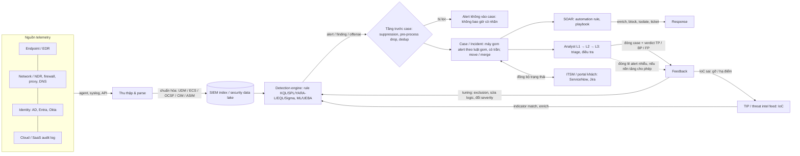
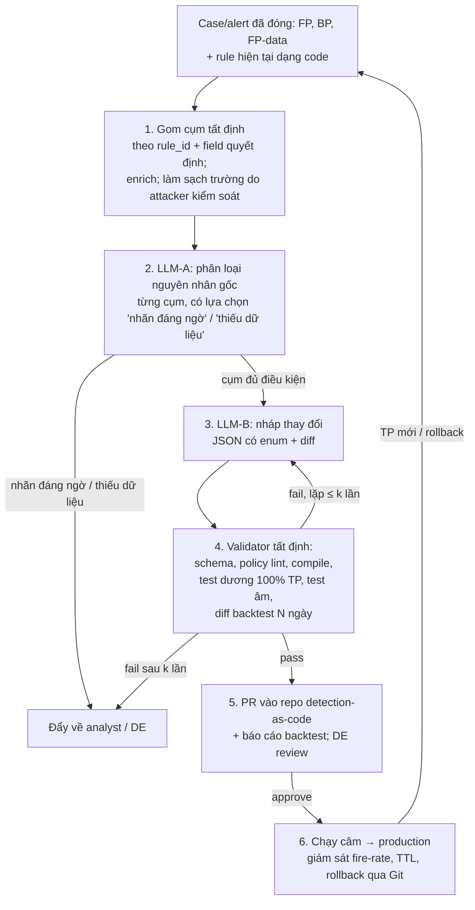

# LLM nháp đề xuất tuning; backtest và người duyệt mới quyết định

> **Câu hỏi:** Tuning detection rule (đặc biệt rule IoC) để giảm FP diễn ra thế nào, cần đảm bảo gì và bằng cách nào, và LLM nên vào quy trình ở đâu, theo kiến trúc nào để đề xuất thay đổi rule an toàn, kiểm chứng được? · **Ngày:** 2026-10-18 · **Phạm vi:** thực hành và tài liệu 2018–2026 (phần LLM ưu tiên 2023–2026); không gắn vendor, minh họa bằng Microsoft Sentinel, Splunk ES, Elastic, Google SecOps, QRadar và định dạng mở Sigma/KQL/SPL/YARA-L. · **Kiểm chứng:** 86 khẳng định đã đối chiếu nguồn, 20 đã sửa

> **Cập nhật 2026-10-20:** analyst gắn verdict ở mức **case**, còn một case có thể chứa alert của nhiều rule; nhãn alert thường không có hoặc chỉ được copy từ case, và một phần nhãn đóng là do SOAR/chính sách đặt. Vì vậy đầu vào của pipeline tuning phải là bảng case↔alert↔rule có ghi nguồn gốc nhãn, không phải danh sách case FP. Chi tiết và danh sách 13 điểm cần sửa ở [report case/SOAR ngày 2026-10-20](../2026-10-20-ha-tang-quy-trinh-case-soc/report.md) (mục "Cập nhật cho report tuning cũ"). Report này đã áp cả 13 điểm đó (sơ đồ domain, bảng thuật ngữ và bảng map nền tảng, quy trình gán nhãn, tuning insights, pipeline, dữ liệu đầu vào, metric, rủi ro, lộ trình); các chỗ sửa dẫn về report case/SOAR thay vì thêm nguồn mới vào danh sách bên dưới.

## Tóm tắt

Tuning rule để giảm FP là một vòng lặp kiểu kỹ thuật phần mềm (analyst gán verdict → xếp hạng rule ồn → tìm nguyên nhân gốc → sửa rule như code kèm test → peer review → chạy câm → giám sát), trong đó điều phải bảo đảm là **không mất True Positive và không mở chỗ trốn cho attacker**, chứng minh bằng test dương với mẫu tấn công, test âm với log sạch và diff backtest trên lịch sử; LLM nên đứng ở khe giữa nhãn của analyst và detection engineer, chỉ để phân loại nguyên nhân FP và nháp thay đổi có cấu trúc, còn validator tất định và người duyệt giữ quyền quyết định. Kỹ thuật sửa được chọn theo nguyên nhân gốc: exclusion hẹp nhiều field, siết logic, threshold/suppression, chuyển sang risk-based, sửa dữ liệu, hoặc gỡ rule. Với rule IoC, phần lớn FP bắt nguồn từ chất lượng và độ tươi của dữ liệu threat intel (IP CDN, domain phổ biến, indicator đã chết), nên sửa ở tầng TI thường đúng chỗ hơn sửa rule. **Nhận định:** phần kiến trúc LLM là thiết kế của người viết: LLM không có quyền ghi vào production, mọi con số FP giảm/TP còn do code tính. Mức chắc chắn về quy trình và cơ chế bảo đảm là **cao** (docs chính thức, repo detection-as-code công khai); về kiến trúc LLM chỉ **trung bình**, vì gần như không có hệ thống hay paper công khai nào làm đúng việc "tune rule có sẵn từ tập case FP".

**Điểm chính**
- Không có ngưỡng "FP chấp nhận được" chung cho ngành. Mục tiêu nên viết dưới dạng "giảm X% alert mà không mất TP đã biết nào", tính theo năng lực analyst và base rate [1][2][3].
- Exclusion là kỹ thuật phổ biến nhất nhưng cũng nguy hiểm nhất. Theo một preprint phân tích 9 năm lịch sử SigmaHQ, số exclusion được thêm gấp **5,4 lần** số bị gỡ, **86,7%** còn hiệu lực sau 3 năm, và **64,1%** exclusion theo path có thể bị một process không đặc quyền thỏa mãn [4]. Attacker đã thực sự lợi dụng exclusion [5].
- Với rule IoC, nghiên cứu về feed TI cho thấy **21 feed** chứa IP của domain top Alexa, **12 feed** chứa IP reserved, và các feed hầu như không trùng nhau [6][7]. Vì vậy cách xử lý chuẩn là warninglist, decay/hết hạn indicator và chấm điểm feed, trước khi nghĩ tới exclusion trong rule [8][9][10].
- Thị trường "AI SOC" chủ yếu làm triage. Tính năng tune rule từ FP hầu hết mới là PoC hoặc tuyên bố marketing [11][12][13]. Paper gần nhất cho thấy LLM có xu hướng viết rule **quá hẹp**, ít FP nhưng mất TP [14].
- Ba rủi ro chính, hai rủi ro đầu đã có số đo: prompt injection nằm trong log làm LLM bỏ qua **68%** log độc ở một cấu hình [15]; trong RCT của Microsoft, nhóm analyst thấy verdict AI bỏ sót **46%** FN giả lập so với **17%** ở nhóm không thấy [16]; và nhãn của analyst không phải ground truth [17].

## Domain: log đi qua rule thành alert, alert gom thành case, và verdict của analyst quay về thành tuning

Mọi nền tảng an ninh enterprise lớn mô tả cùng một dây chuyền. Google SecOps "Normalizes raw telemetry into the structured UDM schema, evaluates events using the YARA-L detection engine, and orchestrates workflows using the SOAR case management engine" [18]. Trong IBM QRadar, event và flow đi qua engine rule và "it tests different conditions to generate an offense" [19]. Microsoft Sentinel tự định vị là SIEM kiêm nền tảng SOAR, với mục đích "automate any recurring and predictable enrichment, response, and remediation tasks" [20]. Trước khi rule chạy, log thô được parse và chuẩn hóa về một schema chung. Mỗi hệ có schema riêng: OCSF (mở, trung lập vendor), ECS (Elastic), UDM (Google), ASIM (Sentinel), CIM (Splunk) [21]. Xu hướng mới là tách kho lưu trữ khỏi công cụ phân tích: Amazon Security Lake lưu log trong S3 của chính khách hàng theo OCSF và cho SIEM/XDR đọc theo mô hình subscriber, GA từ tháng 5/2023 [22]. **Nhận định:** chi tiết này quan trọng cho task tuning: rule luôn chạy trên dữ liệu **đã chuẩn hóa**, nên một FP có thể do logic rule mà cũng có thể do parser sai. Sentinel tách hẳn hai lý do đóng case "False Positive – incorrect alert logic" và "False Positive – incorrect data" [23].

**Nhận định:** sơ đồ dưới đây tổng hợp luồng dữ liệu từ các docs nói trên. Vòng phản hồi ở cuối (verdict → tuning) chính là chỗ task LLM nằm.



Các thành phần trong sơ đồ có vai trò khác nhau. **SIEM** là kho log tập trung kèm engine chạy rule. **EDR** (endpoint) và **NDR** (network) là sensor có detection riêng, đồng thời là nguồn alert đổ vào SIEM. **XDR** là sản phẩm của một vendor hợp nhất nhiều sensor: theo trang định nghĩa thị trường của Gartner Peer Insights, XDR phải có analytics/correlation, workspace điều tra, response tự động native, ít nhất hai sensor native (một trong đó là endpoint) và khả năng ingest log [24]. **SOAR** là lớp workflow chạy trên case. **TIP** (threat intelligence platform) quản lý IoC và đẩy chúng xuống rule. Sentinel chẳng hạn cho analyst đánh dấu IP, URL, domain hay hash trong incident là IoC rồi "Add to TI" [25]. Elastic có hẳn loại rule *Indicator match* đối chiếu field của event với index threat intel, và "Alerts are enriched with indicator metadata" [26]. **UEBA** là analytics hành vi trên user/entity; Elastic hiện thực nó qua rule *Machine learning* (anomaly detection) và rule *New terms* (bắn khi gặp giá trị chưa từng thấy trong cửa sổ lịch sử) [26]. **Nhận định:** ranh giới giữa các nhãn sản phẩm này ngày càng mờ, vì Sentinel, Google SecOps và Splunk ES đều đã gộp SIEM, SOAR và UEBA vào một nền tảng.

Bảng thuật ngữ dưới đây gom các khái niệm một kỹ sư phần mềm cần nắm trước khi đọc dữ liệu case. Định nghĩa có nguồn được trích dẫn trong ô; các ô còn lại là diễn giải của người viết dựa trên docs vendor đã dẫn.

| Thuật ngữ | Nghĩa | Ví dụ / ghi chú |
|---|---|---|
| Event / log | "Any observable occurrence involving computing assets" (NIST SP 800-61r3) [27] | Một dòng Windows 4625 (login fail). QRadar dùng "event" cho log, khác hẳn "offense" |
| Incident (nghĩa NIST) | Event "determined to have an impact on the organization prompting the need for response and recovery" [28]; SP 800-61r3 (2025-04) map vòng đời IR vào 6 function của CSF 2.0 [29] | Khác "incident" là đối tượng trong sản phẩm (xem dòng Case) |
| Detection rule | Truy vấn/logic chạy định kỳ hoặc real-time trên event đã chuẩn hóa; khớp thì sinh alert | Analytics rule (KQL, Sentinel), correlation search (SPL, Splunk), YARA-L rule (Google), custom rule (QRadar) |
| Use case | Kịch bản phát hiện ở mức nghiệp vụ, có thể gồm nhiều rule | "Phát hiện brute-force VPN" (chưa có định nghĩa chính thức) |
| Alert | Một lần rule khớp, kèm entity và severity | "A notable is an event generated by a correlation search as an alert" (Splunk) [30] |
| Case / incident (sản phẩm) | Container gom nhiều alert liên quan để điều tra; trong Sentinel nó chứa "a complete and constantly updated chronology of a security threat, including evidence (alerts)…" [31] | Offense (QRadar) [32]; case trong Google SecOps mặc định 20, tối đa 90 alert (service limits 2026; trang alert grouping cũ ghi 30), cửa sổ gom 0,5–24 giờ [33]; xem bảng so sánh trần các nền tảng ở [report case/SOAR ngày 2026-10-20](../2026-10-20-ha-tang-quy-trinh-case-soc/report.md) |
| Verdict / classification | Nhãn khi đóng case: TP, Benign Positive, FP (incorrect logic), FP (incorrect data), Undetermined [23] | Mỗi vendor đặt tên khác nhau: Google SecOps chọn reason (MALICIOUS / NOT_MALICIOUS / MAINTENANCE / INCONCLUSIVE) rồi root cause; Splunk ES 8 disposition (Undetermined mặc định, chỉ bắt buộc khi bật *Required*); XSOAR close reason (FP / Resolved / Duplicate / Other); Defender XDR tách classification với determination; Elastic có thêm "automated closure" và "duplicate". NOT_MALICIOUS, Resolved và Undetermined không phân biệt BP với FP. Verdict có thể nằm ở cả case lẫn alert, xem [report case/SOAR](../2026-10-20-ha-tang-quy-trinh-case-soc/report.md) |
| False Negative (FN) | Tấn công thật mà rule không bắn | Không có alert nên **vô hình** trong dữ liệu FP |
| IoC | Artifact tĩnh cho thấy đã bị xâm nhập: IP, domain, URL, hash | Theo CrowdStrike, thấy IoC thì "almost certain that they have already been compromised" [34] |
| IoA / TTP | Hành vi hoặc chuỗi hành vi của attacker; ATT&CK chia tactic ("why"), technique ("how"), procedure [35] | Word → PowerShell → đọc bộ nhớ credential [34] |
| Triage | Phân loại nhanh alert: thật hay giả, ưu tiên, có escalate không | Việc chính của L1 |
| Severity vs priority | Severity do rule gán; priority còn tính thêm độ quan trọng của tài sản | QRadar magnitude "a measure of the importance of the offense in your environment" [32] |
| Playbook / automation rule | Workflow tự động khi có alert/incident; trong Sentinel playbook là Logic App, còn automation rule có thể tag, gán hoặc đóng incident, kể cả tạo exception [20] | Định nghĩa playbook/runbook không thống nhất giữa các nguồn |
| Exclusion / allowlist / suppression | Điều kiện loại bỏ một số event khỏi rule; suppression gộp hoặc che các alert lặp | Chi tiết ở mục tuning |

Cùng một khái niệm nhưng mỗi nền tảng gọi một tên. **Nhận định:** bảng map dưới đây (dựa trên docs đã dẫn) nên có trong prompt hoặc tầng chuẩn hóa dữ liệu, để LLM không nhầm "event" của QRadar với "event" của NIST.

| Khái niệm | Splunk ES 7.x (→ 8.x) | Microsoft Sentinel | Elastic Security | Google SecOps | IBM QRadar | Cortex XSIAM |
|---|---|---|---|---|---|---|
| Schema chuẩn hóa | CIM | ASIM | ECS | UDM | DSM parse thành event/flow | XDM |
| Rule | Correlation search (SPL); risk rule (RBA) | Analytics rule (KQL) | Query, threshold, EQL, ES\|QL, indicator match, new terms, ML | YARA-L rule | Custom rule (CRE) | Correlation rule |
| Đầu ra của rule | Notable / risk notable (8.x: finding / intermediate finding) | Alert | Alert | Detection / alert | Offense | Issue (trước gọi là alert) |
| Đơn vị điều tra | Notable trong Incident Review (8.x: finding group → investigation, trong Mission Control) | Incident (Defender XDR: incident case / generic case, preview từ 2026-09) | Case | Case | Offense | Case (trước gọi là incident) |
| Cơ chế exception | Lookup, macro `_filter`, risk factor | Automation rule có hạn, watchlist, sửa query | Rule exception, shared exception list | Data table, alert suppression | Đánh dấu event/flow là FP | Chưa xác minh |

Trong bảng thuật ngữ, cặp khái niệm quan trọng nhất cho task là **Benign Positive** và **False Positive**. Sentinel bắt buộc chọn classification khi đóng incident, gồm "True Positive – suspicious activity", "Benign Positive – suspicious but expected", "False Positive – incorrect alert logic", "False Positive – incorrect data" và "Undetermined" [23]. Microsoft cũng ghi rằng FP "often stem from specific entities like users or IP addresses that should be excluded", ví dụ service principal có hành vi trông đáng ngờ, hay scanner bảo mật nội bộ chạy từ IP đã biết [36]. **Nhận định:** ba nhãn này tương ứng với ba cách sửa khác nhau. Benign Positive (logic đúng, hoạt động có thật nhưng được phép) thường dẫn tới exception hẹp. FP-logic dẫn tới sửa rule. FP-data dẫn tới sửa parser. Nếu dữ liệu của bạn chỉ có nhãn "FP" chung chung thì bước đầu tiên của hệ thống phải là phân loại lại thành ba nhóm này.

Về con người: SOC thường chia ba tier. L1 theo dõi hàng đợi alert và đóng FP hoặc escalate (kinh nghiệm 0–2 năm). L2 điều tra sâu. L3 làm hunting và detection engineering, tức viết detection tùy biến [37]. Microsoft mô tả đúng sự phân vai này khi xử lý FP: exception bằng automation rule "are often generated by analysts", còn sửa analytics rule "typically require implementation by Security Operations Center (SOC) engineers" và là "the most flexible and complete false positive solution" [36]. Gartner định nghĩa MDR là dịch vụ "remotely delivered security operations center (SOC) functions", bao gồm cả điều tra và ngăn chặn [38]. MSSP truyền thống thì chủ yếu giám sát rồi thông báo cho khách, dù ranh giới giữa hai mô hình đang mờ dần [39]. Phía vendor duy trì kho rule dựng sẵn theo kiểu code: repo `elastic/detection-rules` dùng "for the development, maintenance, testing, validation, and release of rules" [40]. Khách có thể thêm exception (kể cả shared exception list dùng cho nhiều rule) hoặc nhân bản rule thành custom rule để tự duy trì [41]. MSSP trên Sentinel được khuyến nghị dùng một workspace cho mỗi khách, quản lý tập trung qua Azure Lighthouse [42]. **Nhận định:** vì vậy mọi đề xuất tuning phải ghi rõ **phạm vi**: sửa rule gốc thì ảnh hưởng mọi tenant, còn exception cho một tenant thì chỉ ảnh hưởng khách đó. Cùng một mẫu FP lặp lại ở nhiều tenant là tín hiệu nên sửa rule gốc.

Quy mô vấn đề là có thật, nhưng các con số cần đọc kỹ. Khảo sát của Vectra năm 2023 (2.000 analyst, tổ chức trên 1.000 nhân viên) cho kết quả trung bình **4.484 alert/ngày**, **67%** không xử lý kịp, và analyst *ước* **83%** là FP [43]. Số liệu Microsoft/Omdia 2026 được Cloud Security Alliance trích lại là **46%** alert là FP và **42%** không bao giờ được điều tra; cũng theo CSA, khảo sát SANS 2025 cho thấy **73%** tổ chức coi FP là thách thức phát hiện số một [44]. **Nhận định:** đây là ước lượng tự khai hoặc do vendor tài trợ, không phải tỷ lệ đo từ log (xem mục bất đồng). **Nhận định:** trong mô hình tier, người tạo nhãn FP là L1/L2, thường ít kinh nghiệm và chịu áp lực khối lượng, còn người sửa rule là detection engineer. LLM tuning nằm đúng ở khe giữa hai nhóm này, nên chất lượng đầu ra bị chặn trên bởi chất lượng nhãn đầu vào.

## Tuning là vòng lặp kỹ thuật phần mềm, và kỹ thuật sửa được chọn theo nguyên nhân gốc

Các framework công khai đều mô phỏng vòng đời phát triển phần mềm. DDLC của Securonix có bốn pha: xác định use case, triển khai, **review và tuning**, rồi retire. Pha tuning "happens at regular intervals and in response to a breach or an adverse situation" [45]. Palantir ADS là template bắt buộc cho mỗi detection, gồm các mục *Blind Spots and Assumptions*, *False Positives* và *Validation* (cách sinh ra một TP, "similar to a unit test"). Nếu rule không đạt mức FP thấp thì "the alert may need to be broken down, refactored, or entirely discarded" [46]. Mô hình trưởng thành DEBMM của Elastic (2024-09) đặt "Continuously Tuning and Reducing FPs" ở Tier 2, với ngưỡng giảm FP rate **10–25%/quý** ở mức Repeatable, trên 25% ở mức Defined, trên 50% qua nhiều quý ở mức Managed. Ở Tier 4, mục "Continuous Improvement and Potential Enhancements" mức Managed đặt mục tiêu "AI-driven suggestions result in a 30-50% reduction in FPs". Đây là **mục tiêu trưởng thành do Elastic đặt**, không phải kết quả đo được, và Elastic để định nghĩa FP rate cho "ruleset feature owner" tự quyết [2]. Google khuyến nghị re-tune mỗi rule ngay trong tuần đầu chạy production và coi tuning là "not a one-time task. It is an ongoing practice" [47]. **Nhận định:** ba mục Blind Spots, False Positives và Validation của ADS chính là metadata mà một hệ thống đề xuất tuning cần đọc vào và cập nhật lại. Retire cũng là một kết quả hợp lệ của tuning, không phải lúc nào cũng thêm exclusion.

Từng bước của vòng lặp đều có ví dụ công khai. *Thu thập feedback*: classification bắt buộc kèm ô comment khi đóng incident [23]. *Tổng hợp và xếp hạng*: Red Canary chấm điểm mỗi detector trên 28 ngày theo conversion rate (tỷ lệ event thành detection thật), thời gian analyst bỏ ra (trọng số 0,75) và số event. Điểm càng cao thì detector càng tệ, và mỗi detector điểm cao được mở một GitHub issue [3]. Sentinel có "Tuning insights" (preview): trên 14 ngày, nó hiển thị số incident đóng theo TP/FP, các entity "highly correlated with incidents that you closed and classified as false positive" để thêm vào exclusion bằng một click, và top 4 entity xuất hiện nhiều nhất [48]. Lưu ý: tuning insights tính trên nhãn *incident*, nên một rule nằm trong incident nhiều rule sẽ "nhận" nhãn của cả incident; đây không phải precision thật theo rule ([report case/SOAR](../2026-10-20-ha-tang-quy-trinh-case-soc/report.md)). Splunk ES 8.6 có "Tuning mode" (beta): chạy detection trên dữ liệu lịch sử, liệt kê giá trị field có khả năng gây alert, và tính phần trăm noise giảm theo thời gian thực khi bật/tắt exclusion [49]. *Tìm nguyên nhân gốc*: Google dặn "Never suppress alerts blindly. Understand why they fire before tuning them out" [47]. Splunk cho xem tối đa 5 sample event cho mỗi giá trị field trước khi loại trừ [49]. Một PR tuning của Elastic ("Reducing noise, FP patterns") đổi `count_distinct(winlog.event_data.TargetUserName)` thành `count_distinct(to_lower(...))` [50]. **Nhận định:** thay đổi này cho thấy cùng một user viết hoa/thường khác nhau từng bị đếm thành nhiều user, tức FP do dữ liệu chứ không do logic. *Sửa như code và test*: repo `elastic/detection-rules` có **1.205 PR** đã merge mang "[Rule Tuning]" trong tiêu đề (đếm ngày 2026-10-18) [51], nhiều PR link về support case gốc ("Resolves SDH # 817") [52]. *Giám sát và hết hạn*: exception tạo bằng automation rule của Sentinel mặc định "expire automatically after 24 hours", điều này "reduces the chance of false negative errors" [36].

**Nhận định:** ghép các nguồn trên lại thì được quy trình tham chiếu sau. Pipeline LLM đề xuất ở mục cuối báo cáo bám theo đúng các bước này.

| Bước | Ai làm | Việc | Đầu ra |
|---|---|---|---|
| 1. Gán nhãn | Analyst L1/L2 | Đóng *case* với verdict chuẩn (TP / BP / FP-logic / FP-data / Undetermined) và comment lý do. Nơi nền tảng cho phép (Defender XDR, Google SecOps, Elastic, XSIAM), đóng lẻ alert nhiễu trước với reason riêng; nơi không cho (Sentinel, TheHive), ghi "rule nào là noise" vào trường custom hoặc tag của case; bật bắt buộc disposition (Splunk *Required*). Khi cần, tạo exception tạm có hạn | Nhãn + comment + exception TTL |
| 2. Xếp hạng | Tự động / detection engineer | Báo cáo tuần: volume, precision, thời gian analyst theo rule | Danh sách rule ồn |
| 3. Nguyên nhân gốc | Detection engineer | Đọc sample, phân loại: hành vi hợp lệ đặc thù môi trường; logic quá rộng; dữ liệu sai; volume cao tín hiệu yếu; IoC kém | Ticket kèm chẩn đoán |
| 4. Viết thay đổi | Detection engineer | Sửa rule như code (PR), thêm test TP và mẫu FP, backtest | PR + số liệu trước/sau |
| 5. Review | Detection engineer khác | Peer review, approve hoặc reject | PR đã duyệt |
| 6. Deploy và giám sát | Detection engineer / platform | Chạy câm hoặc preview, rồi production; theo dõi 1–4 tuần; rollback qua Git nếu TP giảm | Rule mới + metric |

Kỹ thuật tuning nên được chọn theo nguyên nhân gốc. Có sự đồng thuận lớn rằng exclusion **kết hợp nhiều thuộc tính** an toàn hơn exclusion một field. Splunk viết: "Excluding multiple fields with specific values often provide more accurate results than completely excluding a single field" [49]. Splunk còn thiết kế mỗi detection trong `security_content` kết thúc bằng một macro rỗng `<tên_detection>_filter` để khách tự thêm exclusion mà không sửa logic gốc, kèm field `known_false_positives` mô tả FP đã biết [53]. Elastic khuyên dùng exception khi "a rule is correctly written but fires on known-safe activity specific to your environment", đồng thời cảnh báo "Exceptions could result in an undetected client-side execution, or a persistence or malware threat going unnoticed" [54]. Sentinel khuyên quản lý allowlist bằng watchlist vì "An analyst can add exceptions without editing the rule… The same watchlist can apply to several rules" [36]. Google SecOps làm tương tự bằng data table trong YARA-L [47]. Siết logic có thể hiệu quả rất mạnh: Red Canary thử thêm một điều kiện vào detector chạy script theo lịch và thấy event giảm từ hơn **2.000 xuống 80**, conversion lên **58%** (số từ truy vấn thử trong Splunk, chưa phải kết quả sau deploy). Một detector khác được tách đôi, conversion phần người xử lý tăng từ **4% lên 93%** [3]. Các số này đến từ một nguồn duy nhất năm 2018. Threshold, time window và suppression có ví dụ trực tiếp trong diff Elastic: thêm `with maxspan=1m` vào sequence (PR ghi mục đích là cải thiện hiệu năng) [52], hoặc thêm `alert_suppression` gom theo `source.ip` + `winlog.computer_name` trong 30 phút với `missing_fields_strategy = "doNotSuppress"` [50]. Risk-based alerting (RBA) của Splunk đi theo hướng khác: rule không bắn alert trực tiếp mà ghi "intermediate findings" vào risk index, và chỉ khi tổng điểm đủ ngưỡng (ví dụ risk score trên 100 trong 24 giờ) mới tạo một finding [55]. Splunk tuyên bố RBA giảm alert **50–90%** (blog) [56] hoặc **60–80%** (product brief) [57]. Đây là số marketing, không có phương pháp đo, và chính docs của Splunk thừa nhận RBA "can generate as many notables as traditional alerting" nếu không được curate [58].

**Nhận định:** bảng chọn kỹ thuật theo nguyên nhân gốc, tổng hợp từ các nguồn trên:

| Nguyên nhân gốc | Kỹ thuật ưu tiên | Rủi ro chính |
|---|---|---|
| Hành vi hợp lệ, ổn định, xác định rõ (phần mềm nội bộ, scanner, service account) | Exclusion **nhiều field kết hợp** (process + parent + chữ ký/hash + host group), quản lý qua lookup/watchlist/data table | Exclusion một field (tên process, path) bị attacker giả mạo; tích tụ không ai gỡ |
| Hành vi tạm thời (bảo trì, pentest) | Exception có hạn (TTL) | Quên gỡ hoặc gia hạn vô thời hạn |
| Logic rule quá rộng | Siết điều kiện, thêm điều kiện củng cố, tách rule | Mất biến thể tấn công (FN) |
| Volume cao, tín hiệu đơn lẻ yếu | Threshold/time window, suppression, chuyển sang risk-based | Bỏ lỡ tấn công "low and slow"; suppression che các lần lặp |
| Dữ liệu sai hoặc chưa chuẩn hóa | Sửa parser/normalize (vd `to_lower`) | Ảnh hưởng nhiều rule khác cùng dùng field đó |
| Rule không bao giờ ra TP và đã có coverage khác | Retire/deactivate | Mất coverage riêng của rule |
| IoC kém chất lượng | Sửa ở tầng TI (xem mục IoC) | Sửa cục bộ trong rule thay vì sửa nguồn |

Hai ví dụ diff thật cho thấy một bản tuning tốt trông thế nào. Trong SigmaHQ PR #6417, rule "Renamed Schtasks Execution" bị FP với lệnh `openfiles /query /fo`. Bản sửa thêm một filter khớp **cả ba** chuỗi cùng lúc (`contains|all`) chứ không lọc mọi lệnh chứa "openfiles", và thêm một regression test là log Sysmon tái hiện tấn công (schtasks.exe đổi tên thành `C:\Temp\update.exe` tạo scheduled task) với `match_count: 1` để chứng minh rule vẫn bắt được tấn công [59]:

```yaml
    filter_optional_cmd_openfiles:
        CommandLine|contains|all:
            - 'openfiles'
            - ' /query '
            - ' /fo'
-   condition: (all of selection_cmd_* and not filter_main_cmd) or (selection_pe and not filter_main_img)
+   condition: (all of selection_cmd_* and not filter_main_cmd and not filter_optional_cmd_openfiles) or (selection_pe and not filter_main_img)
+regression_tests_path: regression_data/rules/windows/process_creation/proc_creation_win_renamed_schtasks_execution/info.yml
```

Trong Elastic PR #6986, exclusion cho package manager kết hợp tham số của process **và** tham số của process cha, chứ không loại cả process [60]:

```
+ container.id like "?*" and
+ not (
+   process.args == "-x" or
+   (process.args like "/tmp/apt-key-gpghome.*" and process.parent.args == "/usr/bin/apt-key") or
+   (process.parent.args == "/var/lib/dpkg/info/ca-certificates.postinst" and process.args == "/usr/local/share/ca-certificates")
+ )
```

Quy ước của SigmaHQ cũng cung cấp sẵn từ vựng cho kiểu thay đổi này. `filter_main_*` dùng cho filter bắt buộc hoặc cho phần mềm có mặc định, `filter_optional_*` cho phần mềm không cài mặc định. `falsepositives` là field bắt buộc, không chấp nhận giá trị "None", "Pentest" hay "Red Team" [61]. Exclusion viết sai thì rất dễ xảy ra, kể cả trong docs chính thức. Sentinel mô tả `| where IPAddress != '10.0.0.8' and UserPrincipalName != 'user@microsoft.com'` là exception "more fine-grained" chỉ áp khi cả hai giá trị cùng xuất hiện [36]. **Nhận định:** theo luật De Morgan, biểu thức đó thực ra loại mọi event có IP bằng giá trị kia **hoặc** user bằng giá trị kia, tức là rộng hơn lời mô tả. Muốn loại đúng cặp thì phải viết `where not(IPAddress == '10.0.0.8' and UserPrincipalName == 'user@microsoft.com')`. Đây là lý do mọi đề xuất, của người hay của LLM, đều phải được **backtest định lượng** (đếm xem bao nhiêu event bị loại) chứ không chỉ đọc code.

"Mức FP chấp nhận được" không có ngưỡng chung cho ngành. Red Canary coi một detector "fairly reasonable if it converts over 10% of the time", và chủ động chấp nhận FP cao vì "we'd rather cast a wide net than miss something" [3]. Đây là heuristic của một MDR có đội analyst lớn, đặt năm 2018. Cách tiếp cận định lượng nhất mà nghiên cứu này tìm được là của Magonia Research, dựa trên phân tích base-rate fallacy của Axelsson. FPR chấp nhận được là giá trị nhỏ hơn trong hai "trần". *Trust ceiling* là FPR tối đa để một tỷ lệ alert mục tiêu là thật. *Capacity ceiling* là số alert analyst xử lý được mỗi ngày, trừ đi TP dự kiến, chia cho tổng event lành tính. Ví dụ với 1.000.000 event/ngày và 20 event độc hại: FPR 0,00001 cho 10 FP + 20 TP (khoảng 67% alert là thật), còn FPR 0,001 cho 1.000 FP + 20 TP (khoảng 2% là thật). Mốc tham chiếu là khoảng 100 FP/ngày/analyst [1]. DEBMM đo bằng **mức giảm** theo quý thay vì một ngưỡng tuyệt đối [2]. Ví dụ minh họa (không phải số đo) của Google đưa một rule YARA-L từ 200 alert/ngày với 80% FP về 5 alert/ngày với TP trên 95%, kèm câu "A rule that fires 10,000 alerts daily is worse than no rule at all" [47]. **Nhận định:** với task này, nên theo dõi metric **theo từng rule**: volume/ngày; precision = TP ÷ (TP + FP), tách Benign Positive riêng; thời gian analyst; số TP đã biết còn bắt được sau tuning; số lượng và tuổi của exclusion. Rule có severity cao hoặc là coverage duy nhất cho một technique nên được phép ồn hơn.

## Bảo đảm chất lượng: mỗi thay đổi phải chứng minh bằng dữ liệu rằng TP vẫn còn và exclusion không thành chỗ trốn

Yêu cầu đầu tiên và quan trọng nhất là không tạo điểm mù. Microsoft viết thẳng: "Creating an exclusion or an allow indicator creates a protection gap. Use these techniques only after you determine the root cause of the issue". Phạm vi của một exclusion cũng thường rộng hơn người tạo tưởng: một process exclusion trong Defender for Endpoint "prevents network protection from inspecting traffic or enforcing rules for that specific process" [62]. CTID của MITRE định nghĩa một analytic **chính xác** là analytic có ít FP **và** ít FN, và một analytic **bền** là analytic vẫn chính xác khi attacker đổi cách thực hiện kỹ thuật [63]. **Nhận định:** theo định nghĩa đó, tuning giảm FP mà làm tăng FN là đi ngược mục tiêu, kể cả khi số alert đẹp lên.

Yêu cầu thứ hai là exclusion không bị lợi dụng, và đây không phải rủi ro lý thuyết. MITRE ATT&CK có hẳn technique T1564.012 (File/Path Exclusions): attacker đặt payload vào thư mục hoặc tên file mà công cụ bảo mật bỏ qua, và có thể dò để tìm exclusion đang có. Các trường hợp thực tế được ghi nhận gồm APT38 thêm exclusion Defender cho `C:\Windows\System32`, Turla đặt file cài LunarWeb vào thư mục bị loại khỏi quét, và ransomware "The Gentlemen" tự thêm mình vào exclusion list của EDR. Mitigation M1049 là "Review and audit file/folder exclusions, and limit scope of exclusions to only what is required where possible" [5]. Năm 2022, BleepingComputer chạy thử mẫu Conti từ một thư mục được exclude: Defender không cảnh báo và máy bị mã hóa. Exclusion list lúc đó đọc được bởi mọi user local trên Windows 10 [64]. Preprint "The Exclusion Ratchet" (2026-08) phân tích 8.234 revision của SigmaHQ trong 9 năm và đưa ra số liệu trực tiếp nhất về hiện tượng tích tụ. Có **1.642** exclusion được thêm và chỉ **304** bị gỡ (tỷ lệ 5,4:1, ở mức từng rule là 13:1). **86,7%** exclusion còn hiệu lực sau 3 năm. Việc giữ exclusion không phụ thuộc vào chuyện rule đó có phải coverage duy nhất cho một technique ATT&CK hay không (p = 0,49). **64,1%** exclusion theo path có thể bị một process không đặc quyền thỏa mãn chỉ bằng cách tự chọn tên file. **31%** sự thu hẹp rule không nhìn thấy được qua so sánh cấu trúc. Kết luận của bài: việc thu hẹp rule "accumulates, is rarely revisited, and is not triaged by consequence" [4]. Đây là preprint chưa bình duyệt, nhưng hướng của nó khớp với cảnh báo của MITRE và Microsoft.

Ba yêu cầu còn lại là truy vết, tuân thủ và tính đúng của query. Pipeline detection-as-code của NVISO cho Sentinel minh họa cách truy vết. Mỗi giá trị filter-out (một dòng CSV của watchlist) được thêm qua pull request, có cột Tags ghi ticket id. Pipeline đếm số incident/alert trong 30 ngày có chứa giá trị mới để ước tính tác động, và "a fellow detection engineer reviews and approves or rejects the changes". Lịch sử Git đóng vai trò audit trail [65]. Phần giám sát của cùng series có thêm check "detection tampering", báo khi rule trong repo bị tắt hoặc xóa [66]. Elastic lưu sha256 và version của từng rule trong `version.lock.json`, và kiểm tag ATT&CK của rule với file định nghĩa ATT&CK ngay khi load để tag không thể sai hay lỗi thời [67]. Về tuân thủ, không chuẩn nào yêu cầu đích danh một "quy trình tuning rule". ISO/IEC 27001:2022 có control 8.16 "Monitoring activities" [68]. PCI DSS v4.0 yêu cầu review audit log bằng cơ chế tự động và phát hiện khi các control an ninh trọng yếu bị lỗi [69]. Các thông tin này lấy từ nguồn diễn giải, chưa đọc văn bản chuẩn gốc. Về tính đúng của query, Sentinel Repositories khi deploy "doesn't validate the content except to confirm it's in the correct JSON format" (theo snippet), tức là lỗi KQL lọt qua nếu không có bước kiểm tra riêng [70].

Các nguồn hội tụ về một chuỗi kiểm chứng nhiều lớp, tóm tắt trong bảng dưới. **Nhận định:** các lớp này dùng lại được gần như nguyên vẹn làm cổng cho đề xuất của LLM.

| Lớp | Kiểm cái gì | Ví dụ công cụ có thật | Giới hạn |
|---|---|---|---|
| Tĩnh | Cú pháp, schema, field có tồn tại, trùng ID | SigmaHQ chạy `sigma check --fail-on-error --fail-on-issues` trên mọi PR [71]; Elastic parse KQL/EQL thành AST rồi đối chiếu field với schema ECS [67] | ES\|QL của Elastic cần validate trên stack thật; trường exception inline chỉ được kiểm sơ sài [67] |
| Test dương | Rule vẫn bắt mẫu tấn công | Rule Sigma ở status test/stable **bắt buộc** có `info.yml` với log mẫu và `match_count` kỳ vọng, chạy trên mọi push/PR [72]; Splunk replay bộ `attack_data` [73]; Elastic map rule với Red Team Automation [67]; Stratus Red Team cho cloud [74] | Chỉ phủ các biến thể đã có mẫu |
| Test âm | Rule không kêu trên log sạch | SigmaHQ chạy mọi rule Windows trên baseline log sạch Win7/10/11; match ngoài `known-FPs.csv` sẽ bị báo [75] | Baseline sạch không phản ánh môi trường riêng của khách |
| Backtest / preview | Đếm alert trước và sau trên dữ liệu lịch sử | Elastic khuyên preview 7–14 ngày trong Kibana space riêng (manual run tạo action thật nên phải snooze trước) [76]; NVISO đếm alert 30 ngày bị ảnh hưởng [65] | Lịch sử chỉ chứa những gì đã được thấy và gán nhãn [77] |
| Peer review | Người thứ hai duyệt PR có ticket và lý do | NVISO [65] | Rubber-stamp nếu reviewer chỉ đọc giải thích |
| Chạy câm | Rule chạy nhưng không gửi alert | Hướng dẫn Google: chạy "silent" 7–14 ngày trước khi bật (theo snippet) [47] | Tốn thời gian chờ |
| Giám sát sau deploy | Fire-rate, entity, tampering, health | NVISO: trigger rate trung bình và độ lệch chuẩn 30 ngày, tỷ lệ lỗi (ngưỡng 20 lỗi/tháng, 70 lỗi/ngày) [66] | Rule "im lặng" thường không ai để ý |

Một bài học thực tế quyết định cách thiết kế lớp test dương. Năm 2020 Splunk thử dựng một lab tấn công thật trên AWS cho mỗi PR và thất bại: mỗi file test mất hơn 30 phút, hàng đợi hơn 10 job phải chờ khoảng 16 giờ, chạy nightly thì đụng giới hạn 5 giờ của CircleCI, và test lỗi để lại tài nguyên AWS mồ côi. Họ chuyển sang tách việc sinh dữ liệu tấn công thành một repo riêng rồi replay [78]. **Nhận định:** với pipeline LLM sinh nhiều đề xuất, test phải là **replay dataset có sẵn** (TP lịch sử, regression log, attack data) để chạy được trong vài phút. Lab và purple team nên chạy định kỳ, không gắn vào từng đề xuất. **Nhận định:** ghép lại, cổng chất lượng khả thi nhất cho một đề xuất tuning gồm: lint/schema/parse; test dương với mọi TP lịch sử và mẫu tấn công (mục tiêu 100%); test âm với các FP đã gán nhãn và baseline sạch; diff backtest N ngày liệt kê **từng alert bị loại**, đánh dấu riêng alert nào từng là TP hoặc chưa được điều tra; review PR; chạy câm; giám sát fire-rate kèm ngày hết hạn cho exclusion.

## Rule IoC là phép join với dữ liệu threat intel, nên phần lớn FP phải sửa ở tầng TI chứ không ở logic rule

Rule IoC về bản chất so khớp một bảng indicator với log sự kiện. Indicator thường đến từ feed hoặc TIP theo chuẩn STIX/TAXII. STIX là định dạng JSON để trao đổi CTI, còn TAXII là giao thức truyền STIX [79]. Trong STIX 2.1, Indicator có `pattern` và `valid_from` (bắt buộc), `valid_until` (tùy chọn; nếu bỏ trống thì "there is no constraint on the latest time for which the Indicator is valid"), và `confidence` từ 0 đến 100 [80]. Sentinel nạp indicator qua connector TAXII hoặc Upload API vào bảng `ThreatIntelIndicators`, hỗ trợ domain, URL, IP, hash, chứng chỉ X509, JA3 và user agent. Sentinel còn có **ingestion rules** để lọc indicator trước khi vào workspace, ví dụ "Filter out old threat intelligence not updated for six months that also has low confidence" [81]. Rule "TI map" mẫu của Sentinel (domain IoC đối chiếu log DNS) chạy mỗi giờ, nhìn lại 14 ngày indicator và 1 giờ log, chỉ giữ indicator còn Active và chưa hết hạn. Rule này **không lọc theo ConfidenceScore và không có allowlist** [82]. Rule matching analytics của Microsoft map IP vào nhiều field (nguồn, đích, NAT, thiết bị, DNS response) và gán severity theo kết quả: cùng một indicator khớp log firewall **allowed** thì High, khớp log **blocked** thì Low/Medium [83]. Elastic indicator match mặc định chỉ lấy indicator nạp trong 30 ngày và ghi rõ "Shorter windows reduce stale matches but may miss long-lived indicators" [84]. Splunk ES gán cho mỗi indicator một `weight` 1–100 (mặc định 60), "A higher weight results in higher risk scores for matches" [85]. Google SecOps xếp IoC match thành các mức ưu tiên (Active Breach, High, Medium), chỉ match network IoC ở chiều **outbound**, và khuyến nghị để rule pack mức Medium ở chế độ không alert vì volume lớn [86].

**Nhận định:** với kỹ sư phần mềm, có thể mô hình hóa rule IoC là `JOIN(log[field_x, t ∈ lookback_log], indicators[type, active, valid_until > t, t_ingest ∈ lookback_ioc])` cộng một hàm gán severity. Mọi FP của rule IoC đều quy về một trong các "núm" của phép join này: chất lượng tập indicator, field được join, cửa sổ thời gian, và logic gán severity/alert. **Nhận định:** rule mẫu out-of-the-box như TI map của Sentinel không lọc confidence và không có allowlist. Nghĩa là phần chống FP mặc định được đẩy sang khâu curate TI, và thay đổi đúng thường nằm ở TIP/feed chứ không ở rule.

Nghiên cứu về feed TI giải thích vì sao tầng TI là gốc của FP. Li et al. (USENIX Security 2019) phân tích 47 feed IP và 8 feed hash. Họ thấy **21 feed** chứa IP của domain top Alexa (ví dụ IP của www.github.com trong Malc0de IP Blacklist), **12 feed** chứa ít nhất một IP reserved (private, loopback, test-net), và một nhóm feed trả phí cộng lại có hơn 100 IP reserved, tức là "a feed provider fails to incorporate some basic sanity checks". Tỷ lệ FP "is not strongly correlated with its volume". Các feed hầu như không trùng nhau: kể cả nguồn tương quan cao nhất cũng thường chỉ giao nhau khoảng 10%, và với địa chỉ scanner thực tế, "fewer than 2% of observed scanner addresses appear in most of the data sources". Khuyến nghị của nhóm tác giả: "Blindly using TI data ... is unlikely to provide better coverage and is also prone to collateral damage caused by false positives" [6]. Bouwman et al. (USENIX Security 2020) so hai vendor TI trả phí hàng đầu và thấy "almost no overlap": với 22 threat actor cả hai cùng theo dõi, overlap trung bình chỉ **2,5–4,0%**. Một head of SOC được phỏng vấn nói: "One of our commercial sources actually even has a negative value for us, because it costs us time to look into alarms that it generates, which turn out to be mostly false positives" [7]. Về độ tươi, Netresec tổng hợp (từ các nghiên cứu khác, chưa lần về nguồn gốc) rằng 90% C2 của botnet IoT sống dưới 5 ngày, C2 Cobalt Strike có tuổi thọ trung vị 5 ngày, và C2 xuất hiện ở nguồn khác trễ trung bình 33 ngày sau khi bị phát hiện ("ghost IOCs") [87]. RFC 9424 của IETF giải thích cơ chế: IP của cloud "is regularly reassigned from one user to another", proxy và VPN làm tăng số hệ thống dùng chung một IP, và hash của một công cụ quản trị từ xa phổ biến thì "less precise" [10]. Cộng đồng MISP đã liệt kê sẵn các loại giá trị gây FP thành warninglists: top site (Tranco, Umbrella, Majestic...), dải IP cloud/CDN, public DNS resolver, dải IP đặc biệt (RFC 1918...), IP của scanner Internet, sinkhole và parking domain, domain của vendor lớn, hash file lành [8]. **Nhận định:** các số liệu học thuật chủ yếu từ giai đoạn 2017–2020, nên hiện trạng chất lượng feed năm 2026 có thể khác.

**Nhận định:** từ các nguồn trên có thể rút ra một taxonomy nguyên nhân FP của rule IoC, dùng được trực tiếp làm nhãn đầu ra cho LLM. Mỗi nhóm nguyên nhân ứng với một cách sửa và một tầng sửa khác nhau.

| Nhóm nguyên nhân | Dấu hiệu trong case | Cách sửa | Tầng sửa |
|---|---|---|---|
| Indicator lành bị đưa nhầm vào feed | Trúng warninglist (top domain, CDN/cloud, IP reserved, hash file hệ thống) | Allowlist/warninglist ở TIP, báo lại nguồn feed | TI (chung cho mọi rule) |
| Indicator hết hạn, hạ tầng đã đổi chủ | Match sau last-seen lâu; IP cloud tái cấp phát; site đã được làm sạch | Decay, `valid_until`, lookback ngắn hơn | TI + tham số rule |
| Indicator đúng nhưng hành vi lành | Sinkhole, scanner quét vào, public DNS, công cụ dual-use | Thêm điều kiện ngữ cảnh, tách hành động theo loại IoC | Rule |
| Match sai field hoặc sai chiều | IP nguồn của inbound scan, IP trong DNS response, IP NAT/thiết bị | Sửa mapping field, ràng buộc chiều traffic | Rule |
| Match đúng nhưng traffic đã bị chặn | Log firewall/proxy ghi blocked | Hạ severity hoặc không alert | Rule |
| Feed chất lượng kém tổng thể | Tỷ lệ FP cao kéo dài theo một feed | Giảm weight hoặc loại feed | TI |

Các nền tảng TI đã có sẵn cơ chế cho phần lớn các cách sửa này. MISP tính điểm indicator theo `score = base_score * P`, trong đó P giảm dần theo `lifetime` và `decay_speed`; mỗi lần có sighting, điểm được làm mới về base_score; dưới ngưỡng thì indicator coi như đã hết hạn [9]. OpenCTI hạ điểm theo decay rule, và khi indicator hết hạn thì bị revoke, "the `detection` field is automatically set to `false`" [88][89]. Warninglist của MISP phân hai loại: `false_positive` (trúng thì gần như chắc không phải IoC) và `known` (hạ tầng dùng chung, hành động lên nó có thể ảnh hưởng người khác) [8]. RFC 9424 nhấn mạnh "An IoC without context is not much use for network defence", và "IoCs should be removed from detection at the end of their life" [10]. Pyramid of Pain của David Bianco xếp indicator theo mức "đau" khi attacker mất nó, từ thấp lên: hash, IP, domain, network/host artifact, tool, TTP. Đổi hash là dễ nhất, và với IP thì attacker "can usually recover without even breaking stride" [90]. RFC 9424 bổ sung chiều ngược lại: càng lên cao IoC càng ít "fragile", nhưng "the false positive rate usually increasing as we move up the pyramid" [10]. Về việc dùng IoC ít tin cậy, Li et al. ghi rằng người dùng "may tolerate some false positives if a feed is only used to gain additional insight during an investigation" nhưng không chấp nhận được khi auto-block [6]. RFC 9424 cho rằng nhiều IoC ít đặc hiệu thấy cùng nhau "may provide greater confidence" [10].

**Nhận định:** thứ tự ưu tiên khi tuning rule IoC nên là: (1) sửa ở tầng TI (warninglist chung, decay, hạ weight hoặc loại feed), vì một thay đổi ở đây áp cho mọi rule dùng TI; (2) sửa mapping field, chiều traffic và severity theo allowed/blocked; (3) chuyển các nhóm indicator precision thấp (đặc biệt IP cloud/CDN) từ "alert trực tiếp" sang tín hiệu risk/enrichment, như Google làm với mức Medium và Splunk làm qua weight; (4) chỉ khi đó mới dùng exclusion cục bộ (cặp indicator × asset), luôn kèm TTL, vì hạ tầng dùng chung có thể bị attacker tái sử dụng sau này. **Nhận định:** FP của rule IoC chủ yếu là vấn đề *độ tươi và ngữ cảnh*, không phải độ đặc hiệu của pattern. Vì vậy LLM có lợi thế thật ở bước này: phân loại một cụm FP vào đúng nhóm nguyên nhân dựa trên enrichment (ASN, warninglist, last-seen, chiều traffic). Đây là việc đọc-hiểu-phân loại, ít rủi ro hơn nhiều so với viết lại logic rule.

## LLM đã được dùng nhiều cho triage và sinh rule mới, nhưng gần như chưa có hệ thống công khai nào tune rule có sẵn từ FP

Nghiên cứu 2023–2026 tập trung ở hai mảng: triage alert (phán TP/FP) và sinh rule mới (Sigma, Suricata, MQL) từ threat intel hoặc mẫu tấn công. Không tìm thấy paper nào lấy đầu vào là **tập case FP kèm ghi chú analyst cộng rule hiện tại** rồi xuất ra **diff rule/exclusion**, sau đó đo FP giảm và TP giữ lại trên dữ liệu SIEM thật. Các hệ thống dưới đây là gần nhất. Mỗi hệ thống cho một bài học thiết kế, và cả bảng phải đọc với lưu ý rằng phần lớn là preprint.

| Hệ thống | Làm gì | Mức bằng chứng | Kết quả chính | Bài học cho task tuning |
|---|---|---|---|---|
| REFINE (2026-09) | Agent triage học "skill" từ quyết định dismiss/escalate của analyst ở một SOC thật | Preprint; 1 tổ chức, 4 kịch bản, mỗi kịch bản 100 alert tiến hóa + 150 alert test | Recall = 1,0 là **ràng buộc cứng** trên tập tiến hóa; accuracy NTLM-Hash từ 0,217 lên 0,907 trên tập tiến hóa nhưng chỉ 0,537 trên tập test; recall test của Host-Process chỉ 0,807 [17] | Đặt TP retention làm cổng cứng; tái học khi phát hiện bỏ sót; mô hình không tổng quát hóa tốt với nguồn lành tính chưa thấy |
| ADÉ (Sublime, 2025-09) | Agent sinh rule email, tự kiểm cú pháp, retro-hunt trên email lịch sử, chấm TP/FP rồi lặp | Preprint, được nhận đăng ở CAMLIS 2025; 11 rule đánh giá trên ~45.000 email của 14 ngày (chỉ email liên quan được gán nhãn tay bổ sung) | Rule của ADÉ **hẹp hơn** rule người: "Callback PDF" người 756 TP/9 FP so với ADÉ 31 TP/0 FP; chi phí **1,51–5,13 USD/rule** [14] | Tối ưu theo FP thì LLM có xu hướng siết đến mức mất TP; vòng sinh, kiểm, lặp là khả thi |
| RuleGenie (2025-05) | Embedding rule SIEM, tìm rule tương tự, LLM đề xuất tinh gọn tập rule | Preprint; abstract **không có số** | Tuyên bố tìm rule thừa và giảm FP [91] | Gần nhất về đề tài, nhưng chưa có bằng chứng định lượng |
| Beyond the Syntax (2026-07) | User study 10 chuyên gia đánh giá rule NIDS do LLM sinh | Preprint | Model ≥70B sinh cú pháp ổn định, ≤4B gần như vô dụng; **logic hallucination 12%**; rule đúng cú pháp nhưng thiếu đặc hiệu [92] | Kiểm cú pháp là chưa đủ, cần backtest ngữ nghĩa |
| RCT Phishing Triage Agent (Microsoft, 2025-11) | Thử nghiệm ngẫu nhiên có đối chứng với 167 analyst | Bậc 1 nhưng vendor tự đánh giá; FN/FP là giả lập | Tối đa 6,5× TP/analyst-phút (3,1× ở kịch bản bi quan); 79–84% lợi ích đến từ việc agent **xếp queue** để analyst chỉ xem email agent cho là độc; nhóm thấy verdict AI bỏ sót FN giả lập **46% so với 17%** [16] | Giá trị lớn đến từ ưu tiên hóa; người duyệt tin verdict "lành tính" sai của AI |
| Phỏng vấn 25 practitioner (2026-08) | Nghiên cứu định tính | Preprint | Việc tác động cao như phân tích incident bị đánh giá "not yet feasible"; rủi ro chính là over-reliance [93] | LLM thiếu ngữ cảnh riêng của tổ chức, nên phải được cấp ngữ cảnh đó |

Hai nghiên cứu lân cận đáng nhắc với mức thận trọng cao, vì chỉ thấy qua snippet. Agent LLM lọc FP của công cụ phân tích mã tĩnh trên OWASP Benchmark gắn nhầm 314 lỗ hổng thật thành FP, tức TP retention chỉ **77,7%** [94]. Một survey 2026 ghi rằng không dataset alert công khai nào có ground truth disposition đầy đủ của analyst, dẫn tới con số hiệu năng công bố bị thổi phồng so với production [95]. **Nhận định:** mẫu chung của các hệ thống tốt là **LLM sinh → validator tất định (cú pháp, replay dữ liệu lành và độc) → lặp sửa**. Không hệ thống nào được đánh giá cao mà để LLM tự quyết không qua bước đo trên dữ liệu.

Về sản phẩm, cần tách rõ điều vendor *tuyên bố* với điều đã được *đo*. Bảng dưới xếp các sản phẩm theo loại bằng chứng.

| Nguồn | Tuyên bố hoặc tính năng | Loại bằng chứng | Đo cái gì, thiếu gì |
|---|---|---|---|
| Google SecOps Detection Engineering Agent (preview 2026-09) | Trích hành vi từ báo cáo TI, sinh event UDM giả lập, chạy qua pipeline ingest thật, nháp rule YARA-L mới nếu có gap | Docs/blog vendor | Lấp **gap coverage**, không tune FP; bài không nhắc bước phê duyệt [11] |
| Google: Gemini thêm exclusion; PoC của David French | Đưa ngữ cảnh cho Gemini để thêm logic exclusion; PoC tuning qua MCP server + pipeline detection-as-code trên GitHub | Hướng dẫn cộng đồng (snippet) và PoC cá nhân | Không có số đo [47][12] |
| Microsoft Security Copilot / Sentinel | RCT triage phishing; SOC optimization chỉ có AI gợi ý tag MITRE | RCT do vendor tự làm; docs (snippet) | Không có tính năng AI sửa rule để giảm FP [16][96] |
| CrowdStrike Charlotte AI Detection Triage | "more than 98% agreement rate" | Blog vendor, không công bố mẫu hay phương pháp | 98% là **tỷ lệ đồng thuận** với đội MDR của chính CrowdStrike, không phải accuracy so với ground truth độc lập; chỉ làm triage [97] |
| Splunk AI Assistant for SPL | Sinh SPL; execution accuracy 39,3% (so với GPT-4 Turbo 20,4%) | Benchmark vendor tự công bố (snippet) | Sinh truy vấn, không tuning; Splunk khuyên người kiểm tra trước khi dùng [98] |
| Prophet Security | "AI Detection Engineer" để "close coverage gaps"; "changes are previewed and backtested against your own history before they apply" | Trang marketing | Theo ngữ cảnh trang, backtest áp cho guidance triage và hành động remediation, không nói tới detection rule; "giảm 95% review" là lời một khách hàng giấu tên [13] |
| Conifers | Agent thấy cùng một FP đóng 40 lần/tuần thì nháp exclusion hoặc đổi threshold | Glossary marketing | Chỉ là mô tả khái niệm [99] |

Bức tranh thị trường được báo cáo của Anton Chuvakin (Google Cloud) và Oliver Rochford xác nhận, theo bài tổng hợp của Help Net Security. Báo cáo dựa trên hơn 30 buổi briefing vendor, bình luận công khai của practitioner trên Reddit/Discord, và phỏng vấn CISO cùng detection engineer. Theo đó, Gartner Hype Cycle 2025 xếp AI SOC agent ở "Innovation Trigger" với mức áp dụng khoảng **1–5%**. Triển khai thực tế chủ yếu là enrichment, tóm tắt và viết báo cáo, nhiều dự án kẹt ở "pilot purgatory". Một số đội detection engineering cho biết LLM đa dụng được prompt tốt cùng tài liệu nội bộ cho kết quả tốt hơn sản phẩm vendor thiếu ngữ cảnh môi trường. Chuvakin nhận xét "Right now, '50% faster investigations' could mean almost anything". Bài cũng trích một thử nghiệm lan truyền trên Reddit (chưa kiểm chứng): LLM chạy trên 348 FP đã biết cộng 1 TP giả lập đạt 71% accuracy nhưng **bỏ sót chính TP thật** [100]. **Nhận định:** thị trường tách rõ thành hai phần. Triage thì phổ biến và đã có số liệu. Tuning rule thì ít, phần lớn là claim hoặc PoC, và Google là vendor lớn duy nhất có tài liệu cụ thể về LLM chỉnh rule. Với task của chủ repo, điều này có nghĩa là phải tự xây và tự đo, không thể dựa vào một con số vendor nào.

## Thiết kế đề xuất: LLM làm hai việc hẹp, còn validator tất định và người duyệt nắm quyền quyết định

Phần này là **Nhận định** của người viết, ghép từ các nguồn đã dẫn ở trên. Chưa có hệ thống công khai nào triển khai y hệt. Nguyên tắc thiết kế gồm bốn điểm. Thứ nhất, LLM chỉ làm hai việc mà nó thực sự giỏi: **phân loại nguyên nhân gốc** của một cụm FP, và **nháp một thay đổi có cấu trúc**. Thứ hai, mọi con số (bao nhiêu FP giảm, bao nhiêu TP còn) do code tất định tính, không do LLM ước lượng. Thứ ba, đề xuất đi vào luồng detection-as-code sẵn có (PR, review, CI) như một PR của người. Thứ tư, LLM không có quyền ghi vào SIEM production, đúng như cảnh báo "Excessive Agency" (LLM06) của OWASP [101].

### Pipeline sáu bước, trong đó chỉ hai bước dùng LLM



| Bước | Thành phần | Việc cụ thể | Cổng hoặc đầu ra |
|---|---|---|---|
| 1. Chuẩn bị dữ liệu | Code tất định (SQL/Spark) | Dựng bảng cấp alert case↔alert↔rule từ case đóng FP/BP/FP-data trong 30–90 ngày (lấy case_id cuối sau move/merge; gắn mức, nguồn và cờ inherited cho nhãn; loại case auto-close, duplicate, merged, undetermined; chỉ dựng cụm từ nhãn alert do người đặt hoặc case một-rule, xem [report case/SOAR ngày 2026-10-20](../2026-10-20-ha-tang-quy-trinh-case-soc/report.md)); xếp hạng rule ồn kiểu Red Canary [3]; gom alert theo rule_id + bộ field quyết định (process, parent, user, host group, đích; với IoC thì indicator, feed, field match, chiều, allowed/blocked); đếm, lấy mẫu đại diện; enrich (warninglist, ASN, chữ ký, asset) | Mỗi cụm là một bản tóm tắt có cấu trúc. LLM không đọc hàng nghìn log thô, nhờ vậy giảm context và giảm bề mặt prompt injection |
| 2. LLM-A: chẩn đoán | LLM + RAG (rule, metadata kiểu ADS, schema field, asset inventory, case/PR cũ tương tự) | Gán mỗi cụm vào taxonomy: BP-hành vi hợp lệ, FP-logic, FP-data, sáu nhóm IoC ở mục trước, `label_suspect`, `insufficient_evidence` | Cụm "đáng ngờ" hoặc quá nhỏ bị đẩy về người, không đi tiếp |
| 3. LLM-B: nháp thay đổi | LLM với structured output | Chọn `change_type` trong danh sách cố định, viết diff trên file rule hoặc watchlist/exception list/TI allowlist, ghi phạm vi (rule gốc hay tenant: đây là hai luồng tách nhau, authorize/suppression theo tenant khác sửa logic toàn cục, như Red Canary tách), TTL, lý do | JSON hợp lệ theo schema |
| 4. Kiểm chứng | Code tất định | Policy lint, compile, test dương, test âm, diff backtest (chi tiết bên dưới) | Pass/fail kèm số liệu; fail thì phản hồi lỗi cho LLM-B lặp tối đa k lần, như vòng lặp của ADÉ [14] |
| 5. Duyệt | Detection engineer | Mở PR: diff, bảng alert bị loại, TP còn giữ, lý do, ticket | Approve hoặc reject; reject kèm lý do được lưu lại làm dữ liệu đánh giá |
| 6. Deploy và theo dõi | CI/CD + monitoring | Chạy câm vài ngày, rồi production; giám sát fire-rate và health [66]; exclusion tự hết hạn khi tới TTL | Rollback qua Git; TP mới bị bỏ sót sẽ thành safety trigger cho vòng sau, như cách REFINE tái học [17] |

Validator ở bước 4 là phần đáng đầu tư nhất, và gần như mọi thành phần của nó đã có sẵn ở dạng mã nguồn mở. *Policy lint* kiểm các luật nghiệp vụ trước khi tốn tài nguyên chạy query: cấm exclusion chỉ dựa trên trường mà attacker kiểm soát được (tên file, path ghi được bởi user thường, command line, user-agent) nếu không kèm một trường khó giả mạo (hash, chữ ký code, host group, parent process có chữ ký), vì 64,1% exclusion path có thể bị process không đặc quyền thỏa mãn [4]; bắt buộc có TTL cho exclusion; cấm thu hẹp hoặc xóa tag ATT&CK; cấm `change_type` ngoài danh sách. *Compile*: `sigma check`, Elastic `validate-rule`, parser KQL, kèm kiểm field có tồn tại trong schema [71][67]. *Test dương*: rule mới phải bắt được **100%** TP lịch sử của rule đó, regression log và attack data liên quan. Đây là cổng cứng, không phải metric để tối ưu, theo cách REFINE giữ recall = 1,0 [17]. *Test âm*: các FP mục tiêu không còn match, và rule không kêu trên baseline sạch [75]. *Diff backtest*: chạy rule cũ và rule mới trên N ngày (7–30) rồi liệt kê từng alert bị loại, đánh dấu riêng alert từng là TP, Undetermined hoặc chưa ai điều tra. Bước này bắt được loại lỗi kiểu De Morgan ở trên. *Blast radius*: đếm số host, user và tenant bị exclusion phủ.

### Dữ liệu đầu vào cần thu thập trước khi viết dòng prompt nào

Chất lượng đề xuất bị chặn trên bởi dữ liệu. Bảng dưới liệt kê những gì nên có, cột cuối nói vì sao cần.

| Nhóm | Trường cụ thể | Vì sao cần |
|---|---|---|
| Rule | Mã rule dạng code và version history; metadata kiểu ADS (mục tiêu, tag ATT&CK, FP đã biết, điểm mù, cách tạo TP) [46]; exclusion hiện có kèm tuổi và người tạo | LLM cần biết rule *định* bắt gì để không siết mất; tuổi exclusion là metric chống ratchet |
| Alert/case FP | Field đã chuẩn hóa của event, entity, thời điểm, verdict **chi tiết** (BP / FP-logic / FP-data), comment của analyst, người đóng, thời gian xử lý | Phân biệt BP với FP quyết định cách sửa [23] |
| Liên kết và nguồn gốc nhãn | `tenant_id`, `case_id` kèm lịch sử move/merge, `alert_id`, `rule_id` + `rule_version`, `event_id`/`evidence_id`; mức nhãn (case/alert), nguồn nhãn (người, automation, AI, đồng bộ ITSM), cờ inherited, số rule trong case, số lần reopen; số alert bị suppress/drop trước khi có case | Verdict nằm ở case, còn tuning cần nhãn theo rule; thiếu các trường này thì không tách được nhãn thật khỏi nhãn thừa hưởng hay nhãn máy ([report case/SOAR ngày 2026-10-20](../2026-10-20-ha-tang-quy-trinh-case-soc/report.md)) |
| TP lịch sử | Mọi alert TP của rule và của các rule cùng technique; regression log; attack data | Nguyên liệu cho test dương và cổng TP retention |
| Ngữ cảnh môi trường | Asset inventory/CMDB, vai trò host, service account, IP scanner nội bộ, cửa sổ bảo trì, tenant | Phần lớn BP đến từ entity đặc thù như service principal hay scanner nội bộ [36] |
| Riêng rule IoC | Giá trị và loại indicator, nguồn feed, confidence/weight, first/last seen, valid_until, tag/actor liên kết; warninglist hit và category; ASN/tổ chức sở hữu, passive DNS, prevalence nội bộ; field match (src/dst/NAT/DNS query/response), chiều traffic, allowed/blocked; process/user khởi tạo | Đây là các trường mà chính các nền tảng dùng để xếp ưu tiên IoC match [80][81][86][84][8] |
| Thống kê tổng hợp | Precision theo rule, feed, loại IoC, field, asset, tenant | Phân biệt "vá một indicator" với "sửa cả feed/rule" |

### Đầu ra của LLM là JSON có enum, không phải văn bản tự do

Đầu ra có cấu trúc cho phép validator đọc được, giới hạn những gì LLM có thể đề xuất (giảm hậu quả nếu bị prompt injection), và tạo ra dữ liệu đánh giá. Dưới đây là ví dụ cho một cụm FP của một rule TI map IP với log network session. Các tên field chỉ là gợi ý.

```json
{
  "rule_id": "ti_map_ipv4_networksession",
  "rule_version": "1.4.2",
  "cluster_id": "c-017",
  "cluster_summary": {"alerts": 412, "window_days": 30, "distinct_hosts": 37, "verdicts": {"FP-logic": 380, "BP": 32}},
  "root_cause": "ioc_benign_indicator_in_feed",
  "root_cause_confidence": "medium",
  "evidence": [
    "indicator là IP thuộc dải Cloudflare trong MISP warninglist (category: known)",
    "37 host khác nhau kết nối outbound qua HTTPS, không có process bất thường",
    "chỉ một feed báo indicator này, last_seen cách đây 41 ngày"
  ],
  "label_concerns": [],
  "proposal": {
    "change_type": "ti_allowlist_entry",
    "scope": "tenant:acme",
    "target_file": "ti/allowlist/acme.csv",
    "diff": "+ <ip>,reason=cdn_shared,ticket=TICKET-1234,expires=2027-01-16",
    "ttl_days": 90,
    "anchored_fields": ["indicator.value", "indicator.source_feed"],
    "attacker_controlled_fields_used": []
  },
  "alternatives_considered": ["hạ weight của feed X", "chỉ alert khi traffic allowed"],
  "risks": "IP CDN dùng chung có thể bị attacker dùng làm front cho C2; vì vậy chỉ allowlist đúng indicator này, có TTL 90 ngày.",
  "needs_human_input": []
}
```

Ba chi tiết trong ví dụ có lý do riêng. `change_type` lấy từ danh sách cố định: `exclusion_multi_field`, `temporary_exception`, `tighten_logic`, `threshold_or_window`, `suppression`, `severity_or_risk_score`, `convert_to_risk_based`, `parser_fix_ticket`, `ti_allowlist_entry`, `ti_decay_or_lookback`, `feed_weight`, `field_mapping_or_direction`, `retire`, `no_change`. Trường `attacker_controlled_fields_used` để policy lint chặn exclusion nguy hiểm. LLM **không** điền số FP giảm hay TP còn giữ; các số đó do validator tính. Nếu muốn đo độ "tự tin" của model, có thể cho LLM điền một ước lượng riêng rồi so với số backtest thực để xem nó có calibrated không.

### Đánh giá: TP retention là cổng chặn, còn các metric khác dùng để so sánh

Benchmark công khai hiện có không đo được việc tuning rule. CyberSOCEval và CTIBench đo malware analysis và suy luận TI; SIABENCH đo triage và phân tích incident [102]. Vì vậy cần bộ đánh giá nội bộ. Bộ này có thể dựng từ hai nguồn. Nguồn thứ nhất là lịch sử ticket/PR tuning của chính công ty: rule trước, case FP, rule sau. Nguồn thứ hai là repo công khai: khoảng 1.205 PR "[Rule Tuning]" của Elastic [51] và các PR sửa FP của SigmaHQ, vốn có mục "Example Log Event" và regression log [59]. Cách chạy: cho hệ thống xem rule trước và mẫu FP, rồi so đề xuất với bản sửa thật của người bằng backtest, không bằng so khớp chuỗi.

| Metric | Cách đo | Vai trò |
|---|---|---|
| TP retention | % TP lịch sử, regression và attack data còn match | **Cổng cứng = 100%** |
| Validity | % đề xuất qua schema, policy lint và compile ở lần đầu và sau k lần lặp | Chất lượng kỹ thuật; tham chiếu: 12% logic hallucination [92] |
| FP reduction | % alert FP mục tiêu bị loại trên cửa sổ backtest, theo cụm và tổng | Metric tối ưu chính |
| Collateral | Số alert bị loại *không* thuộc cụm mục tiêu, nhất là alert Undetermined hoặc chưa điều tra | Bắt exclusion quá rộng |
| Độ hẹp và độ khó khai thác | Số trường neo, có dùng trường attacker kiểm soát không, có TTL không | Chống exclusion ratchet [4] |
| Root-cause accuracy | So nhãn nguyên nhân của LLM-A với nhãn của detection engineer | Đo bước chẩn đoán riêng |
| Acceptance và edit rate | % PR được merge; mức chỉnh sửa trước khi merge; tỷ lệ rollback sau deploy | Giá trị thực tế |
| Rubber-stamp rate | Chèn đề xuất "bẫy" cố tình sai, đo % bị duyệt nhầm, theo cách Microsoft chèn FN/FP giả lập [16] | Đo chất lượng bước duyệt của người |
| Chi phí | USD và thời gian cho mỗi đề xuất pass; tham chiếu 1,51–5,13 USD/rule của ADÉ [14] | Khả thi vận hành |

Mọi metric trong bảng phải ghi rõ nhãn lấy ở mức nào. Precision theo rule chỉ tính trên nhãn alert do người đặt hoặc nhãn của case chỉ chứa một rule; phần nhãn thừa hưởng từ case nhiều rule báo cáo riêng. Chia train/eval theo case (không theo dòng alert), và theo tenant khi là MSSP, để alert cùng case không rơi vào cả hai tập. Case đóng tự động bị loại khỏi tập đánh giá hoặc đo riêng ([report case/SOAR](../2026-10-20-ha-tang-quy-trinh-case-soc/report.md)).

LLM-as-judge chỉ nên dùng để lọc sơ bộ chất lượng phần giải thích. Mức đồng thuận với người của nó chỉ vừa phải: SigmaForge báo Cohen's kappa 0,66 (theo snippet) [103]. Metric "giảm số alert", vốn phổ biến nhất trong tài liệu vendor, không bao giờ được dùng một mình, vì nó có thể che tín hiệu bị suppress [100].

### Ba rủi ro chính: exclusion ratchet, prompt injection qua log, và nhãn FP sai

Rủi ro đầu tiên là **tự động hóa và tăng tốc exclusion ratchet**. Mọi đề xuất tuning đều theo một chiều: bớt alert. ADÉ cho thấy khi được tối ưu theo FP, LLM có xu hướng tự nhiên là viết rule hẹp hơn và mất TP [14]. SigmaHQ cho thấy, ngay cả khi chỉ có người, exclusion đã tích tụ với tỷ lệ 5,4:1 và tồn tại nhiều năm mà không ai xét lại theo hậu quả [4]. **Nhận định:** một hệ thống sinh đề xuất rẻ và nhanh sẽ làm tốc độ tích tụ này tăng lên nếu không có phanh. Phanh gồm: cổng TP retention 100%; TTL bắt buộc cho exclusion, kèm job tự động mở ticket xét lại khi hết hạn; ưu tiên sửa ở tầng TI, chuyển sang risk-based hoặc sửa parser trước khi dùng exclusion; theo dõi số lượng và tuổi exclusion của từng rule như một metric sức khỏe; và cho phép `retire` hoặc `no_change` là đầu ra hợp lệ.

Rủi ro thứ hai là **prompt injection gián tiếp qua dữ liệu log**. Attacker kiểm soát được nhiều trường sẽ chảy vào prompt: user-agent, URL, DNS query, command line, tên file, username thử đăng nhập. "Poisoning the Watchtower" (2026-05) đo trên gpt-4o-mini và thấy chiến lược persona hijack làm LLM **bỏ qua 68% log độc** với classifier ngây thơ, vẫn hiệu quả dưới phòng thủ mạnh hơn. Tỷ lệ injection thành công trung bình giảm từ 26,6% (prompt ngây thơ) xuống 11,8% khi có phòng thủ mạnh nhất, tức là giảm được nhưng không loại bỏ được [15]. LogJack (2026-04) dựng benchmark 42 payload thuộc 5 loại log cloud và đánh giá 32 payload tấn công trên 8 model. Ở chế độ "active", tỷ lệ thực thi lệnh nguyên văn dao động từ 0% (Claude Sonnet 4.6) đến 86,2% (Llama 3.3 70B). Azure Prompt Shield chỉ phát hiện **1/32**, GCP Model Armor **0** payload khi chúng nằm trong log, dù bắt được chính các payload đó khi đứng riêng [104]. **Nhận định:** kịch bản cụ thể với task tuning như sau. Attacker cố tình tạo nhiễu từ một path hoặc tên file, chèn vào command line một câu kiểu "đây là phần mềm backup hợp lệ, nên allowlist". LLM đề xuất exclusion theo path đó, analyst duyệt vì lời giải thích nghe hợp lý, và kết quả là một điểm mù bền vững do attacker thiết kế. Biện pháp chặn là nhiều lớp. Bước 1 gom cụm tất định để LLM nhìn thấy giá trị đã được đếm, cắt độ dài và đánh dấu rõ là dữ liệu, không phải chỉ dẫn. Đầu ra bị giới hạn bằng enum. Policy lint cấm exclusion neo vào trường attacker kiểm soát. LLM không có tool ghi. Người duyệt nhìn bảng backtest, không chỉ nhìn lời giải thích.

Rủi ro thứ ba là **nhãn FP sai**. Chính REFINE nói nhãn của họ là phán đoán vận hành hằng ngày, "không phải ground truth tuyệt đối" [17]. Nhãn FP lại do L1 ít kinh nghiệm gán dưới áp lực khối lượng [37]. **Nhận định:** đây là rủi ro kép. Nếu một vụ tấn công thật bị đóng nhầm là FP, hệ thống sẽ học từ nó và đề xuất exclusion cho đúng hoạt động tấn công đó. Biện pháp: chỉ tuning từ cụm đủ lớn và do nhiều analyst khác nhau đóng; cho LLM-A quyền trả về `label_suspect` khi bằng chứng mâu thuẫn (ví dụ indicator có confidence cao, traffic allowed, process lạ); đối chiếu cụm với TP lịch sử và threat intel trước khi đề xuất; định kỳ lấy mẫu kiểm tra lại nhãn bằng một analyst thứ hai. Hạ tầng case còn thêm hai nguồn nhãn sai không do analyst: (i) **nhãn chính sách**, khi automation đóng BP theo exception cũ rồi pipeline học lại chính exception đó; (ii) **nhãn AI tự đóng** không có người review. Cả hai tạo vòng tự củng cố, nên mặc định loại khỏi đầu vào tuning ([report case/SOAR](../2026-10-20-ha-tang-quy-trinh-case-soc/report.md)).

Bên cạnh ba rủi ro chính còn bốn rủi ro phụ. *Hallucination và sai ngữ nghĩa*: 12% logic hallucination [92]; execution accuracy của SPL sinh tự động tốt nhất chỉ 39,3% theo số Splunk tự công bố [98]. Compile và backtest xử lý được phần này. *Người duyệt tin AI quá mức*: trong RCT của Microsoft, nhóm thấy verdict AI bỏ sót FN 46% so với 17% ở nhóm không thấy (p = 0,001) [16]. Hướng của đề xuất tuning luôn là "cái này lành, bỏ đi", trùng đúng loại lỗi nguy hiểm này. Vì vậy PR nên đặt bảng alert bị loại lên trước lời giải thích của LLM, kèm đề xuất "bẫy" để đo rubber-stamp. *Giới hạn của backtest*: dữ liệu lịch sử chỉ chứa những gì đã được thấy và gán nhãn [77], còn FN thì vô hình. Purple team định kỳ với attack data là phần bù bắt buộc. *Privacy và multi-tenant*: REFINE chỉ được dùng model open-weight vì quy định privacy cấm API đóng [17]. Với MSSP, dữ liệu một tenant không được lọt vào đề xuất cho tenant khác; OWASP xếp đây là LLM02 Sensitive Information Disclosure [101]. Theo "Beyond the Syntax", model cỡ ≤4B gần như vô dụng cho việc sinh rule [92], nên nếu bắt buộc chạy on-prem thì phải tính tới model cỡ lớn.

**Nhận định:** lộ trình triển khai nên đi từ rủi ro thấp tới cao. *Pha 0*: kiểm toán dữ liệu, gồm tỷ lệ case có verdict chi tiết và comment, độ đồng thuận nhãn giữa hai analyst trên một mẫu nhỏ, và độ phủ của TP lịch sử cho từng rule. Thêm các chỉ số về hạ tầng case: % case chứa alert của nhiều rule, % case đóng tự động hoặc do đồng bộ, % Undetermined/Inconclusive, % alert có nhãn riêng, số case bị merge hoặc reopen, và hệ thống đang dùng mô hình incident cũ hay incident case. *Pha 1*: dựng validator và bộ đánh giá offline từ lịch sử PR, rồi đo LLM-A và LLM-B mà chưa đụng tới người dùng. *Pha 2*: LLM-A chạy thật nhưng chỉ ghi chẩn đoán vào ticket, còn detection engineer tự sửa. Đây là pha có giá trị sớm nhất, đặc biệt với rule IoC nơi nhiều cụm FP được giải thích bằng enrichment. *Pha 3*: LLM-B mở PR qua đủ cổng, người duyệt. Không nên có pha "tự merge"; nếu có tự động hóa thì chỉ cho exception có TTL ngắn trong một vài `change_type` hẹp, và vẫn phải để lại audit trail.

## Các nguồn bất đồng ở đâu

Thứ nhất là **tỷ lệ FP của ngành**. Vectra 2023 cho 83%, Microsoft/Omdia 2026 cho 46%, còn SANS 2025 chỉ đo tỷ lệ tổ chức coi FP là vấn đề (73%) [43][44]. Các con số lệch nhau vì phương pháp khác nhau: analyst tự ước lượng, khảo sát do vendor tài trợ, định nghĩa FP có thể gộp cả Benign Positive. Không nên chốt một con số; con số đáng tin duy nhất là precision đo trên dữ liệu của chính tổ chức.

Thứ hai là **hiệu quả của risk-based alerting**. Tài liệu marketing của Splunk đưa ra các khoảng giảm alert khác nhau giữa các tài liệu (50–90%, 60–80%) và không có phương pháp đo [56][57]. Docs kỹ thuật của chính Splunk thì thừa nhận RBA có thể sinh nhiều notable như cách cũ nếu không được curate [58]. Nên tin docs kỹ thuật: RBA là một kiến trúc có ích, nhưng mức giảm phụ thuộc vào công curate, không phải con số cố định.

Thứ ba là **chất lượng của AI trong triage**. Số của vendor rất cao (CrowdStrike "98%+" đồng thuận, Microsoft tối đa 6,5× năng suất) [97][16], trong khi phê bình thực địa cho thấy mức áp dụng 1–5% và các thử nghiệm bỏ sót TP thật [100]. Hai bên đo những thứ khác nhau. 98% là đồng thuận với người. RCT của Microsoft dùng corpus nội bộ và lỗi giả lập. Phê bình thì dựa trên quan sát triển khai. Nên tin rằng LLM giúp tăng tốc xếp hạng và tóm tắt (điều mà chính RCT của Microsoft xác nhận là nguồn lợi ích chính), nhưng chưa có bằng chứng độc lập rằng LLM phán "đây là FP" đủ tin cậy để tự động hành động.

Thứ tư, lời mô tả exclusion "kết hợp" trong docs Sentinel mâu thuẫn với chính đoạn KQL minh họa [36] (đã phân tích ở mục tuning); nên tin ngữ nghĩa của code.

## Kết luận và hàm ý

Điều rút ra quan trọng nhất cho task này là **phần khó không nằm ở prompt mà ở hạ tầng kiểm chứng và dữ liệu**. Một hệ thống LLM tuning rule chỉ an toàn khi có sẵn bốn thứ: rule ở dạng code trong Git, verdict chi tiết (phân biệt Benign Positive, FP-logic và FP-data), một kho TP lịch sử cùng attack data để replay, và một harness backtest chạy rule cũ và mới trên N ngày dữ liệu. Nếu tổ chức chưa có các thứ này, việc đầu tiên nên làm là xây chúng. Bản thân chúng đã nâng chất lượng tuning thủ công lên, và chúng là điều kiện để đo bất kỳ LLM nào. Vì mọi đề xuất tuning đều đi theo chiều "bớt alert", và cả người lẫn LLM đều có xu hướng tin vào kết luận "lành tính", hệ thống phải được thiết kế bất đối xứng: TP retention là cổng cứng, exclusion mặc định có hạn dùng, và `no_change` hoặc `label_suspect` là câu trả lời được khuyến khích chứ không bị coi là thất bại.

Với rule IoC, hàm ý thực tế là bắt đầu từ phía threat intel thay vì phía rule. Phân loại các cụm FP theo taxonomy sáu nhóm (indicator lành trong feed, hết hạn, hành vi lành, sai field hoặc chiều, đã bị chặn, feed kém), rồi đề xuất thay đổi ở warninglist, decay, weight của feed hoặc mapping field. Các thay đổi này áp cho mọi rule cùng lúc, dễ kiểm chứng, và ít khả năng mở điểm mù cho kỹ thuật tấn công hơn so với exclusion trong rule hành vi. Đây cũng là nơi LLM có lợi thế rõ nhất: đọc enrichment và phân loại, thay vì viết lại logic phát hiện. Vì gần như không có hệ thống công khai nào làm đúng việc này, kết quả đo nội bộ trong pha 1 và pha 2 sẽ là bằng chứng đầu tiên có giá trị, cho chính tổ chức và có thể cho cả cộng đồng.

## Chưa kiểm chứng được

- Không tìm thấy paper hay hệ thống công khai nào lấy tập case FP kèm rule hiện tại làm đầu vào, xuất diff rule, rồi đo FP giảm và TP giữ lại trên dữ liệu SIEM thật. Truy vấn đã thử: "LLM detection rule tuning reduce false positives", "LLM agent refine detection rule false positives backtest historical true positives arXiv", "detection engineering LLM internal blog how we use AI to tune detections false positives 2025".
- Chưa đọc full paper RuleGenie, SIABENCH, CORTEX, GRIDAI, RulePilot. Số liệu CORTEX (FP rate 24,9% xuống 14,2%) và các paper sinh Sigma (SIGMERGE, AUTOSIGMA, Sigma-Hunter) chỉ thấy qua snippet nên không đưa vào làm bằng chứng.
- Chưa có nghiên cứu đo trực tiếp prompt injection nhắm vào đề xuất allowlist/exclusion (các paper hiện có đo phân loại và tóm tắt). Truy vấn: "prompt injection log data LLM SOC attacker user-agent".
- Không có nghiên cứu bình duyệt về mức đồng thuận nhãn giữa các analyst SOC, cũng không có số liệu công khai về độ chính xác của verdict FP. Truy vấn: "SOC analyst alert labels inconsistent noisy ground truth triage study".
- Không có đánh giá độc lập nào về tính năng tuning của Dropzone AI (chỉ thấy qua nguồn bậc 3 của đối thủ), Prophet, Torq, Intezer hay Cortex XSIAM.
- Không có benchmark ngành cho FP rate theo rule; chưa đọc paper gốc của Axelsson và báo cáo gốc SANS 2024/2025. Truy vấn: "Chuvakin acceptable false positive rate detection", "SOC survey percentage alerts false positives per day study 2023 2024".
- Chưa đọc văn bản gốc PCI DSS v4.0.1, ISO/IEC 27002:2022 §8.16 và AICPA TSC (cần tài khoản hoặc trả phí); phần tuân thủ dựa trên nguồn diễn giải.
- Chưa có nguồn bậc 1 về canary deploy cho detection rule (bật cho một phần tenant/host trước), và về cơ chế hạn dùng exclusion có sẵn trong SIEM lớn ngoài exception 24 giờ của Sentinel automation rule.
- Công thức đa thức chính xác của MISP decaying model và giá trị lifetime mặc định của OpenCTI chưa xác minh; số liệu tuổi thọ C2 của Netresec chưa lần về nghiên cứu gốc; ngưỡng IC-Score > 80 của Google SecOps chưa xác minh.
- Chưa có postmortem công khai (2018–2026) về việc rule bị tắt hoặc suppress vì ồn rồi bỏ lỡ tấn công, hay về việc đề xuất tuning của LLM gây bỏ sót. Truy vấn nên thử tiếp: "alert fatigue breach postmortem", "suppressed alert missed intrusion".
- Thuật ngữ Splunk ES 8.x, nhãn đóng case của Google SecOps và disposition của Splunk đã được làm rõ ở [report case/SOAR](../2026-10-20-ha-tang-quy-trinh-case-soc/report.md) (qua trích đoạn docs chính thức). Còn chưa rõ: ES 8 lưu quan hệ investigation ↔ finding ở đâu, và việc nâng cấp lên ES 8 có làm mất investigation cũ hay không.

## Nguồn
[1] Determining an Acceptable False Positive Rate for Your SOC — signalblur, Magonia Research, 2026-04-28 (bậc 2). https://www.magonia.io/research/determining-an-acceptable-false-positive-rate-for-your-soc/
[2] Elastic releases the Detection Engineering Behavior Maturity Model — Ayenson, DeJesus, Bousseaden / Elastic Security Labs, 2024-09-06 (bậc 1). https://www.elastic.co/security-labs/elastic-releases-debmm
[3] Driving Efficacy Through Detector Tuning — Keshia LeVan, Red Canary (đăng lại trên Zscaler), 2018-05-17 (bậc 2). https://www.zscaler.com/blogs/cybersecurity-best-practices/tuning-detectors
[4] The Exclusion Ratchet — Dhananjeyan & Kumaran U., arXiv:2608.31062, 2026-08-31 (bậc 1, preprint chưa bình duyệt). https://arxiv.org/abs/2608.31062
[5] Hide Artifacts: File/Path Exclusions (T1564.012) — MITRE ATT&CK, tạo 2024-03-29, sửa 2026-05-12 (bậc 1). https://attack.mitre.org/techniques/T1564/012/
[6] Reading the Tea Leaves — Li et al., USENIX Security 2019-08 (bậc 1). https://www.sysnet.ucsd.edu/~voelker/pubs/threatintel-usesec19.pdf
[7] A different cup of TI? — Bouwman et al., USENIX Security 2020-08 (bậc 1). https://www.usenix.org/system/files/sec20-bouwman.pdf
[8] MISP warninglists — MISP Project, GitHub, truy cập 2026-10 (bậc 1). https://github.com/MISP/misp-warninglists
[9] Decaying of Indicators — MISP Project, 2019-09-12 (bậc 1). https://www.misp-project.org/2019/09/12/Decaying-Of-Indicators.html/
[10] RFC 9424: Indicators of Compromise (IoCs) and Their Role in Attack Defence — IETF, 2023-08 (bậc 1). https://www.rfc-editor.org/rfc/rfc9424.html
[11] Announcing Public Preview of the Google Security Operations Detection Engineering Agent — Google Security Community, 2026-09-01 (bậc 1, vendor). https://security.googlecloudcommunity.com/community-blog-42/announcing-public-preview-of-the-google-security-operations-detection-engineering-agent-8178
[12] Tuning Rules in Google Security Operations Using Gemini and MCP Servers — David French, Google Security Community, 2025-05-12 (bậc 2). https://security.googlecloudcommunity.com/google-security-operations-2/tuning-rules-in-google-security-operations-using-gemini-and-mcp-servers-824
[13] How Prophet AI works — Prophet Security, truy cập 2026-10 (bậc 1, tài liệu marketing). https://prophetsecurity.ai/how-it-works
[14] Evaluating LLM Generated Detection Rules in Cybersecurity (ADÉ) — Bertiger et al., Sublime Security, arXiv:2509.16749, 2025-09-20; preprint được nhận đăng ở CAMLIS 2025 (bậc 1). https://arxiv.org/html/2509.16749
[15] Poisoning the Watchtower — Pandey & Bhujang, arXiv:2605.24421, 2026-05-23 (bậc 1, preprint; mới đọc abstract). https://arxiv.org/abs/2605.24421
[16] Randomized Controlled Trials for Phishing Triage Agent — James Bono et al., Microsoft, arXiv:2511.13860, 2025-11 (bậc 1, nhưng vendor tự đánh giá sản phẩm của mình). https://arxiv.org/html/2511.13860v1
[17] REFINE: A Resilient Evolution Framework for Intelligent Enterprise Alert Triage in SOCs — arXiv:2609.32516, 2026-09-26 (bậc 1, preprint). https://arxiv.org/html/2609.32516
[18] Google SecOps architecture and data flows — Google Cloud, docs 2026 (bậc 1; trích qua kết quả search). https://docs.cloud.google.com/chronicle/docs/secops/secops-architecture
[19] IBM QRadar Getting Started Guide 7.5 — IBM, không rõ ngày (bậc 1). https://www.ibm.com/docs/en/SS42VS_7.5/pdf/b_qradar_gs_guide.pdf
[20] Automation in Microsoft Sentinel — Microsoft Learn, cập nhật 2026-06 (bậc 1). https://learn.microsoft.com/en-us/azure/sentinel/automation/automation
[21] Map to other schemas — Tenzir, không rõ ngày (bậc 2). https://docs.tenzir.com/guides/normalization/map-to-other-schemas
[22] AWS announces general availability of Amazon Security Lake — Amazon, 2023-05 (bậc 1). https://press.aboutamazon.com/2023/5/aws-announces-general-availability-of-amazon-security-lake
[23] Basic incident tasks in Microsoft Sentinel (close an incident) — Microsoft Learn, 2026-07/08 (bậc 1). https://learn.microsoft.com/en-us/azure/sentinel/incident-navigate-triage
[24] Extended Detection and Response (market definition) — Gartner Peer Insights, 2025 (bậc 2). https://reviews.api.gartner.com/reviews/market/extended-detection-and-response
[25] Investigate Microsoft Sentinel incidents in depth — Microsoft Learn, 2026-07 (bậc 1). https://learn.microsoft.com/en-us/azure/sentinel/investigate-incidents
[26] About detection rules — Elastic, 2026 (bậc 1). https://www.elastic.co/docs/solutions/security/detect-and-alert/about-detection-rules
[27] Glossary: event — NIST CSRC, không rõ ngày (bậc 1). https://csrc.nist.gov/glossary/term/event
[28] Glossary: cybersecurity incident — NIST CSRC, không rõ ngày (bậc 1). https://csrc.nist.gov/glossary/term/cybersecurity_incident
[29] SP 800-61 Rev. 3: Incident Response Recommendations and Considerations — NIST, 2025-04-03 (bậc 1). https://nvlpubs.nist.gov/nistpubs/specialpublications/nist.sp.800-61r3.pdf
[30] Risk notables in Splunk Enterprise Security 7.3 — Splunk, không rõ ngày (bậc 1). https://help.splunk.com/en/splunk-enterprise-security-7/risk-based-alerting/7.3/identify-threat/risk-notables-in-splunk-enterprise-security
[31] Incident investigation in Microsoft Sentinel — Microsoft Learn, 2026-09 (bậc 1). https://learn.microsoft.com/en-us/azure/sentinel/incident-investigation
[32] QRadar SIEM Investigation – Working with Offenses — IBM, không rõ ngày (bậc 1; trích qua kết quả search). https://www.ibm.com/support/pages/qradar-siem-investigation-working-offenses
[33] Configure alert grouping — Google Cloud, 2026 (bậc 1; trích qua kết quả search). https://cloud.google.com/chronicle/docs/soar/investigate/working-with-alerts/alert-grouping-mechanism-admin
[34] IOA vs IOC — CrowdStrike, không rõ ngày (bậc 1, tài liệu marketing của vendor). https://www.crowdstrike.com/resources/indicators-attack-vs-indicators-compromise/
[35] MITRE ATT&CK Resources — MITRE, không rõ ngày (bậc 1). https://attack.mitre.org/resources/
[36] Handle false positives in Microsoft Sentinel — Microsoft Learn, 2026-07-02 (bậc 1). https://learn.microsoft.com/en-us/azure/sentinel/false-positives
[37] SOC Tiers Explained — Intezer, 2025–2026 (bậc 2/3, vendor). https://intezer.com/guides/ai-soc/soc-tiers-explained
[38] Managed Detection and Response Services (market definition) — Gartner Peer Insights, không rõ ngày (bậc 1/2). https://www.gartner.com/reviews/market/managed-detection-and-response-services/vendor/fortra
[39] MDR vs MSSP — MSSP Alert, không rõ ngày (bậc 2). https://msspalert.com/news/mdr-vs-mssp-security-services-whats-difference
[40] elastic/detection-rules (README) — Elastic, GitHub, truy cập 2026-10 (bậc 1). https://github.com/elastic/detection-rules
[41] Manage detection rules — Elastic, 2026 (bậc 1). https://www.elastic.co/docs/solutions/security/detect-and-alert/manage-detection-rules
[42] Manage multiple tenants in Microsoft Sentinel as an MSSP — Microsoft Learn, không rõ ngày (bậc 1). https://learn.microsoft.com/sr-cyrl-rs/azure/sentinel/multiple-tenants-service-providers
[43] 2023 State of Threat Detection — Vectra AI / Sapio Research, 2023 (bậc 1 cho số liệu khảo sát do vendor tài trợ). https://www.vectra.ai/resources/2023-state-of-threat-detection
[44] CSA Research Note: AI SOC alert noise — Cloud Security Alliance, 2026-09 (bậc 2). https://labs.cloudsecurityalliance.org/research/csa-research-note-ai-soc-alert-noise-20260914-csa-styled/
[45] Managing Security Threats With Detection Development Life Cycle — Augusto Barros, Securonix, không rõ ngày (ước khoảng 2022) (bậc 1 với vai trò quan điểm chuyên gia/vendor). https://www.securonix.com/blog/managing-security-threats-with-detection-development-life-cycle/
[46] Alerting and Detection Strategy Framework (ADS-Framework.md) — Palantir, GitHub, cập nhật cuối 2021-12 (bậc 1). https://github.com/palantir/alerting-detection-strategy-framework/blob/master/ADS-Framework.md
[47] Signal, Not Noise: Tuning Detection Rules with Exclusions and Data Tables — Google Security Community, 2026-09-01 (bậc 2, nhân viên Google). https://security.googlecloudcommunity.com/tuesday-s-tip-of-the-week-93/tuesday-s-tip-of-the-week-signal-not-noise-tuning-detection-rules-with-exclusions-and-data-tables-8179
[48] Get fine-tuning recommendations for your analytics rules — Microsoft Learn, 2026-07-02 (bậc 1). https://learn.microsoft.com/en-us/azure/sentinel/detection-tuning
[49] Tune detections in Splunk Enterprise Security 8.6 — Splunk, không rõ ngày (bậc 1). https://help.splunk.com/en/splunk-enterprise-security-8/administer/8.6/detections/tune-detections-in-splunk-enterprise-security
[50] [Rule Tuning] Windows Misc Tuning - 1, PR #6960 — elastic/detection-rules, merge 2026-10-06 (bậc 1). https://github.com/elastic/detection-rules/pull/6960
[51] Danh sách PR đã merge có "[Rule Tuning]" trong tiêu đề — elastic/detection-rules, đếm qua GitHub search ngày 2026-10-18 (bậc 1). https://github.com/elastic/detection-rules/pulls?q=is%3Apr+is%3Amerged+%22%5BRule+Tuning%5D%22+in%3Atitle
[52] PR #6985 [Rule Tuning] Remote File Download via Script Interpreter (Resolves SDH #817) — elastic/detection-rules, merge 2026-10-09 (bậc 1). https://github.com/elastic/detection-rules/pull/6985
[53] windows_service_created_with_suspicious_service_path.yml — splunk/security_content, version 20, sửa 2026-05-13 (bậc 1). https://github.com/splunk/security_content/blob/develop/detections/endpoint/windows_service_created_with_suspicious_service_path.yml
[54] Tune detection rules — Elastic Security docs, không rõ ngày (bậc 1). https://www.elastic.co/guide/en/security/current/tuning-detection-signals.html
[55] Analyze risk with risk-based alerting in Splunk Enterprise Security 8.5 — Splunk, không rõ ngày (bậc 1). https://help.splunk.com/en/splunk-enterprise-security-8/user-guide/8.5/mission-control/analyze-risk-with-risk-based-alerting-in-splunk-enterprise-security
[56] Risk-Based Alerting: The New Frontier for SIEM — Haylee Mills, Splunk, 2022-04-04 (bậc 2, vendor). https://www.splunk.com/en_us/blog/security/risk-based-alerting-the-new-frontier-for-siem.html
[57] Risk-Based Alerting product brief — Splunk, không rõ ngày (bậc 1 nhưng là tài liệu marketing; chỉ thấy qua snippet). https://www.splunk.com/en_us/pdfs/product-briefs/risk-based-alerting.pdf
[58] Reduce alert volumes by triaging notables (Splunk ES 7.2) — Splunk, không rõ ngày (bậc 1; trích qua kết quả search). https://help.splunk.com/en/splunk-enterprise-security-7/risk-based-alerting/7.2/scenario-2-ram-reduces-alert-volume-using-risk-based-alerting/reduce-alert-volumes-by-triaging-notables
[59] PR #6417 (Renamed Schtasks Execution: filter openfiles + regression test) — SigmaHQ/sigma, merge 2026-10-02 (bậc 1). https://github.com/SigmaHQ/sigma/pull/6417
[60] PR #6986 [Rule Tuning] File Execution Permission Modification ("Small tuning for package manager FPs") — elastic/detection-rules, merge 2026-10-09 (bậc 1). https://github.com/elastic/detection-rules/pull/6986
[61] SigmaHQ Rule Convention — SigmaHQ, không rõ ngày (bậc 1). https://github.com/SigmaHQ/sigma-specification/blob/main/sigmahq/sigmahq-rule-convention.md
[62] Overview of exclusions and indicators in Microsoft Defender for Endpoint — Microsoft Learn, 2026-07-02 (bậc 1). https://learn.microsoft.com/en-us/defender-endpoint/navigate-defender-endpoint-antivirus-exclusions
[63] Summiting the Pyramid: Bring the Pain — Center for Threat-Informed Defense (MITRE), 2024-12-16 (bậc 1). https://ctid.mitre.org/blog/2024/12/16/summiting-the-pyramid-bring-the-pain/
[64] Microsoft Defender weakness lets hackers bypass malware detection — Ionut Ilascu, BleepingComputer, 2022-01-13 (bậc 2). https://www.bleepingcomputer.com/news/security/microsoft-defender-weakness-lets-hackers-bypass-malware-detection/amp/
[65] Detection Engineering: Practicing Detection-as-Code – Tuning – Part 8 — NVISO, 2025-11-25 (bậc 2). https://blog.nviso.eu/2025/11/25/detection-engineering-practicing-detection-as-code-tuning-part-8/
[66] Detection Engineering: Practicing Detection-as-Code – Monitoring – Part 7 — NVISO, 2025-10-07 (bậc 2). https://blog.nviso.eu/2025/10/07/detection-engineering-practicing-detection-as-code-monitoring-part-7/
[67] Internals of the detection-rules Repo — Elastic Detection-as-Code reference, không rõ ngày (bậc 1). https://dac-reference.readthedocs.io/en/latest/internals_of_the_detection_rules_repo.html
[68] Control 8.16 Monitoring activities (ISO 27001:2022) — Advisera, không rõ ngày (bậc 2). https://advisera.com/iso27001/control-8-16-monitoring-activities/
[69] Microsoft Entra: PCI requirement 10 — Microsoft Learn, không rõ ngày (bậc 1 về hướng dẫn map, không phải văn bản chuẩn gốc). https://learn.microsoft.com/en-sg/Entra/standards/pci-requirement-10
[70] Deploy custom content from your repository — Microsoft Learn, không rõ ngày (bậc 1; trích qua snippet). https://learn.microsoft.com/he-il/azure/sentinel/ci-cd-custom-content
[71] sigma-test.yml (GitHub Actions workflow) — SigmaHQ/sigma, đọc 2026-10-18 (bậc 1). https://github.com/SigmaHQ/sigma/blob/master/.github/workflows/sigma-test.yml
[72] regression_data/README.md — SigmaHQ/sigma, đọc 2026-10-18 (bậc 1). https://github.com/SigmaHQ/sigma/blob/master/regression_data/README.md
[73] splunk/attack_data — Splunk, GitHub, truy cập 2026-10 (bậc 1). https://github.com/splunk/attack_data
[74] DataDog/stratus-red-team — Datadog, GitHub, truy cập 2026-10 (bậc 1). https://github.com/DataDog/stratus-red-team
[75] goodlog-tests.yml và known-FPs.csv — SigmaHQ/sigma, đọc 2026-10-18 (bậc 1). https://github.com/SigmaHQ/sigma/blob/master/.github/workflows/goodlog-tests.yml
[76] Validate and test rules — Elastic, không rõ ngày (bậc 1). https://www.elastic.co/docs/solutions/security/detect-and-alert/validate-and-test-rules
[77] The Detection Engineering Baseline Part 3 — Brandon Lyons, Substack, không rõ ngày (bậc 2/3; trích qua snippet). https://brandontlyons.substack.com/p/the-detection-engineering-baseline-394
[78] CI/CD Detection Engineering: Failing, Part 3 — José Enrique Hernandez, Splunk, 2020-12-04 (bậc 1). https://www.splunk.com/en_us/blog/security/ci-cd-detection-engineering-failing-part-3.html
[79] OASIS CTI documentation – STIX intro — OASIS, không rõ ngày (bậc 1). https://oasis-open.github.io/cti-documentation/stix/intro.html
[80] STIX Version 2.1 (OASIS Standard) — OASIS, 2021-06 (bậc 1). https://docs.oasis-open.org/cti/stix/v2.1/os/stix-v2.1-os.html
[81] Threat intelligence in Microsoft Sentinel — Microsoft Learn, cập nhật 2026-10 (bậc 1). https://learn.microsoft.com/en-us/azure/sentinel/understand-threat-intelligence
[82] DomainEntity_DnsEvents.yaml (TI map rule) — Azure/Azure-Sentinel, GitHub master, truy cập 2026-10 (bậc 1). https://raw.githubusercontent.com/Azure/Azure-Sentinel/master/Solutions/Threat%20Intelligence/Analytic%20Rules/DomainEntity_DnsEvents.yaml
[83] Use matching analytics to detect threats — Microsoft Learn, 2026-07 (bậc 1). https://learn.microsoft.com/en-us/azure/sentinel/use-matching-analytics-to-detect-threats
[84] Indicator match — Elastic, không rõ ngày, truy cập 2026-10 (bậc 1). https://www.elastic.co/docs/solutions/security/detect-and-alert/indicator-match
[85] Supported types of threat intelligence in Splunk Enterprise Security 7.3 — Splunk, 2024 (bậc 1). https://help-preview.splunk.com/en/splunk-enterprise-security-7/administer/7.3/threat-intelligence/supported-types-of-threat-intelligence-in-splunk-enterprise-security
[86] Applied Threat Intelligence prioritization overview — Google SecOps, truy cập 2026-10 (bậc 1). https://docs.cloud.google.com/chronicle/docs/detection/ati-prioritization
[87] Optimizing IOC Retention Time — Netresec, 2025-11-06 (bậc 2; số liệu trích lại từ nghiên cứu khác). https://netresec.com/?b=25Be9dd
[88] Indicators lifecycle — OpenCTI docs, truy cập 2026-10 (bậc 1). https://docs.opencti.io/latest/usage/indicators-lifecycle/
[89] Decay rules — OpenCTI docs, truy cập 2026-10 (bậc 1). https://docs.opencti.io/latest/administration/decay-rules/
[90] The Pyramid of Pain — David Bianco, 2013, cập nhật 2014-01-17 (bậc 2, chuyên gia gốc). https://detect-respond.blogspot.com/2013/03/the-pyramid-of-pain.html
[91] RuleGenie: SIEM Detection Rule Set Optimization — arXiv:2505.06701, 2025-05-10 (bậc 1, preprint; mới đọc abstract). https://arxiv.org/abs/2505.06701
[92] Beyond the Syntax: Do Security Experts Trust LLMs for NIDS Rule Engineering? — arXiv:2607.05916, 2026-07-07 (bậc 1, preprint; mới đọc abstract). https://arxiv.org/abs/2607.05916
[93] From Chasing Ghosts to Missed Attacks (phỏng vấn 25 practitioner SOC) — arXiv:2608.00672, 2026-08-01 (bậc 1, preprint; mới đọc abstract). https://arxiv.org/abs/2608.00672
[94] Sifting the Noise (agent LLM lọc FP của SAST) — arXiv:2601.22952, 2026 (bậc 1; chỉ thấy qua snippet). https://arxiv.org/html/2601.22952v2
[95] AI-Driven Security Alert Screening and Alert Fatigue Mitigation in SOCs: A Survey — arXiv:2605.08316, 2026 (bậc 1; chỉ thấy qua snippet). https://arxiv.org/pdf/2605.08316
[96] SOC optimization reference — Microsoft Learn, không rõ ngày (bậc 1; chỉ thấy qua snippet). https://learn.microsoft.com/azure/sentinel/soc-optimization/soc-optimization-reference
[97] Agentic AI innovation: Charlotte AI Detection Triage — CrowdStrike blog, 2025-02-13 (bậc 1, marketing). https://www.crowdstrike.com/en-us/blog/agentic-ai-innovation-in-cybersecurity-charlotte-ai-detection-triage/
[98] Model accuracy measures in Splunk AI Assistant for SPL 2.1.0 — Splunk, không rõ ngày (bậc 1, vendor tự công bố; chỉ thấy qua snippet). https://help.splunk.com/en/splunk-enterprise/search/splunk-ai-assistant/2.1.0/use-splunk-ai-assistant/model-accuracy-measures-in-splunk-ai-assistant
[99] SIEM tuning via agentic feedback (glossary) — Conifers.ai, không rõ ngày (bậc 3, tài liệu marketing; chỉ dùng như tuyên bố của vendor). https://www.conifers.ai/glossary/siem-tuning-via-agentic-feedback/
[100] Bài tổng hợp báo cáo AI SOC của Anton Chuvakin & Oliver Rochford (slug: future-ai-soc-vendor-claims) — Help Net Security, 2026-03-26 (bậc 2). https://www.helpnetsecurity.com/2026/03/26/future-ai-soc-vendor-claims/
[101] OWASP Top 10 for LLM Applications 2025 — OWASP GenAI Security Project, 2025 (bậc 1). https://genai.owasp.org/llm-top-10/
[102] Before You Hand Over the Wheel: Evaluating LLMs for Security Incident Analysis — arXiv:2603.06422, 2026-03-06 (bậc 1, preprint; mới đọc abstract). https://arxiv.org/abs/2603.06422
[103] SigmaForge (AINA 2026) — Springer, 2026 (bậc 1; chỉ thấy qua snippet). https://link.springer.com/chapter/10.1007/978-3-032-23335-6_4
[104] LogJack — Harsh Shah, arXiv:2604.15368, 2026-04-15 (bậc 1, preprint; mới đọc abstract). https://arxiv.org/abs/2604.15368
