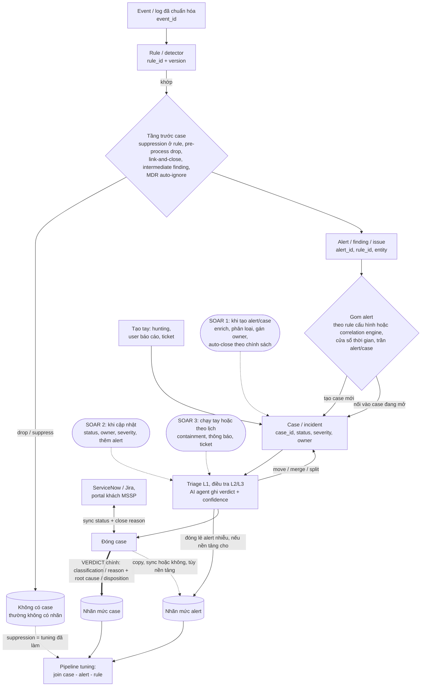

# Case do máy gom, verdict nằm ở case: nhãn theo rule phải tự dựng lại

> **Câu hỏi:** Case được tạo và gom alert thế nào, SOAR tự động hóa gì trong vòng đời case, và verdict mức case truy ngược về rule ra sao cho bài toán tuning? · **Ngày:** 2026-10-20 · **Phạm vi:** docs vendor (Microsoft Sentinel/Defender XDR, Google SecOps, Splunk ES 8/SOAR, Cortex XSOAR/XSIAM, QRadar/QRadar SOAR, Elastic, TheHive 5, DFIR-IRIS), báo cáo MDR, paper 2019–2026. Đọc tiếp theo [report tuning ngày 2026-10-18](../2026-10-18-llm-tuning-rule-giam-false-positive/report.md); không lặp lại phần kỹ thuật tuning, rule IoC và kiến trúc LLM ở đó. · **Cách đọc nguồn:** proxy chặn gần hết trang docs vendor trong phiên này. Chỉ schema bảng `SecurityIncident`/`SecurityAlert` của Sentinel, docs Elastic và docs DFIR-IRIS được đọc nguyên văn từ file nguồn trên GitHub (ghi *đọc gốc* trong mục Nguồn). Các nguồn còn lại là trang chính thức nhưng chỉ đọc qua trích đoạn mà công cụ search trả về (ghi *trích đoạn*). · **Kiểm chứng:** 20 khẳng định đã đối chiếu nguồn, 7 đã sửa

## Tóm tắt

Ở mọi nền tảng phổ biến, case được **máy tạo từ alert theo một luật gom**, hoặc do từng rule cấu hình (Sentinel, Elastic, Google SecOps), hoặc do correlation engine độc quyền gom chéo nhiều rule (Defender XDR, Cortex XSIAM, finding group của Splunk ES 8). Tạo case tay chỉ là ngoại lệ cho hunting, báo cáo của user và ticket, trừ TheHive và IRIS vốn để analyst tự escalate alert thành case. Ở đa số nền tảng, mỗi alert thuộc đúng một case tại một thời điểm, nhưng case_id của alert đổi khi bị move hoặc merge, và các trần cứng (150, 20–90, 100, 1.000 alert/case) khiến "một case" không tương ứng với "một lần rule bắn đúng hay sai". SOAR chạm vào vòng đời ở bốn chỗ: trước khi case tồn tại (suppression, pre-process drop/link), khi case được tạo, khi case được cập nhật, và khi chạy tay hoặc theo lịch. Một phần lớn nhãn đóng vì thế là **nhãn của máy hoặc của chính sách** do người cấu hình chọn sẵn, không phải phán đoán từng case. Verdict có nghĩa nằm ở case: nhãn alert hoặc không tồn tại (bảng `SecurityAlert` của Sentinel không có cột verdict), hoặc được copy hay đồng bộ từ case, và chính tính năng tuning của Microsoft cũng quy nhãn incident cho mọi rule trong incident. Hàm ý cho pipeline tuning: đầu vào không thể là "danh sách case FP" mà phải là bảng case↔alert↔rule, mỗi nhãn mang theo mức (case hay alert), nguồn (người, automation, AI, đồng bộ) và cờ "thừa hưởng". Mức chắc chắn **cao** về cấu trúc ba tầng và chuyện verdict nằm ở case. Về các con số trần và hành vi lan nhãn từng vendor thì chỉ **trung bình**, vì phần lớn đọc qua trích đoạn.

**Điểm chính**
- Alert ↔ case là n-1 ở Defender XDR, Google SecOps, Cortex và QRadar SOAR, nhưng move/merge làm case_id thay đổi theo thời gian, và incident bị merge ở Defender XDR tự đóng mà không mang verdict thật [1][2].
- Trần gom khác nhau tới hai bậc độ lớn: Sentinel **150** alert/incident, Google SecOps **20 mặc định / 90 tối đa** (2026; trang cũ ghi 30), Splunk ES 8 khoảng **100** finding/group, XSIAM **1.000** issue/case, Elastic **1.000** alert/case [3][4][5][6][7].
- Nhiều nền tảng cho đóng lẻ alert với reason riêng, nhưng chỉ Elastic có tài liệu về cơ chế đồng bộ nhãn case xuống alert còn mở mà không ghi đè alert đã đóng, cùng reason "automated closure" ở mức alert. Đây là cách rõ nhất có tài liệu để ghi "case TP nhưng alert FP" [8][9][10].
- Defender XDR đổi hành vi giữa hai đời UI: giao diện cũ copy classification của incident xuống mọi alert, còn "incident cases" (preview 2026) để alert giữ status riêng [11][12].
- Tuning insights của Sentinel và dataset GUIDE của Microsoft (1M incident) đều lấy nhãn ở mức incident rồi gán cho mọi detector bên trong; paper GUIDE báo các incident được SOC chấm lệch lớp **19% TP / 35% FP / 46% BP** [13][14].
- Ở MSSP/MDR, phần lớn việc lọc diễn ra trước khi có case: Arctic Wolf suppress **71%** alert [15], Red Canary chỉ phát hiện **110.000** threat từ **419 triệu** alert được triage [16]. Dữ liệu case vì vậy là phần đuôi đã được lọc, không phải toàn bộ lần rule bắn.

## Ba tầng event → alert → case giống nhau ở mọi vendor; khác nhau ở cardinality và nơi lưu verdict

Mọi nền tảng đều có cùng ba tầng: event thô, alert do rule sinh ra (vendor gọi là detection, finding, issue hay offense), và case là đơn vị analyst xử lý (incident, investigation, offense, container). Có hai thứ quyết định cách lấy nhãn cho tuning. Thứ nhất là cardinality: một alert thuộc bao nhiêu case, và có đổi case được không. Thứ hai là verdict được ghi ở tầng nào. Sơ đồ dưới tổng hợp vòng đời chung, các điểm SOAR chạm vào và chỗ verdict được ghi.

**Nhận định:** sơ đồ do người viết ghép từ docs của các vendor dẫn trong mục này và hai mục sau, không phải sơ đồ của riêng vendor nào.

Microsoft là nơi mô hình được đọc nguyên văn từ schema. Bảng `SecurityIncident` có `AlertIds` ("The IDs of the alerts related to the incident"), `RelatedAnalyticRuleIds`, `Classification` ("The classification the incident was given when closed"), `ClassificationReason`, `ClassificationComment`, `ModifiedBy` ("The source of the change in the incident"), `ProviderIncidentId`, `Owner`, `Status`, `Severity`, `Labels`, `Comments` và `Tasks` [17]. Bảng `SecurityAlert` thì **không có cột verdict nào**, chỉ có `Status`, `SystemAlertId`, `AlertName`, `ProductName`, `Entities`, `ExtendedProperties`, `Tactics`, `Techniques` và `ConfidenceScore` [18]. Trong Defender XDR, mọi alert bắt buộc thuộc một incident; analyst chỉ có thể chuyển alert sang incident khác và phải kèm comment [1]. Khi hai incident được merge, incident bị bỏ lại tự động đóng [2]. Từ ngày **2026-09-23**, Defender portal có Case Management bản public preview với *incident case* và *generic case*, chỉ có trong Defender portal chứ không có ở Sentinel trên Azure portal [19][20].

Các vendor khác cùng khung nhưng đổi tên đối tượng. Splunk ES 8.0 thay *notable event* bằng *finding*, *risk event* bằng *intermediate finding*, gộp "MC incident" với "ES investigation" thành *investigation*, và đổi Incident Review thành Mission Control [21][22]. Phân cấp mới là intermediate finding → finding → finding group (khoảng 100 finding, xem mục bất đồng) → investigation, và một investigation chứa được nhiều finding group [5]. Cortex XSIAM và XDR 5.x đổi *alert* thành *issue* và *incident* thành *case*: issue mới được engine gán vào case mới hoặc case đang có [23]. XSOAR vẫn dùng *incident* với bảng *Linked Incidents* [24]. Splunk SOAR lưu *container* chứa *artifact*, và artifact trùng hash không được lưu lần hai trong cùng container [25]. QRadar SOAR nhận offense thành case theo tỉ lệ 1-1 theo offense ID. Vì QRadar dọn offense cũ ở ngưỡng **100.000** và bộ đếm quay vòng, offense mới có thể trùng ID với offense đã escalate, khi đó plugin ghi đè vào case SOAR cũ thay vì tạo case mới [26]. Elastic cho gắn tối đa **1.000 alert** vào một case, ngoài ra còn gắn được event, Timeline, indicator, entity và file [7][9]. TheHive chuyển alert sang status **Imported** khi merge vào case, status này không chọn tay được [27][28]. IRIS cho *unmerge* alert khỏi case, nhưng IOC và asset đã chuyển vẫn nằm lại trong case [29].

| Nền tảng (thuật ngữ hiện hành) | Tạo / gom case | Alert ↔ case | Verdict ở đâu | Lan nhãn case → alert | Trần có nguồn | Độ kiểm chứng |
|---|---|---|---|---|---|---|
| Microsoft Sentinel | Analytics rule: bật tạo incident; gom tất cả, hoặc theo entity / alert details / custom details; tùy chọn mở lại incident đã đóng [30][31] | n-1 (`AlertIds`) | Incident: `Classification` + `ClassificationReason` + comment; alert không có cột verdict | Không có nhãn alert để lan | Cửa sổ gom 5 phút–7 ngày (mặc định 5 giờ); 150 alert/incident [3] | Schema đọc gốc; grouping và trần qua trích đoạn |
| Defender XDR | Correlation engine độc quyền (entity, artifact, thời gian, multistage); merge tay (preview) chỉ khi các incident có cùng hoặc trống Assigned to / Classification / Determination, hướng merge do Defender quyết định [2][91] | n-1, bắt buộc có incident; move kèm comment | Cả incident lẫn alert (classification + determination) [32][33] | UI cũ: copy xuống mọi alert; incident cases (preview): alert giữ status riêng | Không công bố | Trích đoạn |
| Google SecOps SOAR | Alert grouping rule trong khung 0,5–24 giờ (mặc định 2 giờ); overflow case khi >50 alert tương tự/10 phút [34][35] | n-1; merge chuyển alert nguyên vẹn [36] | Case: reason + root cause; alert đóng lẻ được với `closureDetails` [37][38] | Đóng case thì đóng alert còn mở | 20 alert/case mặc định, 90 tối đa; 500 event/alert; 500 entity [4] | Trích đoạn; số alert/case mâu thuẫn giữa các trang |
| Splunk ES 8.x (+ SOAR) | Finding-based detection gom theo entity, threat object, risk cộng dồn, kill chain, ATT&CK; investigation mở tay từ finding/group [5][39] | n finding/group, n group/investigation | Disposition cho cả finding lẫn investigation [40] | Chưa rõ | Khoảng 100 finding/group (8.1: gom tối đa 100; 8.7: UI hiển thị tối đa 100) | Trích đoạn |
| Cortex XSIAM / XDR 5.x | Case grouping engine, không cấu hình trực tiếp; chỉ tác động qua field mapping của correlation rule [41][42] | n-1 | Resolution reason cho cả case lẫn issue [43] | Chưa rõ | Ngừng gom khi đạt 1.000 issue, 30 ngày từ khi tạo hoặc 14 ngày từ issue cuối; case "Auto Resolved" mở lại nếu có issue khớp trong 6 giờ (Cortex Cloud, XDR 5.x) [6] | Trích đoạn |
| Cortex XSOAR | Fetch từ integration; pre-process rule chạy trước khi tạo incident [44] | Link n-n giữa incident | Incident: `closeReason` (mặc định FP / Resolved / Duplicate / Other) [45] | Không áp dụng | — | Trích đoạn |
| QRadar + QRadar SOAR | Rule tạo offense hoặc nối vào offense theo offense index [46]; plugin escalate tự động hoặc tay [47] | Offense → case 1-1 theo ID (ID quay vòng) | Offense có closing reason; case SOAR có `resolution_id` | Phải map giữa hai hệ [48] | Ngưỡng 100.000 offense | Trích đoạn |
| Elastic Security | Cases connector trên rule: mọi alert vào một case hoặc group-by một trường; time window 7 ngày; mở lại khi đóng; trần số case/rule từ 9.4 [49] | n trong một case; chưa rõ alert có thuộc nhiều case không | **Cả hai**: alert có `workflow_reason`; case có status | Sync alert status: chỉ alert còn mở nhận reason của case (9.4+) [9] | 1.000 alert/case | **Đọc gốc** |
| TheHive 5 | Chủ yếu tay: tạo case từ alert hoặc thêm vào case có sẵn; tự động qua API/functions [27][50] | Alert → một case (Imported) | Case (status đóng tùy biến); alert chỉ có FP / Duplicate / Ignored nếu đóng lẻ | Không | 50 alert/lần merge (cấu hình được) | Trích đoạn |
| DFIR-IRIS | Tay: escalate/merge alert vào case mới hoặc cũ | Merge / unmerge | Case (trường chưa xác minh) | — | — | **Đọc gốc** (alert) |

**Nhận định:** với Microsoft, Google SecOps, Cortex và QRadar SOAR, join alert_id → case_id cho kết quả duy nhất *tại một thời điểm*. Vì vậy pipeline phải lấy case_id cuối cùng và lưu lịch sử move/merge, chứ không giả định quan hệ này cố định. Với Elastic và IRIS, docs không nói rõ một alert có gắn được vào nhiều case hay không, nên cần kiểm tra trên dữ liệu thật trước khi viết logic join.

## Case phần lớn do máy gom theo luật có trần cứng; dedup trước case làm alert biến mất khỏi dữ liệu nhãn

Có ba kiểu tạo case, và mỗi kiểu pha loãng nhãn theo rule ở một mức khác nhau. Kiểu thứ nhất là **gom do rule cấu hình**. Ở Sentinel, alert sinh trong vòng 5 giờ kể từ alert đầu tiên được gom vào cùng incident theo mặc định, cửa sổ chỉnh được từ 5 phút tới 7 ngày [30], và grouping không nối vào incident đã đóng trừ khi bật "re-open closed matching incidents" [31]. Ở Elastic, Cases connector mặc định cho mọi alert của một rule vào cùng một case, hoặc chia case theo một trường, với time window **7 ngày** [49]. Google SecOps dùng grouping rule có khung 0,5–24 giờ [34]. Ở kiểu này rule_id quyết định cách gom, nên một case thường chỉ chứa alert của một rule. Kiểu thứ hai là **correlation engine độc quyền gom chéo nhiều rule**: Defender XDR merge incident theo entity, artifact, thời gian hoặc chuỗi multistage và không công bố ngưỡng [2]; XSIAM gom issue vào case và người dùng không cấu hình trực tiếp được, chỉ tác động được qua việc map trường trong correlation rule [41][42]; Splunk ES 8 gom finding thành finding group theo entity, threat object, risk cộng dồn, kill chain hay ATT&CK [5]. Kiểu thứ ba là **analyst tạo tay**: TheHive và IRIS mặc định để analyst triage alert rồi escalate thành case [27][29], còn Sentinel và Defender (generic case) cho tạo case cho hunting hoặc việc nằm ngoài luồng incident [19].

**Nhận định:** kiểu thứ hai làm nhãn case gán cho từng rule bị pha loãng nhiều nhất, vì một case chứa alert từ nhiều rule là chuyện bình thường. Các trần cứng còn tác động theo hai chiều. Một sự cố thật có thể bị tách thành nhiều case khi chạm trần: Google SecOps mở case mới khi đủ số alert, XSIAM ngừng nhận issue khi đạt **1.000** issue, 30 ngày từ khi tạo hoặc 14 ngày từ issue cuối [6]. Ngược lại, gom theo entity dùng chung có thể dồn nhiều sự cố không liên quan vào một case. Kết quả là nhãn case không tương ứng 1-1 với "một lần rule bắn đúng hay sai".

Dedup và suppression xảy ra ở cả hai phía của thời điểm tạo case, và hai phía gây hai loại nhiễu khác nhau. *Trước case*: pre-process rule của XSOAR chạy sau ingest và mapping nhưng trước khi tạo incident, với các action Drop, Link and close và Drop and update [44][51]; Google SecOps có alert suppression ở tầng SIEM [52]; intermediate finding của Splunk không lên queue cho tới khi được gom [5]; artifact trùng hash bị bỏ trong Splunk SOAR [25]. *Sau case*: incident bị merge tự đóng ở Defender XDR [2], "Link and close" đóng incident mới như một bản trùng [44], và closing reason "Duplicate" có sẵn ở Elastic, XSOAR và TheHive [8][45][28]. **Nhận định:** dedup trước case làm alert *biến mất khỏi dữ liệu nhãn*, còn dedup sau case sinh ra case đóng *không mang verdict thật*. Loại sau phải lọc khỏi tập huấn luyện và tập đánh giá.

## SOAR chạm vòng đời case ở bốn điểm, nên phần lớn nhãn đóng là nhãn của máy hoặc của chính sách

Tầng tự động hóa *trong case* có ba loại trigger gần như giống nhau giữa các vendor. Sentinel có *When incident is created*, *When incident is updated* (đổi status, owner, severity, thêm alert, comment, tag) và *When alert is created*. Trigger mức alert chỉ lọc được theo tên analytics rule, và Microsoft khuyến nghị dùng trigger mức incident cho hầu hết trường hợp [53]. Google SecOps gắn playbook ở mức alert lúc ingest, theo Alert Type, Product, Tag và vài tiêu chí khác. Mỗi alert gắn được tối đa **10 playbook** nhưng **chỉ 1** được gắn tự động qua trigger [54][55]. Splunk SOAR chạy playbook theo *label* của container [56]. Cộng với tầng *trước case* vừa nói ở mục trên, ta có bốn điểm SOAR chạm vào trong sơ đồ.

Những việc thường được tự động hóa gồm enrichment, phân loại, gán owner, dedup/link, containment có điều kiện, thông báo, đồng bộ ticket và **đóng tự động hoạt động đã biết**. Chính docs Microsoft hướng dẫn tạo "exception" bằng automation rule đóng ngay incident vừa tạo, kèm lý do đóng và comment [57]. Khi tạo automation rule từ một incident, action được điền sẵn là đóng với classification "Benign Positive – Suspicious but expected" [58]. Google SecOps cho dùng verdict của AI làm điều kiện rẽ nhánh playbook, ví dụ tự isolate host khi verdict là Malicious [59]. Ở phía ITSM, tích hợp ServiceNow SIR ↔ Sentinel đồng bộ hai chiều: khi SIR incident đóng thì status incident bên Sentinel được cập nhật theo, kèm một "incident classification and closing reason" mặc định [60]. Đồng bộ Defender XDR ↔ Sentinel cũng hai chiều cho "status, owner, and closing reason" [61]. **Nhận định:** cả ba cơ chế này (automation rule, playbook theo verdict AI, đồng bộ ITSM/portal) đều ghi một classification mà *người cấu hình chọn sẵn*. Nhãn này phản ánh chính sách chứ không phải phán đoán trên từng case, nên phải tách khỏi nhãn của người. Ở Sentinel, cột để tách là `ModifiedBy` [17]. Ở Google SecOps là trường closed-action, phân biệt case "closed automatically" với case đóng tay [62].

Không có con số độc lập nào về tỷ lệ case được đóng tự động. Các con số đang lưu hành là của vendor, đo những mẫu số khác nhau, và không so sánh được với nhau. Arctic Wolf (2025) báo **71%** alert được nạp bị suppress vì là hoạt động expected/benign, và triage tự động xử lý **10%** alert [15]. Red Canary (2026) báo đã triage **419 triệu** alert, điều tra **8,5 triệu** event có thể độc hại, và phát hiện **110.000** threat [16]. Torq tuyên bố tự remediate **95%** case Tier-1, nhưng cùng trang đó lại ghi "90%" [63], nên đây chỉ là tài liệu marketing. Microsoft cho biết ở SOC nội bộ của họ, khoảng **96%** incident được xử lý ở Tier 1–2 và khoảng 4% phải escalate [64]. Khảo sát SANS 2025 cho thấy **69%** SOC vẫn báo cáo metric thủ công hoặc phần lớn thủ công [65]. **Nhận định:** hai hệ quả cho tuning. Thứ nhất, base rate TP ở mức alert rất thấp, nên nhãn benign/FP áp đảo và phần lớn trong số đó do máy gán. Thứ hai, timestamp MTTA/MTTR trong case không đủ tin cậy để dùng làm tín hiệu phụ khi phần lớn SOC còn đo tay.

MSSP/MDR thêm một tầng nữa. Expel cho bot triage event trước, chỉ tạo "Expel Alert" khi cần người xem, và hoạt động đã biết là benign bị auto-ignore [66]. Red Canary cho khách "authorize" user, endpoint hay sensor group để hoạt động tương tự không bị gắn vào threat nữa; khi analyst đánh dấu FP thì Detection Engineering vào review lỗi logic [67]. Trong dịch vụ Defender Experts, Microsoft tự đặt classification FP hoặc Informational/Expected Activity rồi chuyển incident của khách sang Resolved [68]. **Nhận định:** ở MDR, verdict mà khách nhìn thấy thường là của nhà cung cấp, còn phản hồi "hợp lệ, đã authorize" của khách là tín hiệu BP mạnh nhất cho tuning theo tenant, nhưng phản hồi này thường nằm trong comment hay ticket tự do. Cách Red Canary tách hai luồng (authorize theo khách và sửa logic toàn cục) gợi ý pipeline tuning nên phân loại đầu ra theo đúng hai luồng đó.

Agent AI triage thêm một nhãn thứ ba bên cạnh nhãn của người và lý do đóng. Triage agent của Google ghi disposition, confidence và explanation [69]. Dropzone kết luận Malicious / Suspicious / Benign / Inconclusive kèm một review state riêng [70]. Phishing triage agent của Microsoft cho analyst override và gửi feedback [71]. Expel ghi rằng rapid triage agent "never auto-closes or resolves an alert" [72]. Elastic báo accuracy verdict AI ở SOC nội bộ tăng từ khoảng **60%** lên **92%** mà không đổi model, chủ yếu nhờ đưa vào context **closure reason của các case 30 ngày trước trên cùng rule** [73]. **Nhận định:** đây là bằng chứng thực tế rằng nhãn đóng case truy ngược được theo rule và có giá trị. Đồng thời, case do AI tự đóng mà không có người review phải được đánh dấu là nhãn máy, vì dùng chúng để tuning rule sẽ tạo vòng lặp tự củng cố.

## Verdict nằm ở case; nhãn alert hoặc thiếu hoặc được copy, nên nhãn theo rule phải suy ra và mang sáu loại nhiễu

Taxonomy verdict không thống nhất giữa các vendor, và không vendor nào map gọn vào nhị phân TP/FP. Google SecOps bắt chọn **reason** rồi **root cause** khi đóng [37]. API `caseCloseDefinitions` liệt kê MALICIOUS, NOT_MALICIOUS, MAINTENANCE, INCONCLUSIVE [74], trong khi trang enum dùng chung "for closing an Alert or Case" cập nhật 2025-07 chưa có INCONCLUSIVE [75]. Splunk ES 8 có disposition cho cả finding lẫn investigation: Undetermined (mặc định), True Positive – Suspicious Activity, Benign Positive – Suspicious But Expected, False Positive – Incorrect Analytic Logic, False Positive – Inaccurate Data, và thêm Other, Testing. Admin phải tự bật toggle *Required* thì disposition mới bắt buộc trước khi đóng [40]. XSOAR mặc định có False Positive, Resolved, Duplicate, Other [45]. Defender XDR API tách `classification` (Unknown / FalsePositive / TruePositive) khỏi `determination` (Malware, SecurityTesting, UnwantedSoftware…) [33], còn ở mức alert có giá trị "Informational/expected activity" [32]. Elastic có các reason false positive, duplicate, true positive, benign positive, **automated closure** và other [10]. **Nhận định:** NOT_MALICIOUS của Google gộp cả BP lẫn FP, "Resolved" của XSOAR không nói TP hay BP, còn Undetermined mặc định của Splunk khi chưa bật Required là một dạng nhãn rỗng trá hình. Ba nhãn này đều phải map về Unknown, trừ khi root cause cho biết rõ hơn.

Về chuyện nhãn có lan từ case xuống alert, nền tảng chia ba nhóm. *Không có nhãn alert*: Sentinel [18], và TheHive, nơi alert đã vào case chỉ mang status Imported [28]. *Copy hoặc đồng bộ*: giao diện cũ của Defender XDR ghi "When the classification is set on an incident, all the alerts in the incident are given the same value" [11], và resolve incident thì resolve luôn mọi alert active [76]; Google SecOps đóng các alert còn mở khi đóng case [38]. *Có nhãn riêng và đồng bộ có kiểm soát*: Elastic từ 9.4 hỏi closing reason khi đóng case để áp cho alert, nhưng chỉ alert open/acknowledged được cập nhật, còn alert đã đóng giữ reason cũ; reason bị xóa nếu alert được mở lại [9][8]. Ngay trong Microsoft, "incident cases" bản preview lại ghi rằng "Related alerts keep their own status and aren't automatically resolved when the incident case is resolved or closed" [12], tức là ngược với hành vi của giao diện cũ. **Nhận định:** pipeline phải đọc nhãn alert và nhãn case riêng, và không được giả định cái này suy ra cái kia, kể cả trong cùng một vendor.

Trường hợp "case TP nhưng có alert FP bên trong" không có best practice nào được vendor tài liệu hóa. Cơ chế rõ nhất có sẵn là của Elastic: đóng alert nhiễu trước với reason FP, rồi đóng case là TP, và nhãn của alert đã đóng không bị ghi đè [9]. Google SecOps, Defender XDR và XSIAM cũng cho đóng lẻ alert với reason riêng [38][32][43]. Dữ liệu MDR cho thấy chuyện này không hiếm: Kaspersky MDR quý 4/2020 có khoảng 65.000 alert dẫn tới 1.506 incident, và **80,1%** incident được phát hiện từ *alert đầu tiên* được phân tích [77]. **Nhận định:** trong một incident TP, thường chỉ một vài alert là "hạt nhân", phần còn lại là alert phụ hay ngữ cảnh. Gán TP cho mọi rule trong case vì vậy thổi phồng precision của các rule phụ. Ở chiều ngược lại, gán FP của case BP cho mọi rule sẽ phạt cả rule đã bắn đúng logic.

Tính năng tuning của vendor dùng nhãn ở mức nào? Tuning insights của Sentinel (preview) đếm incident theo classification TP/FP trên **14 ngày** và đề xuất entity "highly correlated with incidents you closed as false positives" [13]. Nói cách khác, chính Microsoft quy nhãn *incident* về rule. Ngược lại, alert tuning của Defender XDR làm việc ở mức alert: nó tự Resolve alert theo điều kiện, hoặc "Set as behavior" để alert không vào queue và không sinh incident. Microsoft bật sẵn một số rule tuning built-in, và từ **2026-10-12** alert DLP mặc định được set as behavior [78]. **Nhận định:** alert bị tuning Resolve tự động vẫn nằm trong dữ liệu với status Resolved nhưng không có nhãn của người. Pipeline nào đếm "resolved = FP" sẽ đếm nhầm chúng. Dataset công khai lớn nhất cũng theo cách của Sentinel. GUIDE của Microsoft có hơn 13M evidence, 1,6M alert và 1M incident trong hai tuần, lấy từ 6,1k tổ chức và 9,1k `DetectorId`. "Each incident is annotated with a ground-truth triage label by customer security analysts", và nhãn chỉ có ở mức incident [14]. Kaggle chia train/test "with incidents grouped consistently so that related evidence and alert records remain together" [79]. Paper kế tiếp về ưu tiên incident cũng chia dữ liệu theo tổ chức để tránh rò rỉ [80]. Paper ghi các incident được SOC chấm (8,9k–139k mỗi vùng, bảng 2) lệch lớp **19% TP / 35% FP / 46% BP**; đây là phân bố trên tập được chấm của paper, không phải số đếm trên file Kaggle, vốn còn bị giới hạn 1k mẫu mỗi IncidentHash và nhãn [14]. **Nhận định:** BP là lớp lớn nhất, và điều đó khớp với phát hiện của Alahmadi et al. (USENIX Security 2022) rằng phần lớn "false positive" mà practitioner nói tới thực ra là *benign trigger*: alarm đúng logic nhưng do hoạt động hợp lệ [81].

Gom lại thì nhãn theo rule suy từ case mang sáu loại nhiễu, mỗi loại có cột hoặc tín hiệu để lọc:

| Loại nhiễu | Cơ chế | Ví dụ có nguồn | Tín hiệu để lọc |
|---|---|---|---|
| (a) Nhãn thừa hưởng | Nhãn case gán cho mọi rule trong case | Tuning insights quy nhãn incident [13]; GUIDE lặp nhãn incident trên mọi dòng [14] | Số rule khác nhau trong case; cờ `inherited` |
| (b) Nhãn máy / chính sách | Automation rule, playbook, alert tuning, AI tự đóng | BP mặc định khi tạo automation rule [58]; "automated closure" [10]; closed-action automatic [62] | `ModifiedBy`, closed-action, reason automated, người đóng là service account |
| (c) Đóng do đồng bộ | Trạng thái đẩy từ portal khác hay ITSM | Sync status/closing reason Defender ↔ Sentinel [61]; ServiceNow dùng classification mặc định [60] | Nguồn thay đổi, thời điểm đóng trùng với sự kiện sync |
| (d) Không phải verdict | Duplicate, merged, Undetermined/Inconclusive/Unresolved | Incident merge tự đóng [2]; Undetermined mặc định [40]; status merged [62] | Reason thuộc nhóm này; case có cờ merged |
| (e) Taxonomy nghèo / lệch | Không phân biệt BP với FP, hoặc map sai khi chuyển hệ | NOT_MALICIOUS [74]; "Resolved" [45]; benign trigger bị gọi là FP [81] | Root cause, determination, comment |
| (f) Nhãn đổi theo thời gian | Reopen, auto-resolve rồi mở lại, bảng audit nhiều dòng | `SecurityIncident` ghi một dòng mới mỗi lần thay đổi [82]; case Auto Resolved mở lại trong 6 giờ [6]; reason Elastic bị xóa khi reopen [8] | Chỉ lấy trạng thái cuối; đếm số lần reopen |

Thêm vào đó, nhãn do analyst viết tay vốn đã mơ hồ: paper lọc FP tự động cho esNet phải bỏ các ca mà comment chỉ ghi "TP/FP" không lý do, hoặc ghi có điều kiện [83].

## Pipeline tuning cần một bảng case↔alert↔rule có ghi nguồn gốc nhãn, không phải danh sách case FP

Mọi nền tảng đều cho lấy được bộ ba case–alert–rule, nhưng khóa join và độ sạch khác nhau. Bảng dưới gom nguồn dữ liệu và khóa join cho từng nền tảng mà notes có bằng chứng.

| Nền tảng | Nguồn / API | Case ↔ alert | Rule | Tách nhãn người / máy |
|---|---|---|---|---|
| Sentinel | Bảng `SecurityIncident`, `SecurityAlert` (Log Analytics) | Lấy dòng mới nhất mỗi incident (bảng audit) [82], `mv-expand AlertIds` rồi join `SystemAlertId` [17][18] | `RelatedAnalyticRuleIds` ở mức incident (không biết alert nào của rule nào); không có cột rule version | `ModifiedBy` |
| Defender XDR | Advanced hunting `AlertInfo` + `AlertEvidence` join theo `AlertId` [84]; List incidents API trả mảng `alerts`, mỗi alert có classification/determination [33][85] | `alerts[]` trong incident | `DetectionSource`, `ServiceSource`, tiêu đề alert | `verdict` mức evidence là của AIR (máy), không trộn vào nhãn người [86] |
| Google SecOps | SOAR API; alert trong case có `closureDetails{reason, rootCause, comment}` [38]; schema dashboard có closed-action và status merged [62] | Alert nằm trong case; merge chuyển alert | Trường Rule Generator / Alert Type của alert [54] | closed-action |
| Splunk ES | `index=notable` + KV lookup `incident_review_lookup` (status, owner, disposition, comment, `review_time`) [87] | Chưa có docs về chỗ ES 8 lưu quan hệ investigation ↔ finding | `rule_id` / tên correlation search | `review_time`, user trong lookup |
| XSOAR | JSON incident: `closeReason`, `rawCloseReason`, `closeNotes`; script `SearchIncidentsV2` [88] | Bảng Linked Incidents | Theo integration/type | Người đóng; pre-process "Link and close" |
| Elastic | Index alert (`kibana.alert.workflow_reason`) + Cases API [8][9] | Alert đính kèm case | Rule id có sẵn trên alert | Reason "automated closure" |

**Nhận định:** từ các nguồn trên, quy trình làm sạch nhãn tối thiểu gồm năm bước. *Một*, dựng bảng cấp alert với các khóa `tenant_id`, `case_id` (giá trị cuối cùng kèm lịch sử move/merge), `alert_id`, `rule_id`, `rule_version` (tự lưu từ Git hoặc API rule theo thời điểm alert, vì không nền tảng nào trong bảng có sẵn cột này), `event_id`/`evidence_id`, thời điểm alert và thời điểm đóng. *Hai*, gắn cho mỗi nhãn ba thuộc tính: mức (alert hay case), nguồn (người, automation, AI, sync), và `inherited` cùng `n_rules_in_case`. *Ba*, gán nhãn theo thứ bậc: nhãn alert do người đặt, rồi đến nhãn case khi case chỉ có một rule, rồi mới đến nhãn case nhiều rule (đánh dấu inherited, trọng số thấp, hoặc chỉ dùng khi mọi alert cùng entity). *Bốn*, loại hoặc để riêng các case đóng tự động, đóng do sync, Duplicate, merged, Undetermined/Inconclusive/Unresolved và case bị reopen, và chỉ giữ trạng thái cuối. *Năm*, chuẩn hóa taxonomy về {TP, BP, FP-logic, FP-data, Unknown}, rồi chia train/eval theo case, và theo tenant với MSSP, để tránh rò rỉ nhãn như cách GUIDE và paper kế tiếp phải chia [79][80]. Riêng các alert bị suppress hay drop trước case không có nhãn, nhưng nên giữ đếm số theo rule: chúng là phần "tuning đã làm", cho biết exclusion nào đang che bao nhiêu alert.

Hai điểm đặc thù cần lưu ý khi lấy dữ liệu lịch sử. Tích hợp ServiceNow với trải nghiệm Sentinel trên Azure portal đang bị deprecate (thời hạn kéo dài tới 03/2027), và hướng được khuyến nghị là chuyển sang tích hợp qua Defender portal [60]. Cùng lúc đó, Case Management mới chỉ có trong Defender portal [19]. **Nhận định:** dữ liệu nhãn của một tổ chức dùng Microsoft có thể bị chia giữa hai mô hình (incident cũ và incident case) trong giai đoạn chuyển đổi, nên pipeline cần ghi rõ mỗi nhãn lấy từ mô hình nào. Với QRadar SOAR, việc ID offense quay vòng ở 100.000 khiến join theo offense_id có thể gộp nhầm hai offense khác nhau vào một case [26]. Nên join theo cặp (offense_id, thời điểm tạo offense).

## Cập nhật cho report tuning cũ

Bảng dưới liệt kê các chỗ cụ thể trong [report 2026-10-18](../2026-10-18-llm-tuning-rule-giam-false-positive/report.md) nên sửa, theo thứ tự xuất hiện trong report cũ. Cả 13 điểm đã được áp vào report cũ ngày 2026-10-20.

| # | Vị trí trong report cũ | Hiện ghi | Sửa thành | Căn cứ |
|---|---|---|---|---|
| 1 | Sơ đồ domain (mục "Domain: log đi qua rule…") | `CASE --> AN … đóng case + verdict TP / BTP / FP`, một luồng duy nhất | Sửa nhãn "BTP" thành "BP"; thêm tầng trước case (suppression/pre-process drop → không có nhãn), nhánh move/merge, hai nơi lưu verdict (case, alert) và đồng bộ ITSM/portal; hoặc link sang sơ đồ ở report này | [44][2][9][61] |
| 2 | Bảng thuật ngữ, dòng "Case / incident" | "case trong Google SecOps tối đa 30 alert, cửa sổ gom 0,5–24 giờ" | "20 alert/case mặc định, tối đa 90 (service limits, 2026; trang alert grouping vẫn ghi 30); khung gom 0,5–24 giờ, mặc định 2 giờ; overflow case riêng". Nên thêm trần của nền tảng khác: Sentinel 150, Splunk ES 8 khoảng 100 finding/group, XSIAM 1.000, Elastic 1.000 | [4][34][89][3][5][6][7] |
| 3 | Bảng thuật ngữ, dòng "Verdict / classification" | "Mỗi vendor đặt tên khác nhau" | Thêm bảng map: Google reason (MALICIOUS / NOT_MALICIOUS / MAINTENANCE / INCONCLUSIVE) + root cause; Splunk disposition (Undetermined mặc định, có toggle Required); XSOAR (FP / Resolved / Duplicate / Other); Defender classification + determination; Elastic (có "automated closure", "duplicate"). Ghi rõ verdict có thể ở cả alert lẫn case | [74][40][45][33][10] |
| 4 | Bảng map khái niệm theo nền tảng | Cột "Splunk ES 7.x" (notable, Incident Review); không có Cortex | Thêm cột ES 8.x: intermediate finding → finding → finding group → investigation, Mission Control; thêm cột Cortex XSIAM: issue → case; ghi Defender incident case / generic case (preview 2026-09) | [21][5][23][19] |
| 5 | Bảng quy trình tham chiếu, bước 1 "Gán nhãn" | "Đóng alert với verdict chuẩn…" | Analyst đóng *case*. Nơi nền tảng cho phép (Defender XDR, Google SecOps, Elastic, XSIAM), quy trình yêu cầu đóng lẻ alert nhiễu trước với reason riêng. Nơi không cho (Sentinel, TheHive), thêm trường custom hoặc tag ở case ghi "rule nào là noise". Bật bắt buộc disposition (Splunk Required) | [38][9][18][40] |
| 6 | Mục quy trình, câu về Sentinel Tuning insights | Trình bày như nguồn xếp hạng rule ồn | Thêm lưu ý: tuning insights tính trên nhãn *incident*, nên rule nằm trong incident nhiều rule "nhận" nhãn của incident. Không coi đây là precision thật theo rule | [13] |
| 7 | Pipeline sáu bước, bước 1 "Chuẩn bị dữ liệu" | "Lấy case đóng FP/BP/FP-data trong 30–90 ngày; … gom alert theo rule_id + field quyết định" | Đầu vào là bảng cấp alert (case↔alert↔rule) dựng theo năm bước làm sạch ở mục trước: dedup bảng audit, lấy case_id cuối cùng, gắn mức/nguồn/inherited cho nhãn, loại auto-close, sync, duplicate, merged và undetermined, rồi chuẩn hóa taxonomy. Cụm chỉ dựng từ nhãn alert do người đặt hoặc nhãn case một-rule; nhãn inherited là tín hiệu phụ | Mục "Pipeline tuning cần một bảng…" |
| 8 | Bảng "Dữ liệu đầu vào cần thu thập" | Hàng "Alert/case FP" gộp alert với case, chỉ có "người đóng" | Thêm hàng **"Liên kết và nguồn gốc nhãn"**: `tenant_id`, `case_id` + lịch sử move/merge, `alert_id`, `rule_id`, `rule_version` (tự lưu), `event_id`/`evidence_id`, mức nhãn, nguồn nhãn (`ModifiedBy` / closed-action / reason automated / service account), `inherited`, `n_rules_in_case`, số lần reopen, verdict AI + quyết định của người. Thêm hàng **"Alert bị suppress/drop trước case"** (đếm theo rule và exclusion) | [17][62][10][69] |
| 9 | Bảng metric đánh giá | Không nói nhãn lấy ở mức nào; không nói cách chia dữ liệu | Precision theo rule tính trên nhãn alert do người hoặc nhãn case một-rule; báo cáo riêng phần inherited. Chia train/eval theo case, và theo tenant với MSSP. Loại case auto-close khỏi tập đánh giá, hoặc đo riêng | [79][80] |
| 10 | Mục rủi ro "nhãn FP sai" | Rủi ro chủ yếu là L1 gán sai | Thêm hai rủi ro: (i) nhãn chính sách, khi automation đóng BP theo exception cũ rồi pipeline học lại chính exception đó; (ii) nhãn AI tự đóng không có người review. Cả hai tạo vòng tự củng cố, nên mặc định loại khỏi đầu vào tuning | [57][58][59] |
| 11 | Lộ trình, "Pha 0: kiểm toán dữ liệu" | Tỷ lệ case có verdict chi tiết, đồng thuận nhãn, độ phủ TP | Thêm: % case chứa nhiều rule, % case đóng tự động hoặc do sync, % Undetermined/Inconclusive, % alert có nhãn riêng, số case merged/reopen, và hệ thống đang ở mô hình incident cũ hay incident case | Mục nhiễu nhãn ở trên |
| 12 | Kiến trúc, đầu ra LLM-B | Có ghi phạm vi (rule gốc hay tenant) | Giữ, và nói rõ đây là hai luồng khác nhau: authorize/suppression theo tenant và sửa logic toàn cục, như Red Canary tách | [67] |
| 13 | "Chưa kiểm chứng được", gạch cuối | Thuật ngữ Splunk ES 8.x, nhãn đóng Google, disposition Splunk chưa xác minh | Đã có ở report này (qua trích đoạn docs chính thức). Thay bằng: chưa rõ ES 8 lưu quan hệ investigation ↔ finding ở đâu, và việc nâng cấp ES 8 có làm mất investigation cũ hay không | [21][40][74] |

## Các nguồn bất đồng ở đâu

Có ba chỗ bất đồng đáng kể. Chỗ thứ nhất là **số alert/case của Google SecOps**. Trang alert grouping lấy 30 làm giá trị của tùy chọn "Max. alerts grouped into a case", đạt ngưỡng thì mở case mới [34]. Trang service limits ghi mặc định 20, tối đa 90 [4], và một blog tổng hợp release note tháng 6/2026 nói mức tối đa vừa tăng từ 20 lên 90 [89]. **Nhận định:** nên tin trang service limits, vì nó là trang chuyên về giới hạn và khớp với mốc thay đổi có ngày; trang grouping nhiều khả năng chưa cập nhật. Có thêm một bất đồng nhỏ về **trần finding group của Splunk ES 8**: docs 8.1 nói gom tối đa 100 finding vào một group, còn docs 8.7 nói UI chỉ *hiển thị* tối đa 100 finding mỗi group và phải drill-down để xem đủ [5]; có thể trần cứng đã đổi thành trần hiển thị. Chỗ thứ hai là **lan nhãn ở Microsoft**. Bài 2022 và trang legacy nói classification của incident được copy xuống mọi alert [11][76], còn trang incident cases (preview) nói alert giữ status riêng [12]. Hai bên không mâu thuẫn về sự thật mà mô tả hai đời sản phẩm. Hệ quả là không được viết logic dựa trên giả định một hành vi. Chỗ thứ ba là **enum reason của Google**: API `caseCloseDefinitions` có INCONCLUSIVE [74], còn trang enum chung cập nhật 2025-07 thì không [75]. Pipeline nên đọc danh sách reason trực tiếp từ instance thay vì hard-code. Ngoài ra, tài liệu của Expel tự mâu thuẫn: blog nói agent "never auto-closes", trong khi brochure Ruxie tháng 6/2026 nói agent có thể "confidently auto-close benign alerts" [72][90]. Với MDR, cần hỏi trực tiếp nhà cung cấp ai đóng case và nhãn được ghi ở đâu.

## Kết luận và hàm ý

Điều mới so với report cũ là **đơn vị gán nhãn và đơn vị cần tuning không trùng nhau**, và khoảng cách giữa hai đơn vị này do hạ tầng tạo ra chứ không phải do analyst. Luật gom quyết định một case chứa bao nhiêu rule. Trần cứng và move/merge quyết định case_id của một alert. SOAR và đồng bộ quyết định bao nhiêu nhãn là nhãn chính sách. Dedup trước case quyết định phần nào của lần rule bắn không bao giờ có nhãn. Vì vậy, trước khi có LLM, pipeline cần một tầng dữ liệu tất định dựng lại nhãn theo rule từ nhãn case, mang theo nguồn gốc của nhãn. Thiết kế "LLM chẩn đoán cụm FP" trong report cũ vẫn đúng, nhưng chỉ an toàn khi cụm được dựng từ nhãn alert do người đặt hoặc từ case một-rule, còn nhãn thừa hưởng và nhãn máy đi vào như tín hiệu phụ có trọng số thấp.

Với một công ty MSSP/MDR, việc nên làm sớm nhất là thay đổi quy trình đóng case, không phải viết code: bắt buộc verdict chi tiết (TP / BP / FP-logic / FP-data), đóng lẻ alert nhiễu trước khi đóng case nếu nền tảng cho phép, và ghi phản hồi của khách vào trường có cấu trúc thay vì comment. **Nhận định:** cách Elastic đưa closure reason 30 ngày của cùng rule vào context cho agent triage [73] cho thấy một khi nhãn theo rule đủ sạch, nó phục vụ được cả triage lẫn tuning. Đó là lý do đáng đầu tư vào tầng dữ liệu này trước.

## Chưa kiểm chứng được

- Gần như toàn bộ docs vendor (learn.microsoft.com, docs.cloud.google.com, help.splunk.com, cortex-docs/docs-cortex.paloaltonetworks.com, ibm.com, docs.strangebee.com, elastic.co, arxiv.org, kaggle.com) chỉ đọc qua trích đoạn search vì proxy chặn WebFetch. Chỉ schema `SecurityIncident`/`SecurityAlert`, docs Elastic (`elastic/docs-content`, `elastic/kibana`) và docs DFIR-IRIS là đọc nguyên văn. Cần mở lại để kiểm chứng, ưu tiên: câu "alerts keep their own status" của Defender incident cases, câu về copy classification năm 2022, con số 20/90 của Google SecOps, và phân bố 19/35/46% của GUIDE.
- Chưa xác nhận `SecurityAlert.ExtendedProperties` của Sentinel có chứa "Analytic Rule Ids" để biết alert nào thuộc rule nào trong incident nhiều rule. Truy vấn đã thử: "Sentinel SecurityIncident table AlertIds Classification ClassificationReason schema".
- Splunk ES 8: chưa rõ đóng investigation có cập nhật disposition của finding con không, và quan hệ investigation ↔ finding lưu ở đâu. Một nguồn tổng hợp release note (bậc 3) nói investigation tạo trước khi nâng cấp lên ES 8 không còn truy cập được, nhưng chưa đối chiếu docs gốc. Truy vấn: "Splunk Enterprise Security 8 investigation contains findings disposition of investigation vs finding".
- Google SecOps: chưa rõ grouping rule gom theo những khóa nào; chưa có endpoint chính thức để export alert kèm rule id. Một báo cáo người dùng (bậc 3, 2026-07) nói Native Dashboards chỉ query được closure reason ở mức case; chưa kiểm chứng. Chưa rõ SIEM có trường feedback TP/FP gắn với rule hay không (truy vấn "Google SecOps detection feedback verdict TRUE_POSITIVE FALSE_POSITIVE feedbackSummary").
- Sentinel: biên 5 phút–7 ngày của cửa sổ gom chỉ thấy qua trích đoạn mirror docs.azure.cn; mặc định 5 giờ và trần 150 alert thì khớp nhiều trích đoạn. Defender XDR: con số merge tay tối đa 5 incident/lần không tìm lại được trong trích đoạn trang merge, nên đã bỏ khỏi bảng.
- Brief hỏi về chuẩn SLA (MTTA/MTTR), status lifecycle và quy trình escalation L1→L2→L3 cụ thể; report chỉ có số liệu tier của SOC Microsoft [64] và khảo sát SANS [65], chưa có nguồn mô tả chuẩn chung.
- QRadar SOAR: giá trị `resolution_id` (Resolved / Unresolved / Duplicate / Not an Issue) và template map Unresolved/Duplicate → FalsePositive khi đẩy sang Sentinel chỉ có từ IBM Community (bậc 3). Nếu đúng, đây là ví dụ rõ nhất về nhãn "không phải verdict" bị đổ thành FP khi chuyển hệ.
- Danh sách trường đầy đủ của case ở XSIAM, TheHive 5 (resolutionStatus, impactStatus) và IRIS: trang chính thức bị chặn; file model iris-web trên GitHub trả về 404.
- Không có nguồn độc lập đo tỷ lệ case đóng tự động, tỷ lệ case tạo tay so với tự động, hay inter-analyst agreement trên nhãn SOC. SANS SOC Survey 2024/2025 không mở được bản gốc. Truy vấn: "SANS SOC survey 2025 automation metrics", "SOC analyst label noise alert triage inter-analyst agreement study".
- Chưa xác nhận agent triage của Microsoft ghi verdict vào `Classification` của incident hay vào trường riêng, và danh sách giá trị disposition/confidence của triage agent Google.
- Không tìm được vendor hay MDR nào công bố cách quy verdict incident về từng detector (đã thử "MDR detection efficacy per detector true positive rate Red Canary OR Expel").

## Nguồn

[1] Move alerts from one incident to another — Microsoft Learn, hiện hành, không rõ ngày (bậc 1, trích đoạn). https://learn.microsoft.com/en-us/defender-xdr/move-alert-to-another-incident
[2] Alert correlation and incident merging in the Microsoft Defender portal — Microsoft Learn, hiện hành (bậc 1, trích đoạn). https://learn.microsoft.com/en-us/defender-xdr/alerts-incidents-correlation
[3] Service limits for Microsoft Sentinel — Microsoft Learn, hiện hành (bậc 1, trích đoạn). https://learn.microsoft.com/azure/sentinel/sentinel-service-limits
[4] Understand service limits for Google SecOps — Google Cloud, hiện hành (bậc 1, trích đoạn). https://docs.cloud.google.com/chronicle/docs/soar/admin-tasks/advanced/service-limits
[5] Findings and finding groups in Splunk Enterprise Security (8.0–8.1); Triage findings and finding groups (8.7) — Splunk, hiện hành (bậc 1, trích đoạn). https://help.splunk.com/en/splunk-enterprise-security-8/administer/8.1/investigations/findings-and-finding-groups-in-splunk-enterprise-security ; https://help.splunk.com/en/splunk-enterprise-security-8/user-guide/8.7/mission-control/triage-findings-and-finding-groups-in-splunk-enterprise-security
[6] Case thresholds (Cortex Cloud) — Palo Alto Networks, hiện hành (bậc 1, trích đoạn). https://cortex-docs.paloaltonetworks.com/cortex-cloud-runtime-security/cases-and-issues/overview-of-cases/case-thresholds
[7] attach-objects-to-cases.md — Elastic (elastic/docs-content), docs 9.x, truy cập 2026-10 (bậc 1, đọc gốc). https://raw.githubusercontent.com/elastic/docs-content/main/explore-analyze/cases/attach-objects-to-cases.md
[8] manage-detection-alerts.md — Elastic (elastic/docs-content), docs 9.x, truy cập 2026-10 (bậc 1, đọc gốc). https://raw.githubusercontent.com/elastic/docs-content/main/solutions/security/detect-and-alert/manage-detection-alerts.md
[9] security-cases.md — Elastic (elastic/docs-content), docs 9.x, truy cập 2026-10 (bậc 1, đọc gốc). https://raw.githubusercontent.com/elastic/docs-content/main/solutions/security/investigate/security-cases.md
[10] Alert triage workflow step — Elastic, docs 9.x, không rõ ngày (bậc 1, trích đoạn). https://www.elastic.co/docs/explore-analyze/workflows/steps/alert-triage
[11] Reduce time to response with classification — Microsoft Tech Community, 2022-02 (bậc 1, trích đoạn). https://techcommunity.microsoft.com/blog/microsoftthreatprotectionblog/reduce-time-to-response-with-classification/3201189
[12] Manage incident cases in the Microsoft Defender portal — Microsoft Learn, 2025–2026, không rõ ngày (bậc 1, trích đoạn). https://learn.microsoft.com/en-us/defender-xdr/manage-incident-cases
[13] Get fine-tuning recommendations for your analytics rules in Microsoft Sentinel — Microsoft Learn, không rõ ngày (bậc 1, trích đoạn). https://learn.microsoft.com/en-in/azure/sentinel/detection-tuning
[14] AI-Driven Guided Response for Security Operation Centers with Microsoft Copilot for Security (GUIDE) — Freitas, Kalajdjieski, Gharib, McCann; arXiv 2407.09017, 2024-07, WWW '25 Companion (bậc 1, trích đoạn). https://arxiv.org/abs/2407.09017
[15] Arctic Wolf Security Operations Report 2025 (PDF) — Arctic Wolf, 2025 (bậc 1 về số liệu tự báo cáo, trích đoạn). https://cuebid.se/wp-content/uploads/2025/09/Arctic-Wolf-Security-Operations-Report-2025.pdf
[16] Threat Detection Report 2026: Methodology — Red Canary, 2026 (bậc 1 về số liệu tự báo cáo, trích đoạn). https://redcanary.com/threat-detection-report/methodology/
[17] SecurityIncident table reference (file nguồn docs) — Microsoft (MicrosoftDocs/azure-monitor-docs), không rõ ngày, truy cập 2026-10-20 (bậc 1, đọc gốc). https://raw.githubusercontent.com/MicrosoftDocs/azure-monitor-docs/main/articles/azure-monitor/reference/tables/securityincident.md
[18] SecurityAlert table reference (file nguồn docs) — Microsoft (MicrosoftDocs/azure-monitor-docs), không rõ ngày, truy cập 2026-10-20 (bậc 1, đọc gốc). https://raw.githubusercontent.com/MicrosoftDocs/azure-monitor-docs/main/articles/azure-monitor/reference/tables/securityalert.md
[19] Case management in the Microsoft Defender portal — Microsoft Learn, 2026 (bậc 1, trích đoạn). https://learn.microsoft.com/en-us/defender-xdr/siem-defender-case-management
[20] What's new in Microsoft Sentinel: September 2026 — Microsoft Tech Community, 2026-09 (bậc 1, trích đoạn). https://techcommunity.microsoft.com/blog/microsoftsentinelblog/what%E2%80%99s-new-in-microsoft-sentinel-september-2026/4560902
[21] Monitor your SOC with findings in Splunk Enterprise Security (8.0) — Splunk, hiện hành (bậc 1, trích đoạn). https://help.splunk.com/en/splunk-enterprise-security-8/administer/8.0/findings/monitor-your-security-operations-center-with-findings-in-splunk-enterprise-security
[22] Splunk Enterprise Security 8.x tech talk infographic — Splunk, 2025 (bậc 1, trích đoạn). https://www.splunk.com/en_us/pdfs/infographics/splunk-enterprise-security-8-x-tech-talk-2025.pdf
[23] Issues, findings, and events (Cortex XSIAM) — Palo Alto Networks, hiện hành (bậc 1, trích đoạn). https://cortex-docs.paloaltonetworks.com/cortex-xsiam/detect-investigate-and-respond-to-threats/investigation-and-response/case-concepts/issues-findings-and-events
[24] Link incidents (Cortex XSOAR 8) — Palo Alto Networks, hiện hành (bậc 1, trích đoạn). https://cortex-docs.paloaltonetworks.com/cortex-xsoar-8-saas/investigate-and-respond-to-threats/incidents-and-indicators-investigation/investigate-an-incident/link-incidents
[25] Understanding containers (Splunk SOAR Cloud) — Splunk, hiện hành (bậc 1, trích đoạn). https://help.splunk.com/en/splunk-soar/soar-cloud/python-playbook-api-reference/overview/understanding-containers
[26] IBM SOAR QRadar Plugin: conflict escalating offences with duplicate IDs — IBM Support, không rõ ngày (bậc 1, trích đoạn). https://www.ibm.com/support/pages/ibm-soar-qradar-plugin-app-conflict-escalating-offences-duplicate-ids-soar
[27] Add an alert to an existing case (TheHive 5) — StrangeBee, hiện hành (bậc 1, trích đoạn). https://docs.strangebee.com/thehive/user-guides/analyst-corner/alerts/add-an-alert-to-an-existing-case/
[28] About alert status (TheHive 5) — StrangeBee, hiện hành (bậc 1, trích đoạn). https://docs.strangebee.com/thehive/administration-wip/entities-management/alert-status/about-alert-status/
[29] operations/alerts.md — DFIR-IRIS (dfir-iris/iris-doc-src), không rõ ngày (bậc 1, đọc gốc). https://raw.githubusercontent.com/dfir-iris/iris-doc-src/master/docs/operations/alerts.md
[30] Create scheduled analytics rules in Microsoft Sentinel — Microsoft (docs.azure.cn, mirror của Learn), hiện hành (bậc 1, trích đoạn). https://docs.azure.cn/en-us/sentinel/create-analytics-rules
[31] What's New: Reduce alert noise with Incident settings and alert grouping — Microsoft Sentinel blog, 2020-02 (bậc 1, trích đoạn). https://techcommunity.microsoft.com/t5/microsoft-sentinel-blog/what-s-new-reduce-alert-noise-with-incident-settings-and-alert/ba-p/1187940
[32] Investigate alerts in Microsoft Defender XDR — Microsoft Learn, không rõ ngày (bậc 1, trích đoạn). https://learn.microsoft.com/en-us/defender-xdr/investigate-alerts
[33] List incidents API in Microsoft Defender XDR — Microsoft Learn, không rõ ngày (bậc 1, trích đoạn). https://learn.microsoft.com/en-US/defender-xdr/api-list-incidents
[34] Configure alert grouping — Google Cloud (Google SecOps SOAR), hiện hành (bậc 1, trích đoạn). https://docs.cloud.google.com/chronicle/docs/soar/investigate/working-with-alerts/alert-grouping-mechanism-admin
[35] Configure alert overflow — Google Cloud (Google SecOps SOAR), hiện hành (bậc 1, trích đoạn). https://docs.cloud.google.cn/chronicle/docs/soar/investigate/working-with-alerts/define-alert-overflow-admin
[36] Manage case and alert tags — Google Cloud (Google SecOps SOAR), khoảng 2025 (bậc 1, trích đoạn). https://docs.cloud.google.com/chronicle/docs/soar/investigate/working-with-cases/define-tags-in-cases-admin
[37] Resolve and close cases — Google Cloud (Google SecOps SOAR), không rõ ngày (bậc 1, trích đoạn). https://docs.cloud.google.com/chronicle/docs/soar/investigate/working-with-cases/how-to-close-cases
[38] MCP tools reference: update_case_alert — Google Cloud (Google SecOps), không rõ ngày (bậc 1, trích đoạn). https://docs.cloud.google.com/chronicle/docs/reference/mcp/tools_list/update_case_alert
[39] Start investigations in Splunk Enterprise Security (8.3) — Splunk, hiện hành (bậc 1, trích đoạn). https://help.splunk.com/en/splunk-enterprise-security-8/user-guide/8.3/mission-control/start-investigations-in-splunk-enterprise-security
[40] Configure dispositions for findings in Splunk Enterprise Security (8.5) — Splunk, hiện hành (bậc 1, trích đoạn). https://help.splunk.com/en/splunk-enterprise-security-8/administer/8.5/investigations/configure-dispositions-for-findings-in-splunk-enterprise-security
[41] Case grouping (Cortex XDR 5.x) — Palo Alto Networks, hiện hành (bậc 1, trích đoạn). https://cortex-docs.paloaltonetworks.com/cortex-xdr-5.x/detect-investigate-and-respond-to-threats/investigate-and-respond-to-cases/case-concepts/case-grouping
[42] Optimize case grouping in correlations (Cortex XDR 5.x) — Palo Alto Networks, hiện hành (bậc 1, trích đoạn). https://cortex-docs.paloaltonetworks.com/cortex-xdr-5.x/configure-cortex-xdr/customize-cases-and-issues/optimize-case-grouping-in-correlations
[43] Resolution reasons for incidents and alerts (Cortex XSIAM) — Palo Alto Networks, hiện hành (bậc 1, trích đoạn). https://docs-cortex.paloaltonetworks.com/r/Cortex-XSIAM/Cortex-XSIAM-Documentation/Resolution-reasons-for-incidents-and-alerts
[44] Pre-process rules (Cortex XSOAR 8 SaaS) — Palo Alto Networks, hiện hành (bậc 1, trích đoạn). https://cortex-docs.paloaltonetworks.com/cortex-xsoar-8-saas/configure-cortex-xsoar/incident-configuration/pre-process-rules
[45] Palo Alto Cortex XSOAR (integration techdocs) — Cyware, không rõ ngày (bậc 2, trích đoạn). https://techdocs.cyware.com/en/299672-334254-palo-alto-cortex-xsoar.html
[46] Investigating threats in QRadar — IBM Docs, không rõ ngày (bậc 1, trích đoạn). https://www.ibm.com/docs/en/SS42VS_SHR/com.ibm.experience_app.doc/t_Qapps_Experience_investigate.html
[47] Escalating a case manually — IBM Docs (QRadar), không rõ ngày (bậc 1, trích đoạn). https://www.ibm.com/docs/en/qradar-common?topic=escalations-escalating-case-manually
[48] IBM Support technote 6909479 (đóng offense QRadar từ SOAR cần closing reason tương ứng) — IBM, không rõ ngày (bậc 1, trích đoạn). https://www.ibm.com/support/pages/node/6909479
[49] cases-action-type.md (Cases connector) — Elastic (elastic/kibana), truy cập 2026-10 (bậc 1, đọc gốc). https://raw.githubusercontent.com/elastic/kibana/main/docs/reference/connectors-kibana/cases-action-type.md
[50] Functions objects (TheHive 5) — StrangeBee, hiện hành (bậc 1, trích đoạn). https://docs.strangebee.com/thehive/user-guides/organization/configure-organization/manage-functions/functions-objects/
[51] Pre-process rules (Cortex XSOAR 6.14 Administrator Guide) — Palo Alto Networks, hiện hành (bậc 1, trích đoạn). https://cortex-docs.paloaltonetworks.com/xsoar-6-administrator-guide/6.14/customize-cortex-xsoar/customize-and-configure-cortex-xsoar/incidents/pre-process-rules
[52] Configure alert suppression — Google Cloud (Google SecOps), hiện hành (bậc 1, trích đoạn). https://docs.cloud.google.com/chronicle/docs/investigation/alert-suppression
[53] Create and use Microsoft Sentinel automation rules — Microsoft Learn, không rõ ngày (bậc 1, trích đoạn). https://learn.microsoft.com/en-in/azUre/sentinel/create-manage-use-automation-rules
[54] Use triggers in playbooks — Google Cloud (Google SecOps SOAR), không rõ ngày (bậc 1, trích đoạn). https://docs.cloud.google.com/chronicle/docs/soar/respond/working-with-playbooks/using-triggers-in-playbooks
[55] Attach playbooks to alerts or cases — Google Cloud (Google SecOps SOAR), không rõ ngày (bậc 1, trích đoạn). https://docs.cloud.google.com/chronicle/docs/soar/respond/working-with-playbooks/attach-playbooks-to-alerts-cases
[56] View or edit playbook settings in Splunk SOAR — Splunk, hiện hành (bậc 1, trích đoạn). https://help.splunk.com/en/splunk-soar/soar-cloud/build-playbooks/manage-playbooks-and-playbook-settings/view-or-edit-playbook-settings-in-splunk-soar
[57] Handle false positives in Microsoft Sentinel — Microsoft (docs.azure.cn, mirror của Learn), không rõ ngày (bậc 1, trích đoạn). https://docs.azure.cn/en-us/sentinel/false-positives
[58] Microsoft Sentinel blog post 4416378 (automation rule tạo từ incident, mặc định đóng Benign Positive) — Microsoft Tech Community, không rõ ngày (bậc 1, trích đoạn). https://techcommunity.microsoft.com/blog/microsoftsentinelblog/-/4416378
[59] Respond to alerts and cases — Google Cloud (Google SecOps), không rõ ngày (bậc 1, trích đoạn). https://docs.cloud.google.com/chronicle/docs/secops/respond-cases
[60] Automate incident updates and closures by SIR incident status (Microsoft Sentinel integration) — ServiceNow Docs, không rõ ngày (bậc 1, trích đoạn). https://www.servicenow.com/docs/r/Hl2CblJbxzWNxnQLivjlGg/594rNOqIY0WOJfPelELzEQ
[61] Microsoft Defender XDR integration with Microsoft Sentinel — Microsoft Learn, không rõ ngày (bậc 1, trích đoạn). https://learn.microsoft.com/en-us/azure/sentinel/microsoft-365-defender-sentinel-integration
[62] SOAR data foundations for dashboards and search — Google Cloud (Google SecOps), hiện hành (bậc 1, trích đoạn). https://docs.cloud.google.com/chronicle/docs/reference/soar-data-dashboard
[63] HyperSOC — Torq, không rõ ngày (marketing, trích đoạn). https://torq.io/hypersoc
[64] How we manage incidents at Microsoft — Microsoft, 2023-07 (bậc 1 về chính tổ chức, trích đoạn). https://www.microsoft.com/en-au/business/experiences/how-we-manage-incidents-at-microsoft
[65] SANS 2025 SOC Survey (PDF do Elastic host) — SANS Institute, 2025 (bậc 1, trích đoạn). https://www.elastic.co/pdf/sans-soc-survey-2025.pdf
[66] How Expel alerts work — Expel Docs, không rõ ngày (bậc 1, trích đoạn). https://docs.expel.io/workbench-reference/alerts/how-expel-alerts-work
[67] Resolve threats — Red Canary Docs, không rõ ngày (bậc 1, trích đoạn). https://docs.redcanary.com/docs/resolve-threats
[68] Managed detection and response (Defender Experts for XDR) — Microsoft Learn, không rõ ngày (bậc 1, trích đoạn). https://learn.microsoft.com/en-ca/defender-xdr/managed-detection-and-response-xdr
[69] Use Triage and Investigation Agent — Google Cloud (Google SecOps), không rõ ngày (bậc 1, trích đoạn). https://docs.cloud.google.com/chronicle/docs/secops/triage-agent
[70] Investigations (Dropzone 101: terms and definitions) — Dropzone AI Docs, không rõ ngày (bậc 1, trích đoạn). https://docs.dropzone.ai/dropzone-101/terms-and-defs/investigations
[71] Phishing triage agent in Microsoft Defender — Microsoft Learn, không rõ ngày (bậc 1, trích đoạn). https://learn.microsoft.com/en-us/defender-xdr/phishing-triage-agent
[72] New Ruxie AI power-up: blocked malware triage agent clears the noise — Expel blog, khoảng 2025–2026 (bậc 1 về tuyên bố của vendor, trích đoạn). https://expel.com/blog/new-ruxie-ai-power-up-blocked-malware-triage-agent-clears-the-noise/
[73] Inside Elastic's agentic SOC: alert triage with self-correcting agents — Elastic Security Labs, 2026 (bậc 1 về thực hành của tổ chức, trích đoạn). https://www.elastic.co/security-labs/blog/alert-triage-agentic-soc-self-correcting-agents
[74] REST resource: projects.locations.instances.caseCloseDefinitions — Google Cloud (Google SecOps), hiện hành (bậc 1, trích đoạn). https://docs.cloud.google.com/chronicle/docs/reference/rest/v1/projects.locations.instances.caseCloseDefinitions
[75] Shared.Types/Reason (REST) — Google Cloud (Google SecOps), cập nhật 2025-07 (bậc 1, trích đoạn). https://docs.cloud.google.cn/chronicle/docs/reference/rest/Shared.Types/Reason
[76] Manage incidents in Microsoft Defender XDR (legacy) — Microsoft Learn, không rõ ngày (bậc 1, trích đoạn). https://learn.microsoft.com/en-us/defender-xdr/manage-incidents
[77] Managed Detection and Response in Q4 2020 — Kaspersky (Securelist), 2021 (bậc 1, trích đoạn). https://securelist.com/managed-detection-and-response-in-q4-2020/103387/
[78] Microsoft Defender XDR now automatically tunes low-severity alerts — Neowin, 2026 (bậc 2, tóm tắt thông báo Message Center; trích đoạn). https://www.neowin.net/news/microsoft-defender-xdr-now-automatically-tunes-low-severity-alerts/
[79] Microsoft Security Incident Prediction (GUIDE dataset) — Microsoft trên Kaggle, 2024 (bậc 1, trích đoạn). https://www.kaggle.com/datasets/Microsoft/microsoft-security-incident-prediction
[80] Adaptive Incident Prioritization for Security Operations at Scale — Freitas, Gharib, Magenheim; arXiv 2607.16963, 2026-07 (bậc 1 preprint, trích đoạn). https://arxiv.org/abs/2607.16963
[81] 99% False Positives: A Qualitative Study of SOC Analysts' Perspectives on Security Alarms — Alahmadi, Axon, Martinovic; USENIX Security 2022, 2022-08 (bậc 1, trích đoạn). https://www.usenix.org/conference/usenixsecurity22/presentation/alahmadi
[82] Audit and track changes to incident tasks in Microsoft Sentinel — Microsoft Learn, không rõ ngày (bậc 1, trích đoạn). https://learn.microsoft.com/en-us/azure/sentinel/audit-track-tasks
[83] Automated False Positive Filtering for esNetwork Alerts — arXiv 2208.12729, 2022 (bậc 1 preprint, trích đoạn). https://arxiv.org/pdf/2208.12729
[84] AlertInfo table in the advanced hunting schema — Microsoft Learn, không rõ ngày (bậc 1, trích đoạn). https://learn.microsoft.com/en-us/defender-xdr/advanced-hunting-alertinfo-table
[85] Update incidents API — Microsoft Learn, không rõ ngày (bậc 1, trích đoạn). https://learn.microsoft.com/en-NZ/defender-xdr/api-update-incidents
[86] alertEvidence resource type (Microsoft Graph security API) — Microsoft (bản mirror), không rõ ngày (bậc 1 qua mirror, trích đoạn). https://testweb.playready.microsoft.com/en-us/graph/api/resources/security-alertevidence
[87] SEC1544 (Splunk .conf19 slides về Incident Review và notable index) — Splunk, 2019 (bậc 2, trích đoạn). https://conf.splunk.com/files/2019/slides/SEC1544.pdf
[88] SearchIncidentsV2 — Cortex XSOAR developer docs (xsoar.pan.dev), không rõ ngày (bậc 1, trích đoạn). https://xsoar.pan.dev/docs/reference/scripts/search-incidents-v2
[89] What's New in Google SecOps: 2026-06-28 — thatsiemguy (Medium), 2026-06 (bậc 2, trích đoạn). https://medium.com/@thatsiemguy/whats-new-in-google-secops-2026-06-28-29541284b3bc
[90] Expel Ruxie AI Workbench brochure — Expel, 2026-06 (marketing, trích đoạn). https://expel.com/wp-content/uploads/2026/06/Expel-Ruxie-AI-Workbench-062226.pdf
[91] Merge incidents manually in the Microsoft Defender portal (preview) — Microsoft Learn, hiện hành (bậc 1, trích đoạn). https://learn.microsoft.com/en-us/defender-xdr/merge-incidents-manually
