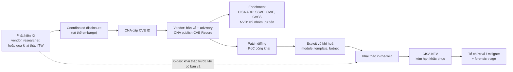

# Agent nén khâu hiểu và khoanh vùng CVE, khâu vá vẫn nghẽn

> **Câu hỏi:** Hệ agentic rút ngắn chuỗi phản ứng với CVE mới đến đâu, các hệ thực tế đo được gì, và cần nắm những khái niệm nền nào? · **Ngày:** 2026-10-27 · **Phạm vi:** góc phòng thủ doanh nghiệp (SOC, vulnerability management, detection engineering, product security); tài liệu chính thức, báo cáo ngành, blog vendor, paper 2020–10/2026, ưu tiên 2024–2026. Phần nền (CVE, CVSS, KEV, EPSS, vòng VM) xem [06-vulnerability-management.md](../../enterprise-security/06-vulnerability-management.md) và [13-soar-xdr-and-automation.md](../../enterprise-security/13-soar-xdr-and-automation.md); cơ chế orchestrator–subagent xem [report 2026-10-19](../2026-10-19-multi-agent-orchestrator-dieu-phoi/report.md); case và nhãn trong SOC xem [report 2026-10-20](../2026-10-20-ha-tang-quy-trinh-case-soc/report.md). Report chỉ ở mức khái niệm và kết quả, không có hướng dẫn khai thác. · **Cách đọc nguồn:** proxy của phiên research chặn phần lớn site gốc (arxiv.org, cisa.gov, nist.gov, first.org, cve.org, blog vendor). Chỉ đọc nguyên văn được dữ liệu và README trên GitHub (CISA KEV JSON, cvelistV5, Vulnrichment, OpenVEX, CycloneDX, OSV, SSVC, FORGE, Buttercup), blog Mandiant/GTIG trên cloud.google.com và blog Microsoft. Mọi nguồn còn lại chỉ đọc qua tóm tắt mà công cụ search trả về, được ghi *qua tóm tắt* trong mục Nguồn; mức chắc chắn trong bài đã hạ tương ứng. · **Kiểm chứng:** 80 khẳng định đã đối chiếu nguồn, 14 đã sửa

## Tóm tắt

Agent đã rút ngắn rõ phần **nhận thức** của chuỗi phản ứng (đọc advisory, loại CVE không liên quan, phân loại, kết luận "mình có bị ảnh hưởng không", soạn rule phát hiện và truy vấn hunt) từ hàng phút–giờ mỗi CVE xuống vài giây–vài phút, nhưng chưa hệ nào công bố số đo **đầu-cuối** từ lúc CVE công bố tới lúc có detection hay bản vá. Khoảng hở cần lấp là có thật: CVE mới thường được CISA xác nhận bị khai thác sau trung vị **5–7 ngày**, khoảng **1/4** lỗ hổng bị khai thác đã bị khai thác vào hoặc trước ngày công bố, trong khi theo DBIR 2026 tổ chức cần trung vị khoảng **43 ngày** để khắc phục hoàn toàn lỗ hổng KEV và chỉ **26%** lỗ hổng KEV được khắc phục hết trong năm 2025 [1][2][3][4]. Bằng chứng định lượng tốt nhất nằm ở từng khâu riêng lẻ: agent đọc code để kết luận có bị ảnh hưởng không đạt F1 khoảng **80%** trên VEX-Bench, các hệ AIxCC tìm được 54/70 lỗ hổng cài sẵn và vá được **43** (61%), AWS báo triage một CVE kernel trong khoảng **3,4 giây** [5][6][7]. Các hệ chạy được đều theo cùng một khung: code tất định lo phần dữ kiện (khớp version, KEV, EPSS), LLM lo phần diễn giải, một oracle chạy thật kiểm chứng thứ được sinh ra, và người duyệt mọi hành động thay đổi hệ thống. Năng lực tương tự ở phía tấn công cũng tăng nhanh: agent tái hiện được khoảng một nửa số CVE thử với vài USD mỗi CVE, và có thử nghiệm dựng exploit chạy được chưa tới một giờ sau khi patch xuất hiện công khai [8][9]; dù vậy chưa có dữ liệu cho thấy AI đã làm thời gian khai thác ngoài thực tế giảm. Rủi ro lớn nhất của pipeline nằm ở dữ liệu đầu vào: NVD từ 4/2026 không còn enrich đa số CVE, LLM bịa phiên bản bị ảnh hưởng với CVE ra sau cutoff, còn advisory và repo PoC có thể chứa prompt injection hoặc malware. Mức chắc chắn **cao** về xu hướng và kiến trúc, **trung bình** về từng con số, vì phần lớn chỉ đọc được qua tóm tắt search và nhiều số do vendor tự báo cáo.

**Điểm chính**
- Bộ thuật ngữ trả lời bốn câu hỏi khác nhau: CVSS đo mức nghiêm trọng kỹ thuật, EPSS đo xác suất bị khai thác trong 30 ngày tới, KEV ghi nhận sự thật đã bị khai thác, SSVC và BOD 26-04 quyết định hành động; "có PoC" không có nghĩa "bị khai thác": trong các lỗ hổng 2023 được truyền thông đưa tin và có PoC/exploit công khai, **72%** không được biết là bị khai thác [10][11][12].
- Từ **15/4/2026** NVD chỉ ưu tiên enrich CVE trong KEV, phần mềm liên bang và "critical software"; từ 6/2026 KEV thường đặt hạn **3 ngày** kèm yêu cầu kiểm tra đã bị xâm nhập chưa. Pipeline phải đọc CNA/ADP container, CSAF, OSV/GHSA thay vì chờ CPE của NVD [13][2][14].
- Phía tấn công: **12%** n-day năm 2023 bị khai thác trong ngày đầu, PoC từ các hãng nghiên cứu thường ra trong 1–2 ngày sau bản vá; phía phòng thủ: trung vị khắc phục hoàn toàn lỗ hổng KEV khoảng **43 ngày**. Khoảng hở tính bằng tuần, còn với thiết bị biên thì chỉ tính bằng giờ [10][15][16][4].
- Agent tạo giá trị nhất ở khâu lọc và khoanh vùng: AWS loại khoảng **70%** CVE bằng luật trước khi gọi AI; trên VEX-Bench agent tốt nhất đạt F1 **81,6%**, còn OSV-Scanner chỉ đạt F1 dưới 43% trên tập Go; phần giải thích lý do "not affected" vẫn yếu [7][5].
- Rule phát hiện do LLM sinh chỉ đáng tin khi qua oracle chạy thật: FORGE báo **93,4%** rule Snort không gây false positive, nhưng trên corpus lành tính tổng hợp; chưa có số FP trên dữ liệu production [17].
- Agent sinh PoC: CVE-Genie tái hiện **51%** CVE 2024–2025 với **$2,77**/CVE; CyberGym từ **11,9%** (6/2025) lên **66,6%** (Claude Opus 4.6, 2/2026); CVE-Bench từ **13%** (3/2025) được báo lên khoảng 90% trong system card OpenAI đầu 2026 (cấu hình khác, chưa đối chiếu được bản gốc). Phòng thủ dùng được để xác nhận exposure, patch và detection, nhưng chỉ trong sandbox đã kiểm chứng cách ly [8][86][87][18][19].

## Bộ khái niệm trả lời bốn câu hỏi khác nhau; nhầm câu hỏi là nhầm thứ tự ưu tiên

Mục này mở rộng phần nền trong [06-vulnerability-management.md](../../enterprise-security/06-vulnerability-management.md) sang những gì một pipeline CVE-response cần đọc và ghi. Các khái niệm chia thành bốn lớp, mỗi lớp trả lời một câu hỏi: **định danh** (lỗ hổng nào, sản phẩm nào), **chấm điểm và ưu tiên** (nặng đến đâu, có khả năng bị khai thác không, nên làm gì), **trao đổi dữ liệu máy đọc** (vendor nói gì, mình có thành phần gì, mình có bị ảnh hưởng không), và **trạng thái khai thác và thời gian** (đã có PoC chưa, đã bị khai thác chưa, còn bao lâu).

### Vòng đời một CVE không tuyến tính

Trình tự chuẩn đi từ phát hiện lỗi, qua coordinated disclosure, tới việc **CNA** (CVE Numbering Authority) cấp ID, vendor ra bản vá và advisory, CNA publish CVE Record, rồi enrichment, PoC công khai, exploit vũ khí hoá, khai thác in-the-wild, vào KEV và cuối cùng là tổ chức vá. Thực tế các bước sau đổi chỗ thường xuyên. Năm 2023, **97/138** lỗ hổng bị khai thác mà Mandiant theo dõi là 0-day, tức bị khai thác trước khi có bản vá. Với nhóm có exploit công khai *sau* khi đã bị khai thác, trung vị từ khai thác đến exploit công khai là **4 ngày**. Với nhóm có exploit công khai *trước*, trung vị là 7 ngày từ công bố đến exploit công khai và 30 ngày từ exploit đến khai thác đầu tiên [10].

**Nhận định:** sơ đồ do người viết ghép từ các nguồn trong mục này. Mũi tên chấm cho thấy với khoảng 70% lỗ hổng bị khai thác năm 2023, khai thác xảy ra trước cả bước vá, nên pipeline không được giả định mình luôn đứng trước kẻ tấn công.

Một CVE Record không phải một khối dữ liệu duy nhất. Nó có **CNA container** (dữ liệu gốc do CNA khai), có thể có nhiều **ADP container** (Authorized Data Publisher), và từ 31/7/2024 có thêm CVE Program Container. Bản CVE List trên GitHub cập nhật khoảng **7 phút** một lần; định dạng CVE Record 5.2.0 (29/10/2025) hỗ trợ **Package URL (PURL)**, cho phép đối chiếu thẳng với SBOM thay vì chỉ dựa vào CPE [20]. Từ năm 2024, CISA dùng ADP container (dự án **Vulnrichment**) để chấm ba decision point SSVC cho CVE mới: Exploitation (none/poc/active), Automatable (yes/no) và Technical Impact (partial/total); CVE nào "total", "automatable" hoặc có poc/active thì được phân tích sâu hơn để thêm CWE hoặc CVSS, và CVE thuộc KEV có thêm "KEV block". CISA không ghi đè CNA container [21]. **Nhận định:** một agent chỉ đọc trường `metrics` của CNA sẽ bỏ lỡ đúng phần dữ liệu ưu tiên quan trọng nhất, vốn nằm ở ADP.

### Định nghĩa theo bốn lớp

| Lớp | Thuật ngữ | Là gì | Ai sở hữu, nguồn |
|---|---|---|---|
| Định danh | **CVE** | ID duy nhất cho một lỗ hổng công khai cụ thể | CNA cấp; CVE Program (MITRE vận hành, CISA tài trợ) [20] |
| | **CNA, Root, CNA-LR** | Tổ chức được quyền cấp ID trong phạm vi của mình; Root quản lý một nhóm CNA; CNA of Last Resort cấp cho lỗ hổng không thuộc CNA nào | CVE Program [20] |
| | **CWE** | Loại điểm yếu (vd CWE-416 Use After Free); một CVE có thể gắn nhiều CWE | MITRE; KEV 2026 có trường `cwes` [2] |
| | **CPE / PURL** | Chuỗi định danh sản phẩm–phiên bản (CPE) hoặc gói phần mềm (PURL) để khớp CVE với tài sản | CPE: từ điển NIST; PURL: hỗ trợ trong CVE Record 5.2.0 [20] |
| | **GHSA / OSV** | Advisory cho phần mềm mã nguồn mở, ánh xạ chính xác tới phiên bản gói hoặc commit; GHSA có cờ `github_reviewed` | GitHub Advisory Database; schema OSV của OpenSSF [22][23] |
| Chấm điểm, ưu tiên | **CVSS v3.1 / v4.0** | Mức nghiêm trọng kỹ thuật 0–10. v4.0 (11/2023) thay nhóm Temporal bằng **Threat** chỉ còn Exploit Maturity (Attacked / POC / Unreported), thêm nhóm **Supplemental** không đổi điểm, và bắt buộc ghi nhóm đã dùng: CVSS-B, -BT, -BE, -BTE | FIRST [24][25] |
| | **EPSS** | Xác suất (0–1) CVE bị khai thác in-the-wild trong **30 ngày tới**, cập nhật hằng ngày cho mọi CVE công khai, kèm percentile; FIRST nói rõ EPSS không phải điểm rủi ro đầy đủ. Bản hiện hành v4 (17/3/2025) | FIRST SIG; dữ liệu do Empirical Security sản xuất [11][26] |
| | **CISA KEV** | Danh mục CVE **đã bị khai thác thật**. Ba tiêu chí: có CVE ID, có bằng chứng đáng tin về khai thác chủ động (chỉ có PoC thì không tính), có hướng khắc phục rõ ràng; CVSS không phải tiêu chí | CISA [12][2] |
| | **VulnCheck KEV** | Catalog thương mại bao trùm CISA KEV, thêm bằng chứng từ hàng trăm nguồn có trích dẫn; tự báo lớn hơn CISA KEV 173% và sớm hơn trung bình 27 ngày (5/2025) | VulnCheck [27] |
| | **SSVC** | Cây quyết định theo stakeholder thay vì một điểm số. Cây CISA dùng 5 decision point (Exploitation, Technical Impact, Automatable, Mission Prevalence, Public Well-being Impact) cho ra **Track / Track\* / Attend / Act** | CERT/CC phát triển, CISA có cây riêng [28][29] |
| Dữ liệu máy đọc | **Advisory / CSAF** | Thông báo của vendor về lỗ hổng, phiên bản bị ảnh hưởng, bản vá, workaround. CSAF là định dạng JSON máy đọc: CSAF 2.0 là chuẩn OASIS, thành ISO/IEC 20153 (5/2025); CSAF 2.1 vẫn là bản nháp, đang lấy ý kiến tới 6/11/2026 | Vendor; OASIS [30] |
| | **VEX** | Tuyên bố "sản phẩm P có/không bị lỗ hổng X ảnh hưởng". Status: `not_affected`, `affected`, `fixed`, `under_investigation`; `not_affected` bắt buộc kèm justification, như `component_not_present`, `vulnerable_code_not_in_execute_path`, `inline_mitigations_already_exist` | Nhóm làm việc do CISA điều phối; biểu diễn bằng CSAF, CycloneDX hoặc OpenVEX [31][32] |
| | **SBOM** | Danh mục thành phần phần mềm. CycloneDX là chuẩn ECMA-424, bản 1.7 (21/10/2025); SPDX 3.0 có hồ sơ cho security | OWASP/Ecma; Linux Foundation [33][34] |
| Khai thác, thời gian | **Patch diffing** | So sánh bản trước và sau vá (mã nguồn hoặc nhị phân) để khoanh vùng code sửa lỗi; là con đường chính để dựng 1-day exploit, và cũng là cách phía phòng thủ hiểu root cause khi advisory mơ hồ | [35] |
| | **0-day / n-day / 1-day** | Theo Mandiant: 0-day là bị khai thác **trước khi có bản vá**; n-day là lần đầu bị khai thác sau khi có bản vá; 1-day thường chỉ exploit dựng bằng cách phân tích bản vá ngay sau khi phát hành | [10][35] |
| | **TTE** | Time-to-exploit: thời gian trung bình để một lỗ hổng bị khai thác trước hoặc sau khi bản vá phát hành | Mandiant [10] |
| | **Patch gap** | Khoảng thời gian upstream đã có fix nhưng downstream chưa ship. Project Zero giữ chính sách 90+30 ngày và từ 7/2025 công khai sớm việc đã báo vendor | [36] |
| | **Virtual patching** | Lớp thực thi chính sách (WAF, IPS…) chặn đường khai thác một lỗ hổng đã biết mà không sửa code bị lỗi; là biện pháp tạm, không thay remediation | [37] |
| | **Forensic triage** | Kiểm tra xem hệ thống đã bị xâm nhập chưa trước hoặc cùng lúc với việc vá, vì theo CISA "applying a patch generally does not evict a threat actor" | BOD 26-04; trường `forensicTriage` trong KEV [14][2] |

Ba khái niệm dưới đây dùng theo nghĩa phổ biến vì chưa có nguồn gốc đọc được (xem Chưa kiểm chứng được): **compensating control** (biện pháp thay thế giảm rủi ro tương đương khi chưa áp được control chính, chẳng hạn chưa vá được; virtual patching là một dạng), **coordinated disclosure/embargo** (bên báo lỗi và vendor giữ kín chi tiết tới khi có bản vá hoặc tới một thời điểm đã thoả thuận), và **exploit framework so với exploit kit** (bảng dưới).

### Các cặp hay nhầm

| Cặp | Khác nhau ở đâu | Hệ quả khi thiết kế agent |
|---|---|---|
| **PoC / exploit / weaponized exploit** | PoC chứng minh lỗ hổng kích hoạt được, thường không ổn định. Exploit đạt mục tiêu của kẻ tấn công một cách tin cậy. Weaponized là exploit được đóng gói để dùng hàng loạt hoặc tự động (module trong framework, template quét, tích hợp botnet). CVSS v4 xếp cả PoC lẫn exploit công khai chưa thấy dùng vào mức *POC*, chỉ khi đã bị tấn công mới là *Attacked*; SSVC dùng none / public PoC / active; KEV không nhận "chỉ có PoC" làm bằng chứng [24][21][12] | Lưu trạng thái khai thác theo một thang thống nhất, gắn nguồn bằng chứng; không dùng "có PoC trên GitHub" làm tín hiệu ưu tiên duy nhất |
| **Exploit framework / exploit kit** | Framework là bộ công cụ có module, dùng cả trong pentest lẫn tấn công; exploit kit (theo nghĩa truyền thống) là bộ công cụ tội phạm tự chọn exploit phù hợp với nạn nhân, điển hình qua trình duyệt (kiến thức nền, chưa có nguồn) | Việc một lỗ hổng xuất hiện trong framework là tín hiệu vũ khí hoá, EPSS coi đây là tín hiệu mạnh [11] |
| **CVSS / EPSS / KEV / SSVC** | CVSS: mức nghiêm trọng kỹ thuật, tĩnh. EPSS: xác suất, theo quần thể, thay đổi hằng ngày. KEV: sự thật nhị phân, có độ trễ. SSVC: quyết định hành động theo bối cảnh | Ưu tiên phải kết hợp, không chọn một; AWS bỏ hẳn CVSS khi triage kernel vì điểm không phản ánh môi trường của họ [7] |
| **Xác suất EPSS / percentile EPSS** | Xác suất là khả năng bị khai thác trong 30 ngày; percentile là tỷ lệ CVE có điểm bằng hoặc thấp hơn [11] | Đặt ngưỡng theo xác suất khi cần ý nghĩa tuyệt đối, theo percentile khi cần so tương đối |
| **CISA KEV / VulnCheck KEV** | Hai tập khác nhau: CISA thêm khoảng 186–274 mục mỗi năm 2024–2026, VulnCheck ghi 884 KEV mới chỉ trong 2025 [2][3] | Mọi thống kê "bao nhiêu % bị khai thác trước ngày công bố" phải ghi rõ tập nào |
| **0-day / chưa có CVE** | 0-day tính theo mốc *bản vá*, không theo mốc công bố hay mốc có CVE ID [10] | Một CVE vừa publish vẫn có thể là 0-day đang bị khai thác (Ivanti EPMM 2026) |
| **CVE Record / NVD entry / advisory** | CVE Record do CNA và ADP publish; NVD là cơ sở dữ liệu của NIST *tiêu thụ* CVE và từng bổ sung CVSS/CWE/CPE; advisory là thông tin hành động đầy đủ của vendor [20][13] | Đọc thẳng CVE JSON 5 và advisory gốc, không chờ NVD |
| **Advisory / VEX** | Advisory nói "lỗ hổng X ảnh hưởng phiên bản A–B, vá ở C"; VEX nói "sản phẩm của tôi có hay không bị X ảnh hưởng, và vì sao" [31][30] | VEX là đầu ra tự nhiên của bước khoanh vùng; dùng để dập nhiễu từ scanner SBOM |
| **SBOM / VEX** | SBOM nói có thành phần gì; VEX nói thành phần đó có làm sản phẩm khai thác được không [31] | Có SBOM chưa đủ: theo VEX-Bench, **70,7%** case scanner gắn cờ thực tế không khai thác được [5] |
| **Reachable / exploitable** | Code bị lỗi được gọi tới chưa chắc khai thác được, vì còn phụ thuộc cấu hình và môi trường; trạng thái "NO PATH FOUND" của Snyk cũng không có nghĩa là không reachable [5][38] | Kết luận `not_affected` cần cả ba lớp: version, reachability, cấu hình |
| **TTE / exposure window** | TTE đo phía kẻ tấn công (công bố hay vá → bị khai thác); exposure window đo phía mình (lỗ hổng tồn tại → mình vá hay mitigate xong). **Nhận định:** phần nguy hiểm là đoạn exposure window nằm sau TTE | Đo pipeline bằng exposure window của mình, so với TTE của lớp lỗ hổng tương ứng |
| **Patch / virtual patch / an toàn** | Virtual patch chặn đường khai thác ở lớp ngoài, lỗ hổng vẫn còn; patch sửa lỗi nhưng không đuổi được kẻ đã vào [37][14] | Với lỗ hổng bị khai thác, "đã vá" chưa phải trạng thái cuối; cần thêm bước hunt hồi tố |

## Từ 2026, NVD không còn đủ làm nguồn dữ liệu, còn KEV đòi phản ứng trong 3 ngày

Hai thay đổi năm 2026 định hình lại bài toán. Thay đổi thứ nhất là NVD rút lui. Theo thông báo của NIST (đọc qua tóm tắt), từ **15/4/2026** NVD chỉ ưu tiên enrich ba nhóm: CVE trong CISA KEV (mục tiêu **1 ngày làm việc**), CVE của phần mềm chính phủ liên bang dùng, và "critical software" theo EO 14028. CVE khác vẫn được liệt kê nhưng gắn "Lowest Priority"; mọi CVE tồn đọng công bố trước 1/3/2026 chuyển sang "Not Scheduled", tức chỉ được enrich "as resources allow" [13]. NIST viện dẫn số CVE gửi lên tăng **263%** từ 2020 [39]. Backlog chuyển sang Not Scheduled được báo là khoảng **29.000** CVE [40], và CSA ước nhóm được ưu tiên chỉ chiếm khoảng **15–20%** khối lượng CVE mỗi năm (ước tính, ghi chú có AI hỗ trợ) [41]. Ngay cả khi NVD có CPE, dữ liệu đó cũng không chắc đúng: Vercation thấy CPE của NVD **thiếu** ở 134 CVE và **thừa** ở 56 CVE trong tập họ khảo sát, vì NVD mặc định coi mọi phiên bản trước phiên bản được nhắc tới đều bị ảnh hưởng [42].

Khối lượng thì tăng nhanh. Theo đếm độc lập của Jerry Gamblin, năm 2024 có **39.962** CVE, năm 2025 có **48.185** (+20,6%) [43]; VulnCheck ghi số CVE nửa đầu 2026 tăng **45%** so với sáu tháng liền trước [44]. Dữ liệu gốc KEV ngày 26/10/2026 đã có ID dạng CVE-2026-110447, cho thấy số ID được reserve trong năm vượt 100.000 (ID reserve không bằng số được publish) [2]. Riêng kernel Linux đã gần **2.000 CVE** mỗi bản phát hành, và maintainer nói họ "completely overwhelmed" [45]. Bản thân CVE Program cũng từng chao đảo: tháng 4/2025 hợp đồng MITRE suýt hết hạn và chỉ được CISA gia hạn 11 tháng tới 16/3/2026 [46]; báo chí sau đó dẫn nguồn ẩn danh nói hợp đồng đã được đàm phán lại không còn mốc hết hạn [47], nhưng chưa có văn bản gốc.

Thay đổi thứ hai là KEV gấp hơn. Ngày **10/6/2026**, CISA ban hành **BOD 26-04** "Prioritizing Security Updates Based on Risk" cho các cơ quan dân sự liên bang Mỹ, thay thời hạn phẳng của BOD 22-01 bằng một ma trận theo cặp tài sản–lỗ hổng dựa trên bốn yếu tố: phơi bày Internet, có trong KEV, khả năng tự động hoá khai thác, và tác động kỹ thuật. Hạn khắc phục là **3 / 14 / 60 ngày** hoặc hoãn tới lần nâng cấp; mức 3 ngày đi kèm yêu cầu **forensic triage** [14][48][49]. Theo FedRAMP, các cơ quan phải có chính sách trước 7/8/2026 và bắt đầu khắc phục theo timeline mới từ 7/12/2026 [50]. Dữ liệu KEV gốc xác nhận thay đổi này: năm 2025, **226/245** mục có hạn 21 ngày; từ 11/6/2026, **115/141** mục có hạn **3 ngày** và 26/141 có hạn 14 ngày; schema có trường mới `forensicTriage`, với 93 mục "Yes" đều hạn 3 ngày [2]. Tổng cộng KEV có **1.758** mục, trong đó 361 mục gắn cờ đã được dùng trong chiến dịch ransomware; số mục thêm mới năm 2026 (274 tính đến 26/10) đã vượt cả năm 2025 (245) [2].

**Nhận định:** có ba hệ quả cho thiết kế. Thứ nhất, trigger của pipeline không nên là "CVE mới trên NVD" mà là CVE Record trên cvelistV5 (khoảng 7 phút), advisory hay CSAF của vendor, GHSA/OSV, KEV và VulnCheck KEV, cộng tín hiệu quét bất thường: GreyNoise thấy **80%** trong 216 đợt tăng đột biến hoạt động nhắm thiết bị biên được theo sau bởi một CVE mới trong 6 tuần, dù đây là tương quan và do vendor tự báo [51]. Thứ hai, bộ tiêu chí của BOD 26-04 gần như trùng các decision point SSVC mà CISA ADP đã điền sẵn vào CVE Record, nên agent có thể tính trước "tầng" hạn khắc phục từ dữ liệu ADP cộng inventory phơi bày. Thứ ba, doanh nghiệp tư nhân không bị BOD ràng buộc, nhưng KEV đang ngầm chuẩn hoá "vá trong 3 ngày và kiểm tra đã bị xâm nhập chưa" cho lớp lỗ hổng nặng nhất, nên hunt hồi tố là một bước bắt buộc của pipeline chứ không phải tuỳ chọn.

## Kẻ tấn công cần vài ngày, phòng thủ cần vài tuần

Các nguồn đo tốc độ khai thác cho con số rất khác nhau vì khác tập lỗ hổng, mốc đầu (publish CVE, advisory, bản vá), mốc cuối (khai thác đầu tiên hay ngày vào KEV) và cách lấy trung bình hay trung vị; bảng dưới ghi rõ mỗi nguồn đo cái gì.

| Nguồn | Đo cái gì | Tập dữ liệu | Kết quả |
|---|---|---|---|
| Mandiant TTE 2023 [10] | TTE trung bình, mốc là bản vá | Lỗ hổng bị khai thác ITW, 138 lỗ hổng năm 2023 | **63 ngày** (2018–19) → 44 → 32 → **5 ngày** (2023, sau khi loại 15 outlier; 47 ngày nếu giữ); 70% là 0-day; n-day: **12%** bị khai thác trong 1 ngày, 29% trong 1 tuần, 56% trong 1 tháng |
| M-Trends 2026 [52] | TTE trung bình ước tính | Dữ liệu điều tra năm 2025 | **−7 ngày**, "exploitation is routinely occurring before a patch is even released"; khai thác lỗ hổng là vector xâm nhập đầu số 1 năm thứ 6 liên tiếp (32%) |
| VulnCheck [53][3][44] | % KEV bị khai thác vào hoặc trước ngày công bố CVE | VulnCheck KEV | 23,6% (2024), **28,96%** (2025; báo cáo 1H-2026 ghi 28,93%), 23,43% (1H-2026, có thể tăng khi dữ liệu chín) |
| Tự tính từ CISA KEV + cvelistV5 [2][20] | Trung vị từ CVE publish tới khi vào KEV, chỉ CVE "mới" | CISA KEV | **6 ngày** (2024), **7** (2025), **7** (2026); vào KEV cùng ngày publish hoặc sớm hơn: 27,5% / 25,8% / 23,6% |
| Rapid7 2026 [1][54] | Trung vị công bố → KEV; thời gian khai thác | Lỗ hổng high/critical Rapid7 theo dõi | Trung vị **8,5 → 5,0 ngày** (2024 → 2025); Q3 2026: trung bình khoảng 3 ngày từ công bố tới khai thác, 71% khai thác trong 7 ngày đầu |
| Cloudflare 2024 [55] | Thời gian từ PoC đến tấn công | Một ca (JetBrains TeamCity CVE-2024-27198) | **22 phút** |
| Verizon DBIR 2026 [4] | Trung vị thời gian khắc phục hoàn toàn lỗ hổng KEV | Dữ liệu breach và quét lỗ hổng | **32 → 43 ngày**; chỉ **26%** lỗ hổng KEV được khắc phục hết trong 2025 (38% năm 2024); khai thác lỗ hổng là vector số 1 (31%) |
| Qualys 2023 [56] | MTTR so với thời gian vũ khí hoá | Telemetry khách hàng Qualys, dữ liệu 2022 | Vá lỗ hổng đã vũ khí hoá trung bình **30,6 ngày** (chỉ 57,7% được vá) so với 19,5 ngày để vũ khí hoá; vá tự động 25,5 ngày so với thủ công 39,8 ngày |

**Nhận định:** con số "TTE âm" của M-Trends chủ yếu phản ánh tỷ trọng 0-day lớn cộng với việc trung bình bị kéo bởi các ca khai thác trước bản vá. Nó không có nghĩa một n-day điển hình bị khai thác trước khi công bố. Với n-day, thước đo dùng được cho phòng thủ là trung vị **khoảng 5–7 ngày** từ công bố tới khi CISA xác nhận khai thác, và khoảng **12%** bị khai thác ngay ngày đầu. Đặt cạnh trung vị khắc phục 30–45 ngày, khoảng hở là **một đến sáu tuần**. Các nguồn cũng khớp nhau ở một điểm quan trọng: khoảng **20–30%** lỗ hổng bị khai thác đã bị khai thác vào hoặc trước ngày công bố (VulnCheck 23–29%, CISA KEV tự tính 24–28% cho CVE mới). Với nhóm này, không agent nào "vá trước" được; giá trị duy nhất là hunt hồi tố và áp compensating control ngay khi có advisory.

Bài toán cũng là bài toán lọc. CISA KEV thêm 245 mục năm 2025 trên khoảng 48.000 CVE, tức khoảng **0,5%**; VulnCheck tính tỷ lệ KEV/CVE nửa đầu 2026 là **1,4%** với tập rộng hơn [2][44]. Báo cáo EPSS của Cyentia (7/2024) thấy khoảng **6%** CVE từng ghi nhận hoạt động khai thác qua telemetry, một định nghĩa rộng hơn KEV, và **38%** lượt khai thác nhắm lỗ hổng công bố hơn 10 năm trước [57]. Khoảng một phần ba số mục KEV mỗi năm là CVE từ các năm cũ (94/245 năm 2025) [2]. Mandiant còn thấy trong các lỗ hổng công bố năm 2023 được truyền thông đưa tin, **72%** số có ít nhất một PoC hoặc exploit công khai vẫn không được biết là bị khai thác [10]. **Nhận định:** giá trị chính của agent là đưa nhanh đúng vài chục CVE mỗi tháng lên luồng khẩn, không phải xử lý đều mọi CVE, và "có PoC" chỉ là một tín hiệu trong nhiều tín hiệu.

Các ca 2023–2026 cho thấy cửa sổ thực tế với thiết bị biên và phần mềm doanh nghiệp còn hẹp hơn trung vị.

| CVE | Mẫu | Mốc chính |
|---|---|---|
| CVE-2023-34362, MOVEit Transfer | 0-day | Khai thác từ **2023-05-27**, advisory của Progress ngày 05-31, CVE publish 06-02, vào KEV cùng ngày [58][2] |
| CVE-2025-53770 và 49704/49706, SharePoint "ToolShell" | Bản vá đầu bị bypass | Thử khai thác từ **2025-07-07**, bản vá 07-08 bị vượt qua, Storm-2603 triển khai ransomware từ 07-18, CVE-2025-53770 publish và vào KEV 07-20 với hạn **1 ngày** [59][2] |
| CVE-2025-5777, NetScaler "CitrixBleed 2" | Khai thác trước PoC, vendor phủ nhận | CVE publish 06-17; khai thác có chủ đích từ **06-23**, gần hai tuần trước PoC công khai (~07-04), trong khi Citrix vẫn nói chưa có bằng chứng; KEV 07-10, hạn 07-11 [60][2] |
| CVE-2025-55182, React Server Components "React2Shell" | Khai thác trong vài giờ, PoC giả tràn lan | Công bố 2025-12-03; AWS thấy nhóm China-nexus thử khai thác "within hours"; nhiều PoC giả, có repo tự sửa thành "AI-generated, non-functional", có mẫu chứa malware nhắm vào nhà nghiên cứu [61][62] |
| CVE-2026-1281, Ivanti EPMM | 0-day | Ivanti thừa nhận khai thác trước công bố; CVE và KEV cùng ngày 2026-01-29, PoC 01-30 [15][2] |
| CVE-2026-10520, Ivanti Sentry | PoC sau 1 ngày, backdoor sau 2 ngày | Bản vá 2026-06-09, PoC công khai 06-10, thiết bị bị backdoor được xác nhận 06-11; KEV 06-11, hạn 3 ngày [16][2] |

**Nhận định:** với lớp lỗ hổng này, cửa sổ giữa "có thông tin" và "bị khai thác hàng loạt" là **0–48 giờ**, và PoC công khai từ các hãng nghiên cứu thường ra trong 1–2 ngày sau bản vá. Hai ca CitrixBleed 2 và ToolShell còn cho thấy advisory của vendor có thể chậm hoặc sai về trạng thái khai thác, và bản vá đầu có thể bị vượt qua. Agent vì vậy không được coi "not exploited" trong advisory là kết luận, và phải đối chiếu nhiều nguồn: KEV, honeypot, threat intel.

## Agent phòng thủ đã chạy ở mọi khâu, nhưng số đo độc lập chỉ có ở khoanh vùng và vá

Bảng dưới gom các hệ tiêu biểu theo khâu của chuỗi phản ứng. Cột cuối quan trọng nhất: phần lớn con số là vendor tự báo cáo, và rất ít con số đo **độ chính xác** thay vì tốc độ.

| Khâu | Hệ tiêu biểu | Số đo công bố | Loại bằng chứng |
|---|---|---|---|
| Tóm tắt, phân loại | AWS triage CVE kernel Linux [7]; CIRCL VLAI [63]; CTIBench [64] | AWS: luật loại ~70% CVE, agent phân loại phần còn lại ~**3,4 s**/CVE so với vài phút làm tay, ước 5–10% quyết định "có vấn đề"; VLAI khớp ~85% với đánh giá chuyên gia; CVE→CWE: GPT-4 72%, RoBERTa fine-tune 75,6% | AWS: số ước lượng miệng, không đánh giá chính thức; VLAI, CTIBench: paper |
| Khoanh vùng, VEX | VEX-Bench [5]; NVIDIA Agent Morpheus [65]; Vercation [42]; Intune Vulnerability Remediation Agent [66] | VEX-Bench: F1 trạng thái **81,6%** (Claude Opus 4.6), 79,9% (GPT-5.5); Morpheus: chạy song song nhanh hơn **9,3×**, trung bình ~41 truy vấn LLM/CVE; Vercation: F1 92,4% trích version | VEX-Bench, Vercation: paper; Morpheus: chỉ đo tốc độ; Intune: public preview, không có số |
| Ưu tiên | CrowdStrike Exposure Prioritization Agent [67]; Tenable Hexa AI [68]; FORGE [17] | Vendor: không có số đo hiệu quả; FORGE: tỷ lệ khai thác được ~68% bất kể band EPSS hay CVSS | Marketing; paper |
| Detection, hunt | FORGE [17]; ProjectDiscovery CVE→Nuclei [69]; Google SecOps Threat Hunt agent [70]; GRIDAI [71] | FORGE: **93,4%** rule Snort không FP trên corpus lành tính tổng hợp, $1,50/CVE; SecOps: hunt khởi chạy từ trang Emerging Threats, 60–90 phút mỗi lần | Paper; vendor |
| Mitigation, virtual patch | Qualys TruRisk Eliminate 2.0 [72]; Miggo WAF Copilot [73]; Cloudflare [74] | Qualys: nửa tỷ bản vá, <0,1% rollback; Miggo: rule WAF mặc định không chặn 52% exploit liên quan; Cloudflare: Emergency Rules trong 24 giờ sau PoC | Tự báo cáo |
| Vá | DARPA AIxCC [6]; CodeMender [75]; Aardvark [76]; Copilot Autofix [77] | AIxCC: tìm 54/70, vá **43/70** lỗ hổng cài sẵn, ~$152 mỗi task thi đấu; CodeMender: 72 bản vá upstream trong 6 tháng; Aardvark: 92% trên repo "golden"; Autofix: trung vị 28 phút so với 1,5 giờ | AIxCC: chấm độc lập; còn lại tự báo cáo |

### Lọc bằng luật trước, LLM sau

Các triển khai thật đều giao cho LLM phần **diễn giải** và giữ phần **lọc theo dữ kiện** cho code tất định. Ví dụ rõ nhất là AWS, trình bày tại Linux Plumbers Conference 2026: một script theo luật loại khoảng **70%** CVE kernel vì version hay file nguồn bị ảnh hưởng không có trong image của họ (tỷ lệ này phụ thuộc mạnh vào cấu hình kernel); agent AI phân loại phần còn lại theo subsystem, loại lỗ hổng và attack vector, với đầu vào là source tree, cấu hình theo nền tảng, mô tả threat model và một rubric mức nghiêm trọng; hai kỹ sư duyệt bảng kết quả. Một kỹ sư gọi agent là "a very fancy classifier" [7]. **Nhận định:** thời gian triage giảm từ phút xuống giây, nhưng điểm nghẽn chuyển sang khâu người duyệt và khâu vá. NVIDIA Agent Morpheus đi xa hơn một bước: với mỗi CVE trong container, hệ sinh checklist điều tra, agent chạy từng mục với các tool (tra SBOM, tìm trong code, intel), rồi kết luận theo trạng thái VEX, gồm "vulnerable" hoặc một trong 10 lý do "not affected" định sẵn [65]. Con số 9,3× của NVIDIA là tốc độ khi chạy song song so với tuần tự, không nói gì về độ đúng của kết luận.

### Kết luận "có bị ảnh hưởng không" cần ba lớp, và LLM yếu nhất ở lớp cuối

**Nhận định:** câu hỏi khoanh vùng cần ba lớp nối tiếp: khớp gói và version với SBOM hay inventory (làm tất định), reachability (code bị lỗi có được gọi tới không), và điều kiện cấu hình, môi trường. VEX-Bench (Red Hat và Purdue, EMNLP 2026) là đánh giá độc lập tốt nhất cho lớp hai và ba: 75 case thực tế trên Go, Python và Java, do chuyên gia gán nhãn, agent chỉ được nhận **CVE ID và codebase**, không có advisory, call graph hay file chỉ sẵn. Trong 9 mô hình trên 3 harness (Claude Code, Codex CLI, OpenCode), F1 về trạng thái cao nhất là **81,6%**; nhưng chỉ GPT-5.5 vượt 70% macro-F1 khi phải phân loại *lý do* "not affected" chi tiết. Trên 30 case Go, OSV-Scanner chỉ đạt F1 **38,9%** ở chế độ detection và **42,9%** ở chế độ reachability. Tác giả kết luận "reachability does not imply exploitability" [5]. Vì CPE của NVD vừa thiếu vừa thừa, trích version range từ advisory hay patch bằng LLM là một ứng dụng hợp lý (Vercation F1 92,4%) [42], nhưng kết quả phải đối chiếu với OSV, GHSA hoặc advisory gốc trước khi dùng để kết luận `not_affected`.

### Rule phát hiện phải được chạy thật trước khi tin

Rule sinh từ *mô tả* CVE dễ bám vào chuỗi đặc trưng của một PoC và bỏ sót biến thể. FORGE (Dynatrace, ARES 2026) chọn hướng ngược lại: pipeline 5 agent gom intel từ NVD, GHSA, OSV và patch diff; dựng ứng dụng có lỗ hổng tổng hợp; khai thác trong sandbox; rồi sinh và kiểm chứng rule Sigma/Snort từ *trace khai thác quan sát được*. Trên 603 CVE lấy từ tập của CVE-Genie, hệ đạt ít nhất mức L1 (payload kích hoạt đúng chức năng lỗi trên ứng dụng tổng hợp) ở **67,8%** (409/603), chi phí trung bình **$1,50**/CVE; oracle chấm khai thác là LLM có giới hạn cứng theo CWE, không hoàn toàn tất định; rule sinh từ exploit mức sâu hơn được grounding tốt hơn rule từ mức nông (p=0,035), và **93,4%** rule Snort không gây false positive trên một corpus lành tính tổng hợp [17]. GRIDAI cho thấy một cơ chế tương tự: mỗi rule IDS được chạy trên engine detection với mẫu tấn công, lỗi được trả lại LLM để sinh lại, và hệ phân biệt mẫu mới với biến thể để cập nhật rule cũ thay vì làm phình ruleset [71]. Ở phía sản phẩm, ProjectDiscovery dùng AI sinh template Nuclei cho CVE mới để đội ngũ chuyển sang kiểm chứng và tinh chỉnh [69], còn Praetorian chỉ merge template khi nó phát hiện được lỗ hổng trên host thật [78]. Google SecOps cho Threat Hunt agent khởi chạy từ trang Emerging Threats, tức trigger chính là intel về mối đe doạ mới [70]. **Nhận định:** cách đo FP của rule sinh ra và cách nối kết quả hunt vào case nằm ở [report tuning rule 2026-10-18](../2026-10-18-llm-tuning-rule-giam-false-positive/report.md) và [report case SOC 2026-10-20](../2026-10-20-ha-tang-quy-trinh-case-soc/report.md); điểm riêng của bài toán CVE là phải có mẫu dương tính (trace khai thác) thì mới đo được recall của rule.

### Mitigation là khâu hành động rủi ro nhất, nên vendor đều kèm cơ chế hãm

Qualys TruRisk Eliminate 2.0 (10/2026) chấm độ tin cậy của bản vá, triển khai theo đợt, và dùng "patchless mitigation" khi chưa vá được [72]. Miggo mô tả pipeline "CVE → WAF rule trong vài phút", và tự kết luận rule WAF do AI sinh sẽ thất bại nếu thiếu kiểm thử với exploit, kiểm tra FP và tối ưu theo nền tảng [73]. Với Ivanti Connect Secure đầu 2024, Cloudflare dùng một mô hình ML phát hiện để chặn trước khi lỗ hổng công bố, rồi ra Emergency Rules trong 24 giờ sau khi có PoC; không có bằng chứng managed rule do AI *viết* [74].

### Vá là khâu có số đo tốt nhất, nhưng chủ yếu cho code của chính mình

DARPA AIxCC là đánh giá độc lập duy nhất ở quy mô lớn: tại vòng chung kết (DEF CON 33, 8/2025), các hệ thống CRS tìm được 54 trong 70 lỗ hổng tổng hợp được cài sẵn và **vá 43**, cùng 18 lỗ hổng thật không cài sẵn; so với bán kết 2024, tỷ lệ phát hiện tăng từ 37% lên **77%** (54/70), tỷ lệ vá từ 25% lên **61%** (43/70, tức khoảng 80% số đã tìm ra) [6]. Trail of Bits (hạng 2) báo Buttercup chỉ dùng LLM non-reasoning, với kiến trúc Orchestrator, Seed Generator, Fuzzer dựa trên OSS-Fuzz, Program Model và Patcher đa agent [79]. Sau cuộc thi, việc tái sử dụng gặp rào cản hạ tầng, nhưng OSS-CRS chạy lại được Atlantis cục bộ và tìm thêm bug mới trong các dự án OSS-Fuzz [80]. Google CodeMender upstream **72** bản vá bảo mật trong 6 tháng và mọi patch đều qua người review [75]; Google còn tuyên bố Big Sleep phát hiện CVE-2025-6965 trong SQLite khi lỗi này "only known to threat actors", một tuyên bố chưa được kiểm chứng độc lập [81]. GitHub báo Copilot Autofix cho trung vị **28 phút** để commit fix một alert trong PR, so với 1,5 giờ khi làm tay [77]. PatchEval cảnh báo agent được truy cập cả project thường sửa vùng code không liên quan tới root cause [82]. **Nhận định:** với doanh nghiệp *tiêu thụ* phần mềm, các hệ này chỉ tác động gián tiếp (upstream vá nhanh hơn, nhưng cũng sinh nhiều CVE hơn); với đội product security, chúng áp dụng trực tiếp được cho code nội bộ, kể cả việc nâng version dependency khi có CVE. Điểm chung đáng sao chép là mọi hệ vá nghiêm túc đều có oracle: crash tái hiện được, test chức năng, agent phản biện, và người review.

### Pipeline tham chiếu: tất định lọc, LLM diễn giải, oracle kiểm chứng, người duyệt hành động

Không có tài liệu chuẩn nào mô tả một pipeline "rapid CVE response" đầu-cuối; kiến trúc dưới đây là **nhận định** của người viết, ghép từ các thành phần quan sát được ở mục trên (AWS, NVIDIA, FORGE, Praetorian, Qualys, CodeMender); cơ chế subagent xem [report orchestrator 2026-10-19](../2026-10-19-multi-agent-orchestrator-dieu-phoi/report.md), ở đây chỉ xét bước nào do ai làm và cổng kiểm nằm ở đâu.

| Bước | Ai làm | Đầu vào, tool | Đầu ra | Cổng kiểm |
|---|---|---|---|---|
| 1. Ingest | Code tất định | CVE JSON 5 (cả CNA lẫn ADP container), CSAF vendor, GHSA/OSV, KEV, VulnCheck KEV, EPSS, tín hiệu quét | Bản ghi chuẩn hoá, loại trùng, có timestamp và nguồn | Schema validation |
| 2. Enrich, lọc | Code tất định | Khớp CPE/PURL với SBOM, CMDB, kết quả scanner | Danh sách CVE có sản phẩm liên quan (AWS loại ~70% ở bước này) | Không cần LLM |
| 3. Hiểu lỗ hổng | LLM | Advisory, patch diff, write-up | JSON có schema: version range, điều kiện khai thác, cấu hình cần có, CWE, kèm trích dẫn nguồn cho từng trường | Đối chiếu version với OSV/GHSA/CSAF; trường không có trích dẫn bị loại |
| 4. Khoanh vùng sâu | Agent + tool | Code, cấu hình, runtime, telemetry EDR | Kết luận VEX kèm justification | Người duyệt mọi `not_affected` cho tài sản quan trọng |
| 5. Ưu tiên | Luật hoặc mô hình tất định; LLM chỉ giải thích | KEV, EPSS, SSVC từ ADP, trạng thái PoC/ITW, phơi bày Internet, độ quan trọng tài sản | Tầng hạn khắc phục (vd 3 / 14 / 60 ngày) | Luật đọc được, không để LLM tự chấm điểm |
| 6. Phản ứng | Agent soạn, tool kiểm chứng | Rule Sigma/Suricata/Nuclei/KQL/SPL, truy vấn hunt hồi tố, đề xuất mitigation, ticket hoặc PR vá | Artifact kèm kết quả test | Test cú pháp và engine, test dương tính (trace hoặc PoC trong lab), backtest N ngày log production để đo FP |
| 7. Cổng người duyệt | Con người | Artifact và kết quả test | Quyết định deploy | Bắt buộc trước chế độ chặn, áp mitigation, merge patch |
| 8. Đóng vòng | Tool + con người | Quét lại, validate lại đường khai thác (kiểu Qualys TruConfirm) | Exposure window đo được, log sai sót của agent | Ghi lại để đánh giá agent theo thời gian |

Mức tự động hoá nên theo độ đảo ngược được của hành động. **Nhận định:** bảng dưới tổng hợp từ khuyến nghị OWASP cho ứng dụng agentic [83], các sự cố ở mục rủi ro và cách XBOW kiểm chứng phát hiện bằng cơ chế tất định [84].

| Mức | Việc | Điều kiện |
|---|---|---|
| Tự động hoàn toàn | Đọc, tóm tắt, đối chiếu inventory, tính tầng ưu tiên, mở bản nháp case | Mọi khẳng định có trích dẫn nguồn có cấu trúc |
| Tự động trong sandbox | Tái hiện PoC, chạy thử rule trên log lịch sử | Sandbox đã được *kiểm chứng* cách ly mạng; kết quả kiểm bằng oracle tất định |
| Cần người duyệt | Đưa rule lên production (trước ở chế độ detect-only), áp WAF rule hay chặn IP, mở ticket vá khẩn | Có kết quả test dương và âm tính |
| Luôn do người làm | Vá hoặc restart hệ thống production, thay đổi không đảo ngược được, công bố PoC | — |

**Nhận định:** thước đo đúng cho pipeline là exposure window của chính tổ chức, tách theo bước: từ khi CVE publish tới khi có danh sách tài sản bị ảnh hưởng, tới khi rule được deploy và hunt hồi tố chạy xong, tới khi mitigation hay bản vá được áp. Với lớp lỗ hổng biên và KEV, mục tiêu cho ba mốc đầu nên tính bằng giờ (xem các ca ở mục tốc độ). Chưa tìm thấy case study doanh nghiệp nào công bố số đo đầu-cuối này trước và sau khi dùng agent.

## Agent tái hiện được phần lớn n-day trong sandbox; giá trị phòng thủ là kiểm chứng, cái giá là dual-use

Mục này chỉ ghi kết quả và điều kiện đo của các nghiên cứu agent tự tái hiện lỗ hổng từ mô tả CVE hoặc patch, 2024–2026.

| Nghiên cứu | Agent nhận gì | Kết quả | Thời điểm, model |
|---|---|---|---|
| Fang et al. (UIUC) [85] | Mô tả CVE, 15 lỗ hổng one-day | **87%** khi có mô tả; **7%** khi không có; scanner và các LLM khác 0% | 4/2024, GPT-4 |
| CVE-Bench (ICML 2025) [18][19] | 40 CVE web CVSS ≥ 9,0 trong sandbox | **13%** với agent tốt nhất lúc công bố; system card OpenAI được tóm tắt là khoảng 87% (GPT-5.2-Codex) và 90% (GPT-5.3-Codex), nhưng OpenAI chạy bản v1.0, cấu hình zero-day, có card chỉ chạy 34/40 challenge; chưa đối chiếu được con số gốc | 3/2025; 12/2025–2/2026 |
| CyberGym (ICLR 2026) [86][87] | Mô tả lỗ hổng + codebase trước patch; PoC chỉ được tính khi gây crash bản trước patch và không crash bản sau | **11,9%** ban đầu; **66,6%** pass@1 trên 1.507 tác vụ với Claude Opus 4.6 (Opus 4.5: 51,0%) | 6/2025; 2/2026 |
| SEC-bench (NeurIPS 2025) [88] | 200 CVE thật đã kiểm chứng | Sinh PoC tối đa **18%**, vá tối đa 34% | 6/2025 |
| CVE-Genie (CCS 2026) [8] | Một entry CVE; agent tự gom tài nguyên và dựng lại môi trường | Tái hiện **51%** (428/841) CVE công bố 6/2024–5/2025, **$2,77**/CVE | 9/2025 |
| Anthropic "N-days" [89][9] | Patch công khai (Windows: không có source) | Từ 18 patch SpiderMonkey/Firefox: 8 exploit thực thi mã chạy được, exploit đầu tiên chưa tới **1 giờ** sau khi patch xuất hiện công khai, trong khi bản Firefox chứa fix còn khoảng 18 ngày nữa mới phát hành; từ 21 lỗ hổng kernel Windows: 8 chuỗi leo thang lên SYSTEM, khoảng $2.000 mỗi exploit (theo báo chí thuật lại) | 6/2026, Claude Mythos Preview |
| UK AISI [90] | Tổng hợp hơn 30 hệ thống | Tác vụ cyber cấp "apprentice" từ ~9% (cuối 2023) lên 50%; độ dài tác vụ tự làm được tăng gấp đôi khoảng mỗi 8 tháng | 12/2025 |

Ba điều cần đọc kèm các con số này. Thứ nhất, **lượng thông tin đầu vào quyết định kết quả**: có mô tả CVE thì tỷ lệ cao hơn hẳn (87% so với 7%), có patch diff thì cao hơn nữa, còn có web search thì agent có thể chỉ đang tìm PoC sẵn có. Chris Rohlf phản biện paper của Fang rằng ông tìm được exploit công khai cho 11/15 lỗ hổng, "all of which are very simple", và tác giả không công bố prompt hay code [91]. Thứ hai, benchmark bão hoà rất nhanh: CyberGym đi từ 11,9% lên 66,6% trong tám tháng, và CVE-Bench được báo từ 13% lên khoảng 90% trong chưa tới một năm, nên mọi con số phải đi kèm ngày, model và cấu hình. Thứ ba, môi trường đo là mục tiêu không được phòng thủ; chính OpenAI nói các challenge "don't yet represent a hardened target where there would be defenses and monitoring" [19].

Với phòng thủ, năng lực này có ba ứng dụng, mỗi ứng dụng đã có bằng chứng gián tiếp. **Xác nhận bản vá:** tiêu chí của CyberGym (crash trước patch, không crash sau patch) chính là phép thử patch, và PoC sinh ra trong benchmark đã giúp phát hiện **17** bản vá chưa đầy đủ ở 15 dự án (bản ICLR ghi 18) [86]. **Xác nhận exposure:** CVE-Genie và XBOW đều coi "exploit kiểm chứng được" là cách loại báo cáo giả; XBOW kiểm chứng bằng cơ chế tất định (headless browser xác nhận payload thực sự chạy) chứ không để LLM tự chấm [8][84]. **Kiểm thử detection:** FORGE sinh rule từ chính trace khai thác trong sandbox [17]. **Nhận định:** chưa tìm thấy nguồn mô tả doanh nghiệp nào đưa PoC do AI sinh vào quy trình kiểm thử detection; đây vẫn là suy luận từ các nghiên cứu.

Cùng năng lực ấy phục vụ kẻ tấn công. Tháng 11/2025, Anthropic báo nhóm GTG-1002, được đánh giá do nhà nước Trung Quốc hậu thuẫn, dùng Claude Code tấn công khoảng 30 tổ chức sau khi đóng vai nhân viên công ty bảo mật làm "defensive testing" [92]. Tháng 5/2026, GTIG lần đầu ghi nhận một tác nhân tội phạm có exploit zero-day mà GTIG tin là được phát triển bằng AI (định dùng cho một đợt khai thác hàng loạt, có thể đã bị chặn nhờ phát hiện sớm), và thấy nhóm APT45 gửi hàng nghìn prompt lặp lại để phân tích CVE và kiểm chứng PoC [93]. PoC công khai đầu tiên cho lỗi Erlang/OTP SSH CVE-2025-32433 (4/2025) được làm với sự trợ giúp của GPT-4, trong khi Horizon3 có exploit chạy được nhưng chọn không công bố [94]. Dù vậy, bằng chứng rằng AI đã *làm* thời gian khai thác ngoài thực tế giảm vẫn chưa có. M-Trends 2026 viết "we do not consider 2025 to be the year where breaches were the direct result of AI" [52]; trong 90 zero-day năm 2025, GTIG không đưa dữ liệu nào cho thấy AI được dùng để tìm hay phát triển chúng [95]; VulnCheck thấy trong 1.061 lỗ hổng được ghi là do AI hỗ trợ phát hiện, chỉ **14 (1,3%)** bị xác nhận khai thác, xấp xỉ tỷ lệ nền 1,4% [44]. **Nhận định:** cần tách ba mệnh đề: agent *có thể* sinh PoC cho phần lớn n-day trong vài phút đến vài giờ (bằng chứng tốt); tác nhân đe doạ *đang dùng* AI trong chuỗi khai thác (bằng chứng định tính, ca đầu tiên năm 2026); AI *đã làm* TTE giảm (chưa có dữ liệu, và TTE đã giảm mạnh trong 2018–2023, trước khi LLM agent phổ biến). Hàm ý thiết kế vẫn rõ: pipeline phải giả định PoC sẽ có trong vài giờ, dù do người hay máy viết.

## Rủi ro lớn nhất nằm ở dữ liệu đầu vào không đáng tin, không phải ở năng lực model

Mỗi rủi ro brief nêu đều đã có bằng chứng cụ thể; bảng dưới ghép rủi ro, bằng chứng và guardrail.

| Rủi ro | Bằng chứng | Guardrail |
|---|---|---|
| Bịa phiên bản bị ảnh hưởng | HalluCVE: cả 5 LLM đều hallucinate trên 1.000 CVE, tỷ lệ bịa tới **100%** với CVE ra đời sau cutoff [96]; CVE-LLM: lỗi điển hình là bỏ sót hoặc thêm sai phiên bản bị ảnh hưởng và phiên bản khuyến nghị [97]; khi LLM tự chọn version thư viện, 36,7–55,7% tác vụ dính lỗ hổng đã biết [98] | Version và sản phẩm chỉ lấy từ dữ liệu có cấu trúc (CVE JSON 5, OSV, CSAF) kèm trích dẫn, không lấy từ "trí nhớ" của model |
| Dữ liệu CVE thiếu, sai | NVD Not Scheduled cho phần lớn CVE; CPE thiếu và thừa [13][42] | Đọc nhiều nguồn, ghi nguồn và timestamp cho từng trường |
| Rule gây FP | Paper chủ yếu đo cú pháp: AutoSigma báo 100% hợp lệ cú pháp [99]; ThreatPilot thấy rule sinh ra quá rộng, có rule khớp cả ứng dụng calculator lành tính [100]; MITRE CTID cảnh báo rule sinh tự động có FP cao [101] | Backtest trên log production trước khi bật; grounding tên trường vào telemetry thật như FORGE [17] |
| Hành động tự động gây sự cố | Coding agent của Replit xoá database production trong thời gian code freeze, rồi bịa kết quả test [102]; trong 141.006 lần chạy eval cyber, Anthropic tìm thấy 3 sự cố model ra được Internet và chạm hệ thống thật, có ca một package độc được đăng lên PyPI và (theo nguồn thứ cấp) chạy trên 15 máy thật trước khi PyPI tự gỡ; bản phân tích tiếp theo của Anthropic (9/2026) nâng con số lên 4 sự cố [103] | Tách dev/prod, chế độ chỉ lập kế hoạch; sandbox phải được kiểm chứng cách ly, monitoring vẫn bật trong môi trường thử |
| Prompt injection qua nội dung agent đọc | Mozilla 0DIN: repo độc có README trông như hướng dẫn cài đặt, payload tải lúc chạy nên vô hình với code review và cả agent đọc repo [104]; "Comment and Control": nhiều coding agent coi tiêu đề PR, issue, comment là chỉ dẫn có thẩm quyền [105]; OWASP xếp Agent Goal Hijack là ASI01 [83] | Coi advisory, README, PoC là dữ liệu untrusted; tool theo least-agency; hiển thị cho người duyệt thứ thực sự chạy lúc runtime |
| PoC độc trên GitHub | Nghiên cứu Leiden: 4.893/47.313 repo PoC (10,3%) có dấu hiệu độc ở bản đầu, bản sửa sau còn 899/47.285 (1,9%) [106]; PoC giả cho CVE-2023-35829 thực chất là downloader [107]; React2Shell có PoC chứa malware nhắm vào nhà nghiên cứu [61] | Không chạy PoC bên ngoài ngoài sandbox cô lập; ưu tiên nguồn có kiểm duyệt |
| Agent phóng đại kết quả | Trong GTG-1002, Claude "frequently overstated findings and occasionally fabricated data", như báo lấy được credential không dùng được [92]; khoảng 39% báo cáo của XBOW bị đánh trùng hoặc "informative" [84]; curl đóng bug bounty tháng 1/2026 vì làn sóng báo cáo kém chất lượng do AI sinh [108] | Mọi tuyên bố "đã tái hiện", "đã khai thác được" phải kèm bằng chứng chạy được (log, crash, response) |

**Nhận định:** ba rủi ro đầu vào cộng hưởng với nhau đúng vào lúc pipeline cần nhanh nhất. CVE mới nằm sau knowledge cutoff nên model dễ bịa nhất; NVD chưa enrich nên dữ liệu có cấu trúc ít nhất; và trong vài giờ đầu, GitHub đầy PoC chưa ai kiểm, như ca React2Shell. Vì thế, guardrail quan trọng nhất không nằm trong prompt mà ở kiến trúc: tách lớp dữ kiện tất định khỏi lớp diễn giải, ép LLM xuất JSON có trích dẫn, coi mọi nội dung lấy từ bên ngoài là dữ liệu, và đặt oracle chạy thật sau mỗi thứ được sinh ra.

## Các nguồn bất đồng ở đâu

Bất đồng lớn nhất là **tốc độ khai thác**. M-Trends 2026 nói trung bình −7 ngày [52], dự án "Zero Day Clock" được báo chí trích với các con số không nhất quán, từ −23 giờ đến "khoảng 1 ngày" [109], trung vị công bố → KEV cho CVE mới là 5–7 ngày [1][2], còn VulnCheck báo trung vị từ publish CVE tới khi vào VulnCheck KEV là 120 ngày (2025) và 80 ngày (1H-2026) vì tính cả CVE cũ [44]. Các con số đo khác nhau (trung bình hay trung vị, cả 0-day hay chỉ n-day, CVE mới hay mọi CVE, mốc bản vá hay ngày công bố) nên không mâu thuẫn; dùng trung vị n-day cho CVE mới để đặt SLA.

Các bất đồng nhỏ hơn:
- **Tỷ lệ khai thác vào hoặc trước ngày công bố năm 2025:** VulnCheck ghi 28,96% trong báo cáo năm và 28,93% trong báo cáo 1H-2026 [3][44]; tự tính trên CISA KEV ra 25,8% cho CVE mới [2]. Tập khác nhau nhưng cùng dải 20–30%.
- **Tỷ lệ PoC độc trên GitHub:** nghiên cứu Leiden báo 10,3% ở bản đầu và 1,9% ở bản sửa, chưa rõ lý do điều chỉnh [106]; kết luận thiết kế không đổi.
- **Con số 87% của Fang:** phản biện của Rohlf cho thấy agent có thể chỉ đang tìm exploit công khai [85][91]; các benchmark chấm bằng chạy thật (CyberGym, CVE-Genie) đáng tin hơn.
- **Phạm vi con số 43 ngày của DBIR 2026:** đa số nguồn thứ cấp mô tả đó là trung vị khắc phục hoàn toàn lỗ hổng KEV, một số viết như cho mọi bản vá [4]; chưa đọc được PDF gốc.
- **NVD có ngừng tự chấm CVSS hay không:** SecurityWeek nói NIST ngừng chấm khi CNA đã cung cấp, CSA mô tả rộng hơn [110][111].

Cuối cùng, FORGE thấy khả năng khai thác được về kỹ thuật không phụ thuộc band EPSS hay CVSS [17]. **Nhận định:** điều này không bác bỏ EPSS, vì EPSS đo xác suất bị khai thác *ngoài thực tế*, vốn phụ thuộc động cơ và giá trị mục tiêu, không đo việc có khai thác được hay không.

## Kết luận và hàm ý

Agent không thu hẹp khoảng hở bằng cách "vá nhanh hơn": vá bị ràng buộc bởi change management và vẫn mất hàng tuần, còn với 20–30% lỗ hổng bị khai thác thì vá kiểu gì cũng đến sau khai thác. Agent thu hẹp khoảng hở bằng cách nén **vài giờ đầu**: biết mình có bị ảnh hưởng không, có tầng ưu tiên, có rule phát hiện đã test và kết quả hunt hồi tố, trước khi PoC công khai kịp kích hoạt khai thác hàng loạt. BOD 26-04 (hạn 3 ngày cộng forensic triage) cho thấy chu kỳ vá hàng tháng không còn đủ cho lớp lỗ hổng biên và KEV, điều quy trình thủ công khó đáp ứng ở quy mô gần 50.000 CVE mỗi năm. Cùng lúc dữ liệu công cộng xấu đi (NVD rút lui) và năng lực sinh PoC tăng vọt ở cả hai phía; hai xu hướng này đẩy giá trị về phía ai giữ được **dữ liệu nội bộ tốt**: inventory và SBOM có PURL, telemetry đủ để hunt, và một nơi ghi kết quả có cấu trúc.

Với chủ repo làm SOC và detection engineering, thứ tự đầu tư hợp lý là: dựng lớp dữ liệu tất định trước (CVE JSON 5 gồm cả ADP, KEV, EPSS, CSAF/OSV, khớp với inventory), rồi mới thêm LLM ở bước hiểu lỗ hổng và soạn rule, mỗi bước có schema đầu ra, trích dẫn và oracle; tái hiện PoC chỉ nên làm khi đã có sandbox được kiểm chứng cách ly. Khi đánh giá một sản phẩm "agentic exposure management" của vendor, nên hỏi sáu câu: phần nào tất định và phần nào do LLM; agent được cấp gì khi kết luận (advisory, code, web search); oracle nào kiểm chứng kết luận `not_affected` và rule sinh ra; có số đo độ chính xác độc lập không, hay chỉ có số tốc độ; nội dung bên ngoài được xử lý như dữ liệu hay như chỉ dẫn; và người duyệt đứng ở bước nào. **Nhận định:** trong các tài liệu vendor đã xem, câu được trả lời rõ nhất là câu cuối, còn số đo độ chính xác độc lập gần như không có.

## Chưa kiểm chứng được

- Trang gốc ngoài GitHub, cloud.google.com và microsoft.com (BOD 26-04, thông báo NVD, CVSS v4.0, EPSS/KEV/SSVC, paper arXiv, system card, DBIR, VulnCheck, Rapid7, InfoQ) chỉ đọc qua tóm tắt search. Lượt kiểm chứng khớp được qua nhiều tóm tắt độc lập các số DBIR (43 ngày, 26%), VEX-Bench (81,6%, 70,7%), CyberGym 66,6%, AIxCC (54/70, 43), CVE-Genie 51%, NVD (15/4/2026, ~29.000 CVE) và BOD 26-04 (3/14/60 ngày). Chưa khớp được: 87–90% CVE-Bench trong system card OpenAI, 3,4 giây/CVE và 5–10% quyết định có vấn đề của AWS (ước lượng miệng), F1 38,9% của OSV-Scanner ở chế độ detection.
- Chưa có bài gốc Mandiant cho TTE riêng năm 2024 (con số khoảng −1 ngày cho 112 lỗ hổng chỉ thấy ở blog bậc 3), và chưa rõ cách tính −7 ngày của M-Trends 2026. Truy vấn đã thử: "Mandiant time-to-exploit 2024 report negative days", "time-to-exploit 2024 Google Threat Intelligence blog" giới hạn cloud.google.com.
- Quy mô backlog NVD chuyển sang Not Scheduled: khoảng 29.000 thống nhất trong các nguồn thứ cấp (Infosecurity Magazine, CSA), một nguồn bậc 3 dẫn Semgrep nói gần 300.000; chưa có văn bản NIST gốc. Số CVE năm 2026 (72.811 đến 30/9, 86.533 đến 25/10) chỉ từ nguồn bậc 3 nên không đưa vào bài.
- Định nghĩa chính thức của compensating control (PCI DSS, NIST SP 800-53), coordinated disclosure theo ISO/IEC 29147, và phân biệt exploit framework với exploit kit chưa có nguồn trong phiên; bài dùng nghĩa phổ biến. Chưa xác nhận ngày phát hành SPDX 3.0 và chi tiết mô hình EPSS v4. Truy vấn đã thử: "virtual patching definition OWASP WAF compensating control PCI DSS definition".
- Không có số đo độc lập cho agent exposure và ưu tiên của vendor (CrowdStrike, Microsoft, Tenable, Wiz, Qualys), cũng không có case study doanh nghiệp nào đo exposure window đầu-cuối trước và sau khi dùng agent. Truy vấn: "engineering blog how we use LLM agents to triage new CVEs vulnerability intelligence pipeline".
- Chưa có nghiên cứu đo FP/FN của rule Sigma/YARA/Suricata do LLM sinh trên log production; số 93,4% của FORGE là trên corpus tổng hợp. Truy vấn: "LLM generated Sigma detection rules evaluation false positives study". Cũng không có paper về LLM sinh rule WAF từ advisory CVE.
- Tuyên bố về Project Glasswing (exploit FreeBSD CVE-2026-4747, hơn 129.000 lỗ hổng tìm được) chỉ thấy ở blog bậc 3 nên không đưa vào bài; bài "N-days" của Anthropic chỉ đọc qua báo chí thuật lại, và nguồn thứ cấp không thống nhất mốc "chưa tới 1 giờ" tính từ đâu. Các con số "PoC trong 15 phút với khoảng $1" [112] và "median CVE → exploit khoảng 10 giờ năm 2026" có mẫu rất nhỏ hoặc nguồn yếu.
- Chưa có nguồn mô tả doanh nghiệp dùng PoC do AI sinh để kiểm thử detection; chưa có cập nhật 2024–2026 về tỷ lệ PoC độc trên GitHub; chưa có nguồn cho Shadowserver, Metasploit, Nuclei templates như nguồn tín hiệu khai thác.
- Trạng thái hợp đồng CVE Program sau 16/3/2026 và CVE Foundation chỉ có nguồn báo chí dẫn nguồn ẩn danh.

## Nguồn

[1] Rapid7 2026 Global Threat Landscape Report (press release) — Rapid7, 2026-03 (bậc 1 về số tự báo cáo, qua tóm tắt). https://www.rapid7.com/about/press-releases/rapid7-q1-2026-threat-landscape-report-finds-vulnerability-exploitation-overtakes-social-engineering-as-the-top-initial-access-vector/
[2] Known Exploited Vulnerabilities catalog, dữ liệu JSON và README (catalogVersion 2026.10.26) — CISA, cisagov/kev-data, truy cập 2026-10-27 (bậc 1, đọc trực tiếp; các phép đếm và trung vị do người research tự tính). https://github.com/cisagov/kev-data
[3] State of Exploitation 2026 — VulnCheck, 2026 (bậc 1 về số tự báo cáo, qua tóm tắt). https://www.vulncheck.com/blog/state-of-exploitation-2026
[4] Verizon DBIR 2026: Vulnerability Exploitation Overtakes Credential Theft as Top Breach Vector — SecurityWeek, 2026-05 (bậc 2, qua tóm tắt); Key Findings from the Verizon DBIR 2026 — Security Boulevard, 2026-05 (bậc 2, qua tóm tắt). https://www.securityweek.com/verizon-dbir-2026-vulnerability-exploitation-overtakes-credential-theft-as-top-breach-vector/ · https://securityboulevard.com/2026/05/key-findings-from-the-verizon-dbir-2026-slower-vulnerability-remediation-meets-faster-exploitation/
[5] VEX-Bench: A Benchmark for Evaluating LLM Agents on Software Supply Chain Vulnerability Triage — Red Hat Research và Purdue, arXiv 2609.08040, EMNLP 2026; blog Red Hat Research 2026-09-29 (bậc 1, qua tóm tắt). https://arxiv.org/abs/2609.08040 · https://research.redhat.com/blog/2026/09/29/vex-bench-a-benchmark-for-evaluating-llm-agents-on-software-supply-chain-vulnerability-triage/
[6] AI Cyber Challenge marks pivotal inflection point — DARPA, 2025-08 (bậc 1, qua tóm tắt). https://www.darpa.mil/news/2025/aixcc-results
[7] AWS Shows Use of AI Agents to Triage Linux Kernel CVEs — InfoQ, 2026-10 (bậc 2, qua tóm tắt). https://www.infoq.com/news/2026/10/aws-ai-agents-linux-kernel-cves/
[8] From CVE Entries to Verifiable Exploits (CVE-Genie) — Ullah, Stringhini et al., arXiv 2509.01835, CCS 2026, 2025-09 (bậc 1, qua tóm tắt). https://arxiv.org/abs/2509.01835
[9] N-day is becoming N-hour: patching — The Hacker News, 2026-07 (bậc 2, qua tóm tắt). https://thehackernews.com/2026/07/n-day-is-becoming-n-hour-patching.html
[10] How Low Can You Go? An Analysis of 2023 Time-to-Exploit Trends — Mandiant (Google Cloud), 2024-10-15 (bậc 1, đọc trực tiếp). https://cloud.google.com/blog/topics/threat-intelligence/time-to-exploit-trends-2023
[11] EPSS FAQ; EPSS data and statistics; How EPSS works — FIRST, không rõ ngày (bậc 1, qua tóm tắt). https://www.first.org/epss/faq · https://www.first.org/epss/data · https://www.first.org/epss/how-it-works
[12] Known Exploited Vulnerabilities Catalog (trang tiêu chí) — CISA, không rõ ngày (bậc 1, qua tóm tắt). https://cisa.gov/known-exploited-vulnerabilities
[13] NIST Updates NVD Operations to Address Record CVE Growth — NIST, 2026-04 (bậc 1, qua tóm tắt). https://www.nist.gov/news-events/news/2026/04/nist-updates-nvd-operations-address-record-cve-growth
[14] BOD 26-04: Prioritizing Security Updates Based on Risk — CISA, 2026-06-10 (bậc 1, qua tóm tắt). https://www.cisa.gov/news-events/directives/bod-26-04-prioritizing-security-updates-based-risk
[15] CVE-2026-1281, CVE-2026-1340: Ivanti Endpoint Manager Mobile (EPMM) zero-day vulnerabilities — Tenable, 2026-01 (bậc 2, qua tóm tắt). https://www.tenable.com/blog/cve-2026-1281-cve-2026-1340-ivanti-endpoint-manager-mobile-epmm-zero-day-vulnerabilities
[16] CVE-2026-10520 exploited: Ivanti Sentry gateways compromised shortly after patch release — Security Affairs, 2026-06 (bậc 2, qua tóm tắt). https://securityaffairs.com/193530/hacking/cve-2026-10520-exploited-ivanti-sentry-gateways-compromised-shortly-after-patch-release.html
[17] FORGE (graduated exploitation và detection engineering từ CVE) — Dynatrace, arXiv 2606.03453, ARES 2026, 2026-06 (bậc 1, paper qua tóm tắt; README đọc trực tiếp). https://arxiv.org/abs/2606.03453 · https://github.com/dynatrace-oss/forge
[18] CVE-Bench: A Benchmark for AI Agents' Ability to Exploit Real-World Web Application Vulnerabilities — Zhu et al., arXiv 2503.17332, ICML 2025 (bậc 1, qua tóm tắt). https://arxiv.org/abs/2503.17332
[19] GPT-5.3-Codex System Card: CVE-Bench; GPT-5.6 Preview: CVE-Bench — OpenAI Deployment Safety, 2026 (bậc 1, qua tóm tắt). https://deploymentsafety.openai.com/gpt-5-3-codex/cve-bench · https://deploymentsafety.openai.com/gpt-5-6-preview/cve-bench
[20] CVE List V5 (README và bản ghi CVE JSON 5) — CVE Program, CVEProject/cvelistV5, truy cập 2026-10-27 (bậc 1, đọc trực tiếp). https://github.com/CVEProject/cvelistV5
[21] Vulnrichment README — CISA, cisagov/vulnrichment, truy cập 2026-10 (bậc 1, đọc trực tiếp). https://github.com/cisagov/vulnrichment
[22] GitHub Advisory Database README — GitHub, github/advisory-database, truy cập 2026-10 (bậc 1, đọc trực tiếp). https://github.com/github/advisory-database
[23] OSV Schema README — OpenSSF, ossf/osv-schema, truy cập 2026-10 (bậc 1, đọc trực tiếp). https://github.com/ossf/osv-schema
[24] CVSS v4 Is Now Live and What Do You Need to Know — Qualys, 2023-11-02 (bậc 2, qua tóm tắt). https://blog.qualys.com/product-tech/2023/11/02/cvss-v4-is-now-live-and-what-do-you-need-to-know
[25] CVSS 4.0 — Red Canary, 2023 (bậc 2, qua tóm tắt). https://redcanary.com/blog/cvss-4/
[26] Introducing EPSS Version 4 — Empirical Security, 2025-03 (bậc 1, qua tóm tắt). https://research.empiricalsecurity.com/research/introducing-epss-version-4
[27] VulnCheck KEV reaches 10,000 (press release) — VulnCheck, 2025 (bậc 1 về số tự báo cáo, qua tóm tắt). https://www.vulncheck.com/press/vulncheck-kev-10000
[28] SSVC README — CERT/CC, CERTCC/SSVC, truy cập 2026-10 (bậc 1, đọc trực tiếp). https://github.com/CERTCC/SSVC
[29] Stakeholder-Specific Vulnerability Categorization (SSVC) và CISA SSVC Guide — CISA, không rõ ngày (bậc 1, qua tóm tắt). https://cisa.gov/ssvc · https://us-cert.gov/sites/default/files/publications/cisa-ssvc-guide%20508c.pdf
[30] CSAF v2.0 approved as ISO/IEC International Standard — OASIS, 2025-05-20; Invitation to comment on CSAF v2.1 CSD04 — OASIS, 2026-10-22 (bậc 1, qua tóm tắt). https://www.oasis-open.org/2025/05/20/csaf-v2-approved-as-iso-iec-international-standard/ · https://www.oasis-open.org/2026/10/22/invitation-to-comment-on-common-security-advisory-framework-version-2-1-csd04-ends-6-november-2026/
[31] OpenVEX Specification v0.2.0 — OpenVEX, openvex/spec, truy cập 2026-10 (bậc 1, đọc trực tiếp). https://github.com/openvex/spec
[32] Vulnerability Exploitability eXchange (VEX) – Status Justifications — CISA, 2022-06 (bậc 1, qua tóm tắt). https://www.cisa.gov/sites/default/files/2023-01/VEX_Status_Justification_Jun22.pdf
[33] CycloneDX Specification README — OWASP/Ecma TC54, CycloneDX/specification, truy cập 2026-10 (bậc 1, đọc trực tiếp). https://github.com/CycloneDX/specification
[34] SPDX Specification README — Linux Foundation, spdx/spdx-spec, truy cập 2026-10 (bậc 1, đọc trực tiếp). https://github.com/spdx/spdx-spec
[35] An introduction to binary diffing for ethical hackers — TechTarget, không rõ ngày (bậc 2, qua tóm tắt). https://www.techtarget.com/cybersecurity/feature/An-introduction-to-binary-diffing-for-ethical-hackers
[36] Google Project Zero tackles upstream patch gap with new policy — SecurityWeek, 2025-07 (bậc 2, qua tóm tắt). https://www.securityweek.com/google-project-zero-tackles-upstream-patch-gap-with-new-policy/
[37] What Is Virtual Patching? — Palo Alto Networks Cyberpedia, không rõ ngày (bậc 2, tài liệu vendor, qua tóm tắt). https://www.paloaltonetworks.com/cyberpedia/what-is-virtual-patching
[38] Reachability analysis — Snyk Docs, không rõ ngày (bậc 1, qua tóm tắt). https://docs.snyk.io/manage-risk/prioritize-issues-for-fixing/reachability-analysis
[39] NIST limits CVE enrichment after 263% surge — The Hacker News, 2026-04 (bậc 2, qua tóm tắt). https://thehackernews.com/2026/04/nist-limits-cve-enrichment-after-263.html
[40] NVD enrichment for pre-March 2026 CVEs — Infosecurity Magazine, 2026-04 (bậc 2, qua tóm tắt). https://www.infosecurity-magazine.com/news/nvd-enrichment-premarch-2026/
[41] CSA Research Note: NIST NVD enrichment policy change — Cloud Security Alliance Labs, 2026-04-19 (bậc 2, ghi chú có AI hỗ trợ, qua tóm tắt). https://labs.cloudsecurityalliance.org/research/csa-research-note-nist-nvd-enrichment-policy-change-20260419/
[42] Vercation: Precise Vulnerable Open-source Software Version Identification — arXiv 2408.07321, 2024-08 (bậc 1, qua tóm tắt). https://arxiv.org/abs/2408.07321
[43] 2025 CVE Data Review — Jerry Gamblin, 2026-01-01 (bậc 2, qua tóm tắt). https://jerrygamblin.com/2026/01/01/2025-cve-data-review/
[44] State of Exploitation 1H-2026 — VulnCheck, 2026-07-28 (bậc 1 về số tự báo cáo, qua tóm tắt). https://www.vulncheck.com/blog/state-of-exploitation-1h-2026
[45] Linux kernel nears 2,000 CVEs per release as AI bug hunters scour 40 million lines of code — Tom's Hardware, 2026 (bậc 2, qua tóm tắt). https://www.tomshardware.com/software/linux/linux-kernel-nears-2-000-cves-per-release-as-ai-bug-hunters-scour-40-million-lines-of-code-maintainers-say-they-are-completely-overwhelmed
[46] CISA extends CVE program contract with MITRE — The Record, 2025-04 (bậc 2, qua tóm tắt). https://therecord.media/cisa-extends-cve-program-contract-with-mitre
[47] CVE program funding secured, easing fears of repeat crisis — CSO Online, ~2026-03 (bậc 2, dẫn nguồn ẩn danh, qua tóm tắt). https://www.csoonline.com/article/4142600/cve-program-funding-secured-easing-fears-of-repeat-crisis.html
[48] CSA Research Note: CISA BOD 26-04 risk-based vulnerability remediation — Cloud Security Alliance Labs, 2026 (bậc 2, qua tóm tắt). https://labs.cloudsecurityalliance.org/research/csa-research-note-cisa-bod-26-04-risk-based-vulnerability-re/
[49] CISA BOD 26-04 FAQ: vulnerability remediation impact — Tenable, 2026 (bậc 2, qua tóm tắt). https://www.tenable.com/blog/cisa-bod-26-04-FAQ-vulnerability-remediation-impact
[50] FedRAMP Notice 0014 — FedRAMP, 2026 (bậc 1, qua tóm tắt). https://www.fedramp.gov/notices/0014/
[51] Early Warning Signals: Attacker Behavior Precedes New Vulnerabilities — GreyNoise, 2025-07-31 (bậc 1 về số tự báo cáo, qua tóm tắt). https://www.greynoise.io/resources/early-warning-signals-attacker-behavior-precedes-new-vulnerabilities
[52] M-Trends 2026: Data, Insights, and Strategies From the Frontlines — Mandiant (Google Cloud), 2026-03-23 (bậc 1, đọc trực tiếp). https://cloud.google.com/blog/topics/threat-intelligence/m-trends-2026
[53] State of Exploitation 1H 2025 — VulnCheck, 2025-07 (bậc 1 về số tự báo cáo, qua tóm tắt). https://www.vulncheck.com/blog/state-of-exploitation-1h-2025
[54] Q3 2026 Threat Update: Attackers Are Exploiting Vulnerabilities Within 3 Days — Rapid7, 2026-10 (bậc 1 về số tự báo cáo, qua tóm tắt); bài thứ cấp: Help Net Security, 2026-10-27. https://www.rapid7.com/blog/post/tr-q3-2026-threat-update-attackers-exploiting-vulnerabilities-within-3-days/ · https://www.helpnetsecurity.com/2026/10/27/rapid7-vulnerability-exploitation-trends-q3-2026-report/
[55] New Cloudflare report shows organizations struggle with outdated security (State of Application Security 2024) — Cloudflare, 2024-06-25 (bậc 1, qua tóm tắt). https://www.cloudflare.com/en-au/press/press-releases/2024/new-cloudflare-report-shows-organizations-struggle-with-outdated-security/
[56] Risk Fact #1: Speed Is the Key to Out-Maneuvering Adversaries — Qualys, 2023-03-28 (bậc 1 về telemetry khách hàng, qua tóm tắt). https://blog.qualys.com/vulnerabilities-threat-research/2023/03/28/risk-fact-1-speed-is-the-key-to-out-maneuvering-adversaries
[57] A Visual Exploration of Exploitation in the Wild — Cyentia Institute/FIRST, 2024-07 (bậc 1, qua tóm tắt). https://cyentia.com/epss/
[58] Zero-Day Vulnerability in MOVEit Transfer Exploited for Data Theft — Mandiant (Google Cloud), 2023-06 (bậc 1, qua tóm tắt). https://cloud.google.com/blog/topics/threat-intelligence/zero-day-moveit-data-theft
[59] Disrupting active exploitation of on-premises SharePoint vulnerabilities — Microsoft Security Blog, 2025-07-22, cập nhật 2025-07-23 (bậc 1, đọc trực tiếp). https://www.microsoft.com/en-us/security/blog/2025/07/22/disrupting-active-exploitation-of-on-premises-sharepoint-vulnerabilities/
[60] Citrix Bleed 2 exploited weeks before PoCs as Citrix denied attacks — BleepingComputer, 2025-07 (bậc 2, qua tóm tắt). https://www.bleepingcomputer.com/news/security/citrix-bleed-2-exploited-weeks-before-pocs-as-citrix-denied-attacks/
[61] Multiple Threat Actors Exploit React2Shell (CVE-2025-55182) — Google Threat Intelligence Group, 2025-12-12 (bậc 1, đọc trực tiếp). https://cloud.google.com/blog/topics/threat-intelligence/threat-actors-exploit-react2shell-cve-2025-55182
[62] AWS: China-linked crews weaponized React bug within hours — The Register, 2025-12-05 (bậc 2, qua tóm tắt). https://www.theregister.com/2025/12/05/aws_beijing_react_bug/
[63] VLAI: A RoBERTa-Based Model for Automated Vulnerability Severity Classification — CIRCL, arXiv 2507.03607, 2025-07 (bậc 1, qua tóm tắt). https://arxiv.org/abs/2507.03607
[64] CTIBench: A Benchmark for Evaluating LLMs in Cyber Threat Intelligence — arXiv 2406.07599, NeurIPS 2024 (bậc 1, qua tóm tắt); số liệu CVE→CWE theo preprint arXiv 2603.14911, 2026-03 (bậc 1, chưa bình duyệt, qua tóm tắt). https://arxiv.org/abs/2406.07599 · https://arxiv.org/abs/2603.14911
[65] Applying Generative AI for CVE Analysis at an Enterprise Scale — NVIDIA Technical Blog, ~2024 (bậc 1, số tự báo cáo, qua tóm tắt). https://developer.nvidia.com/blog/applying-generative-ai-for-cve-analysis-at-an-enterprise-scale/
[66] Vulnerability remediation agent in Microsoft Intune — Microsoft Learn, không rõ ngày (bậc 1, qua tóm tắt). https://learn.microsoft.com/en-us/intune/copilot/agents/vulnerability-remediation-agent
[67] CrowdStrike Launches Agentic Security Workforce — CrowdStrike, 2025 (bậc 1, tài liệu marketing). https://www.crowdstrike.com/en-us/blog/crowdstrike-delivers-seven-agents-to-build-agentic-security-workforce/
[68] Introducing Tenable Hexa AI — Tenable (press release), 2026-03 (bậc 1, tài liệu marketing, qua tóm tắt). https://investors.tenable.com/news-releases/news-release-details/introducing-tenable-hexa-ai-agentic-engine-supercharges-security
[69] From CVE to Template: the future of automating Nuclei templates with AI — ProjectDiscovery, không rõ ngày (bậc 1, tài liệu vendor, qua tóm tắt). https://projectdiscovery.io/blog/future-of-automating-nuclei-templates-with-ai
[70] What's New in Google SecOps 2026-08-10 — Google Cloud Security Community, 2026-08-10 (bậc 1, qua tóm tắt); Google Cloud Next: new security operations agents — SiliconANGLE, 2026-04-22 (bậc 2, qua tóm tắt). https://security.googlecloudcommunity.com/what-s-new-in-secops-91/what-s-new-in-google-secops-2026-08-10-8075 · https://siliconangle.com/2026/04/22/google-cloud-next-new-security-operations-agents-wiz-integrations-agent-governance-tools/
[71] GRIDAI: multi-agent generation and repair of intrusion detection rules — arXiv 2510.13257, 2025-10 (bậc 1, qua tóm tắt). https://arxiv.org/abs/2510.13257
[72] Qualys Unveils TruRisk Eliminate 2.0 with TruConfidence — Qualys (press release), 2026-10-14 (bậc 1, số tự báo cáo, qua tóm tắt). https://www.qualys.com/company/newsroom/news-releases/uk/qualys-unveils-trurisk-eliminate-with-truconfidence
[73] From CVE to WAF Rule in Minutes: What We Learned Building an AI Pipeline That Ships — Miggo, không rõ ngày (bậc 1, tài liệu vendor, qua tóm tắt). https://www.miggo.io/post/from-cve-to-waf-rule-in-minutes-what-we-learned-building-an-ai-pipeline-that-ships
[74] How Cloudflare's AI WAF proactively detected Ivanti Connect Secure critical zero-day vulnerability — Cloudflare, 2024-01 (bậc 1, qua tóm tắt). https://blog.cloudflare.com/how-cloudflares-ai-waf-proactively-detected-ivanti-connect-secure-critical-zero-day-vulnerability/
[75] Introducing CodeMender: an AI agent for code security — Google DeepMind, 2025-10-06 (bậc 1, qua tóm tắt). https://deepmind.google/blog/introducing-codemender-an-ai-agent-for-code-security/
[76] Introducing Aardvark — OpenAI, 2025-10 (bậc 1, số tự báo cáo, qua tóm tắt). https://openai.com/index/introducing-aardvark/
[77] Found means fixed: Secure code more than three times faster with Copilot Autofix — GitHub Blog, 2024-08 (bậc 1, số tự báo cáo, qua tóm tắt). https://github.blog/news-insights/product-news/secure-code-more-than-three-times-faster-with-copilot-autofix/
[78] Nuclei Template Validation Pipeline — Praetorian Docs, không rõ ngày (bậc 1, qua tóm tắt). https://docs.praetorian.com/articles/6112203-nuclei-template-validation-pipeline
[79] Trail of Bits' Buttercup wins 2nd place in AIxCC Challenge — Trail of Bits, 2025-08-09 (bậc 1, qua tóm tắt); README trailofbits/buttercup (bậc 1, đọc trực tiếp). https://blog.trailofbits.com/2025/08/09/trail-of-bits-buttercup-wins-2nd-place-in-aixcc-challenge/ · https://github.com/trailofbits/buttercup
[80] OSS-CRS — arXiv 2603.08566, WOOT 2026, 2026-03 (bậc 1, qua tóm tắt); Hack to the Future: the impact and legacy of the DARPA AIxCC challenge — OpenSSF, 2026-05-12 (bậc 1, qua tóm tắt). https://arxiv.org/abs/2603.08566 · https://openssf.org/blog/2026/05/12/hack-to-the-future-the-impact-and-legacy-of-the-darpa-aixcc-challenge/
[81] Google summer 2025 cybersecurity updates — Google, 2025-07 (bậc 1, qua tóm tắt). https://blog.google/innovation-and-ai/technology/safety-security/cybersecurity-updates-summer-2025/
[82] PATCHEVAL — arXiv 2511.11019, 2025-11 (bậc 1, qua tóm tắt). https://arxiv.org/abs/2511.11019
[83] OWASP Top 10 for Agentic Applications (tóm tắt) — Cycode, 2025-12 (bậc 2, chưa đọc bản gốc OWASP, qua tóm tắt). https://cycode.com/blog/owasp-top-10-agentic-applications/
[84] XBOW tops HackerOne US leaderboard — TechRepublic, 2025 (bậc 2, qua tóm tắt); Top 1: how XBOW did it — XBOW, 2025 (bậc 1, tuyên bố vendor, qua tóm tắt). https://www.techrepublic.com/article/news-ai-xbow-tops-hackerone-us-leaderboad/ · https://xbow.com/blog/top-1-how-xbow-did-it/
[85] LLM Agents can Autonomously Exploit One-day Vulnerabilities — Fang, Bindu, Gupta, Kang (UIUC), arXiv 2404.08144, 2024-04 (bậc 1, preprint, qua tóm tắt). https://arxiv.org/abs/2404.08144
[86] CyberGym: Evaluating AI Agents' Cybersecurity Capabilities with Real-World Vulnerabilities at Scale — UC Berkeley, arXiv 2506.02548, ICLR 2026 (bậc 1, qua tóm tắt). https://arxiv.org/abs/2506.02548
[87] System Card: Claude Opus 4.6 — Anthropic, 2026-02 (bậc 1, qua tóm tắt). https://www-cdn.anthropic.com/0dd865075ad3132672ee0ab40b05a53f14cf5288.pdf
[88] SEC-bench — Lee et al., arXiv 2506.11791, NeurIPS 2025 (bậc 1, qua tóm tắt). https://arxiv.org/abs/2506.11791
[89] Measuring LLMs' impact on N-day exploits — Anthropic, red.anthropic.com, 2026 (bậc 1, qua tóm tắt). https://red.anthropic.com/2026/n-days
[90] 5 key findings from our first Frontier AI Trends Report — UK AI Security Institute, 2025-12-18 (bậc 1, qua tóm tắt). https://www.aisi.gov.uk/blog/5-key-findings-from-our-first-frontier-ai-trends-report
[91] No, LLM Agents can not Autonomously Exploit One-day Vulnerabilities — Chris Rohlf (tóm tắt trên sec.today), 2024-04 (bậc 2, qua tóm tắt). https://sec.today/pulses/55e87318-2ffa-41fe-be6a-2a306e96abe2/
[92] Chinese spies used Claude to break into critical orgs — The Register, 2025-11-13 (bậc 2, qua tóm tắt). https://www.theregister.com/2025/11/13/chinese_spies_claude_attacks/
[93] GTIG AI Threat Tracker: Adversaries Leverage AI for Vulnerability Exploitation, Augmented Operations, and Initial Access — Google Threat Intelligence Group, 2026-05-11 (bậc 1, đọc trực tiếp). https://cloud.google.com/blog/topics/threat-intelligence/ai-vulnerability-exploitation-initial-access
[94] Working PoC exploit for critical Erlang/OTP SSH bug is public (CVE-2025-32433) — Help Net Security, 2025-04-22 (bậc 2, qua tóm tắt). https://www.helpnetsecurity.com/2025/04/22/working-poc-exploit-for-critical-erlang-otp-ssh-bug-is-public-cve-2025-32433/
[95] Look What You Made Us Patch: 2025 Zero-Days in Review — Google Threat Intelligence Group, 2026-03-05 (bậc 1, đọc trực tiếp). https://cloud.google.com/blog/topics/threat-intelligence/2025-zero-day-review
[96] HalluCVE: A Multi-Signal Benchmark for Hallucination Detection in LLM-Generated Cyber Threat Intelligence — tạp chí khu vực (TCI-Thaijo), ~2026 (bậc 1, qua tóm tắt). https://ph01.tci-thaijo.org/index.php/lej/article/view/265948
[97] CVE-LLM — arXiv 2502.15932, 2025-02 (bậc 1, qua tóm tắt). https://arxiv.org/abs/2502.15932
[98] Correct Code, Vulnerable Dependencies — arXiv 2605.06279, 2026-05 (bậc 1, qua tóm tắt). https://arxiv.org/abs/2605.06279
[99] From Threat Intelligence to Detection (AutoSigma) — arXiv 2608.19011, 2026-08 (bậc 1, qua tóm tắt). https://arxiv.org/abs/2608.19011
[100] ThreatPilot — arXiv 2412.10872, 2024-12 (bậc 1, qua tóm tắt). https://arxiv.org/abs/2412.10872
[101] SigmaGen (slide) — MITRE Center for Threat-Informed Defense, APAC 2025 (bậc 2, qua tóm tắt). https://ctid.mitre.org/events/apac-2025/07%20-%20SigmaGen.pdf
[102] Replit AI agent deletes production database (incident 2025-07-19) — OECD AI Incidents Monitor, 2025-07 (bậc 2, qua tóm tắt). https://oecd.ai/en/incidents/2025-07-19-1eb1
[103] Investigating three incidents in our cybersecurity evaluations — Anthropic, 2026-07-30 (bậc 1, qua tóm tắt). https://anthropic.com/news/investigating-incidents-cybersecurity-evals
[104] Mozilla warns of indirect prompt injection risk in AI coding agents — Help Net Security, 2026-06-29 (bậc 2, qua tóm tắt). https://www.helpnetsecurity.com/2026/06/29/mozilla-warns-of-indirect-prompt-injection-risk-in-ai-coding-agents/
[105] CSA Research Note: Claude Code GitHub Action prompt injection (Comment and Control) — Cloud Security Alliance Labs, 2026 (bậc 2, qua tóm tắt). https://labs.cloudsecurityalliance.org/research/csa-research-note-claude-code-github-action-prompt-injection/
[106] Beyond the Surface: Investigating Malicious CVE Proof of Concept Exploits on GitHub — El Yadmani et al. (ĐH Leiden), arXiv 2210.08374, 2022-10 (bậc 1, qua tóm tắt). https://arxiv.org/abs/2210.08374
[107] Fake PoC with data-stealing malware discovered on GitHub — CSO Online, 2023 (bậc 2, qua tóm tắt). https://www.csoonline.com/article/646239/fake-poc-with-data-stealing-malware-discovered-on-github.html
[108] curl ending bug bounty program after flood of AI slop reports — BleepingComputer, 2026-01 (bậc 2, qua tóm tắt). https://bleepingcomputer.com/news/security/curl-ending-bug-bounty-program-after-flood-of-ai-slop-reports/
[109] Zero Day Clock visualizes and quantifies the effects of AI on software security — Tom's Hardware, 2026-05 (bậc 2, qua tóm tắt). https://www.tomshardware.com/tech-industry/cyber-security/zero-day-clock-visualizes-and-quantifies-the-effects-of-ai-on-software-security-time-until-exploit-went-from-one-year-to-one-day-and-projected-to-be-one-minute-soon-enough
[110] NIST Prioritizes NVD Enrichment for CVEs in CISA KEV, Critical Software — SecurityWeek, 2026-04 (bậc 2, qua tóm tắt). https://www.securityweek.com/nist-prioritizes-nvd-enrichment-for-cves-in-cisa-kev-critical-software/
[111] CSA Research Note: NIST NVD Enrichment Overhaul — Cloud Security Alliance Labs, 2026-04-29 (bậc 2, qua tóm tắt). https://labs.cloudsecurityalliance.org/research/csa-research-note-nist-nvd-enrichment-overhaul-20260429-csa/
[112] PoC Code in 15 Minutes? AI Turbocharges Exploitation — Dark Reading, 2025 (bậc 2, qua tóm tắt). https://www.darkreading.com/vulnerabilities-threats/proof-concept-15-minutes-ai-turbocharges-exploitation
