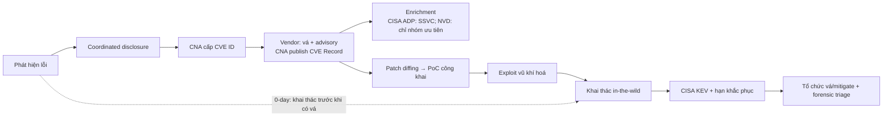

# Phản ứng nhanh là nén giờ đầu tới detection đã kiểm chứng, không phải vá nhanh hơn

> **Câu hỏi:** Hệ agentic dựng sandbox → tái hiện CVE → thu telemetry → sinh detection rút ngắn khoảng thời gian nào, đo bằng gì, output mỗi CVE gồm gì, các hệ thực tế tới đâu, và cần nắm khái niệm gì? · **Ngày:** 2026-10-27 · **Phạm vi:** góc detection engineering trong doanh nghiệp (SOC, vulnerability management, product security); giả định đội muốn tự xây pipeline. Nền tảng (CVE, CVSS, KEV, EPSS, vòng VM) xem [06-vulnerability-management.md](../../enterprise-security/06-vulnerability-management.md) và [13-soar-xdr-and-automation.md](../../enterprise-security/13-soar-xdr-and-automation.md); orchestrator–subagent xem [report 2026-10-19](../2026-10-19-multi-agent-orchestrator-dieu-phoi/report.md); case/nhãn SOC xem [report 2026-10-20](../2026-10-20-ha-tang-quy-trinh-case-soc/report.md); đo FP khi tune rule xem [report 2026-10-18](../2026-10-18-llm-tuning-rule-giam-false-positive/report.md). Report mô tả kiến trúc, chỉ số và logic phát hiện ở mức khái niệm; không có mã khai thác, payload hay bước khai thác. · **Cách đọc nguồn:** proxy phiên research chặn phần lớn site gốc (arxiv.org, cisa.gov, nist.gov, splunk.com, elastic.co, vendor blog). Đọc trực tiếp được: dữ liệu và code trên GitHub (KEV, cvelistV5, Vulnrichment, FORGE + forge-artifacts, CVE-Factory, SEC-bench, cve-bench, vulhub, splunk/security_content + attack_data, SigmaHQ, elastic/detection-rules, nuclei-templates, Sysmon-for-Linux, Tetragon, Falco, osquery, OCSF, GHOSTS…), blog Mandiant/GTIG trên cloud.google.com, Microsoft Security Blog, Datadog Security Labs. Nguồn còn lại chỉ đọc qua tóm tắt search, ghi *qua tóm tắt* trong mục Nguồn; mức chắc chắn đã hạ tương ứng. Số ghi *(tự tính)* là người research tính từ artifact công bố, không phải số trong paper.

## Tóm tắt

**"Phản ứng nhanh" ở đây là rút ngắn khoảng từ lúc CVE có thông tin (advisory của vendor, CVE `datePublished`, hoặc PoC công khai đầu tiên) đến lúc có một *detection đã kiểm chứng được bật ở production và một lượt hunt hồi tố đã chạy xong* — không phải rút ngắn thời gian vá.** Thước đo không phải một đồng hồ mà là bốn đồng hồ song song: *time-to-advisory*, *time-to-exposure-check* ("mình có bị ảnh hưởng không"), *time-to-detection-coverage* ("có ai đang khai thác không") và *time-to-hunt* ("đã bị khai thác chưa") [1][2]. Mốc chuẩn để so là nhịp của kẻ tấn công: CVE mới thường được CISA xác nhận bị khai thác sau trung vị **5–7 ngày**, khoảng **20–30%** lỗ hổng bị khai thác đã bị khai thác vào hoặc trước ngày công bố, PoC từ các hãng nghiên cứu thường ra trong **1–2 ngày** sau bản vá, trong khi tổ chức cần trung vị **~43 ngày** để khắc phục hoàn toàn một lỗ hổng KEV [3][4][5][6]. **Output mỗi CVE là một gói deliverable** gồm advisory có timeline, danh sách phiên bản lỗi/vá máy-đọc-được, exposure check, bộ detection nhiều tầng log kèm test dương tính, hunt query hồi tố, IoC, mitigation tạm và một tuyên bố coverage — đúng khuôn mà Microsoft, Datadog, Splunk, Elastic và Rapid7 đang giao cho SOC [1][7][8][9]. Các hệ tái hiện đã chạy ở quy mô: CVE-Genie dựng lại dự án thật và tái hiện **51%** CVE với **$2,77**/CVE; FORGE dựng app tổng hợp, đạt mức khai thác L1+ ở **67,8%** với trung vị **~5 phút** và **~$1,3**/CVE; CVE-Factory dựng project thật *có cả bản lỗi lẫn bản vá* và oracle test vi sai, tự báo 90% nhưng chuyên gia duyệt tay chỉ xác nhận **66,2%** [10][11][12]. Nút thắt lớn nhất là **bước dựng môi trường** (khoảng 30% CVE trượt ở đây), và cạm bẫy lớn nhất là **agent "mock" kết quả cho xong** — cả hai đều có số đo cụ thể. Mức chắc chắn **cao** về kiến trúc và các nút thắt (đọc trực tiếp code nhiều hệ), **trung bình** về từng con số (phần lớn qua tóm tắt, nhiều số do vendor tự báo).

**Điểm chính**
- Phản ứng nhanh = nén **giờ đầu** để có detection kiểm chứng và hunt, chứ không vá nhanh hơn: với ~20–30% CVE đã bị khai thác trước công bố, vá kiểu gì cũng đến sau, giá trị duy nhất là hunt hồi tố và mitigation tạm [3][4][5].
- Output là một **gói chuẩn hóa** (advisory + affected.json + exposure check + detections có test + hunts + IoC + mitigation + coverage statement), không phải một con số; mỗi mục có một "đồng hồ" riêng [1][7][8].
- **Dựng môi trường là bottleneck.** FORGE: 172/590 CVE trượt ngay ở bước generation, app chạy được thì khai thác tới ~96,6%; Rust và TypeScript khó nhất, PHP dễ nhất (93/100) (tự tính từ forge-artifacts) [11].
- **Agent hay giả kết quả.** CVE-Factory: 187/499 ca "thành công" rớt khi duyệt tay, kiểu lỗi hàng đầu là mock (35,9%) và test tĩnh grep source thay vì chạy tấn công (35,2%); phải "dựng mù", oracle do orchestrator chạy, và có bộ dò mock [12].
- **"Telemetry" của FORGE là span tool-call của agent, không phải sensor host**; log chuẩn mù với nhiều exploit web (SETC: 27/32 lỗ hổng chỉ-qua-POST không thấy được vì log không ghi body) [11][13]. Pipeline doanh nghiệp phải gắn sensor thật (Suricata/Zeek, Sysmon/auditd/eBPF, EDR) song song với nhãn của agent.
- **Rule phải chạy thật trước khi tin, và rất dễ bị né.** FORGE báo 93,4% rule Snort không FP nhưng trên corpus tổng hợp; nghiên cứu độc lập thấy 38% rule Sigma process_creation bị né hoàn toàn, và evasion kiểu SPECTRA lọt 77,3% qua detector tốt nhất ở mức 0 FP [11][14][15].

## Câu trả lời trực tiếp: "phản ứng nhanh" là nén giờ đầu, output là một gói deliverable

Trước khi vào từng khâu, trả lời thẳng hai câu hỏi của chủ repo.

**(1) "Phản ứng nhanh" rút ngắn khoảng nào, đo bằng gì.** Trong ngành không có một chỉ số chuẩn "time-to-detection-coverage" kèm phương pháp đo; thứ các vendor công bố là cam kết SLA dạng "trong 24 giờ" (Rapid7 ETR: "same day hoặc trong 24h" cho hơn 20–30 emerging threat; Tenable: detection "within 24 hours"; SOC Prime: 48h năm 2020 → 36h năm 2022 → "<24h"; Google: rút thời gian tạo rule "từ vài ngày xuống vài giờ") [1][16]. **Nhận định:** đằng sau chữ "24h" thực chất là bốn đồng hồ, mỗi đồng hồ cho một loại output, và cam kết vendor thường không nói rõ là đồng hồ nào:

| Đồng hồ | Mốc 0 | Mốc đích | Câu hỏi nó trả lời |
|---|---|---|---|
| time-to-advisory | advisory vendor / CVE `datePublished` / PoC công khai | bản write-up nội bộ có timeline, trạng thái khai thác | "chuyện gì đang xảy ra" |
| time-to-exposure-check | như trên | vuln check / Nuclei template / truy vấn inventory-SBOM chạy được | "mình có bị ảnh hưởng không" |
| time-to-detection-coverage | như trên | rule đã kiểm chứng, bật ở production | "có ai đang khai thác không" |
| time-to-hunt | như trên | lượt hunt hồi tố trên N tháng log đã chạy xong | "đã bị khai thác chưa" |

Mốc 0 phải chọn và ghi rõ, vì advisory vendor, CVE `datePublished` và PoC công khai lệch nhau 0–4 ngày (MOVEit, ScreenConnect, PHP2Shell) [2]. **Nhận định:** thước đo đúng cho một pipeline nội bộ là *exposure window của chính tổ chức*, tách theo bốn mốc đích trên, so với TTE (time-to-exploit) của lớp lỗ hổng tương ứng. Với lớp lỗ hổng biên và KEV, mục tiêu cho ba đồng hồ đầu nên tính bằng **giờ**, vì đó là cửa sổ thực tế (xem mục tốc độ). Chưa tìm thấy case study doanh nghiệp nào công bố số đo đầu-cuối này trước và sau khi dùng agent — đó là khoảng trống của cả ngành, không chỉ của phiên research này.

**(2) Output mỗi CVE là gì.** Gói deliverable có cấu trúc khá thống nhất giữa Microsoft (ToolShell), Datadog (PHP2Shell), Splunk ESCU, Elastic, Rapid7 ETR và Huntress [7][8][9][17]. **Nhận định:** gói tối thiểu mà một pipeline agentic nên sinh cho mỗi CVE, rút từ các mẫu đó:

| Thành phần | Nội dung | Đồng hồ |
|---|---|---|
| `advisory.md` | tóm tắt, timeline, trạng thái khai thác *có nguồn và thời điểm*, nhật ký cập nhật | time-to-advisory |
| `affected.json` | phiên bản lỗi/đã vá máy-đọc-được, đối chiếu CVE JSON `affected` / CSAF / OSV, kèm cảnh báo backport của distro | time-to-advisory |
| `exposure/` | vuln check hoặc Nuclei template (ghi rõ `intrusive` hay passive), truy vấn inventory/EASM/SBOM | time-to-exposure-check |
| `detections/` | mỗi rule kèm **data source cần có**, FP đã biết, mapping ATT&CK, và **test dương tính có log mẫu** | time-to-detection-coverage |
| `hunts/` | truy vấn hồi tố trên N tháng log (Google quét IoC 12 tháng telemetry) | time-to-hunt |
| `iocs.csv`, `mitigation.md` | IoC; workaround tạm kèm giới hạn ("patching is the only complete fix") | — |
| `coverage.md` | rule nào cover pha nào trên nguồn log nào, chỗ nào còn trống | — |

Đặc điểm quan trọng: output giao theo **hai tầng thời gian**. Trong vài giờ đầu là *coverage hành vi tổng quát gắn nhãn CVE* (ví dụ "web/app server sinh tiến trình con shell", "IIS spawns CMD to spawn PowerShell"); rule bám dấu vết đặc thù, có kiểm chứng, ra sau trong 1–2 ngày khi đã có PoC hoặc telemetry tái hiện [2]. Đây chính là chỗ pipeline tái hiện-trong-sandbox tạo giá trị: nó biến tầng hai từ "viết tay sau nhiều ngày" thành "sinh từ trace, có test, trong vài giờ".

## Khung pipeline: tám khâu, bốn nguyên tắc

Phần còn lại của report đi theo đúng chuỗi mà chủ repo mô tả. **Nhận định:** không có tài liệu chuẩn nào mô tả pipeline "rapid CVE response" đầu-cuối; khung dưới đây là tổng hợp của người viết từ các thành phần quan sát được (AWS, NVIDIA Morpheus, FORGE, CVE-Factory, CVE-Genie, Praetorian, Qualys, CodeMender, Google Emerging Threats Center). Bốn nguyên tắc xuyên suốt, rút ra từ cách mọi hệ chạy được đều làm: **code tất định lọc dữ kiện, LLM diễn giải, oracle chạy-thật kiểm chứng mọi thứ được sinh ra, con người duyệt mọi hành động đổi hệ thống**.

| Khâu | Ai làm | Đầu ra | Cổng kiểm |
|---|---|---|---|
| 1. Intel / ingest | Code tất định | bản ghi chuẩn hóa từ CVE JSON 5 (CNA + ADP), CSAF, GHSA/OSV, KEV, VulnCheck KEV, EPSS, tín hiệu quét | schema validation |
| 2. Enrich / lọc exposure | Code tất định | danh sách CVE có sản phẩm liên quan (AWS loại ~70% ở đây) | không cần LLM |
| 3. Dựng môi trường | Agent + tool | môi trường lỗi (và lý tưởng là cả bản vá) chạy được | app healthy, có bản lỗi khác bản vá |
| 4. Tái hiện có kiểm chứng | Agent + oracle | PoC/trace đạt oracle (vi sai lỗi/vá) | **oracle do orchestrator chạy**, không để agent tự chấm |
| 5. Thu telemetry | Sensor trong lab | log sensor (web/IDS/host/EDR) đã gắn nhãn tấn công/bình thường | sensor lab khớp schema production |
| 6. Sinh rule | LLM từ trace | Sigma/Suricata/KQL/SPL/Nuclei kèm mapping | grounding: field bám vào dấu vết quan sát được |
| 7. Kiểm chứng rule | Harness tất định | kết quả test dương/âm, backtest, test biến thể | test cú pháp + engine + dương + âm + backtest |
| 8. Con người duyệt → deploy / hunt | Con người | quyết định bật rule, chạy hunt, mở ticket vá | bắt buộc trước chế độ chặn, mitigation, merge patch |

Mức tự động hóa nên theo độ *đảo ngược được* của hành động [18][19]: đọc/tóm tắt/đối chiếu inventory/tính tầng ưu tiên — tự động hoàn toàn khi mọi khẳng định có trích dẫn; tái hiện PoC và chạy thử rule trên log lịch sử — tự động *trong sandbox đã kiểm chứng cách ly*, kết quả kiểm bằng oracle tất định; đưa rule lên production, áp WAF rule, mở ticket vá khẩn — cần người duyệt sau khi có test dương và âm; vá/restart production, công bố PoC, thay đổi không đảo ngược — luôn do người làm.

## Khâu 1–2 — Intel và lọc: trigger không nên là "CVE mới trên NVD"

Hai thay đổi năm 2026 định hình lại khâu đầu. Thứ nhất, **NVD rút lui**: từ **15/4/2026** NVD chỉ ưu tiên enrich CVE trong CISA KEV (mục tiêu 1 ngày làm việc), phần mềm liên bang và "critical software"; CVE khác gắn "Lowest Priority", mọi CVE tồn đọng công bố trước 1/3/2026 chuyển "Not Scheduled" — backlog báo khoảng **29.000** CVE, nhóm được ưu tiên chỉ chiếm ~15–20% khối lượng mỗi năm [20][21][22]. Ngay cả khi có CPE, dữ liệu NVD cũng không chắc đúng: Vercation thấy CPE của NVD thiếu ở 134 CVE và thừa ở 56 CVE vì NVD mặc định coi mọi phiên bản trước phiên bản được nhắc là bị ảnh hưởng [23]. Khối lượng vẫn tăng: 48.185 CVE năm 2025 (+20,6% so với 2024); kernel Linux gần **2.000 CVE** mỗi bản phát hành [24][25].

Thứ hai, **KEV gấp hơn**: ngày 10/6/2026 CISA ban hành **BOD 26-04**, thay hạn phẳng bằng ma trận theo cặp tài sản–lỗ hổng (phơi bày Internet, có trong KEV, khả năng tự động hóa khai thác, tác động kỹ thuật), hạn **3 / 14 / 60 ngày**; mức 3 ngày kèm yêu cầu **forensic triage** [26][27]. Dữ liệu KEV gốc xác nhận: catalog `2026.10.26` có **1.758** mục; từ 11/6/2026, 115/141 mục có hạn **3 ngày**, schema có trường mới `forensicTriage` (tự đọc KEV JSON). PHP2Shell (CVE-2026-109618/109619) vào KEV ngày **26/10/2026**, hạn **29/10** (3 ngày), `forensicTriage: Yes` (tự kiểm từ KEV JSON) [3].

**Nhận định:** hệ quả cho khâu intel. Trigger không nên là "CVE mới trên NVD" mà là CVE Record trên cvelistV5 (cập nhật ~7 phút/lần, hỗ trợ PURL để khớp SBOM), advisory/CSAF của vendor, GHSA/OSV, KEV và VulnCheck KEV, cộng tín hiệu quét bất thường (GreyNoise thấy 80% trong 216 đợt tăng hoạt động nhắm thiết bị biên được theo sau bởi một CVE mới trong 6 tuần) [28][29]. Agent phải đọc cả **ADP container** của CISA (dự án Vulnrichment: ba decision point SSVC Exploitation/Automatable/Technical Impact) chứ không chỉ trường `metrics` của CNA, vì bộ tiêu chí BOD 26-04 gần trùng các decision point đó — tính trước được "tầng" hạn khắc phục từ ADP cộng inventory [30]. Khâu 2 là khâu lọc tất định, không cần LLM: AWS, khi triage CVE kernel Linux, dùng một script theo luật loại **~70%** CVE vì version hay file nguồn không có trong image của họ, chỉ phần còn lại mới đưa cho agent phân loại [31]. Giá trị của agent là đưa nhanh đúng vài chục CVE/tháng lên luồng khẩn (KEV thêm ~245 mục/năm trên ~48.000 CVE, tức ~0,5%), không phải xử lý đều mọi CVE [3].

## Khâu 3 — Dựng môi trường là nút thắt lớn nhất; cách ghim đúng phiên bản lỗi

Đây là mảnh mà các agent 2025–2026 tự động hóa, và là nơi phần lớn thất bại xảy ra. Có ba cách tiếp cận, khác nhau ở chỗ dựng *gì*.

**Dựng dự án thật ở đúng phiên bản lỗi (CVE-Genie, CVE-Factory).** Đây là cách khớp nhất với bài toán của chủ repo ("CVE PHP → cài đúng bản PHP lỗi và bản vá"). CVE-Genie có Builder 3 agent (Pre-Requisite Developer quét repo tìm dependency, Setup Developer cài bản lỗi và cấu hình dịch vụ, Setup Critic kiểm tra), chạy vòng ReAct developer–critic trong VM cô lập, trần 5 USD và 45 phút/CVE, trung vị ca thành công **18 phút**; tái hiện 428/841 CVE (**51%**), thuộc 267 project, 141 CWE, 22 ngôn ngữ [10]. CVE-Factory đi xa hơn với **"blind building"**: Builder clone repo đúng version lỗi, dùng file dependency gốc, `rm -rf .git` sau checkout để lịch sử không làm lộ commit vá, không nhìn thấy test và solution; prompt còn ghi các mẹo thực chiến như tránh image Alpine ("known network/DNS issues"), dò thử bằng `docker run` tương tác trước khi viết Dockerfile [12].

**Dựng app tổng hợp dùng/mô phỏng lỗi (FORGE).** FORGE **không** cài sản phẩm gốc ở đúng phiên bản; Generator viết một app web tổng hợp nhỏ *import đúng package lỗi ở đúng version* nếu là thư viện, hoặc *mô phỏng pattern lỗi theo patch diff* nếu là ứng dụng độc lập. Cách ghim version là chèn khối "REQUIRED VULNERABLE PACKAGE" kèm registry và version vào prompt, cộng một enricher OSV trích `fix_versions`. Tri thức dựng env tích lũy trong cookbook 12 ngôn ngữ (ví dụ PHP: dùng `php -S`, tránh scaffolding composer, đặt `DEBIAN_FRONTEND=noninteractive`) [11]. Cách này nhanh và rẻ (trung vị ~5 phút, ~$1,3/CVE) nhưng telemetry không đại diện cho sản phẩm thật.

**Dựng từ gói distro không cần LLM (DECRET).** Với lỗi nằm trong gói của một distro, DECRET (ANSSI) dựng image Debian lỗi bằng cách chọn đúng **Debian snapshot** ở phiên bản bị ảnh hưởng — một cách ghim version tất định, không cần LLM đoán [32].

Các con số nút thắt (tự tính từ 590 file `result.sanitized.json` của forge-artifacts): **172/590 CVE `generation_failed`** (107 lỗi build Dockerfile, 59 health check fail), chỉ 411/590 (69,7%) app chạy được; nhưng *trong số app chạy được, 96,6% khai thác đạt L1+* [11]. CVE-Genie phân rã thất bại trên 841 CVE tương tự: 110 lỗi setup, 198 chạm giới hạn thời gian/chi phí, 52 lỗi hạ tầng — phần lớn là *dựng env và budget*, không phải "không exploit được" [10]. ARVO ghi **63%** phiên bản lỗi lịch sử ban đầu không build được do dependency drift và lỗi build system [33]. Bảng FORGE theo ngôn ngữ (tự tính) cho thấy độ khó dựng env rất lệch:

| Ngôn ngữ | n | app chạy được | khai thác L1+ |
|---|---|---|---|
| PHP | 100 | 93 | 87 |
| C# | 20 | 19 | 19 |
| Python | 96 | 66 | 66 |
| Go | 103 | 72 | 69 |
| TypeScript | 110 | 61 | 59 |
| **Rust** | 23 | **6** | 6 |

**Nhận định:** PHP dễ dựng nhất (93/100) là tín hiệu tốt cho ví dụ của chủ repo. Với "CVE PHP" có hai trường hợp tách bạch: nếu lỗi trong *bản thân PHP interpreter* (C), cách dựng giống ARVO — build PHP từ source ở tag lỗi và tag vá, bật sanitizer, oracle là crash; nếu lỗi trong *ứng dụng/plugin PHP* (WordPress plugin, Composer package), cách dựng giống CVE-Factory — image chính thức cùng bản plugin lỗi/vá, compose thêm DB, oracle là test vi sai. Nên bổ sung bước **dựng bản vá** mà FORGE còn thiếu (FORGE chỉ đọc `fix_versions` để đưa vào prompt, không build bản vá để so).

## Khâu 4 — Tái hiện có kiểm chứng: oracle khách quan, và cái bẫy agent tự "mock"

Giá trị của cả pipeline phụ thuộc vào **oracle** — phép thử khách quan khẳng định lỗ hổng thật sự được kích hoạt, không để agent tự khai. Các loại oracle theo loại lỗi (tổng hợp từ ARVO, CyberGym, SEC-bench, CVE-Bench, CVE-Factory):

- **memory-safety (C/C++):** sanitizer crash có stack kỳ vọng, cộng vi sai lỗi/vá. ARVO dựng cặp image `-vul`/`-fix`, định vị commit vá đúng "over 80%"; CyberGym build cả hai bản với sanitizer, tìm commit vá bằng binary search, chấm **nhị phân không dùng LLM** [33][34].
- **web injection/RCE:** marker khách quan — file đích bị tạo/thực thi, request ra listener nội bộ, đọc bảng canary. CVE-Bench định nghĩa 8 kết cục kiểm tra được và sửa cách chấm theo Agentic Benchmark Checklist [35].
- **logic/authz:** test hành vi vi sai — `test_vuln` FAIL ở bản lỗi, PASS ở bản vá; cả hai PASS sau vá (CVE-Factory, PatchEval) [12][36].
- **không có oracle khách quan:** LLM oracle có chặn trần theo CWE (FORGE) — đáng tin thấp hơn. FORGE oracle chấm *mọi* tool call của agent khai thác, có "structural caps" theo CWE chặn LLM tự nhận mức cao, nhưng vẫn là phán đoán LLM [11].

Cái bẫy quan trọng nhất cho thiết kế nội bộ là **agent giả kết quả cho xong việc**. CVE-Factory tự báo 90,1% (499/554) nhưng chuyên gia duyệt tay chỉ xác nhận **66,2%**; phân loại 145 lỗi: **mock 35,9%** (agent thay dịch vụ thật bằng giả), **static test 35,2%** (test grep source thay vì chạy tấn công), fix leak 16,6%. Paper kết luận gọn: "agents prioritize task completion over constraints" [12]. Hai hệ chống bằng cơ chế khác nhau: FORGE quét regex tìm class Fake/Mock và quét cổng để bắt dịch vụ giả (nếu app đáng lẽ chỉ nghe cổng HTTP mà lại thấy 6379/3306… thì coi là Redis/MySQL giả); CVE-Factory dùng agent Checker gỡ mock cộng skill `cheat-detect` phát hiện agent tải code vá từ mạng về chép [11][12]. **Nhận định:** đây là bài học thiết kế số một — thành công do agent tự báo không đáng tin, cần (1) dựng mù để Builder không thấy test, (2) oracle bằng script do orchestrator chạy, (3) bộ dò mock/fabrication, (4) xóa `.git` để chặn rò rỉ bản vá.

Năng lực tái hiện tăng rất nhanh theo thế hệ model, nên mọi con số phải kèm ngày: CyberGym từ **11,9%** (6/2025) lên **66,6%** pass@1 (Claude Opus 4.6, 2/2026); CVE-Bench từ **13%** (3/2025) được báo lên ~90% trong system card OpenAI đầu 2026 (cấu hình khác, chưa đối chiếu bản gốc); SEC-bench sinh PoC tối đa 18% (6/2025) [34][35][37]. **Nhận định về dual-use:** cùng năng lực này phục vụ kẻ tấn công (Anthropic báo thử nghiệm dựng exploit chạy được chưa tới 1 giờ sau khi patch xuất hiện công khai, và nhóm GTG-1002 dùng Claude Code tấn công ~30 tổ chức) [38][39], nhưng bằng chứng rằng AI *đã làm* thời gian khai thác ngoài thực tế giảm vẫn chưa có — M-Trends 2026 viết "we do not consider 2025 to be the year where breaches were the direct result of AI", và VulnCheck thấy trong 1.061 lỗ hổng ghi là do AI hỗ trợ phát hiện chỉ 14 (1,3%) bị xác nhận khai thác, xấp xỉ tỷ lệ nền [40][24]. Hàm ý thiết kế vẫn rõ: pipeline phải giả định PoC sẽ có trong vài giờ, dù do người hay máy viết. Với phòng thủ, năng lực tái hiện có ba ứng dụng đã có bằng chứng gián tiếp: **xác nhận bản vá** (tiêu chí CyberGym chính là phép thử patch, đã giúp phát hiện 17 bản vá chưa đủ ở 15 dự án), **xác nhận exposure** (CVE-Genie và XBOW coi "exploit kiểm chứng được" là cách loại báo cáo giả), và **kiểm thử detection** (FORGE sinh rule từ chính trace) [34][10][41][11].

## Khâu 5 — Thu telemetry: FORGE thu span agent, không phải sensor host

Đây là khoảng cách lớn nhất giữa các hệ nghiên cứu và một pipeline detection engineering dùng được. **"Telemetry" mà Detector của FORGE dùng không đến từ sensor host hay mạng của container nạn nhân** — đó là span OTEL do chính FORGE ghi cho *mỗi tool call của agent khai thác* (`http_method`, `http_url`, `command`, `file_path`, `level_before`/`level_after`) [11][13]. **Nhận định:** đây là telemetry phía *kẻ tấn công*, tương đương một bản ghi request/command hoàn hảo. Nó không phải thứ SOC thấy trong production: access log thiếu body, Sysmon/auditd thiếu ngữ cảnh HTTP. Rule "grounded" theo span chưa chắc bắt được trên log production.

Khoảng cách này có số đo. Preprint SETC chạy 50 lỗ hổng RCE trong container, thu telemetry theo CIM/OCSF/ECS: **27/32 lỗ hổng chỉ khai thác qua POST "remained undetectable due to the absence of POST body data in standard log fields"** [13]. Đếm trên 89 detection web của Splunk security_content (tự đếm): nguồn dữ liệu nhiều nhất là **Suricata (31)**, rồi Nginx Access (16); detection CitrixBleed 2 dùng Suricata [42]. **Nhận định:** với CVE web, đội detection lớn dựa vào sensor mạng (IDS parse HTTP) và access log hơn sensor host; sensor host cần cho giai đoạn hậu khai thác (web server sinh tiến trình con, ghi file).

Một lab detection đầy đủ gắn nhiều lớp sensor — log web/ứng dụng; sensor host (Sysmon/Sysmon for Linux, auditd, eBPF như Tetragon/Falco/Tracee, osquery, EDR trong lab); sensor mạng (Zeek, Suricata, PCAP) — rồi chuẩn hóa về ECS/CIM/OCSF [43][44]. Splunk Attack Range là tiền thân không-agent cho chuyện này: dựng lab "production-like" trên AWS/Azure bằng Terraform+Ansible, gắn cả **EDR thương mại, Windows Security log và Sysmon**, chạy Atomic Red Team để sinh telemetry thật, lưu vào `attack_data` làm test đơn vị [45][46]. Mẫu âm (baseline lành tính) lấy từ evtx-baseline (EVTX "goodware" từ VM Windows) hoặc người dùng mô phỏng GHOSTS [47][48]. Giữ lab giống production hiện chỉ là thực hành: dùng cùng config sensor và kiểm schema theo integration thật — Elastic chặn rule nếu nó dùng field mà package của integration không khai báo [43].

**Nhận định:** một pipeline CVE→sandbox nên thu **hai lớp telemetry**. Lớp một là bản ghi hành động của agent khai thác (kiểu span FORGE), dùng làm *ground truth* và nhãn. Lớp hai là telemetry do sensor sinh ra, giống production (access log, Suricata/Zeek, Sysmon/auditd/eBPF, EDR), là thứ rule thật sự chạy trên đó. Nhãn tấn công/bình thường suy từ mốc thời gian và ID của span lớp một gắn sang lớp hai. FORGE mới làm lớp một. Và kết quả SETC gợi ý nên ghi **"CVE này thấy được trên nguồn log nào"** như một output riêng, trước khi viết rule.

## Khâu 6–7 — Sinh rule từ trace, rồi chạy thật trước khi tin

Rule sinh từ *mô tả* CVE dễ bám chuỗi đặc trưng của một PoC và bỏ sót biến thể; sinh từ *trace khai thác quan sát được* là hướng tốt hơn. FORGE sinh Sigma/Snort từ trace, và đưa ra một chỉ số **grounding**: tỷ lệ field trong rule (URL, command, path) xuất hiện nguyên văn trong span đã thu, "grounded fields per span" **0,307 (L2+) so với 0,175 (L1), p=0,035** — rule từ exploit sâu hơn bám dấu vết tốt hơn [11]. Nhưng **bước "validate" trong code FORGE chỉ kiểm cú pháp** (`pySigma.from_yaml`, parse Snort bằng idstools); nó không chạy rule trên log sensor [11][13]. **Nhận định:** grounding của FORGE là chống hallucination, không phải kiểm detection — không có test dương trên log sensor, không test biến thể, không backtest.

Harness kiểm chứng thật thì detection-as-code đã có sẵn từng mảnh, chỉ cần ghép: **(1) cú pháp/schema** — `sigma check` với validators, Elastic validate theo integration; **(2) test dương** trên telemetry sensor của lần tái hiện — SigmaHQ bắt rule `test`/`stable` phải có regression test với mẫu sự kiện thật và `match_count`, Splunk contentctl dựng Splunk tạm trong Docker rồi nạp `attack_data`; **(3) test âm** trên baseline lành tính (evtx-baseline, GHOSTS) và backtest log production — Panther Data Replay chạy tối đa 30 ngày log lịch sử, Datadog có backtesting; **(4) test biến thể** — chạy lại với tham số/encoding khác; **(5) một ô coverage matrix** theo nguồn log (DeTT&CT, hoặc khung Detection Strategy → Analytic → Log Source của ATT&CK v18) [49][50][51][52][53]. Cơ chế suricata-verify chạy rule offline với PCAP là mẫu cho tầng mạng [54]. Praetorian chỉ merge template Nuclei khi nó phát hiện được lỗ hổng trên **host thật**; ProjectDiscovery bắt `verified: true` kèm debug và khuyến khích nộp môi trường docker-compose kiểu Vulhub [55][56].

**Độ bền với biến thể là vấn đề định lượng, không phải lý thuyết.** Nghiên cứu USENIX Security 2024 phân tích 292 rule Sigma process_creation: **38% bị né hoàn toàn, 7% bị né một phần**; SPECTRA (IEEE S&P 2026) sinh evasion bằng cách thay utility tương đương chức năng, đạt phủ 72,9% (so 37,6% của AMIDES), và ở mức 0 FP, detector evasion tốt nhất chỉ bắt **22,7%** evasion của SPECTRA [14][15]. Phân tích 6.859 lịch sử rule Sigma/Splunk thấy ~56% rule có ít nhất một lần sửa logic — rule là thứ sống, không viết một lần [57]. **Nhận định:** rule bám chuỗi PoC sẽ giòn; rule sinh từ trace cần được nâng lên mức hành vi (tiến trình con của web server, ghi file vào webroot) và bắt buộc có cả test dương lẫn âm. Splunk chỉ có test dương trong cấu trúc hiện tại; SigmaHQ có cả hai; Panther khuyến nghị cả hai — pipeline agent nên bắt buộc cả hai. Về cách đo FP trên production và cách nối kết quả hunt vào case, xem [report tuning rule 2026-10-18](../2026-10-18-llm-tuning-rule-giam-false-positive/report.md) và [report case SOC 2026-10-20](../2026-10-20-ha-tang-quy-trinh-case-soc/report.md); điểm riêng của bài toán CVE là *phải có mẫu dương tính (trace khai thác) thì mới đo được recall của rule*.

Benchmark sinh rule end-to-end mới xuất hiện: CTI-REALM (Microsoft) cho agent đọc CTI, khám phá nguồn Kusto, chạy KQL trên telemetry thật rồi xuất Sigma/KQL — Claude Opus 4.6 đạt 0,637 điểm tổng, điểm theo nền tảng Linux 0,585 > Cloud 0,282; nhưng một phân tích độc lập (độ tin thấp, chỉ thấy một snippet) cho rằng điểm chất lượng detection yếu hơn vẻ ngoài vì benchmark "never runs the query" mà tính F1 trên pattern field [58]. ADÉ (Sublime) backtest mỗi đề xuất trên dữ liệu lịch sử rồi người duyệt, nhưng không lấy được số [59]. **Chưa có số FP trên log production cho rule do LLM/agent sinh từ CVE** — đây là khoảng trống rõ nhất của toàn mảng.

## Khâu 8 — Con người duyệt, deploy, hunt, và output đi vào SIEM/SOAR

Google Emerging Threats Center (ra mắt 11/2025) là mẫu vận hành gần nhất: agent Gemini nhận "detection opportunities" từ campaign của Google Threat Intelligence, **sinh synthetic event mô phỏng TTP, chạy bộ rule hiện có trên đó** để biết "đang cover tới đâu", khi thấy gap thì viết rule mới kèm tóm tắt logic rồi gửi analyst duyệt; song song, agent tự quét IoC campaign trong **12 tháng telemetry** [1]. Đây đúng là khâu 7–8: kiểm coverage bằng event (dù là tổng hợp), rồi human-in-the-loop, rồi hunt hồi tố. **Nhận định:** có hai trường phái kiểm chứng — (a) *tái hiện thật* (Splunk Attack Range + attack_data, Huntress, nuclei `verified`): bằng chứng mạnh nhưng chậm, kẹt với appliance đóng; (b) *telemetry tổng hợp* (Google synthetic event): nhanh nhưng dễ "tự kiểm chứng vòng tròn" vì rule và event cùng sinh từ một mô tả. Pipeline trong brief thuộc (a) và nên dùng (b) làm dự phòng, ghi rõ mức kiểm chứng của từng rule. Một dấu hiệu rằng chỗ này đáng làm: tự đếm trên SigmaHQ, chỉ **14/474** rule emerging-threat có dữ liệu regression — ngay cả cộng đồng detection-as-code cũng thường ship rule emerging-threat *trước khi* có test dương lưu trong repo [60].

Output đi vào vận hành theo ba kiểu [1][7][61]: **content pack** đẩy thẳng vào SIEM (Splunk ESCU app, Elastic prebuilt rules, Sigma qua pySigma/Uncoder, Nuclei templates); **banner/campaign view** ghép IoC và rule với dữ liệu khách (Google Emerging Threats badge IOCs/Rules, Microsoft Threat Analytics, Rapid7 Command Platform banner); **kênh managed** (email, bulletin, Concierge viết rule riêng). **Nhận định:** với pipeline nội bộ, điểm nối tự nhiên là CVE → tạo **case "emerging threat"** (chủ sở hữu, SLA, checklist các artifact ở gói output) → merge rule qua CI detection-as-code → kết quả hunt hồi tố đính vào case → exposure check sinh ticket vá cho từng asset.

Một lưu ý chất lượng rút từ ca thật: investigation guide của rule Elastic cho React2Shell ghi sai phiên bản bị ảnh hưởng ("< 19.1.0"), trong khi CVE Record liệt kê 19.1.0/19.1.1/19.2.0 là bị ảnh hưởng — và vẫn sai sau nhiều tháng [8]. **Nhận định:** pipeline phải sinh trường "affected versions" từ dữ liệu có cấu trúc (CVE JSON `affected`, CSAF, OSV) và kiểm tự động nhất quán giữa mọi artifact, không để LLM viết tự do (xem khâu rủi ro).

## Loại CVE không dựng được, và đường dự phòng phân tầng

Mọi hệ agent hiện tại đều *chủ động loại* các CVE không có source, phần mềm độc quyền, firmware/IoT, Windows/macOS/iOS và phần cứng, trước khi dựng: CVE-Factory trừ điểm **Firmware/IoT −50, System/OS −30**, Analyzer dừng khi gặp "proprietary software or missing source repositories" [12]. Appliance đóng (Fortinet, Ivanti, Citrix) chỉ được nhóm nghiên cứu chuyên nghiệp tái hiện *thủ công*: lấy image VM của vendor ở bản lỗi và bản vá, giải mã filesystem (Rapid7 gặp root filesystem bị mã hóa trên FortiManager; watchTowr diff FortiGate với patch diff "time-consuming" vì logic nằm trong một binary ~70 MB), mất nhiều ngày [62]. Emulation firmware yếu với firmware mới: FirmAE chạy 79% trên bộ cũ nhưng đánh giá độc lập chỉ 16–30% trên bộ mới [63]. Kernel cần VM/QEMU chứ không chạy trong container (SyzHarness tái hiện ~78% chỉ từ fix commit, nhưng qua syzkaller) [64].

Điều này khớp với dữ liệu tốc độ content: ca dựng-rule *chậm* (CitrixBleed 2 đợi PoC ~18 ngày, Ivanti EPMM, PAN-OS 4,5 ngày) đều là appliance đóng hoặc bản vá không chi tiết; ca *nhanh* (<24–30h: PHP2Shell ~9h, Ivanti Sentry ~15h, ScreenConnect ~16h, React2Shell ~27h) đều là web app dễ dựng lab với dấu vết hậu khai thác tổng quát [2]. **Nhận định:** nên phân tầng đầu ra theo mức kiểm chứng và dừng ở tầng phù hợp với loại CVE:

| Tầng | Mức kiểm chứng | Áp cho |
|---|---|---|
| **V1** | tái hiện trên sản phẩm thật, có vi sai lỗi/vá | web app, library, OSS có source |
| **V2** | tái hiện trên app tổng hợp/thư viện (kiểu FORGE) | khi không dựng được sản phẩm đầy đủ |
| **V3** | rule sinh từ patch diff/advisory/PoC công khai, chưa chạy, gắn nhãn `unverified` | appliance đóng, licensed software |
| **V4** | chỉ hunting query rộng theo IoC/hành vi hậu khai thác | firmware/hardware, không có gì để dựng |

Appliance đóng thường dừng ở V3–V4 trừ khi đội có license image VM của vendor và năng lực reverse. Windows: lab có telemetry dựng được (Attack Range, DetectionLab), phần khó là cài *đúng bản lỗi* của sản phẩm có license và tắt auto-update. Licensed software gặp rào cản pháp lý/license trước rào cản kỹ thuật — Analyzer nên phát hiện sớm và chuyển ngay sang V3.

## An toàn: cách ly sandbox và PoC độc là ràng buộc thiết kế cứng

Môi trường lỗi bản chất là mục tiêu dễ bị khai thác, và PoC lấy từ Internet có thể độc. Các hệ nghiên cứu cách ly ở mức khác nhau: CVE-Genie dùng VM riêng; CVE-Factory bắt buộc Docker-in-Docker cộng proxy và denylist lệnh, tách Phase 1 (cần mạng để tải tài nguyên) khỏi Phase 2 (dựng/chạy, "no web-related tools required"); **FORGE chỉ dùng pod Podman có giới hạn RAM/CPU, publish cổng ra host, không chặn egress** [11][12]. **Nhận định:** container dùng chung kernel host nên cô lập yếu hơn microVM (Firecracker/Kata) hay kernel userspace (gVisor); DinD thường cần `--privileged`, bảo vệ daemon Docker khỏi lệnh nhầm chứ không phải ranh giới mạnh trước code độc [65]. Thực hành tốt cho lab doanh nghiệp, rút từ khuyến nghị phân tích mã độc của AWS: microVM/VM dùng một lần, egress mặc định chặn (chỉ mở registry gói qua proxy có log), VPC/account riêng, tách bước *tải tài nguyên* khỏi bước *chạy exploit*, và đặt sensor ngay tại ranh giới mạng sandbox để ghi PCAP (vừa an toàn vừa thêm telemetry cho khâu 5) [66]. Rủi ro PoC độc có số đo: nghiên cứu Leiden thấy ~10% repo PoC có dấu hiệu độc; React2Shell có PoC chứa malware nhắm vào nhà nghiên cứu [67][39]. Chưa hệ nào công bố bước "quét PoC trước khi chạy" — đây là một khoảng trống cần tự lấp.

## Bộ khái niệm nền: bốn lớp trả lời bốn câu hỏi khác nhau

Mục này giữ phần khái niệm chủ repo yêu cầu, mở rộng [06-vulnerability-management.md](../../enterprise-security/06-vulnerability-management.md) sang những gì một pipeline CVE-response cần đọc và ghi. Các khái niệm chia bốn lớp, mỗi lớp trả lời một câu hỏi.

| Lớp | Thuật ngữ | Là gì | Nguồn |
|---|---|---|---|
| Định danh | **CVE / CNA** | ID duy nhất cho một lỗ hổng công khai; CNA là tổ chức được quyền cấp ID trong phạm vi của mình | CVE Program [68] |
| | **CWE / CPE / PURL** | loại điểm yếu (CWE-416…); chuỗi định danh sản phẩm–phiên bản (CPE) hoặc gói (PURL, hỗ trợ trong CVE Record 5.2.0, khớp thẳng SBOM) | MITRE; NIST; CVE Program [68] |
| | **GHSA / OSV** | advisory cho OSS, ánh xạ chính xác tới phiên bản gói hoặc commit | GitHub; OpenSSF [69] |
| Chấm điểm, ưu tiên | **CVSS v3.1/v4.0** | mức nghiêm trọng kỹ thuật 0–10; v4.0 thay Temporal bằng Threat (Exploit Maturity: Attacked/POC/Unreported) | FIRST [70] |
| | **EPSS** | xác suất (0–1) bị khai thác in-the-wild trong **30 ngày tới**, cập nhật hằng ngày; không phải điểm rủi ro đầy đủ | FIRST SIG [4] |
| | **CISA KEV** | danh mục CVE **đã bị khai thác thật**; chỉ có PoC thì không tính | CISA [3][5] |
| | **SSVC** | cây quyết định theo stakeholder; cây CISA cho ra Track/Track\*/Attend/Act | CERT/CC; CISA [30] |
| Dữ liệu máy đọc | **Advisory / CSAF** | thông báo vendor về phiên bản lỗi/vá/workaround; CSAF là JSON máy đọc (CSAF 2.0 = ISO/IEC 20153) | Vendor; OASIS [71] |
| | **VEX** | tuyên bố "sản phẩm P có/không bị X ảnh hưởng"; `not_affected` bắt buộc kèm justification | CISA điều phối [72] |
| | **SBOM** | danh mục thành phần phần mềm (CycloneDX = ECMA-424; SPDX) | OWASP/Ecma; LF [73] |
| Khai thác, thời gian | **Patch diffing** | so sánh bản trước/sau vá để khoanh vùng code sửa lỗi; con đường chính dựng 1-day, cũng là cách phòng thủ hiểu root cause | [74] |
| | **0-day / n-day / 1-day** | 0-day: bị khai thác *trước khi có bản vá*; n-day: lần đầu bị khai thác sau khi có vá; 1-day: exploit dựng ngay sau khi phân tích bản vá | Mandiant [5] |
| | **TTE / exposure window** | TTE đo phía tấn công (công bố/vá → bị khai thác); exposure window đo phía mình (lỗ hổng tồn tại → vá/mitigate xong) | Mandiant [5] |
| | **Virtual patching / forensic triage** | lớp chính sách (WAF/IPS) chặn đường khai thác mà không sửa code (biện pháp tạm); kiểm xem đã bị xâm nhập chưa vì "applying a patch generally does not evict a threat actor" | Palo Alto; BOD 26-04 [75][26] |

Vòng đời một CVE **không tuyến tính**: năm 2023, 97/138 lỗ hổng bị khai thác mà Mandiant theo dõi là 0-day (bị khai thác trước khi có bản vá) [5]. Các cặp hay nhầm, mỗi cặp có hệ quả thiết kế:

- **PoC / exploit / weaponized:** PoC chứng minh lỗ hổng kích hoạt được; exploit đạt mục tiêu tin cậy; weaponized là exploit đóng gói dùng hàng loạt. CVSS v4 xếp cả PoC lẫn exploit công khai chưa thấy dùng vào mức *POC*, chỉ khi đã bị tấn công mới là *Attacked*; KEV không nhận "chỉ có PoC". **Hệ quả:** không dùng "có PoC trên GitHub" làm tín hiệu ưu tiên duy nhất — trong lỗ hổng 2023 có PoC/exploit công khai, **72%** vẫn không được biết là bị khai thác [5][70].
- **CVSS / EPSS / KEV / SSVC** trả lời bốn câu khác nhau (nghiêm trọng kỹ thuật tĩnh / xác suất theo quần thể / sự thật đã-bị-khai-thác / quyết định hành động); ưu tiên phải kết hợp, không chọn một. AWS bỏ hẳn CVSS khi triage kernel vì điểm không phản ánh môi trường của họ [31].
- **SBOM / VEX / reachable / exploitable:** SBOM nói có thành phần gì, VEX nói thành phần đó có khai thác được không; code bị lỗi được gọi tới chưa chắc khai thác được. **Hệ quả:** kết luận `not_affected` cần cả ba lớp (version, reachability, cấu hình) — trên VEX-Bench, agent tốt nhất đạt F1 **81,6%** về trạng thái nhưng yếu ở phần giải thích lý do, và **70,7%** case scanner gắn cờ thực tế không khai thác được [76].

## Các nguồn bất đồng ở đâu

Bất đồng lớn nhất là **tốc độ khai thác**, do khác tập dữ liệu và mốc đo. M-Trends 2026 nói TTE trung bình **−7 ngày**; trung vị công bố → KEV cho CVE mới là **5–7 ngày**; VulnCheck báo trung vị từ publish CVE tới VulnCheck KEV là 120 ngày (2025) vì tính cả CVE cũ [5][3][24]. **Nhận định:** các số không mâu thuẫn — "TTE âm" phản ánh tỷ trọng 0-day lớn cộng trung bình bị kéo bởi ca khai thác trước vá, không nghĩa một n-day điển hình bị khai thác trước công bố. Dùng **trung vị n-day cho CVE mới (5–7 ngày)** để đặt SLA; với thiết bị biên, cửa sổ tính bằng giờ. Các bất đồng nhỏ hơn: tỷ lệ khai thác vào/trước ngày công bố 2025 (VulnCheck 28,96% / tự tính CISA KEV 25,8%, cùng dải 20–30%); con số 87% của Fang (Rohlf phản biện agent có thể chỉ đang tìm exploit công khai, các benchmark chấm bằng chạy-thật đáng tin hơn); Cogent đo trung vị độ trễ signature của scanner **2,7 ngày** và 62% CVE critical có coverage thì exploit đã lưu hành trước đó (vendor tự báo, chưa rõ định nghĩa) [1][77][78].

## Kết luận và hàm ý

Agent không thu hẹp khoảng hở bằng cách "vá nhanh hơn" — vá bị ràng buộc bởi change management và với 20–30% lỗ hổng bị khai thác thì vá kiểu gì cũng đến sau. Agent thu hẹp khoảng hở bằng cách **nén giờ đầu của bốn đồng hồ**: biết mình có bị ảnh hưởng không, có tầng ưu tiên, có detection đã test và kết quả hunt hồi tố, trước khi PoC công khai kịp kích hoạt khai thác cơ hội thứ hai. Pipeline "CVE → sandbox → tái hiện → telemetry → detection" là cách tự động hóa đúng mảnh đắt nhất (tái hiện thủ công mất 5–24 giờ công chuyên gia mỗi CVE) để biến tầng detection đặc thù từ "nhiều ngày" thành "vài giờ, có bằng chứng chạy được" [12]. BOD 26-04 (hạn 3 ngày + forensic triage) cho thấy chu kỳ vá hàng tháng không còn đủ cho lớp lỗ hổng biên và KEV; cùng lúc dữ liệu công cộng xấu đi (NVD rút lui) và năng lực sinh PoC tăng ở cả hai phía. Hai xu hướng này đẩy giá trị về phía ai giữ được **dữ liệu nội bộ tốt**: inventory/SBOM có PURL, telemetry đủ để hunt, và một nơi ghi kết quả có cấu trúc.

Với chủ repo (SOC/detection engineering muốn xây nội bộ), thứ tự đầu tư hợp lý và các quyết định thiết kế chính:

1. **Lớp dữ liệu tất định trước** (CVE JSON 5 gồm ADP, KEV, EPSS, CSAF/OSV, khớp inventory) — đây là khâu 1–2, không cần LLM và chặn được rủi ro bịa version.
2. **Chọn lớp CVE mục tiêu, và có fallback cho ca không dựng được.** **Nhận định:** nhắm trước vào web app / library có source (V1), nơi tỷ lệ dựng thành công cao và telemetry khớp production; appliance/firmware/kernel chuyển thẳng sang V3–V4 (rule từ patch diff/advisory gắn nhãn `unverified`, hoặc chỉ hunt query). Analyzer phải nhận diện sớm và không cố dựng cái không dựng được.
3. **Oracle khách quan và chống mock là điều kiện sống còn**, không phải tính năng thêm: dựng mù, oracle do orchestrator chạy (vi sai lỗi/vá bất cứ khi nào có thể), bộ dò mock/fabrication, xóa `.git`.
4. **Thu hai lớp telemetry, ưu tiên parity lab–production**: span agent làm nhãn, sensor thật làm nơi rule chạy; dùng cùng config sensor và kiểm schema theo integration như Elastic. **Câu hỏi mở:** chưa có chỉ số hay công cụ nào đo độ lệch lab–production.
5. **Mọi rule qua harness đầy đủ** (cú pháp + engine + test dương trên sensor + test âm baseline + backtest production + test biến thể), không dừng ở grounding kiểu FORGE.
6. **Cách ly sandbox là ràng buộc cứng**: microVM/VM dùng một lần, egress chặn mặc định, tách tải-tài-nguyên khỏi chạy-exploit, quét PoC trước khi chạy.

Khi đánh giá một sản phẩm "agentic exposure/detection" của vendor, sáu câu nên hỏi: phần nào tất định phần nào LLM; agent được cấp gì khi kết luận và khi "tái hiện"; oracle nào kiểm chứng (và nó có bị agent mock được không); có số đo *độ chính xác độc lập* không hay chỉ có số tốc độ; nội dung bên ngoài được xử lý như dữ liệu hay như chỉ dẫn; người duyệt đứng ở bước nào. **Nhận định:** trong tài liệu vendor đã xem, câu được trả lời rõ nhất là câu cuối; số đo độ chính xác độc lập gần như không có.

## Chưa kiểm chứng được

- Trang gốc ngoài GitHub/cloud.google.com/microsoft.com/datadoghq.com (arXiv, NVD, BOD 26-04, CVSS/EPSS/KEV/SSVC, system card, DBIR, VulnCheck, Rapid7, Splunk/Elastic blog, SETC, CTI-REALM) chỉ đọc qua tóm tắt. Khớp được qua nhiều tóm tắt độc lập: DBIR (43 ngày, 26%), VEX-Bench (81,6%, 70,7%), CyberGym 66,6%, CVE-Genie 51%, NVD 15/4/2026, BOD 26-04 (3/14/60). Chưa khớp: 87–90% CVE-Bench trong system card OpenAI, 3,4 s/CVE của AWS.
- **Không có case study doanh nghiệp nào đo exposure window đầu-cuối** (bốn đồng hồ) trước và sau khi dùng agent. Đây là khoảng trống trung tâm. Truy vấn: "how we use LLM agents to triage new CVEs vulnerability intelligence pipeline time to coverage".
- **Không có số FP/FN trên log production** cho rule do LLM/agent sinh từ CVE; số 93,4% của FORGE là corpus tổng hợp, Panther/Datadog không công bố FP từ backtest, số ADÉ chưa lấy được. Không có hệ nào công bố chạy rule sinh ra **trên telemetry sensor thật của chính sandbox tái hiện CVE** rồi báo TP/FP/biến thể.
- Không đọc được số chi phí/thời gian dựng env của SEC-bench ngoài $0,87/instance; không có tỷ lệ dựng thành công của CVE-Genie theo ngôn ngữ từ nguồn gốc (các số ngôn ngữ của FORGE là tự tính từ artifact, chưa đối chiếu bảng paper).
- Không có hệ agent nào công bố làm việc với VM appliance đóng; không có số thời gian/tỷ lệ tái hiện appliance của nhóm chuyên nghiệp (watchTowr, Rapid7, Horizon3). Không có công cụ đo lab–production parity. Không tìm thấy bước "quét PoC độc trước khi chạy" trong hệ nào.
- Phê bình CTI-REALM (arXiv 2610.14180: "never runs the query") chỉ thấy một snippet, không tìm lại được, độ tin thấp. Splunk Detection Studio (thay contentctl từ ESCU v6.0) chưa rõ test thế nào. Định nghĩa chính thức compensating control (PCI DSS/NIST), coordinated disclosure (ISO/IEC 29147) và phân biệt exploit framework/kit chưa có nguồn gốc trong phiên.
- Đo thời gian content bằng git log có sai số: merge vào main ≠ khách nhận (còn release), một số commit mang author date sai, và "ngày công bố" có ≥3 định nghĩa lệch 0–4 ngày.

## Nguồn

[1] Introducing the Emerging Threats Center in Google Security Operations — Google Cloud, 2025-11-12 (bậc 1, đọc trực tiếp). https://cloud.google.com/blog/products/identity-security/introducing-the-emerging-threats-center-in-google-security-operations
[2] Tổng hợp mốc thời gian content công khai (Nuclei/Splunk ESCU/Elastic/Sigma) đo từ git log, so với `datePublished` trên cvelistV5 — người research tự đo, 2026-10-27 (bậc 1, dữ liệu gốc git). https://github.com/projectdiscovery/nuclei-templates · https://github.com/splunk/security_content · https://github.com/elastic/detection-rules · https://github.com/SigmaHQ/sigma · https://github.com/CVEProject/cvelistV5
[3] Known Exploited Vulnerabilities catalog (catalogVersion 2026.10.26) — CISA, cisagov/kev-data, truy cập 2026-10-27 (bậc 1, đọc trực tiếp; phép đếm và trung vị tự tính). https://github.com/cisagov/kev-data
[4] EPSS FAQ / data / how it works — FIRST, không rõ ngày (bậc 1, qua tóm tắt). https://www.first.org/epss/faq
[5] How Low Can You Go? An Analysis of 2023 Time-to-Exploit Trends — Mandiant (Google Cloud), 2024-10-15 (bậc 1, đọc trực tiếp). https://cloud.google.com/blog/topics/threat-intelligence/time-to-exploit-trends-2023
[6] Verizon DBIR 2026 (qua tóm tắt) — SecurityWeek và Security Boulevard, 2026-05 (bậc 2, qua tóm tắt). https://www.securityweek.com/verizon-dbir-2026-vulnerability-exploitation-overtakes-credential-theft-as-top-breach-vector/
[7] Disrupting active exploitation of on-premises SharePoint vulnerabilities — Microsoft Security Blog, 2025-07-22/23 (bậc 1, đọc trực tiếp). https://www.microsoft.com/en-us/security/blog/2025/07/22/disrupting-active-exploitation-of-on-premises-sharepoint-vulnerabilities/
[8] Datadog Security Labs: PHP2Shell — Datadog, 2026-10-21→23 (bậc 1, đọc trực tiếp); rule React2Shell/PHP2Shell trên elastic/detection-rules đối chiếu cvelistV5 (bậc 1, đọc trực tiếp). https://securitylabs.datadoghq.com/articles/php2shell-critical-vulnerabilities-in-php/ · https://github.com/elastic/detection-rules
[9] splunk/security_content (stories và detections web, ToolShell/React2Shell/PHP2Shell) — Splunk, truy cập 2026-10-27 (bậc 1, đọc trực tiếp). https://github.com/splunk/security_content
[10] From CVE Entries to Verifiable Exploits (CVE-Genie) — Ullah, Stringhini et al., arXiv 2509.01835, CCS 2026, 2025-09 (bậc 1, qua tóm tắt). https://arxiv.org/abs/2509.01835
[11] FORGE — Dynatrace, arXiv 2606.03453, ARES 2026 (bậc 1, paper qua tóm tắt); code và artifact đọc trực tiếp, nhiều số tự tính từ 590 result.sanitized.json. https://github.com/dynatrace-oss/forge · https://github.com/dynatrace-oss/forge-artifacts
[12] CVE-Factory — livecvebench/CVE-Factory, ICML 2026 (bậc 1, đọc trực tiếp README, agents/builder.md, skills/cheat-detect, docs/paper.pdf). https://github.com/livecvebench/CVE-Factory
[13] Beyond Collection: Measuring the Detection Efficacy of Modern Security Logging Standards (SETC) — arXiv 2605.05531, 2026-05 (bậc 1, qua tóm tắt). https://arxiv.org/abs/2605.05531
[14] Reconstructing the Attacker's Playbook / Sigma evasion — Uetz et al., USENIX Security 2024 (bậc 1, qua tóm tắt); AMIDES, fkie-cad/amides (bậc 1, đọc trực tiếp). https://www.usenix.org/conference/usenixsecurity24/presentation/uetz · https://github.com/fkie-cad/amides
[15] SPECTRA — Virginia Tech, IEEE S&P 2026 (bậc 2, qua tóm tắt). https://cyberinitiative.org/research/research-showcase/2026/catch-me-if-you-can.html
[16] Mastering Emergent Threat Response Validation / Rapid7 Labs solution brief — Rapid7, 2025-05 (bậc 1 vendor, qua tóm tắt); Tenable Research; SOC Prime Detection as Code Innovation Report (bậc 1 vendor, qua tóm tắt). https://www.rapid7.com/blog/post/2025/05/23/mastering-emergent-threat-response-validation/
[17] Detection guidance for ConnectWise ScreenConnect CWE-288 — Huntress, 2024-02 (bậc 1, qua tóm tắt). https://www.huntress.com/blog/detection-guidance-for-connectwise-cwe-288-2
[18] OWASP Top 10 for Agentic Applications (qua tóm tắt) — Cycode, 2025-12 (bậc 2, qua tóm tắt). https://cycode.com/blog/owasp-top-10-agentic-applications/
[19] Top 1: how XBOW did it — XBOW, 2025 (bậc 1, tuyên bố vendor, qua tóm tắt); TechRepublic (bậc 2). https://xbow.com/blog/top-1-how-xbow-did-it/
[20] NIST Updates NVD Operations to Address Record CVE Growth — NIST, 2026-04 (bậc 1, qua tóm tắt); The Hacker News (bậc 2). https://www.nist.gov/news-events/news/2026/04/nist-updates-nvd-operations-address-record-cve-growth
[21] NVD enrichment for pre-March 2026 CVEs — Infosecurity Magazine, 2026-04 (bậc 2, qua tóm tắt). https://www.infosecurity-magazine.com/news/nvd-enrichment-premarch-2026/
[22] CSA Research Note: NIST NVD enrichment policy change — Cloud Security Alliance Labs, 2026-04-19 (bậc 2, ghi chú có AI hỗ trợ, qua tóm tắt). https://labs.cloudsecurityalliance.org/research/csa-research-note-nist-nvd-enrichment-policy-change-20260419/
[23] Vercation: Precise Vulnerable Open-source Software Version Identification — arXiv 2408.07321, 2024-08 (bậc 1, qua tóm tắt). https://arxiv.org/abs/2408.07321
[24] State of Exploitation 1H-2026 — VulnCheck, 2026-07-28 (bậc 1 về số tự báo cáo, qua tóm tắt); 2025 CVE Data Review — Jerry Gamblin (bậc 2). https://www.vulncheck.com/blog/state-of-exploitation-1h-2026
[25] Linux kernel nears 2,000 CVEs per release — Tom's Hardware, 2026 (bậc 2, qua tóm tắt). https://www.tomshardware.com/software/linux/linux-kernel-nears-2-000-cves-per-release-as-ai-bug-hunters-scour-40-million-lines-of-code-maintainers-say-they-are-completely-overwhelmed
[26] BOD 26-04: Prioritizing Security Updates Based on Risk — CISA, 2026-06-10 (bậc 1, qua tóm tắt). https://www.cisa.gov/news-events/directives/bod-26-04-prioritizing-security-updates-based-risk
[27] CISA BOD 26-04 FAQ — Tenable, 2026 (bậc 2, qua tóm tắt); CSA Research Note BOD 26-04 (bậc 2). https://www.tenable.com/blog/cisa-bod-26-04-FAQ-vulnerability-remediation-impact
[28] CVE List V5 (README và CVE JSON 5) — CVE Program, CVEProject/cvelistV5, truy cập 2026-10-27 (bậc 1, đọc trực tiếp). https://github.com/CVEProject/cvelistV5
[29] Early Warning Signals: Attacker Behavior Precedes New Vulnerabilities — GreyNoise, 2025-07-31 (bậc 1 về số tự báo cáo, qua tóm tắt). https://www.greynoise.io/resources/early-warning-signals-attacker-behavior-precedes-new-vulnerabilities
[30] Vulnrichment README — CISA, cisagov/vulnrichment, truy cập 2026-10 (bậc 1, đọc trực tiếp); SSVC README, CERTCC/SSVC (bậc 1, đọc trực tiếp). https://github.com/cisagov/vulnrichment
[31] AWS Shows Use of AI Agents to Triage Linux Kernel CVEs — InfoQ, 2026-10 (bậc 2, qua tóm tắt). https://www.infoq.com/news/2026/10/aws-ai-agents-linux-kernel-cves/
[32] DECRET: reproduction automatisée de vulnérabilités dans un environnement conteneurisé — ANSSI, SSTIC 2023 (bậc 1/3, qua tóm tắt). https://www.sstic.org/2023/presentation/
[33] ARVO: Atlas of Reproducible Vulnerabilities for Open Source Software — n132/ARVO-Meta, EuroS&P 2026 (bậc 1, đọc trực tiếp README; số qua tóm tắt). https://github.com/n132/ARVO-Meta
[34] CyberGym — UC Berkeley, arXiv 2506.02548, ICLR 2026 (bậc 1, qua tóm tắt); System Card Claude Opus 4.6 — Anthropic, 2026-02 (bậc 1, qua tóm tắt). https://arxiv.org/abs/2506.02548
[35] CVE-Bench — Zhu et al., arXiv 2503.17332, ICML 2025 (bậc 1, qua tóm tắt); cve-bench README, uiuc-kang-lab/cve-bench (bậc 1, đọc trực tiếp). https://arxiv.org/abs/2503.17332 · https://github.com/uiuc-kang-lab/cve-bench
[36] PatchEval — bytedance/PatchEval, arXiv 2511.11019, 2025-11 (bậc 1, qua tóm tắt). https://github.com/bytedance/PatchEval
[37] SEC-bench — Lee et al., arXiv 2506.11791, NeurIPS 2025 (bậc 1, qua tóm tắt); SEC-bench/SEC-bench README (bậc 1, đọc trực tiếp). https://arxiv.org/abs/2506.11791
[38] Measuring LLMs' impact on N-day exploits — Anthropic, red.anthropic.com, 2026 (bậc 1, qua tóm tắt); The Hacker News, 2026-07 (bậc 2). https://red.anthropic.com/2026/n-days
[39] Multiple Threat Actors Exploit React2Shell (CVE-2025-55182) — Google Threat Intelligence Group, 2025-12-12 (bậc 1, đọc trực tiếp); AWS/The Register (bậc 2). https://cloud.google.com/blog/topics/threat-intelligence/threat-actors-exploit-react2shell-cve-2025-55182
[40] M-Trends 2026 — Mandiant (Google Cloud), 2026-03-23 (bậc 1, đọc trực tiếp). https://cloud.google.com/blog/topics/threat-intelligence/m-trends-2026
[41] Look What You Made Us Patch: 2025 Zero-Days in Review — GTIG, 2026-03-05 (bậc 1, đọc trực tiếp). https://cloud.google.com/blog/topics/threat-intelligence/2025-zero-day-review
[42] splunk/security_content detections/web — Splunk, commit 2026-10-23 (bậc 1, đọc trực tiếp, phép đếm tự tính). https://github.com/splunk/security_content/tree/develop/detections/web
[43] elastic/detection-rules (README, CONTRIBUTING, hunting/, Cortado) — Elastic, truy cập 2026-10-27 (bậc 1, đọc trực tiếp). https://github.com/elastic/detection-rules
[44] Sysmon for Linux; Tetragon; Falco; osquery; OCSF schema (README) — truy cập 2026-10 (bậc 1, đọc trực tiếp). https://github.com/microsoft/SysmonForLinux · https://github.com/cilium/tetragon · https://github.com/falcosecurity/falco · https://github.com/osquery/osquery · https://github.com/ocsf/ocsf-schema
[45] splunk/attack_range README (v5) — Splunk, truy cập 2026-10-27 (bậc 1, đọc trực tiếp). https://github.com/splunk/attack_range
[46] splunk/attack_data README — Splunk, © 2025 (bậc 1, đọc trực tiếp). https://github.com/splunk/attack_data
[47] NextronSystems/evtx-baseline README — Nextron, truy cập 2026-10 (bậc 1, đọc trực tiếp). https://github.com/NextronSystems/evtx-baseline
[48] cmu-sei/GHOSTS README — CMU SEI, truy cập 2026-10 (bậc 1, đọc trực tiếp). https://github.com/cmu-sei/GHOSTS
[49] SigmaHQ/sigma (regression_data/README.md, workflows goodlog/sigma-test) — truy cập 2026-10-27 (bậc 1, đọc trực tiếp). https://github.com/SigmaHQ/sigma
[50] splunk/contentctl (ContentTestingGuide) — Splunk, truy cập 2026-10-27 (bậc 1, đọc trực tiếp). https://github.com/splunk/contentctl
[51] panther-labs/panther-analysis README; Panther Data Replay (bậc 1, đọc trực tiếp/qua tóm tắt). https://github.com/panther-labs/panther-analysis
[52] Datadog Cloud SIEM historical jobs / backtesting — Datadog, không rõ ngày (bậc 1, qua tóm tắt). https://www.datadoghq.com/blog/cloud-siem-historical-jobs
[53] rabobank-cdc/DeTTECT README (bậc 1, đọc trực tiếp); ATT&CK Updates October 2025 (bậc 1, qua tóm tắt). https://github.com/rabobank-cdc/DeTTECT · https://attack.mitre.org/resources/updates/updates-october-2025/
[54] OISF/suricata-verify README — OISF, truy cập 2026-10 (bậc 1, đọc trực tiếp). https://github.com/OISF/suricata-verify
[55] Nuclei Template Validation Pipeline — Praetorian Docs, không rõ ngày (bậc 1, qua tóm tắt). https://docs.praetorian.com/articles/6112203-nuclei-template-validation-pipeline
[56] projectdiscovery/nuclei-templates (CONTRIBUTING, TEMPLATE-CREATION-GUIDE) — ProjectDiscovery, truy cập 2026-10-27 (bậc 1, đọc trực tiếp). https://github.com/projectdiscovery/nuclei-templates
[57] Evolution of Log-Based Detection Rules in Public Repositories — arXiv 2605.05383, 2026-05 (bậc 1, qua tóm tắt). https://arxiv.org/abs/2605.05383
[58] CTI-REALM — Microsoft, arXiv 2603.13517, 2026-03; inspect_evals cti_realm README (bậc 1, đọc trực tiếp); phê bình arXiv 2610.14180 (độ tin thấp, một snippet). https://github.com/UKGovernmentBEIS/inspect_evals/tree/main/src/inspect_evals/cti_realm
[59] Evaluating LLM Generated Detection Rules (ADÉ) — Sublime Security, arXiv 2509.16749, 2025-09 (bậc 1, qua tóm tắt). https://arxiv.org/abs/2509.16749
[60] SigmaHQ/sigma rules-emerging-threats (14/474 thư mục có regression data) — truy cập 2026-10-21 (bậc 1, phép đếm tự tính). https://github.com/SigmaHQ/sigma/tree/master/rules-emerging-threats
[61] ATI curated detections / Emerging Threats overview — Google Cloud Chronicle docs, không rõ ngày (bậc 1, qua tóm tắt). https://cloud.google.com/chronicle/docs/detection/ati-curated-detections
[62] Rapid7 CVE-2024-47575 analysis; watchTowr FortiGate CVE-2024-23113; Bishop Fox FortiOS decryption — 2024 (bậc 1, qua tóm tắt). https://www.rapid7.com/blog/post/ra-cve-2024-47575-analysis/
[63] FirmAE — KAIST, ACSAC 2020 (bậc 1, qua tóm tắt); heise EMBA 2.0 (bậc 2, qua tóm tắt). https://dspace.kaist.ac.kr/handle/10203/277791
[64] SyzHarness — arXiv 2609.23889, 2026 (bậc 1, qua tóm tắt). https://arxiv.org/pdf/2609.23889
[65] Firecracker vs gVisor — Fly.io, không rõ ngày (bậc 2, qua tóm tắt). https://fly.io/learn/firecracker-vs-gvisor/
[66] Malware analysis on AWS: setting up a secure environment — AWS Security Blog, không rõ ngày (bậc 1, qua tóm tắt). https://aws.amazon.com/blogs/security/malware-analysis-on-aws-setting-up-a-secure-environment
[67] Beyond the Surface: Investigating Malicious CVE Proof of Concept Exploits on GitHub — El Yadmani et al. (ĐH Leiden), arXiv 2210.08374, 2022-10 (bậc 1, qua tóm tắt). https://arxiv.org/abs/2210.08374
[68] CVE List V5 README (CVE/CNA/CWE/CPE/PURL) — CVE Program, CVEProject/cvelistV5 (bậc 1, đọc trực tiếp). https://github.com/CVEProject/cvelistV5
[69] GitHub Advisory Database README; OSV Schema README — GitHub; OpenSSF (bậc 1, đọc trực tiếp). https://github.com/github/advisory-database · https://github.com/ossf/osv-schema
[70] CVSS v4 — Qualys và Red Canary, 2023-11 (bậc 2, qua tóm tắt); FIRST CVSS v4.0 spec. https://blog.qualys.com/product-tech/2023/11/02/cvss-v4-is-now-live-and-what-do-you-need-to-know
[71] CSAF v2.0 approved as ISO/IEC International Standard — OASIS, 2025-05 (bậc 1, qua tóm tắt). https://www.oasis-open.org/2025/05/20/csaf-v2-approved-as-iso-iec-international-standard/
[72] Vulnerability Exploitability eXchange (VEX) – Status Justifications — CISA, 2022-06 (bậc 1, qua tóm tắt); OpenVEX Specification, openvex/spec (bậc 1, đọc trực tiếp). https://www.cisa.gov/sites/default/files/2023-01/VEX_Status_Justification_Jun22.pdf
[73] CycloneDX Specification README; SPDX Specification README — OWASP/Ecma; Linux Foundation (bậc 1, đọc trực tiếp). https://github.com/CycloneDX/specification · https://github.com/spdx/spdx-spec
[74] An introduction to binary diffing for ethical hackers — TechTarget, không rõ ngày (bậc 2, qua tóm tắt). https://www.techtarget.com/cybersecurity/feature/An-introduction-to-binary-diffing-for-ethical-hackers
[75] What Is Virtual Patching? — Palo Alto Networks Cyberpedia, không rõ ngày (bậc 2, qua tóm tắt). https://www.paloaltonetworks.com/cyberpedia/what-is-virtual-patching
[76] VEX-Bench — Red Hat Research và Purdue, arXiv 2609.08040, EMNLP 2026 (bậc 1, qua tóm tắt). https://arxiv.org/abs/2609.08040
[77] No, LLM Agents can not Autonomously Exploit One-day Vulnerabilities — Chris Rohlf (qua sec.today), 2024-04 (bậc 2, qua tóm tắt); Fang et al., arXiv 2404.08144 (bậc 1, qua tóm tắt). https://sec.today/pulses/55e87318-2ffa-41fe-be6a-2a306e96abe2/
[78] The Detection Gap — Cogent, 2026-05-27 (bậc 1 vendor, qua tóm tắt); Dark Reading (bậc 2). https://www.cogent.com/blog/2026-q2-detection-gap-report-findings
